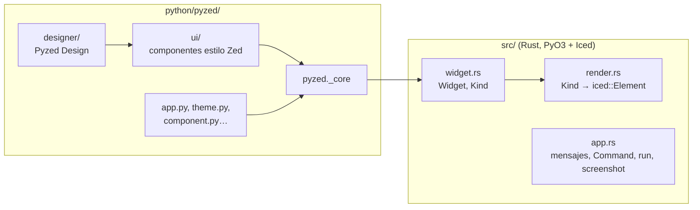

¡Gracias por ayudar! Esta sección es la guía de desarrollo de Pyzed: cómo compilarlo desde el código fuente,
cómo está organizado, cómo [añadir un componente al editor visual](/pyzed/es/contributing/adding-components/),
cómo [documentarlo](/pyzed/es/contributing/documenting-components/) y cómo
[editar esta web](/pyzed/es/contributing/docs/). La versión corta también está en
[`CONTRIBUTING.md`](https://github.com/albakore/pyzed/blob/main/CONTRIBUTING.md), en la raíz del
repositorio.

## Entorno de desarrollo

Necesitas **Python 3.10+**, una toolchain estable de **Rust** (`rustup`) y, en Linux, las bibliotecas de
desarrollo habituales de X11/Wayland. Pyzed es una extensión de Rust (PyO3 + Iced) con un paquete de Python
encima, compilada con [maturin](https://www.maturin.rs).

Con [uv](https://docs.astral.sh/uv/):

```bash
git clone https://github.com/albakore/pyzed
cd pyzed
uv sync                       # crea .venv, compila el núcleo de Rust (release) e instala pyzed editable
uv run pytest tests
uv run python examples/gallery.py
uv run pyzed design           # el editor visual, Pyzed Design
```

Con pip:

```bash
python -m venv .venv
source .venv/bin/activate     # Windows: .venv\Scripts\activate
pip install maturin pytest ty
maturin develop --release     # compila el núcleo de Rust e instala pyzed en el venv
pytest tests
```

- Compila siempre con `--release`: las compilaciones de depuración de Iced son demasiado lentas para usar
  una ventana real.
- Los cambios en los archivos de Python de `python/pyzed/` se aplican directamente (el paquete se instala en
  modo editable).
- Después de cambiar código de **Rust** en `src/`, vuelve a compilar: `maturin develop --release` (con uv, el
  siguiente `uv run` o `uv sync` recompila el núcleo solo).

## Comprobaciones

Ejecuta las mismas comprobaciones que la CI antes de hacer push:

```bash
cargo fmt --check             # formato de Rust
cargo clippy -- -D warnings   # lints de Rust; los avisos son errores
pytest tests                  # o: uv run pytest tests
```

Los tests se ejecutan sin pantalla: las ventanas se dibujan con `App.screenshot` en archivos PNG, así que no
necesitan GPU ni display. Opcionales:

```bash
uv run ty check                            # comprueba los tipos del paquete de Python
python docs/scripts/gen_api.py --check     # nombres públicos sin documentación en la API
```

La CI ejecuta el lint, los tests en Linux, macOS y Windows, una vista previa de las notas de la versión y la
comprobación del **título del PR**. Los cambios que solo tocan la documentación no compilan el paquete.

## La web de la documentación

La documentación es una web de [Astro Starlight](https://starlight.astro.build) en `docs/`:

```bash
cd docs
npm install
npm run dev        # http://localhost:4321/pyzed/
npm run build      # la web estática en docs/dist (lo que publica GitHub Pages)
```

Los dos scripts ejecutan primero `scripts/sync-changelog.mjs`, que convierte `CHANGELOG.md` en la página
[Novedades](/pyzed/es/changelog/). Lee [Editar la documentación](/pyzed/es/contributing/docs/) para la
estructura de la web, las traducciones y los scripts que regeneran la referencia y las imágenes.

## Arquitectura del proyecto



| Ruta | Qué contiene |
| --- | --- |
| `src/` | Núcleo en Rust (PyO3 + Iced): el árbol de widgets, el puente con el renderer, el runtime y el editor de código |
| `python/pyzed/` | Paquete de Python: `App`, temas, iconos, `pz.Component`, CLI |
| `python/pyzed/ui/` | Los componentes listos para usar (`ui.button`, `ui.select`, `ui.table`…), funciones que devuelven widgets |
| `python/pyzed/designer/` | El editor visual: modelo del formulario, registro de la caja de herramientas, comandos del documento, runtime, paneles |
| `tests/` | Tests de pytest (sin pantalla ni GPU) |
| `examples/` | Ejemplos ejecutables y el código de los tutoriales |
| `docs/` | Esta web, con sus scripts generadores en `docs/scripts/` |
| `scripts/` | Scripts de publicación y mantenimiento |

Lee [Cómo funciona](/pyzed/es/guides/how-it-works/) para el puente entre Python e Iced y
[Pyzed Design → Archivos, plantillas y scripts](/pyzed/es/editor/files-and-scripting/) para las clases del
editor.

## Commits y pull requests

Pyzed sigue el estilo de [FastAPI](https://github.com/fastapi/fastapi): cada commit en `main`, es decir, cada
**título de PR**, empieza con un [gitmoji](https://gitmoji.dev) seguido de una frase corta en imperativo, en
inglés y sin punto final:

```text
✨ Add a Rating component to the designer
🐛 Fix line numbers when the editor wraps lines
📝 Document the Rating component
```

Los PR se integran con **Squash and merge**, así que el título se convierte en el commit de `main` y en la
línea de las notas de la versión. El emoji decide la sección de las notas:

| Emoji | Úsalo para | Sección de las notas |
| --- | --- | --- |
| 💥 | Un cambio incompatible (explícalo también en el PR) | Breaking Changes |
| ✨ | Una funcionalidad, widget o componente nuevo | Features |
| 🐛 🚑️ 🔒️ | Una corrección, un hotfix crítico, una corrección de seguridad | Fixes |
| ♻️ ⚡️ 🎨 🔥 | Refactorizaciones, rendimiento, estructura, eliminar código | Refactors |
| ⬆️ ⬇️ 📌 | Actualizar, bajar de versión o fijar una dependencia | Upgrades |
| 📝 ✏️ | Documentación, erratas | Docs |
| 🌐 | Traducciones de la documentación | Translations |
| ✅ 👷 💚 🔧 🔨 | Tests, CI, configuración, scripts de desarrollo | Internal |

El workflow **PR title** (`.github/workflows/pr-title.yml`) rechaza los títulos que no empiezan con un gitmoji
(o un shortcode como `:sparkles:`) y un espacio.

El flujo de un cambio:

1. Haz un fork del repositorio y crea una rama desde `main` (`feature/rating`, `fix/editor-scroll`,
   `docs/tutorial-typo`). Para cualquier cosa más grande que una corrección pequeña, abre antes un issue.
2. Mantén cada PR centrado en un solo cambio. Añade o actualiza tests para los cambios de comportamiento y
   documentación para los que ve el usuario.
3. Ejecuta `cargo fmt --check`, `cargo clippy -- -D warnings` y `pytest tests`.
4. Abre el PR con un título con gitmoji y completa la plantilla: qué cambia, cómo se probó (capturas para los
   cambios de interfaz) y la lista de comprobación. Enlaza el issue que cierra (`Closes #123`).
5. Sube los commits de seguimiento a la misma rama; no hace falta que los juntes tú.

Los commits deben ser de tu autoría: no añadas trailers `Co-authored-by` ni pies de «generado por».

## Siguientes pasos

- [Añadir un componente al editor](/pyzed/es/contributing/adding-components/): de una función de `pyzed.ui` a
  una entrada de la caja de herramientas con propiedades, eventos y tests, con un ejemplo completo.
- [Documentar un componente](/pyzed/es/contributing/documenting-components/): docstrings, referencia de la API,
  biblioteca de componentes, capturas, traducciones y el changelog.
- [Editar la documentación](/pyzed/es/contributing/docs/): cómo está organizada y cómo se compila esta web.
