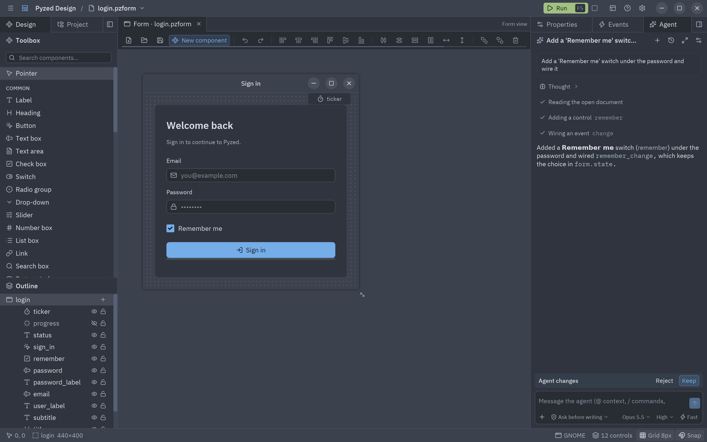
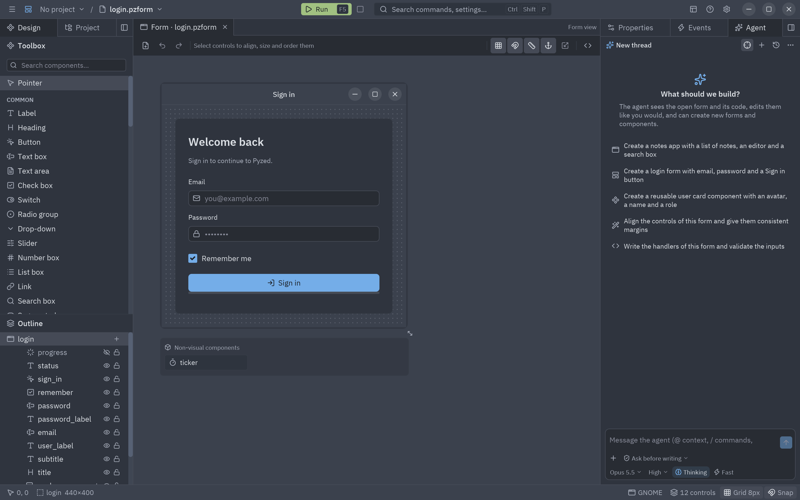
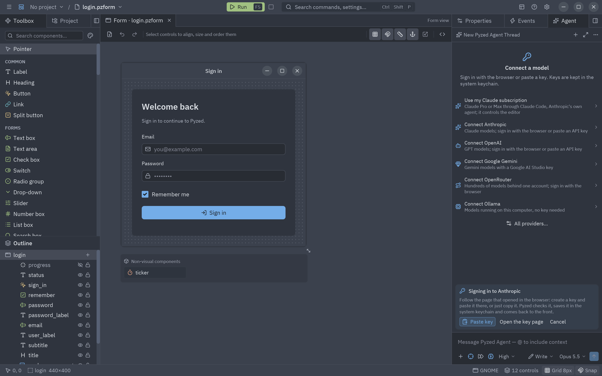
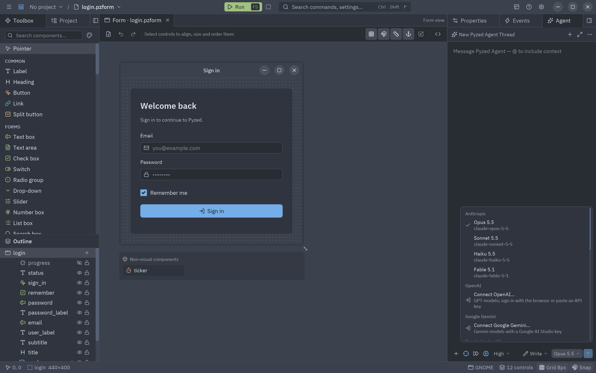
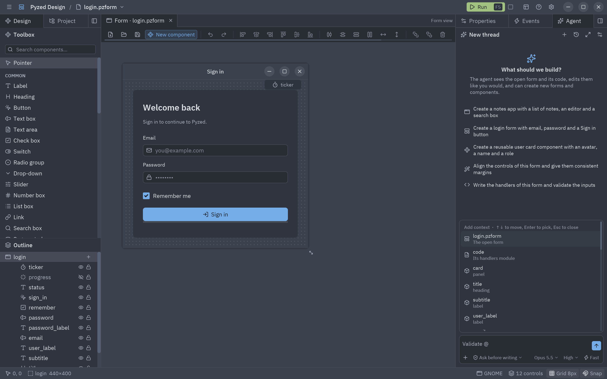
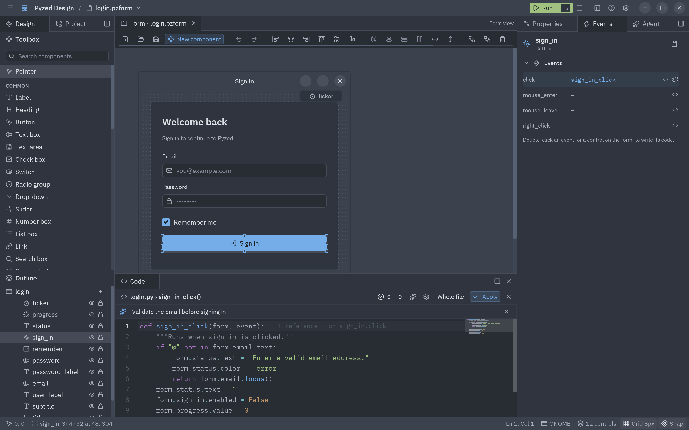
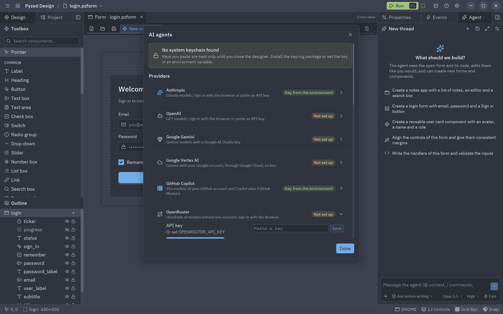

El panel **Agente** (dock derecho, junto a Propiedades y Eventos) es un agente de IA al estilo del de Zed.
Describe lo que quieres y lee el formulario abierto, añade y ordena controles, conecta eventos, escribe los
manejadores, crea formularios y componentes nuevos y revisa su propio código. Cada cambio que hace es un paso
normal de deshacer, y puedes rechazar toda la ejecución de una vez.



## Primeros pasos

1. Abre el panel: la pestaña **Agente** del dock derecho, **Ver → Panel del agente** o <kbd>Ctrl</kbd>+<kbd>Alt</kbd>+<kbd>A</kbd>.
2. La primera vez el panel te pide **conectar un modelo** y muestra los proveedores principales. Pulsa uno para
   [iniciar sesión con el navegador](#iniciar-sesión), o **Todos los proveedores…** para el resto.
3. Escribe lo que quieres y pulsa <kbd>Intro</kbd>, o elige una de las sugerencias.

Claude necesita las dependencias opcionales (`anthropic` y `keyring`); el Pyzed Design compilado ya las trae:

```bash
pip install "pyzed-ui[agents]"     # o: uv add "pyzed-ui[agents]"
```



### Iniciar sesión

El inicio de sesión ocurre dentro de Pyzed Design; no hace falta ningún otro programa.

- **Anthropic (Claude), OpenAI, Gemini, xAI, Mistral, DeepSeek, Groq**: estos proveedores no permiten que otras
  apps inicien sesión con OAuth (el inicio de sesión con suscripción de Anthropic es solo para sus propias apps),
  así que Pyzed inicia sesión con una página propia. El navegador abre una página **Connect … to Pyzed Design**
  que Pyzed sirve en este equipo (`127.0.0.1`, una dirección de un solo uso) y que enlaza a la página de claves de
  API del proveedor. Crea una clave allí y pégala en la página de Pyzed, o simplemente pulsa el botón **Copiar** de
  la clave: Pyzed también detecta la clave copiada. Pyzed la comprueba con el proveedor, la guarda en el llavero del
  sistema, carga los modelos del proveedor y vuelve al frente, así que puedes cerrar la pestaña y seguir trabajando.
  Mientras espera, una tarjeta **Iniciando sesión** ofrece **Pegar la clave** (leer el portapapeles ahora),
  **Abrir la página de claves** y **Cancelar**. El portapapeles solo se lee mientras se ve esa tarjeta (cinco
  minutos como mucho), y solo se usa un texto que parezca una clave de ese proveedor. La página local solo acepta
  una clave enviada desde ella misma: otros sitios y otros nombres de host no pueden usarla. Para usar tu plan
  Claude Pro o Max en lugar de una clave, mira [Tu suscripción de Claude](#tu-suscripción-de-claude).
- **OpenRouter**: OAuth real con PKCE. Apruebas a Pyzed en la página de OpenRouter y la clave que emite vuelve a
  Pyzed directamente; no hay nada que copiar.
- **GitHub Copilot**: **Iniciar sesión con GitHub** usa el flujo de dispositivo de GitHub. Pyzed abre
  `github.com/login/device` y muestra un código corto; escríbelo allí, aprueba a Pyzed y el token vuelve solo (la
  tarjeta tiene un botón para copiar el código y **Cancelar**). Da acceso a los modelos de tu cuenta de GitHub y tu
  plan de Copilot a través de GitHub Models. Iniciar sesión necesita el client ID de una GitHub App en los ajustes
  del proveedor; sin ella, **Iniciar sesión con un token** acepta un token de acceso personal detallado con el
  permiso **Models**.
- **Google Vertex AI**: **Iniciar sesión con Google** abre la página de consentimiento de Google (OAuth con PKCE) y
  el token vuelve a Pyzed; se renueva solo. Si ya ejecutaste `gcloud auth application-default login`, se usan esas
  credenciales y no hace falta nada más. Elige el **Proyecto de Google Cloud** (con Vertex AI activado) en los
  ajustes del proveedor, o pulsa **Listar mis proyectos**.
- **Anthropic sin clave**: la [federación de identidades](#claude-sin-clave-de-api) cambia un token de tu proveedor
  de identidad por un token de Claude de corta duración.
- **Ollama, LM Studio**: no hay que iniciar sesión. Al pulsarlos se piden los modelos al servidor local.

Siempre puedes pegar una clave a mano en los [ajustes](#ajustes) o definir la variable de entorno del proveedor.



## El panel

| Parte | Qué hace |
| --- | --- |
| **Cabecera** | El título de la conversación, **Nueva conversación** (<kbd>+</kbd>), **Historial**, **Expandir el panel** (ocupa toda la ventana; púlsalo otra vez para devolverlo a su dock) y los **ajustes** del agente. |
| **Conversación** | Tus mensajes, las respuestas del agente (Markdown), su razonamiento (**Razonamiento**, plegado) y una línea por cada herramienta que usa: un indicador mientras corre, una marca cuando funcionó y una cruz roja cuando falló. Pulsa una línea para ver la entrada y el resultado. |
| **Cambios del agente** | Tras una ejecución que cambió algo: **Rechazar** deja cada formulario y archivo de código que tocó como estaban antes; **Conservar** oculta la barra. Deshacer (<kbd>Ctrl</kbd>+<kbd>Z</kbd>) sigue retrocediendo un cambio cada vez. |
| **Cuadro de mensaje** | Crece con el texto. <kbd>Intro</kbd> envía y <kbd>Mayús</kbd>+<kbd>Intro</kbd> empieza otra línea. Escribe <kbd>@</kbd> para [añadir contexto](#añadir-contexto-con-) y <kbd>/</kbd> para [comandos](#comandos-con-); en su lista <kbd>↑</kbd> <kbd>↓</kbd> te mueven, <kbd>Intro</kbd> elige y <kbd>Esc</kbd> la cierra. Mientras el agente trabaja, el botón de enviar pasa a ser **Detener**. |
| **+** | **Archivos, el formulario, su código, controles** (una mención con @), **Adjuntar imágenes…**, **Pegar imagen** y **Captura del formulario**. Ver [Imágenes](#imágenes). |
| **Modo de permisos** | Qué puede hacer el agente sin preguntar (ver abajo). |
| **Modelo** | Todos los proveedores con sus modelos, y los [agentes externos](#agentes-externos). Un proveedor sin configurar muestra **Conectar…**, que inicia sesión ahí mismo. |
| **Esfuerzo** | Cuánto piensa el modelo antes de responder: **Bajo**, **Medio**, **Alto**, **Muy alto**, **Máximo**. Solo modelos Claude. |
| **Rápido** | Modo rápido: respuestas más rápidas a mayor precio, en Claude Opus 5.5 y Opus 5 a través de la API de Claude. |

| Modo de permisos | Qué puede hacer el agente |
| --- | --- |
| **Preguntar antes de escribir** | Edita el formulario abierto y su código libremente (cada cambio se puede deshacer); pregunta antes de crear documentos o escribir archivos. Es el modo por defecto. |
| **Omitir permisos** | Nunca pregunta. |
| **Solo lectura** | Solo lee: responde preguntas y sugiere código sin cambiar nada. |
| **Solo conversación** | Sin herramientas: una conversación simple con el modelo. |



Cada mensaje lleva una nota breve de dónde estás (el documento abierto, los controles seleccionados, el manejador
del editor de código), así que "alinea estos" o "valida este campo" se refieren a lo que tienes delante.

### Añadir contexto con @

Escribe <kbd>@</kbd> (o pulsa **+**) y elige qué adjuntar: la **selección**, el **formulario** abierto, su
**código**, uno de sus **controles**, un **archivo** del proyecto (un archivo de imagen va como imagen) o una
**captura** del formulario abierto. Sigue escribiendo para filtrar la lista;
<kbd>Intro</kbd> elige la fila resaltada. Lo que elijas aparece como una etiqueta sobre el mensaje y su contenido
va con el mensaje, así el agente no tiene que buscarlo. Los archivos que pueden tener secretos (`.env`, claves…)
nunca se ofrecen.



### Comandos con /

Escribe <kbd>/</kbd> al principio del mensaje:

| Comando | Hace |
| --- | --- |
| `/new` | Empieza una conversación nueva. |
| `/app` | Empieza una petición para [crear una aplicación completa](#crear-una-aplicación). |
| `/history` | Muestra las conversaciones pasadas. |
| `/settings` | Abre los ajustes de los agentes de IA. |
| `/form`, `/component` | Empieza una petición para generar un formulario o un componente. |
| `/explain` | Explica el formulario abierto y sus manejadores. |
| `/fix` | Revisa el código del formulario con `validate_code` y corrige lo que encuentre. |
| `/tidy` | Alinea los controles e iguala los márgenes. |
| `/look` | Hace una captura del formulario, la mira y mejora su distribución y su diseño. |

### Qué puede hacer el agente

| Herramienta | Hace |
| --- | --- |
| `get_document` | Lee el formulario o componente abierto: ajustes, cada control con su rect, props, eventos y estilo, la selección y el código. |
| `add_control`, `update_control`, `remove_controls` | Coloca, cambia, mueve a un contenedor, renombra y borra controles. Tipos y props se comprueban contra la caja de herramientas. |
| `set_form`, `select_controls` | Cambia el título, tamaño, tema o estilo del formulario; selecciona controles para que los veas. |
| `wire_event`, `set_handler`, `set_code` | Conecta eventos y escribe un manejador o el módulo entero (debe ser Python válido). |
| `new_document`, `save_document` | Crea un formulario o componente junto al abierto y lo abre en una pestaña; guarda. |
| `list_components`, `describe_component`, `search_icons`, `list_themes`, `read_docs`… | El mismo conocimiento que el [servidor MCP](/pyzed/es/guides/mcp/): componentes, iconos, temas y esta documentación. |
| `validate_code`, `validate_form` | Revisan código y formularios antes de devolverlos. |
| `list_files`, `read_file`, `search_text`, `write_file` | Trabajan con archivos del proyecto, nunca fuera de su carpeta. |
| `screenshot_form` | Dibuja el formulario abierto en una imagen y la mira, para revisar la distribución tal como la ves. |
| `run_app` | Ejecuta la app (el formulario principal del proyecto u otro) en el entorno del propio proyecto sin mostrar ninguna ventana, y devuelve lo que imprimió (errores y trazas incluidos) y una imagen de su ventana. |
| `update_plan` | Muestra el plan del agente como una lista sobre el cuadro de mensaje y lo mantiene al día. |
| `get_project`, `create_project`, `add_dependency`, `check_project`, `open_document` | Leen el proyecto abierto (formularios, componentes, dependencias, punto de entrada), crean uno nuevo y lo abren, añaden un paquete con uv, ejecutan las comprobaciones del proyecto y abren cualquiera de sus archivos en una pestaña. |
| `list_examples`, `read_example`, `new_form` | Los ejemplos de Pyzed para aprender de ellos, y un formulario inicial escrito a partir de una descripción. |
| `mcp_<servidor>_<herramienta>` | Las herramientas de los [servidores MCP](#servidores-mcp) que añadiste. |

En el modo **Preguntar antes de escribir**, las herramientas que **crean o escriben archivos** preguntan antes: una
tarjeta muestra **Permitir**, **Permitir siempre** (el resto de la sesión) y **Denegar**. **Omitir permisos** se la
salta. Los cambios al documento abierto nunca preguntan, porque se pueden deshacer.

## Imágenes

El agente puede mirar imágenes: una maqueta que reconstruir, una captura de un error, el formulario tal como se ve
ahora. Añádelas con **+**:

- **Adjuntar imágenes…** abre el diálogo de archivos del sistema (PNG, JPEG, GIF o WebP, hasta 5 MB cada una).
- **Pegar imagen** toma la imagen que copiaste (una captura, una imagen del navegador).
- **Captura del formulario** dibuja el formulario abierto y la adjunta.

Aparecen como miniaturas sobre el mensaje y en la conversación. Las herramientas también pueden responder con
imágenes: `screenshot_form` y las de los servidores MCP que devuelven imágenes. El modelo tiene que admitir
imágenes (Claude, GPT-4.1 y posteriores, Gemini, la mayoría de modelos de visión de Ollama…).

## Crear una aplicación

`/app`, la sugerencia **Crea una app de notas…** o una petición normal ("Crea una app para llevar mis gastos")
empiezan una aplicación entera, no solo un formulario. El agente conoce el editor (proyectos, formularios,
componentes, estilos, enlace de datos, el [servidor MCP](/pyzed/es/guides/mcp/) y esta documentación) y, en cada
mensaje, lo que está abierto: el proyecto y sus archivos, el formulario, la selección y las demás pestañas. Luego:

1. Hace un plan con `update_plan`: una tarjeta **Plan** sobre el cuadro de mensaje muestra cada paso, lo marca al
   terminarlo y se pliega cuando todo está hecho (pulsa su cabecera para plegarla tú).
2. Crea un [proyecto](/pyzed/es/editor/projects/) con `create_project` (o usa el abierto) y añade los paquetes que
   necesita con `add_dependency`.
3. Escribe los formularios y componentes, coloca sus controles, conecta los eventos y escribe el código, leyendo
   los ejemplos y la documentación de Pyzed cuando los necesita, y los guarda.
4. Mira cada formulario con `screenshot_form`, y ejecuta `check_project` y `validate_code` hasta que pasan.
5. Ejecuta la app con `run_app`, lee sus errores y la imagen de su ventana, arregla lo que falla y la vuelve a
   ejecutar hasta que arranca sin errores. Luego te dice qué construyó y cómo ejecutarla (<kbd>F5</kbd>).

Trabaja solo de principio a fin, con hasta 150 respuestas del modelo por mensaje. Para que no se interrumpa, elige
**Omitir permisos** en el menú de modo; con **Preguntar antes de escribir** pregunta antes de escribir archivos y
antes de ejecutar la app.

## Generar formularios y componentes

**Ver → Generar un formulario con IA…** y **Generar un componente con IA…** (también en la paleta de comandos)
abren el panel con el principio de la petición ya escrito: termina la frase y pulsa <kbd>Intro</kbd>. Por ejemplo:

> Crea un formulario nuevo para un cliente: nombre, correo, un desplegable de país y botones Guardar / Cancelar;
> Guardar valida el correo y muestra un aviso.

El agente crea `customer.pzform` y `customer.py`, los abre, coloca y alinea los controles, conecta los botones y
escribe los manejadores. Con un componente crea el `.pzcomp` y su clase, que luego aparece en la caja de
herramientas como cualquier [componente](/pyzed/es/editor/component-designer/).

## Asistente en línea

En el editor de código, <kbd>Ctrl</kbd>+<kbd>Alt</kbd>+<kbd>I</kbd> (o el botón ✦ de su cabecera) abre una barra
sobre el código. Describe el cambio y pulsa <kbd>Intro</kbd>: el modelo reescribe el manejador (o el archivo
entero, en modo archivo completo) y el editor muestra el resultado. **Deshacer** devuelve el código anterior y
**Conservar** cierra la barra. Nada se aplica al formulario hasta que pulses **Aplicar**, como con tus propias
ediciones.



## Ajustes

**Ajustes → Agentes de IA → Ajustes de los agentes de IA…**, el engranaje de la cabecera del panel o **Ajustes de
los agentes de IA…** en la paleta de comandos.



### Proveedores

| Proveedor | Cómo conectarlo | Notas |
| --- | --- | --- |
| **Anthropic** | **Iniciar sesión con el navegador**, clave de API, `ANTHROPIC_API_KEY` o [federación de identidades](#claude-sin-clave-de-api) | Los modelos Claude transmiten resúmenes de su razonamiento, usan pensamiento adaptativo y admiten esfuerzo y modo rápido. Si existe un perfil de la CLI de Anthropic (`ant auth login`) también se usa, pero la CLI no hace falta. |
| **OpenAI** | **Iniciar sesión con el navegador**, clave de API u `OPENAI_API_KEY` | |
| **Google Gemini** | **Iniciar sesión con el navegador**, clave de AI Studio o `GEMINI_API_KEY` | A través del endpoint compatible con OpenAI de Gemini. |
| **OpenRouter** | **Iniciar sesión con el navegador** (OAuth), clave de API u `OPENROUTER_API_KEY` | OAuth con PKCE: la clave que OpenRouter emite para Pyzed va al llavero. |
| **xAI**, **Mistral**, **DeepSeek**, **Groq** | **Iniciar sesión con el navegador**, clave de API o `XAI_API_KEY`, `MISTRAL_API_KEY`, `DEEPSEEK_API_KEY`, `GROQ_API_KEY` | Sus modelos aparecen tras iniciar sesión. |
| **GitHub Copilot** | **Iniciar sesión con GitHub** (flujo de dispositivo), un token detallado con el permiso **Models** o `GITHUB_TOKEN` | Los modelos de GitHub Models (`openai/gpt-4.1`, …) con los límites de tu cuenta. Iniciar sesión necesita el **Client ID de la GitHub App** (o `PYZED_GITHUB_CLIENT_ID`). |
| **Google Vertex AI** | **Iniciar sesión con Google**, o las credenciales de Google Cloud de este equipo (`gcloud auth application-default login`) | Gemini a través del endpoint compatible con OpenAI de Vertex AI, sin clave. Necesita un **Proyecto de Google Cloud** y una **Ubicación** (`global` por defecto); iniciar sesión con Google necesita un **Cliente OAuth** (app de escritorio) cuyo secreto va al llavero. |
| **Ollama**, **LM Studio** | Nada: corren en tu equipo | Cambia la **URL del servidor** si corren en otra máquina. |
| **Compatible con OpenAI** | URL del servidor y una clave si la necesita | vLLM, llama.cpp, una pasarela de empresa… |

Pulsa un proveedor para abrirlo: **Iniciar sesión con el navegador** (ver [Iniciar sesión](#iniciar-sesión)), pega
una clave y **Guardar**, **Obtener una clave** (abre la página de claves del proveedor), **Quitar la clave** y
**Actualizar modelos**, que pide al proveedor su lista de modelos para que aparezcan en el selector.

**Probar la conexión** comprueba el proveedor con lo que esté configurado y muestra de dónde salen las credenciales.

### Claude sin clave de API

Abre **Anthropic** y rellena **Federación de identidad de cargas de trabajo**. Un token de tu proveedor de
identidad (GitHub Actions, Google Cloud, Azure, Okta, Kubernetes…) se cambia por un token de Claude de corta
duración, así que no se guarda ninguna clave de API. Primero crea el emisor y la regla de federación en la Claude
Console y luego rellena:

| Campo | Qué va ahí |
| --- | --- |
| **Regla de federación** | El ID de la regla, `fdrl_…`. |
| **ID de la organización** | El UUID de tu organización. |
| **Cuenta de servicio** | `svac_…`, cuando la regla no nombra una. Opcional. |
| **Espacio de trabajo** | `wrkspc_…` o `default`. Opcional. |
| **Token de identidad** | De dónde sale el token: un **Archivo** (la ruta del JWT, o `ANTHROPIC_IDENTITY_TOKEN_FILE`), un **Comando** que imprime uno nuevo (por ejemplo `gcloud auth print-identity-token`) o una **Variable** (`ANTHROPIC_IDENTITY_TOKEN`). |

Una clave de API guardada tiene prioridad sobre la federación; quítala para usar la federación. También sirven las
variables `ANTHROPIC_FEDERATION_RULE_ID`, `ANTHROPIC_ORGANIZATION_ID` y `ANTHROPIC_IDENTITY_TOKEN_FILE`.

### Servidores MCP

**Servidores MCP** suma las herramientas de cualquier servidor del
[Model Context Protocol](https://modelcontextprotocol.io) a las del agente, como los servidores de contexto de Zed.
**Añadir un servidor MCP** pide:

- un **Nombre**;
- el **Comando**, como lo escribirías en una terminal (`npx -y @modelcontextprotocol/server-github`,
  `uvx mcp-server-fetch`…), **o la URL** de un servidor remoto (Streamable HTTP);
- **Secretos**: pares `NOMBRE=valor` separados por `;`, que se pasan como variables de entorno (o como cabeceras
  para una URL). Van al llavero del sistema, nunca a `agents.json`.

**Probar** arranca el servidor y lista sus herramientas; el interruptor lo apaga sin quitarlo. Sus herramientas
aparecen como `mcp_<servidor>_<herramienta>`. Las que el servidor no marca como de solo lectura preguntan antes en
**Preguntar antes de escribir**, como al escribir archivos; en **Solo lectura** se dejan fuera.

### Agentes externos

**Agentes externos** ejecuta Claude Code, Gemini CLI, Codex o cualquier agente que hable el
[Agent Client Protocol](https://agentclientprotocol.com) dentro del panel, como en Zed. **Añadir un agente
externo…** ofrece los conocidos (Claude Code con `@zed-industries/claude-code-acp`, `gemini --experimental-acp`,
Codex con `@zed-industries/codex-acp`) u **Otro…** para cualquier comando. Una vez añadido, elígelo en el selector
de modelos en **Agentes externos**.

El agente corre como su propio programa en la carpeta del proyecto e inicia sesión a su manera (su propia cuenta o
clave; pon las claves en **Secretos**). Pyzed responde a sus peticiones: lee y escribe archivos solo dentro del
proyecto y nunca los que pueden tener secretos, y pregunta antes de actuar según el modo de permisos (**Solo
lectura** solo permite leer, **Solo conversación** rechaza todas las herramientas).

Con **Dejar que los agentes externos controlen el editor** activado (por defecto), el agente recibe por MCP las
herramientas del agente integrado: lee y cambia el formulario abierto y su código, crea formularios y componentes,
ejecuta la app con `run_app`, lleva un plan y conoce los componentes y la documentación de Pyzed. Sus cambios se ven
en vivo en el editor, y **Conservar** y **Rechazar** funcionan como con el agente integrado. Pyzed sirve estas
herramientas en `127.0.0.1`, en una dirección de un solo uso y con un token que solo recibe ese agente (los agentes
que solo arrancan servidores locales reciben un pequeño programa puente). Sus propias herramientas de archivos y de
terminal siguen siendo suyas. El plan que sigue el agente se ve en la tarjeta **Plan**.

### Tu suscripción de Claude

**Usar mi suscripción de Claude** (lo primero en un panel vacío, y en el selector de modelos en **Agentes
externos**) usa tu plan Claude Pro o Max a través de Claude Code, el agente de Anthropic, ya que Anthropic solo
deja que sus propias apps inicien sesión con una suscripción:

1. Necesita [Node.js](https://nodejs.org/en/download) 18 o posterior; si no está, Pyzed abre la página de descarga.
2. Añade Claude Code como agente externo, lo elige y le deja controlar el editor.
3. Si Claude Code todavía no inició sesión, se abre en una terminal: elige iniciar sesión con tu cuenta de Claude y
   termina en el navegador. Pyzed detecta el inicio de sesión, vuelve al frente y queda listo.

Claude Code guarda su propio inicio de sesión; Pyzed nunca lo ve. El uso cuenta para tu plan. Si una respuesta
falla porque Claude Code cerró la sesión, **Iniciar sesión en Claude** vuelve a abrir la terminal.

### Dónde se guardan las claves

Las claves y tokens van al **llavero del sistema operativo**: Llavero en macOS, Administrador de credenciales en
Windows, Secret Service (GNOME Keyring, KWallet) en Linux, bajo el servicio `pyzed`. Nunca se escriben en los
archivos de ajustes de Pyzed, en las conversaciones ni en el proyecto. Si no hay llavero, una clave que pegues se
conserva en memoria hasta que cierres el diseñador, y los ajustes lo indican; en ese caso usa una variable de
entorno.

Las variables de entorno, las apps abiertas desde el Finder o el menú Inicio, los secretos de MCP y las buenas
prácticas están en [Claves de API y credenciales](/pyzed/es/ai/api-keys/).

El resto también se queda en tu equipo: los ajustes en `agents.json` y las conversaciones en `agents/threads/`,
ambos en la [carpeta de ajustes de Pyzed](/pyzed/es/editor/settings/#dónde-se-guardan). No se envía nada a ningún
sitio salvo las peticiones al proveedor que elijas.

### Opciones del agente

| Ajuste | Qué hace |
| --- | --- |
| **Modelo predeterminado** | El modelo con el que empiezan las conversaciones nuevas. |
| **Esfuerzo** | Cuánto piensa el modelo antes de responder (`low` … `max`). Solo Claude; `high` por defecto. |
| **Modo rápido** | Respuestas más rápidas a mayor precio (Claude Opus 5.5 y Opus 5). También en el cuadro de mensaje. |
| **Preguntar antes de escribir archivos** | Crear formularios y componentes y guardar archivos esperan tu permiso. Activado por defecto; equivale a los modos **Preguntar antes de escribir** / **Omitir permisos**. |
| **Mostrar el razonamiento** | Muestra los resúmenes del razonamiento del modelo en la conversación. |
| **Reglas** | Instrucciones añadidas a cada conversación, como las reglas de Zed: "Responde en español", "Nombra los botones con el sufijo `_button`"… |

## Cómo obtener buenos resultados

- **Empieza por la pantalla, no por los widgets.** *"Un formulario de cliente: nombre, email, un desplegable de país y
  Guardar / Cancelar; Guardar valida el email y muestra un aviso"* le da al agente el objetivo y las reglas a la vez.
- **Selecciona y luego pide.** Selecciona un grupo de controles y di *"ponlos en una fila con 8 px de separación"*.
- **Usa @ para ser preciso.** `@email_input` más *"acepta solo direcciones de empresa"* no deja dudas sobre el control.
- **Enséñale una imagen.** Adjunta un boceto o una captura del error, o pide `/look` para que revise el formulario.
- **Deja que se compruebe solo.** Termina las peticiones con *"y luego ejecuta /fix"*, o pídele que valide antes de
  responder.
- **Guarda las reglas en los ajustes.** Las *Reglas* se añaden a cada conversación: *"Responde en español"*, *"Usa el
  tema Gruvbox Dark"*.
- **Revisa y luego conserva.** Tras una ejecución, **Cambios del agente** ofrece **Conservar** o **Rechazar** para toda
  la ejecución.

Hay más prompts que funcionan bien en la [guía de prompts](/pyzed/es/ai/prompting/).

## Historial

**Historial** en la cabecera lista tus conversaciones, de la más reciente a la más antigua. Pulsa una para
continuarla (el agente recuerda toda la conversación) o bórrala. Se guardan las últimas 200.

## Usar agentes en tu propia app

El agente no está atado al diseñador: `pyzed.agents` da a cualquier app los mismos proveedores, el llavero y el
bucle del agente. Consulta [Agentes de IA en tu app](/pyzed/es/guides/agents/).
