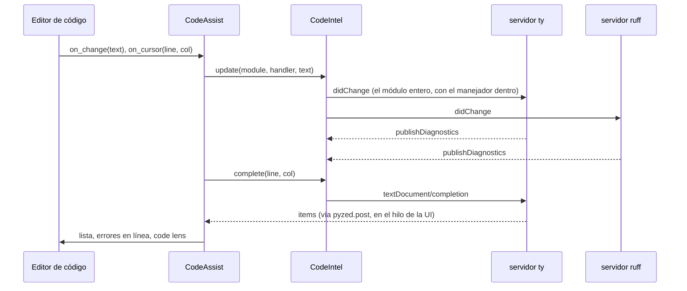
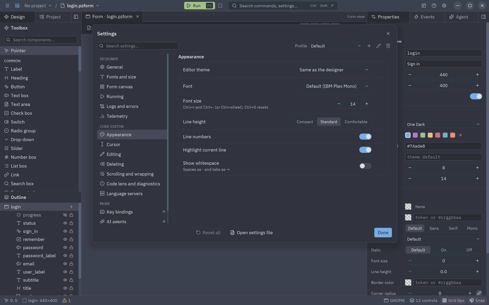
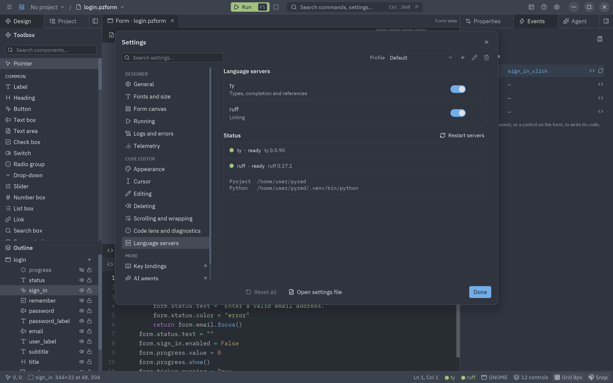

El panel **Código** (dock inferior) es un editor de Python respaldado por dos servidores de
lenguaje de Astral: **ty** (tipos, autocompletado, referencias) y **ruff** (lint y formato). Aparece cuando abres un
manejador o un archivo del proyecto y se va cuando lo cierras.


## Qué edita

El editor muestra **un manejador** o **el archivo de código entero**:

| Modo | Cómo llegar | Título |
| --- | --- | --- |
| Un manejador | Doble clic en un control o en un evento, <kbd>Enter</kbd> con un control seleccionado, **View code**, un método del [panel Component](/pyzed/es/editor/component-designer/#el-panel-component). | `login.py › sign_in_click()` |
| Archivo entero | <kbd>F7</kbd>, **Editar el código** (barra de herramientas, menú ☰, paleta), o **Whole file** en la cabecera. | `login.py` |
| Un archivo del proyecto | Un clic en un archivo de texto de la [pestaña Proyecto](/pyzed/es/editor/projects/#archivos), o <kbd>Ctrl</kbd>+<kbd>P</kbd>. | `src/shop/cart.py` |

**Whole file** y **This handler** en la cabecera cambian entre los dos. En modo manejador solo ves la función, pero
los servidores de lenguaje siempre ven el módulo entero con ese manejador dentro, así que el autocompletado y los
diagnósticos conocen los imports y las funciones auxiliares del principio del archivo.

## La cabecera

La cabecera del panel está en inglés:

| Elemento | Hace |
| --- | --- |
| Título | El archivo de código y, en modo manejador, la función. |
| **Problems** (`2 · 1`) | Errores y avisos del código; clic para mostrar u ocultar la lista de problemas. Una marca de verificación indica que no hay ninguno. |
| **Engranaje** | Abre los [ajustes del editor](#ajustes-del-editor). |
| **Whole file / This handler** | Cambia de modo. |
| **Apply** | Comprueba la sintaxis, escribe el código en el documento y, con *Format with ruff on Apply* activo, lo formatea. |
| **×** | Cierra el editor (antes aplica el código). |

Tu código se aplica solo al documento cada vez que cambias de manejador, de modo o de pestaña, guardas o ejecutas;
**Apply** sirve para comprobarlo (y formatearlo) en el momento. Si el código no se puede analizar, una línea roja
bajo el editor dice dónde (`Line 3: invalid syntax`), y guardar, ejecutar o cambiar esperan a que lo arregles.

## Escribir código

- **Resaltado de sintaxis** de Python, con el tema del editor (o uno propio, ver los ajustes).
- **Sangría**: <kbd>Tab</kbd> inserta espacios (el *Tamaño de tabulación*), o una tabulación con *Sangrar con
  tabulaciones*; <kbd>Enter</kbd> mantiene la sangría de la línea (sus espacios y tabulaciones) y añade un nivel
  después de `:`; <kbd>Retroceso</kbd> dentro de la sangría quita un nivel entero (un espacio si se apaga *Retroceso
  borra un nivel entero*). Ver [Tabulaciones o espacios](#tabulaciones-o-espacios).
- **Paréntesis y comillas**: escribir `(`, `[`, `{`, `"` o `'` inserta su pareja, envuelve la selección si la hay,
  y escribir el carácter de cierre lo salta en lugar de duplicarlo.
- **Margen**: números de línea (siguen a las líneas ajustadas) y la línea actual resaltada.
- **Plegado**: los chevrons del margen pliegan y despliegan bloques (funciones, clases, `if`...);
  <kbd>Ctrl</kbd>+<kbd>Shift</kbd>+<kbd>[</kbd> pliega el bloque más interior alrededor del cursor y
  <kbd>Ctrl</kbd>+<kbd>Shift</kbd>+<kbd>]</kbd> lo despliega.
- **Minimapa**: el código en miniatura a la derecha; haz clic o arrastra en él para desplazarte.
- **Métodos de entrada**: los métodos de entrada (IME) de chino, japonés y coreano funcionan: el texto que se
  está componiendo se dibuja en el cursor y el texto confirmado se inserta en cada cursor.
- **Espacios en blanco**: opcionalmente dibuja los espacios como `·` y los tabuladores como `→`.
- **Zoom**: <kbd>Ctrl</kbd>+<kbd>=</kbd>, <kbd>Ctrl</kbd>+<kbd>-</kbd> o <kbd>Ctrl</kbd>+rueda cambian el tamaño de
  letra; <kbd>Ctrl</kbd>+<kbd>0</kbd> lo restablece. El tamaño se guarda.
- **Desplazamiento**: la rueda del ratón desplaza el código (<kbd>Mayús</kbd>+rueda, de lado) y las barras de
  desplazamiento quedan a la derecha del minimapa. La vista también sigue al cursor.
- **Líneas largas**: por defecto se desplazan de lado; <kbd>Alt</kbd>+<kbd>Z</kbd> (o *Ajustar líneas largas* en los
  ajustes) las ajusta al ancho del editor.


### Teclas en el editor

| Teclas | Acción |
| --- | --- |
| Flechas, <kbd>Inicio</kbd>, <kbd>Fin</kbd> | Mover el cursor. |
| <kbd>Ctrl</kbd>+<kbd>←</kbd> / <kbd>→</kbd> | Mover por palabras. |
| <kbd>Ctrl</kbd>+<kbd>Inicio</kbd> / <kbd>Fin</kbd> | Principio o final del código. |
| <kbd>RePág</kbd> / <kbd>AvPág</kbd> | Una página arriba o abajo. |
| <kbd>Shift</kbd> + cualquiera de las anteriores | Ampliar la selección. |
| <kbd>Ctrl</kbd>+<kbd>A</kbd> | Seleccionar todo. |
| <kbd>Ctrl</kbd>+<kbd>C</kbd> / <kbd>X</kbd> / <kbd>V</kbd> | Copiar, cortar, pegar. |
| <kbd>Tab</kbd> | Sangrar (insertar espacios). |
| <kbd>Ctrl</kbd>+<kbd>Espacio</kbd> | Abrir la lista de sugerencias. |
| <kbd>Ctrl</kbd>+<kbd>Shift</kbd>+<kbd>[</kbd> / <kbd>]</kbd> | Plegar / desplegar en el cursor. |
| <kbd>Ctrl</kbd>+<kbd>=</kbd> / <kbd>-</kbd> / <kbd>0</kbd> | Letra más grande, más pequeña, por defecto. |
| <kbd>Ctrl</kbd>+<kbd>Z</kbd> / <kbd>Ctrl</kbd>+<kbd>Shift</kbd>+<kbd>Z</kbd> | Deshacer, rehacer (lo escrito seguido es un solo paso). |
| <kbd>Ctrl</kbd>+<kbd>F</kbd> / <kbd>H</kbd> / <kbd>G</kbd> | Buscar, reemplazar, ir a la línea (ver abajo). |
| <kbd>Esc</kbd> | Volver a un cursor, cerrar la lista de sugerencias, o salir del editor. |

En macOS, <kbd>Cmd</kbd> funciona donde aquí pone <kbd>Ctrl</kbd>. Los comandos globales del editor
(<kbd>F5</kbd>, <kbd>Ctrl</kbd>+<kbd>S</kbd>, <kbd>Ctrl</kbd>+<kbd>Shift</kbd>+<kbd>P</kbd>...) funcionan mientras
escribes; los atajos del lienzo (<kbd>Supr</kbd>, flechas, <kbd>Ctrl</kbd>+<kbd>D</kbd>) no, así que escribir nunca
mueve un control.

## Tabulaciones o espacios

Python rechaza un bloque que mezcla tabulaciones y espacios, así que el editor se queda con uno de los dos:

- **Sangrar con tabulaciones** (Ajustes del editor → Edición) hace que <kbd>Tab</kbd>, <kbd>Enter</kbd> y sangrar
  (<kbd>Ctrl</kbd>+<kbd>]</kbd>) escriban tabulaciones. Se dibujan con el ancho del *Tamaño de tabulación*, y
  <kbd>Enter</kbd> copia tal cual los espacios y tabulaciones de la línea de arriba, en los dos modos.
- **Convertir la sangría a tabulaciones** y **Convertir la sangría a espacios**, en la paleta de comandos
  (<kbd>Ctrl</kbd>+<kbd>Shift</kbd>+<kbd>P</kbd>), reescriben la sangría del archivo que muestra el editor de
  código. El texto dentro de cadenas de varias líneas queda como está.
- **Convertir la sangría al guardar** lo hace cada vez que se guarda un archivo de Python (o el código del
  formulario), así el código pegado nunca rompe el archivo.
- El código que el diseñador escribe por ti (un manejador o método nuevo) sigue al archivo: en un archivo sangrado
  con tabulaciones se escribe con tabulaciones.

Mantener <kbd>Retroceso</kbd> o <kbd>Supr</kbd> borra al ritmo de **Borrado**: la primera pulsación siempre borra;
las siguientes esperan la *Espera antes de repetir* y luego llegan como mucho *Borrados por segundo* veces por
segundo. Pueden ir más lentas que la repetición de teclas del sistema, no más rápidas.

## Buscar, reemplazar y varios cursores


- <kbd>Ctrl</kbd>+<kbd>F</kbd> abre la barra de búsqueda con la palabra bajo el cursor; las coincidencias se
  resaltan en el código y la barra las cuenta. <kbd>Enter</kbd> o <kbd>F3</kbd> van a la siguiente,
  <kbd>Shift</kbd>+<kbd>F3</kbd> a la anterior y <kbd>Alt</kbd>+<kbd>Enter</kbd> pone un cursor en cada una. Los
  botones distinguen mayúsculas, buscan palabras completas o usan una expresión regular.
- <kbd>Ctrl</kbd>+<kbd>H</kbd> muestra también el campo de reemplazo: **Reemplazar** cambia la coincidencia actual y
  **Reemplazar todo** todas, en un solo paso de deshacer. Con una expresión regular, `\1` en el reemplazo inserta un
  grupo.
- <kbd>Ctrl</kbd>+<kbd>G</kbd> va a una línea (`42`) o a una línea y columna (`42:8`).
- El editor tiene cursores múltiples y los atajos de edición habituales de los editores modernos: <kbd>Alt</kbd>+clic,
  <kbd>Ctrl</kbd>+<kbd>Alt</kbd>+<kbd>↑</kbd>/<kbd>↓</kbd>, <kbd>Ctrl</kbd>+<kbd>D</kbd>,
  <kbd>Alt</kbd>+<kbd>Shift</kbd>+<kbd>↑</kbd>/<kbd>↓</kbd> para duplicar líneas en cada cursor,
  <kbd>Ctrl</kbd>+<kbd>Shift</kbd>+<kbd>L</kbd>, <kbd>Alt</kbd>+<kbd>↑</kbd>/<kbd>↓</kbd> para mover líneas,
  <kbd>Ctrl</kbd>+<kbd>/</kbd> para comentar, <kbd>Ctrl</kbd>+<kbd>Z</kbd> / <kbd>Ctrl</kbd>+<kbd>Shift</kbd>+<kbd>Z</kbd>
  y más. La lista completa está en
  [el componente editor de código](/pyzed/es/components/code/#varios-cursores-y-los-atajos-de-zed) o con
  <kbd>F1</kbd> en el diseñador.

## Autocompletado


- La lista se abre mientras escribes un nombre o después de un `.` (no en comentarios ni cadenas), y
  <kbd>Ctrl</kbd>+<kbd>Espacio</kbd> la abre en cualquier sitio. Desactiva *Autocomplete while typing* para abrirla
  solo con las teclas.
- <kbd>↑</kbd>/<kbd>↓</kbd> se mueven (dando la vuelta), <kbd>RePág</kbd>/<kbd>AvPág</kbd> saltan nueve filas,
  <kbd>Enter</kbd> o <kbd>Tab</kbd> insertan, <kbd>Esc</kbd> cierra; un clic también inserta. El pie muestra la
  posición (`3/42`).
- La rueda del ratón desplaza la lista sin mover la entrada resaltada, y una barra a su derecha indica dónde estás.
  Los nombres y firmas largos se recortan con `…` para que quepan; el panel junto a la lista los muestra completos.
- Al seguir escribiendo la lista se filtra: primero los nombres que empiezan por lo escrito, luego los que contienen
  las letras en orden (`gtx` encuentra `get_text`).
- Cada entrada tiene un icono según su tipo y, junto a la lista, un panel con su **firma** y su **documentación**
  (el docstring, como Markdown).

  | Color del icono | Tipo |
  | --- | --- |
  | Morado | Funciones y métodos |
  | Amarillo | Clases, enums, parámetros de tipo |
  | Azul | Variables, atributos y propiedades |
  | Cian | Constantes |
  | Rojo | Módulos |
  | Acento | Controles del formulario |

- Los nombres **privados** (`_cache`) salen atenuados, con un candadito, después de los públicos; los dunders
  (`__init__`) van al final.
- **Auto-import**: elegir un nombre que aún no está importado añade también su `import` al principio del archivo,
  incluso en modo manejador.
- La lista se abre bajo la palabra, o encima cuando hay más sitio ahí.

### Los nombres propios del formulario

El `form` y el `event` de un manejador no tienen un tipo que los servidores puedan leer, así que el editor los
completa por su cuenta:

| Escribes | Obtienes |
| --- | --- |
| `form.` | Todos los controles del formulario, más `title`, `name`, `size`, `window` y `close()`. |
| `form.email.` | Las propiedades de ese control, con sus tipos, más `name`, `type`, `visible`, `enabled`, `show()`, `hide()` y `focus()`. |
| `event.` | `sender`, `name` y `value`. |


## Ayuda contextual

<kbd>Shift</kbd>+<kbd>F1</kbd> abre la [referencia integrada](/pyzed/es/editor/reference/) en el nombre bajo el
cursor: `form.email` o `form.email.text` abre la página del tipo del control, `form` y `event` abren las páginas del
código del formulario, y los nombres de la librería (`pz.text`, `ui.button`, `Theme`) abren su página de la API. Si
no hay coincidencia, busca el nombre en la referencia.

## Diagnósticos y code lens


- **Diagnósticos en línea** (error lens): el problema más grave de cada línea se escribe al final de ella, en rojo
  los errores, en amarillo los avisos y en azul la información.
- **Lista de problemas**: bajo el editor, cada problema con su línea y columna, mensaje y origen (`ruff (F401)`,
  `ty`). Haz clic en uno para saltar a él. El botón de la cabecera muestra los recuentos y oculta o muestra la
  lista.
- **Code lens** al final de cada línea `def` y `class`: cuántas **referencias** tiene (de ty, o contadas por nombre
  con ty apagado), cuántas clases **implementan** una clase y qué eventos **llaman** a un manejador
  (`on sign_in.click`).

## Servidores de lenguaje

Los servidores arrancan en la carpeta del marcador de proyecto más cercano por encima del archivo de código
(`pyproject.toml`, `uv.lock`, `setup.py`, `.git`) y usan su `.venv` (donde `uv sync` instala tus dependencias), o
`$VIRTUAL_ENV`. La carpeta del código y `src/` se añaden como raíces de import, así que una UI en su propia carpeta
resuelve las dos cosas:

```
myapp/
├── pyproject.toml      ← uv add httpx
├── .venv/              ← uv sync
├── src/myapp/
└── ui/
    ├── login.pzform
    ├── login.py        ← import httpx / from helpers import greet / from myapp import api
    └── helpers.py
```

El editor busca `ty` y `ruff` primero en el `.venv` del proyecto, luego junto al editor y luego en el `PATH`.
Instálalos con `uv add --dev ty ruff` en el proyecto, o con `pip install "pyzed-ui[designer]"` junto al editor. Ruff
lee sus reglas de `[tool.ruff]` en `pyproject.toml`.

Con el editor de código abierto, la barra de estado muestra un punto por servidor: verde cuando está **listo**,
amarillo mientras **arranca**, rojo si **falta** o ha fallado. Pasa el ratón para ver los detalles; haz clic para
abrir los ajustes del editor.



## Ajustes del editor

Los abren el **engranaje** de la cabecera del panel de código y los puntos de los servidores en la barra de estado:
son las páginas *Editor de código* del [diálogo de Ajustes](/pyzed/es/editor/settings/), con su buscador, sus
perfiles, **↺** para devolver un ajuste a su valor por defecto y el ámbito *Proyecto* para que un proyecto tenga
los suyos (su tabulación, por ejemplo).



| Sección | Ajuste | Qué hace |
| --- | --- | --- |
| Apariencia | **Tema** | *Igual que el diseñador*, o cualquier tema solo para el editor. |
| | **Fuente** | *Por defecto* (IBM Plex Mono) o cualquier fuente instalada; también en Ajustes → Fuentes y tamaño. |
| | **Tamaño de letra** | De 8 a 32 (también <kbd>Ctrl</kbd>+<kbd>=</kbd>/<kbd>-</kbd>/<kbd>0</kbd> y <kbd>Ctrl</kbd>+rueda). |
| | **Interlineado** | Compacto, Normal o Amplio. |
| | **Números de línea**, **Resaltar la línea actual** | El margen y la franja de la línea actual. |
| | **Mostrar espacios** | Espacios como `·`, tabulaciones como `→`. |
| Cursor | **Forma** | Barra, bloque, subrayado o hueco. |
| | **Parpadeo** | Si el cursor parpadea. |
| | **Ancho** | De 1 a 4 píxeles, para el cursor de barra. |
| Edición | **Tamaño de tabulación** | De 1 a 8 columnas por nivel, y el ancho con que se dibujan las tabulaciones. |
| | **Sangrar con tabulaciones** | <kbd>Tab</kbd>, <kbd>Enter</kbd> y <kbd>Ctrl</kbd>+<kbd>]</kbd> sangran con tabulaciones en vez de espacios. |
| | **Convertir la sangría al guardar** | Al guardar un archivo de Python su sangría se reescribe con tabulaciones o espacios, según lo de arriba. |
| | **Retroceso borra un nivel entero** | Apagado: <kbd>Retroceso</kbd> en la sangría borra un espacio cada vez. |
| | **Autocompletar al escribir** | Apagado: la lista solo se abre con <kbd>Ctrl</kbd>+<kbd>Espacio</kbd>. |
| | **Cerrar paréntesis y comillas** | Pares, envolviendo la selección y saltando el de cierre. |
| | **Plegado de código** | Los chevrones y las teclas de plegado. |
| | **Remarcar corchetes** | Marca el paréntesis que hace pareja con el del cursor (<kbd>Ctrl</kbd>+<kbd>M</kbd> salta a él). |
| | **Resaltar coincidencias de la selección** | Resalta los otros sitios con el texto seleccionado. |
| | **Formatear con ruff al aplicar** | Ejecuta `ruff format` sobre el código al pulsar Aplicar. |
| Borrado | **Espera antes de repetir** | Milisegundos que esperan <kbd>Retroceso</kbd> y <kbd>Supr</kbd>, mantenidos, antes de repetirse (500 por defecto; 0 deja los del sistema). |
| | **Borrados por segundo** | Qué tan rápido borran mientras se mantienen (20 por defecto; 0 deja el ritmo del sistema). |
| Desplazamiento y ajuste de línea | **Ajustar líneas largas** | Apagado por defecto: las líneas largas se desplazan de lado. <kbd>Alt</kbd>+<kbd>Z</kbd> lo alterna. |
| | **Barras de desplazamiento** | Muestra u oculta las barras. |
| | **Minimapa** | El código en miniatura a la derecha. |
| Code lens y diagnósticos | **Code lens** | Referencias, implementaciones y eventos conectados al final de las definiciones. |
| | **Diagnósticos en línea** | Los problemas al final de la línea. |
| Servidores de lenguaje | **ty**, **ruff** | Enciende o apaga cada servidor. Cada fila muestra su estado y versión. Debajo: la raíz del proyecto y el Python en uso. |
| | **Reiniciar servidores** | Reinicia los dos; úsalo después de `uv sync` o de instalarlos. |



### Atajos de teclado

**Atajos de teclado** en el índice abre el [editor de keymap](/pyzed/es/editor/keymap/), donde puedes cambiar las teclas
de cada acción del editor, del panel de código y del resto del diseñador. Los cambios se guardan en `keymap.json`, en
el formato de Zed.

En tus propias apps, `ui.editor(keymap=...)` usa teclas → acción (el mismo formato que los keymaps de Zed, `None` para
quitar una tecla por defecto), y `pyzed.ui.editor.keymap_for` convierte en ella cambios por acción.
