El diseñador tiene un segundo modo para crear **componentes** en vez de ventanas. Dibujas el componente como un
formulario, declaras sus propiedades y eventos en un panel, escribes la lógica de sus métodos y luego lo colocas en
formularios o dentro de otros componentes. La idea es la de las escenas de Godot: cada componente tiene sus propias
propiedades, métodos y eventos, y puede contener otros componentes.

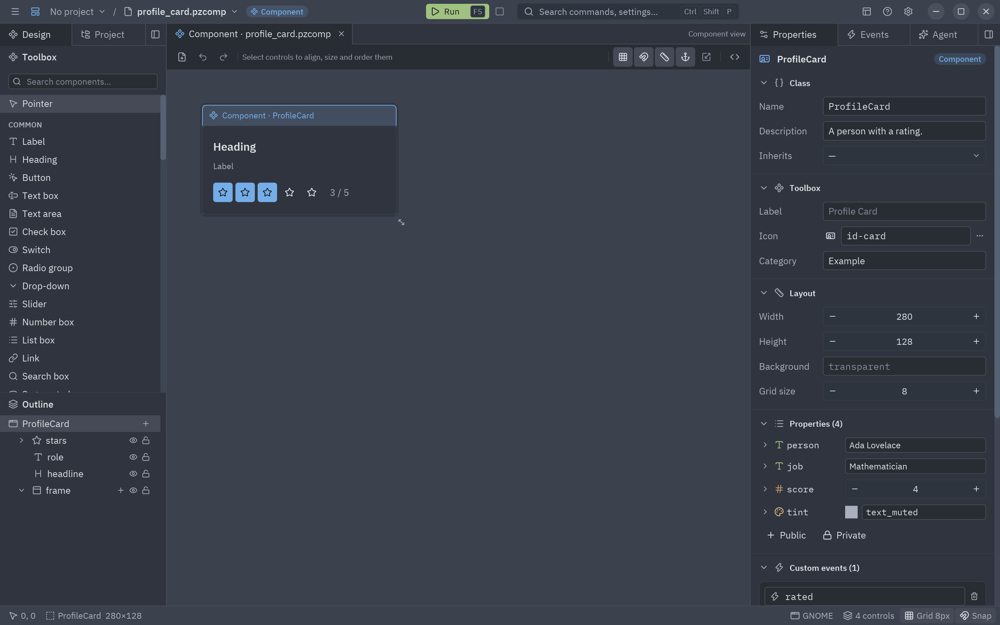

Un componente diseñado **es** un [`pz.Component`](/pyzed/es/guides/components/). El diseñador escribe una clase
normal, así que dibujarlo y escribirlo a mano son lo mismo, y puedes pasar de una forma a la otra cuando quieras.

## Crear uno

Pulsa **Nuevo componente…** al final de la caja de herramientas o en el menú ☰ (Ctrl+Shift+N), o **Nuevo…** (Ctrl+N, el primer botón de la barra) y elige la tarjeta
**Component**. Ponle un nombre y una carpeta; **Inherits from** puede partir de otro componente (mira
[Herencia](#herencia)). **Create component** guarda los dos archivos y lo abre. También puedes abrir un `.pzcomp`:

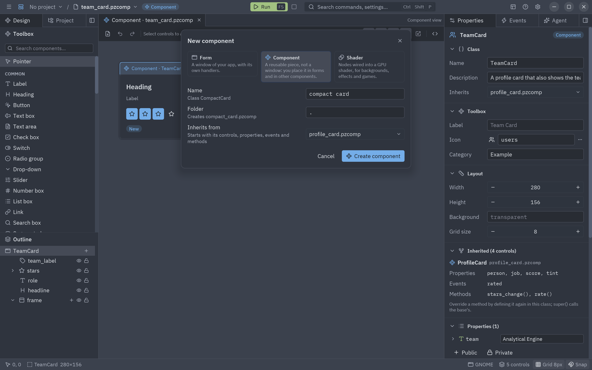

```bash
pyzed design ui/rating.pzcomp     # se crea al guardar si no existe
```

Un componente no es un formulario: no tiene ventana, título ni menú, y solo existe dentro de un formulario o de otro
componente. El diseñador lo muestra así: una etiqueta **Component** en la barra de título, y un marco de color con el
nombre de la clase en el lienzo en vez de los botones de ventana.

## Vista de formulario y vista de componente

Cada archivo abierto es una pestaña sobre el lienzo. Un `.pzform` se abre en la **vista de formulario** y un
`.pzcomp` en la **vista de componente**, donde se trabaja sobre la clase: sus propiedades, eventos, métodos y
componentes hijos. Haz doble clic en un componente colocado en un formulario, o en otro componente, para abrirlo en
su propia pestaña de vista de componente:

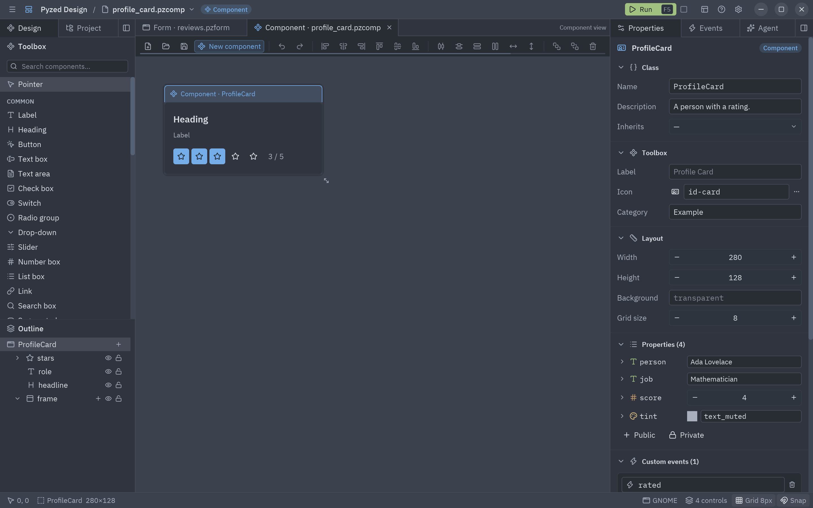

Al cambiar de pestaña cada documento queda como estaba, con su historial de deshacer. Al cerrar una pestaña con
cambios sin guardar se pregunta si guardarlos antes.

Un componente son dos archivos juntos:

| Archivo | Qué contiene |
| --- | --- |
| `rating.pzcomp` | El diseño: los controles, su tamaño, cómo aparece en la biblioteca y sus enlaces (JSON). |
| `rating.py` | La clase: sus propiedades, eventos propios y métodos. |

```python
from typing import Annotated

import pyzed as pz
from pyzed.designer import SceneComponent


class Rating(SceneComponent, scene="rating.pzcomp"):
    """Five stars the user can click."""

    value: Annotated[int, pz.Range(0, 5)] = 3  # How many stars are lit
    readonly: bool = False
    clicks: int = pz.state(0, doc="Times the user picked a rating")
    events = {"change": "A star was picked (event.value is the rating)"}

    def star1_click(self, event):
        return self.pick(1)

    def pick(self, stars):
        """Lights ``stars`` stars and tells the parent."""
        if self.readonly:
            return None
        self.value = stars
        self.clicks += 1
        return self.emit("change", stars)
```

## El panel Component

Sin nada seleccionado, la pestaña Propiedades muestra el propio componente, en secciones plegables:

| Sección | Campos |
| --- | --- |
| **Class** | **Name** (el nombre de la clase de Python, en CamelCase), **Description** (el docstring de la clase, que la caja de herramientas muestra como tooltip) e **Inherits** (un componente diseñado del que heredar, ver [Herencia](#herencia)). |
| **Toolbox** | **Label**, **Icon** (un nombre de Lucide, o elígelo en el [diálogo de iconos](/pyzed/es/editor/properties/#el-diálogo-de-iconos)) y **Category**: cómo aparece el componente en la caja de herramientas de los formularios y de otros componentes. |
| **Layout** | **Width**, **Height**, **Background** (transparente si está vacío) y **Grid size** de la superficie de diseño. |
| **Inherited** | Solo con una base: lo que viene de cada clase base, de solo lectura. |
| **Properties** | Una fila por propiedad (icono del tipo, nombre y valor), y los botones **Public** / **Private** para añadir una. |
| **Methods** | El código de la clase, agrupado, un campo para añadir un método y **Edit the class**. |

Los **eventos personalizados** están en la pestaña **Eventos**, en una sección **Eventos personalizados** debajo de
los **Eventos incluidos** (`setup`, `mount`, `unmount`): una tarjeta por evento (nombre y descripción), y **Evento**
para añadir uno. Son los eventos que el componente lanza con `self.emit("change", valor)`. El padre los recibe con
`on_change=...` en código, o en la pestaña Eventos de un formulario, donde aparecen aparte de los eventos incluidos
del control.

- **Properties**: como en el panel de detalles de Unreal, cada propiedad es una fila compacta: el icono de su tipo,
  su nombre (un candado marca una privada) y su valor por defecto. Las listas, diccionarios e instancias muestran
  sus elementos debajo. La flecha antes del nombre abre sus ajustes: **Name**, **Type**, **Annotation**,
  **Access**, **Description**, mover y **Remove**. Una propiedad **pública** es una prop que pasa el padre
  (`Rating(value=4)`); una **privada** es estado, declarado con `pz.state`. Las dos son atributos en el código:
  `self.value`, `self.clicks`. El tipo decide el editor de la propiedad, aquí y en la pestaña Propiedades de los
  formularios que usan el componente (ver [Tipos de propiedad](#tipos-de-propiedad)).
- **Methods**: todos los métodos de la clase, agrupados en **Lifecycle** (`setup()`, `on_mount()`, `on_unmount()`,
  que se añaden al hacer clic en ellos), **Event handlers** (el código de los eventos de los controles) y tus
  propios **Methods** (un nombre que empieza por `_` se marca como privado). Haz clic en uno para abrirlo en el
  editor de código. Escribe un nombre y pulsa **+ Method** (o <kbd>Enter</kbd>) para añadir un método reutilizable;
  **Edit the class** abre el archivo entero.

Cada cambio se escribe en la clase en el momento, y lo que escribas en la clase aparece en el panel. Si el código
tiene un error de sintaxis, el panel muestra la última versión válida, con un aviso, hasta que lo corrijas.

## Tipos de propiedad

Como en el inspector de Godot y el panel de detalles de Unreal, el tipo de una propiedad elige su editor, y cada
tipo tiene su propio icono de color. Elige un tipo común en la lista **Type** de los ajustes de la propiedad, o
escribe cualquier anotación en **Annotation**:

| Tipo | Anotación en la clase | Editor |
| --- | --- | --- |
| str, int, float, bool | `str`, `int`... | Texto, campo numérico o interruptor. |
| Color | `pz.Color` | Muestra de color con un token del tema o `#rrggbb`. |
| Icon | `pz.Icon` | Selector de icono. |
| Multiline | `pz.Multiline` | Área de texto. |
| Archivo, carpeta | `pz.FilePath`, `pz.FolderPath` (o `pathlib.Path`) | Un campo de ruta con un botón que abre el diálogo de archivo o de carpeta. |
| Choice | `Literal["fast", "slow"]` | Desplegable; la tarjeta tiene un campo **Options**. |
| Range | `Annotated[int, pz.Range(0, 5)]` | Campo numérico con límites; la tarjeta tiene **Min**, **Max** y **Step**. |
| Optional | `float \| None`, `Optional[float]` | **None** con **+** para darle un valor, o el editor del valor con **×** para vaciarlo. |
| Unión | `int \| str` | Una lista de los tipos y el editor del elegido. |
| list, set, tuple | `list[str]`, `set[int]`, `tuple[int, int]` | El número de elementos con **+**, y una fila por elemento (`[0]`, `[1]`...) con su editor. |
| dict | `dict[str, int]` | El número de entradas con **+**, y una fila por entrada: su clave y su valor. |
| Clase | `Point`, `Point \| None` | **New Point** crea una instancia con sus valores por defecto; luego una fila por campo. **×** la vacía. |
| Any | `Any`, cualquier otra | Una expresión de Python. |

Los tipos se anidan: `list[Point]`, `dict[str, list[int]]` u `Optional[tuple[int, int]]` muestran sus elementos
unos dentro de otros. Una clase puede ser una dataclass o cualquier clase del módulo con campos anotados, u otro
componente.

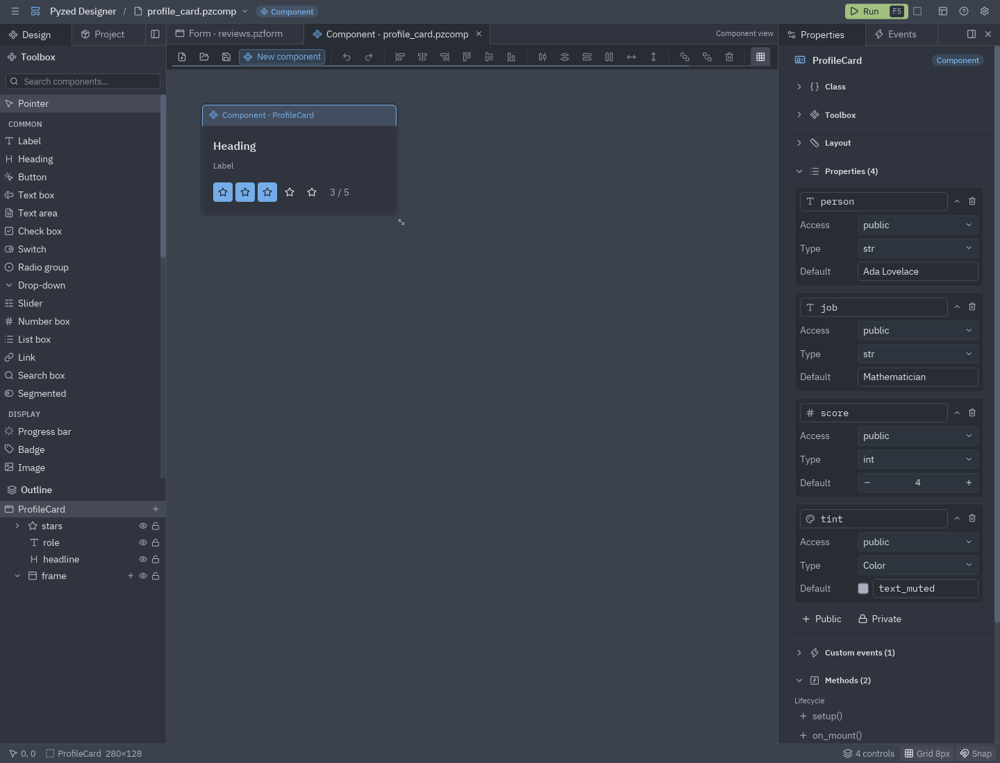

```python
@dataclass
class Point:
    x: int = 0
    y: int = 0


class Gadget(SceneComponent, scene="gadget.pzcomp"):
    mixed: int | str | list[str] = 0
    maybe: Optional[float] = None
    scores: dict[str, int] = {"ada": 5}
    origin: Point = Point()
```

El panel Properties y el código son lo mismo: lo que cambias en el panel se escribe en la clase al instante, aunque
la clase esté abierta en el editor de código (lo que escribiste allí y no aplicaste se conserva), y lo que escribes
en la clase aparece en el panel. El diseñador añade los imports que necesitan estos tipos (`import pyzed as pz`,
`from typing import Annotated, Optional`).

```python
class Rating(SceneComponent, scene="rating.pzcomp"):
    value: Annotated[int, pz.Range(0, 5)] = 3  # How many stars are lit


class ProfileCard(SceneComponent, scene="profile_card.pzcomp"):
    tint: pz.Color = "text_muted"  # Color of the role line
```

## Código reutilizable

La clase de un componente es Python normal, así que puede tener cualquier código y no solo manejadores de eventos:
métodos auxiliares, estado privado, valores calculados, imports. Un método público forma parte de la API del
componente, y los formularios y componentes padre pueden llamarlo:

```python
class ProfileCard(SceneComponent, scene="profile_card.pzcomp"):
    def rate(self, stars):
        """Rates the person from code, as if the user clicked the stars."""
        return self.stars.pick(stars)
```

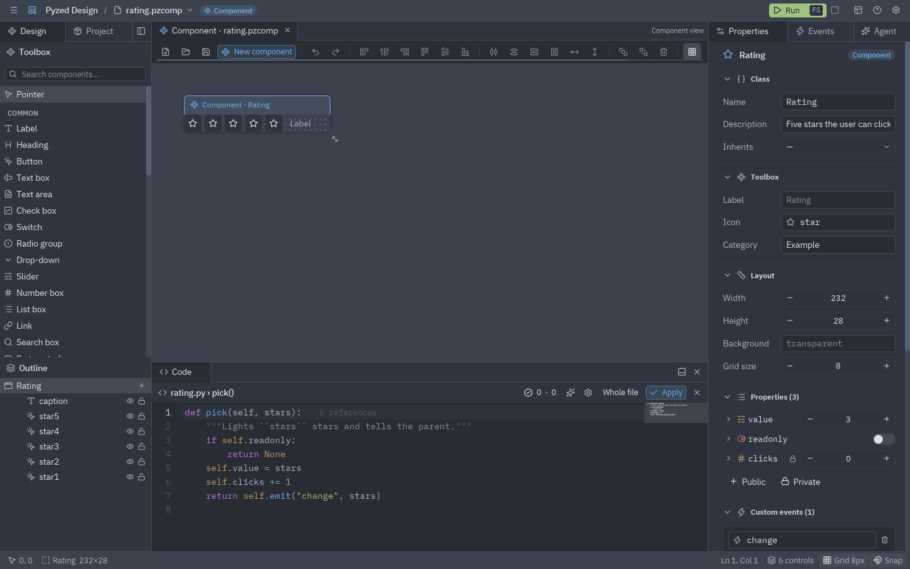

## Eventos de los controles

Haz doble clic en un control, o usa la pestaña Events, para escribir el código de sus eventos, como en un
formulario. En un componente son métodos: `def star1_click(self, event)`. Los controles son atributos del
componente y sus propiedades se leen y escriben como atributos:

```python
def clear_click(self, event):
    self.query.text = ""
    self.results.items = []
```

Cada instancia tiene su propia copia de los controles, así que dos ratings en un formulario guardan su propio estado.

## Enlaces

Selecciona un control y la sección **Bindings** enlaza sus propiedades con las del componente. Elige una propiedad
en la lista, o elige **Expression…** y escribe cualquier expresión de Python sobre ellas:

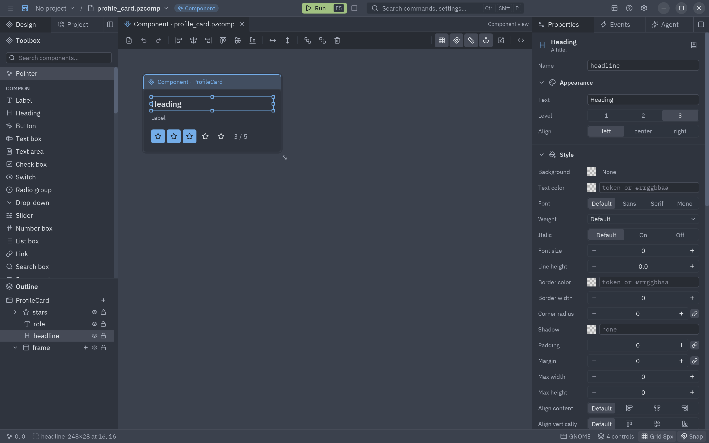

| Propiedad del control | Enlace |
| --- | --- |
| `headline.text` | `person` |
| `caption.text` | `f"{value} / 5"` |
| `star3.variant` | `"solid" if value >= 3 else "ghost"` |

Los enlaces se evalúan en cada render, así que los controles siguen siempre a las propiedades. En el lienzo, un
pequeño eslabón marca los controles que tienen enlaces, y se dibujan con los valores que estás probando (mira abajo).

## Probar valores, Diseño y En vivo

Un componente se hace para reutilizarlo con valores distintos, así que su vista te deja probarlos sin escribir lógica:

- **Probar valores** es la primera sección del panel del componente (Propiedades, sin nada seleccionado). Cada
  propiedad pública tiene un editor; cambia una y el lienzo se vuelve a dibujar al momento a través de los enlaces.
  Los valores probados no se guardan ni cambian el código: los **valores por defecto** siguen en la sección
  **Properties**, que escribe la clase. El botón ↺ devuelve una propiedad a su valor por defecto, y **Volver a los
  valores por defecto** todas.
- **Diseño | En vivo**, al principio de la barra de herramientas, cambia lo que muestra el lienzo. **Diseño** es
  donde colocas y ordenas controles (los enlaces dibujados con los valores probados, sin ejecutar código). **En
  vivo** ejecuta la clase: el componente se dibuja como dice su código, con `setup()` y los manejadores, recibiendo
  los valores probados como props, así que puedes hacer clic y ver cómo su propio código cambia su comportamiento.
  Debajo se listan los eventos personalizados que lanza, y ↺ **Reiniciar** lo vuelve a ejecutar desde `setup()`.
  En vivo ejecuta tu código, así que un proyecto en modo restringido pide confiar en él primero; hasta entonces en
  Diseño solo se dibujan los enlaces a una propiedad, no las expresiones.

## Miembros

Bajo la Estructura, la vista de componente añade **Miembros**: lo que trae su clase, leído del código mientras lo
escribes.

| Grupo | Qué lista | Clic para |
| --- | --- | --- |
| **Variables** | Propiedades públicas y estado privado (marcado con un candado), con el icono de su tipo y el valor que se prueba. | Abrir su tarjeta en el panel del componente. |
| **Métodos** | Todos los métodos de la clase, marcados *ciclo de vida* o *manejador* cuando lo son. | Abrirlo en el editor de código. |
| **Eventos** | Los eventos personalizados que lanza con `self.emit(...)`. | Abrir la pestaña Eventos. |
| **Clases** | La clase del componente, las clases anidadas en ella y las demás clases de su módulo (ayudantes, dataclasses...). | Abrir el módulo en su línea. |

El **+** de cada grupo añade una propiedad, un método o un evento.

## El script enlazado

La primera fila de la Estructura (el componente, o el formulario en la vista de formulario) muestra un icono de
**script** como el de Godot: el `.py` al que está ligado el documento. Haz clic para abrir el archivo entero
(<kbd>F7</kbd>). Sale atenuado mientras aún no hay código. Un componente diseñado colocado en un formulario o dentro
de otro componente tiene su propio icono de script en su fila, que abre su clase. Los componentes escritos solo en
código (un `pz.Component` sin `.pzcomp`) no tienen ninguno: su código lo genera todo, así que no hay nada que enlazar.

## Componentes anidados

Los componentes guardados aparecen en la biblioteca bajo su categoría, en formularios y en otros componentes. El
diseñador encuentra todos los `.pzcomp` del proyecto al arrancar, y recarga un componente al guardarlo. Coloca un
`Rating` dentro de un `ProfileCard`, enlaza su `value` con el `score` de la tarjeta y reenvía su evento:

```python
class ProfileCard(SceneComponent, scene="profile_card.pzcomp"):
    """A person with a rating."""

    person: str = "Ada Lovelace"
    job: str = "Mathematician"
    score: int = 4
    events = {"rated": "The rating changed (event.value is the new score)"}

    def stars_change(self, event):
        """The inner Rating raised change."""
        self.score = event.value
        return self.emit("rated", event.value)
```

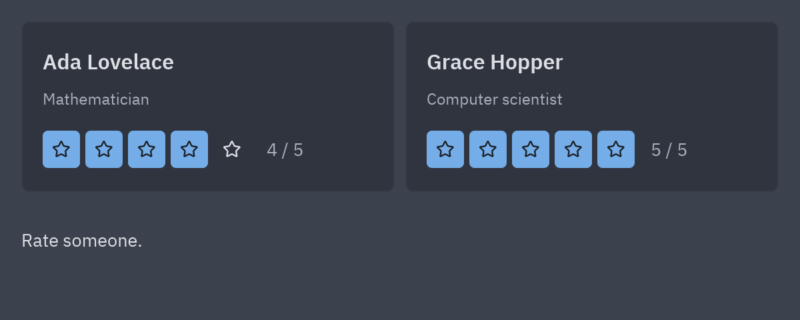

### Componentes hijos en el esquema

Un componente hijo es un atributo de su padre, y sus propiedades y métodos se alcanzan desde él:
`self.stars.value`, `self.stars.pick(5)`. Desde un formulario funciona igual: `form.ada.rate(5)`.

En el **Outline**, la flecha junto a un componente colocado lista sus propiedades y métodos públicos. Haz clic en uno
para insertarlo en el editor de código, en el cursor (`self.stars.pick()` en un componente, `form.ada.rate()` en un
formulario):

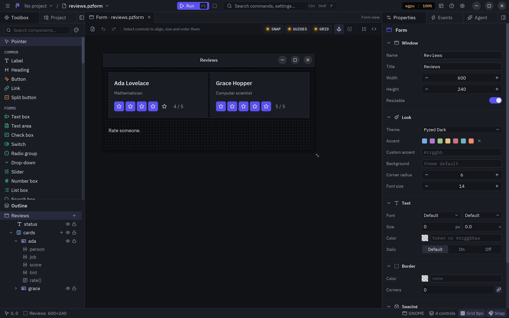

Una propiedad que el propio componente cambia, como `self.score` arriba, conserva su valor hasta que el padre pasa
otro distinto, como una variable exportada en Godot. Un handler del formulario también puede cambiarla:

```python
def ada_rated(form, event):
    event.sender.score = event.value
    form.status.text = f"{event.sender.person} now has {event.value} stars"
```

## Componentes responsive

Un componente colocado en un formulario, o dentro de otro componente, toma el tamaño de su rectángulo ahí, y sus
controles siguen sus **anclas** como en un formulario: anclado a izquierda y derecha, un control se estira con el
componente; anclado a la derecha, se mueve con el borde derecho. Las filas, columnas y rejillas flex dentro del
componente también se reparten el nuevo tamaño.

En el ejemplo, el marco de `ProfileCard` está anclado a los cuatro lados y el título, el puesto y la valoración a
izquierda, arriba y derecha. `Reviews` pone sus dos tarjetas en una **fila flex** con `grow` 1 cada una, así que se
reparten el ancho de la ventana y se encogen con ella:

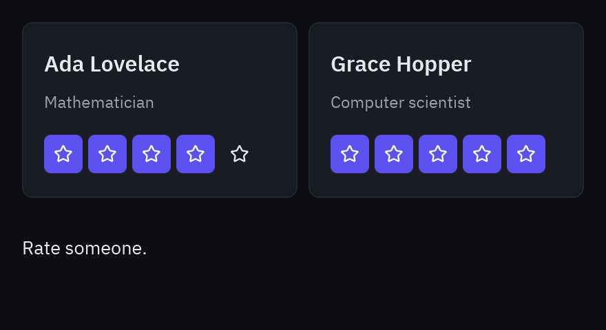

Desde código, un componente ocupa el ancho que haya, hasta su ancho de diseño, y la altura de su diseño.

## Herencia

Un componente puede heredar de otro para reutilizar su diseño y su lógica. Elige la base en **Inherits from** al
crearlo, o después en el campo **Inherits** de la sección Class. La clase pasa a derivar de la clase base:

```python
from pyzed.designer import import_component

ProfileCard = import_component("profile_card.pzcomp")


class TeamCard(ProfileCard, scene="team_card.pzcomp"):
    """A profile card that also shows the team."""

    team: str = "Analytical Engine"

    def stars_change(self, event):
        """Does what a ProfileCard does, and the badge turns green with five stars."""
        result = super().stars_change(event)
        self.team_label.tint = "success" if event.value == 5 else "accent"
        return result
```

`import_component` importa la clase de un `.pzcomp` relativo al módulo, así que la base y el nuevo componente pueden
estar en cualquier carpeta. Lo que recibe el nuevo componente:

- **Controles**: los controles de la base aparecen en el lienzo, con los tuyos encima. Puedes mover o cambiar un
  control heredado (el cambio solo se guarda en tu `.pzcomp`), pero no renombrarlo ni borrarlo, porque el código de
  la base lo usa. Al guardar se escriben solo tus controles y los heredados que cambiaste.
- **Propiedades, eventos propios y métodos**: todo lo de la clase base, como en cualquier subclase de Python. Los
  enlaces pueden usar propiedades heredadas. Define de nuevo un método para sobrescribirlo y llama a `super()` para
  ejecutar el de la base.
- **Cambios en la base**: al guardar la base se recargan los componentes que heredan de ella, así que reciben sus
  nuevos controles y su código.

La sección **Inherited** del panel lista lo que viene de cada base:

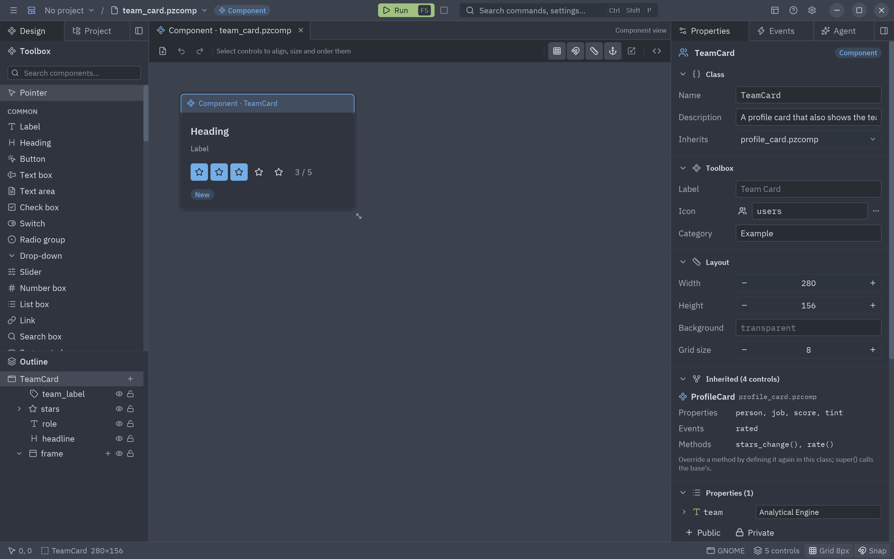

## Ejecutarlo y usarlo

Pulsa **F5** para abrir el componente en una ventana de vista previa. La ventana lista los eventos propios que
lanza, así que puedes probarlo antes de usarlo. `pyzed run rating.pzcomp` hace lo mismo desde una terminal.

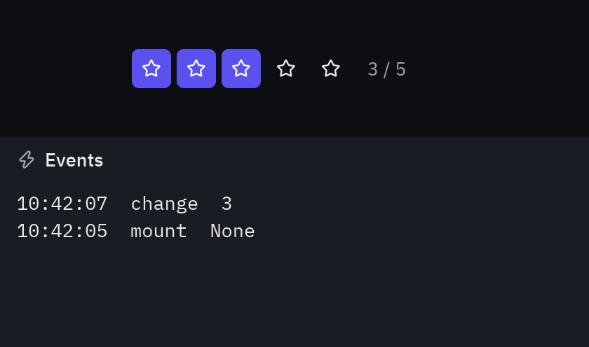

En código, importa la clase y úsala como cualquier componente:

```python
from ui.rating import Rating

class Review(pz.App):
    stars = 3

    def view(self):
        return Rating(value=self.stars, on_change=lambda e: setattr(self, "stars", e.value))
```

Los formularios encuentran solos los componentes de su proyecto al ejecutarse (`pyzed run`, `designer.run`).

## Componentes desde código

Todo lo que hace el panel está disponible desde Python:

```python
from pyzed import designer

doc = designer.new_component("Rating", "ui/rating.pzcomp", width=232, height=32, icon="star")
doc.add("button", 0, 0, 28, 28)
doc.add_member("value", "int", 3)
doc.add_member("clicks", "int", public=False)
doc.add_event("change", "A star was picked")
doc.set_binding("button1", "variant", '"solid" if value >= 1 else "ghost"')
doc.wire("button1", "click")
doc.save()

big = designer.new_component("BigRating", "ui/big_rating.pzcomp", extends="ui/rating.pzcomp")
big.save()

designer.discover("ui")  # importa todos los componentes diseñados de una carpeta
```

Mira [`examples/designer/components`](https://github.com/albakore/pyzed/tree/main/examples/designer/components)
para el ejemplo de Rating, ProfileCard, TeamCard y Reviews.

:::tip
Los componentes diseñados se descubren al abrir el editor y se recargan al guardarlos, así que ten el componente y
un formulario que lo use abiertos en dos pestañas: edita el componente, pulsa <kbd>Ctrl</kbd>+<kbd>S</kbd>, cambia a
la pestaña del formulario y pulsa <kbd>F5</kbd>.
:::
