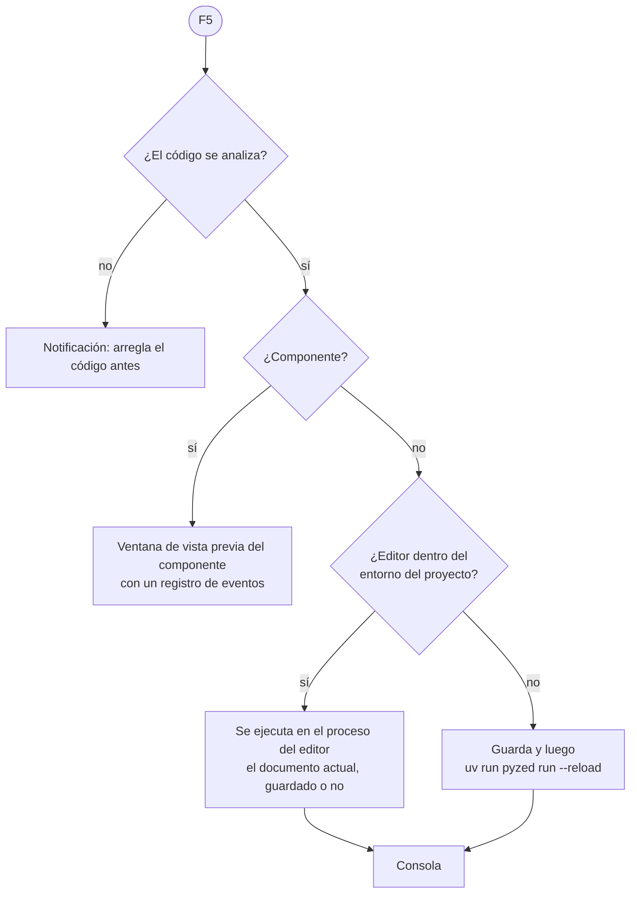

## Ejecutar y Detener

**Ejecutar** (<kbd>F5</kbd>, el botón verde de la barra de título, el menú ☰ o la consola) abre el documento en una
ventana nueva con toda su lógica; **Detener** (<kbd>Shift</kbd>+<kbd>F5</kbd>, el cuadrado junto a Ejecutar) la
cierra.


Lo que hace Ejecutar depende del documento y de dónde corre el editor:



- **En el proceso del editor** (arrancaste el editor con `uv run pyzed design`, o no hay proyecto): el formulario
  se ejecuta tal como está en el editor, **con los cambios sin guardar**, con su archivo de código recién compilado.
  Ejecutar otra vez cierra antes la ventana anterior.
- **Con `uv run`** (la app independiente Pyzed Design, o un editor instalado con `uv tool`, que no tiene las
  dependencias del proyecto): el formulario se guarda y se arranca en su propio proceso con
  `uv run pyzed run --reload`, así tiene disponibles todos los paquetes de `.venv`.
- **Un componente** se abre en una [ventana de vista previa](/pyzed/es/editor/component-designer/#ejecutarlo-y-usarlo)
  que lista los eventos personalizados que lanza.

Con **Guardar antes de ejecutar** activo (Ajustes → Ejecución), Ejecutar siempre guarda primero.

:::tip
Si el archivo de código falla al cargarse (un error de import, una errata en el nivel superior), Ejecutar se
detiene y la consola muestra la traza, con una notificación que nombra el error.
:::

## La consola

El panel **Consola** (dock inferior, <kbd>Ctrl</kbd>+<kbd>Shift</kbd>+<kbd>Y</kbd> o **Ver → Consola**) muestra lo
que hace el formulario en ejecución sin salir del editor:


| Línea | Viene de |
| --- | --- |
| ▶ `login started` / ■ `login stopped` | Una ejecución que empieza y termina (con `(uv run)` cuando corre en su propio proceso). |
| Evento (acento, icono de rayo) | Cada evento que atiende el formulario, con su valor y el manejador al que llama: `sign_in.click → sign_in_click()`. `tick`, `mouse_enter` y `mouse_leave` se omiten para no inundarla. |
| Salida | Lo que los manejadores imprimen con `print`. |
| Salida de error (amarillo) | Lo que escriben en `stderr`. |
| Error (rojo) | La traza completa de un manejador que lanzó una excepción, empezando por el manejador. |

La barra de la consola:

- Campo de **filtro**: muestra solo las líneas que contienen el texto.
- **Interruptores de nivel**, uno por cada tipo de línea presente, con su recuento: haz clic en uno para ocultar o
  mostrar esas líneas.
- **Copy** pone todo el registro en el portapapeles; **Clear** lo vacía.
- Una insignia **Running** mientras corre un formulario, **Detener** y **Ejecutar**.

La lista sigue desplazándose a la línea más nueva mientras estás abajo del todo; sube para leer líneas anteriores con
calma. La salida sigue llegando también a la terminal desde la que arrancaste el editor.

Si la consola se abre al ejecutar lo decide **Ajustes → Ejecución → Abrir la consola al ejecutar**, y si registra
los eventos, **Registrar los eventos en la consola**. Una vez que tiene algo que mostrar, o la abriste desde el menú
Ver, la consola se queda en su dock hasta que la ocultes.

### Seleccionar y copiar líneas

Haz clic en una línea para seleccionarla, <kbd>Shift</kbd>+clic para seleccionar un rango y <kbd>Ctrl</kbd>+clic
(<kbd>Cmd</kbd> en macOS) para añadir o quitar una; <kbd>Ctrl</kbd>+<kbd>A</kbd> selecciona todas las líneas
visibles, <kbd>Ctrl</kbd>+<kbd>C</kbd> copia la selección y <kbd>Escape</kbd> la quita. Un error seleccionado muestra
su traceback completo debajo.

Un **clic derecho** en una línea abre su menú:

| Opción | Qué hace |
| --- | --- |
| **Copiar línea** / **Copiar N líneas** | Las líneas seleccionadas, con su hora y nivel. |
| **Copiar solo el texto** | Solo el texto de las líneas (y su traceback). |
| **Copiar todo** / **Seleccionar todo** | Todas las líneas que dejan ver los filtros. |
| **Ir a archivo.py:12** | Abre el archivo de una línea de traceback en el panel Código, en esa línea (también con doble clic). |
| **Ver el error…** | El error en el [diálogo de error](#cuando-falla-el-propio-editor), con el traceback seleccionable. |
| **Ocultar las líneas error** | Apaga el interruptor de ese nivel. |
| **Ver en Logs** / **Limpiar** | Abre el panel Logs, o vacía la consola. |

## El panel Logs

**Ver → Logs** (<kbd>Ctrl</kbd>+<kbd>Shift</kbd>+<kbd>U</kbd>) abre el panel **Logs**, el registro del propio editor:
todo lo que hace Pyzed Design y cada error que encuentra, mientras que la consola es para tu formulario en ejecución.
Como cualquier panel, puede ir a otro dock o a una ventana propia.

Cada línea lleva su hora, un nivel y un **tipo**:

| Tipo | Qué registra |
| --- | --- |
| Diseñador | El editor al arrancar y al cerrarse, los ajustes cambiados y sus errores inesperados con su traceback. |
| Comandos | Cada comando ejecutado desde un menú, la paleta de comandos o un atajo. |
| Documentos | Formularios y componentes abiertos y guardados. |
| Proyecto | El proyecto y sus comandos de `uv`. |
| Ejecutar | Las ejecuciones al empezar y al parar, y los eventos y errores del formulario en ejecución. |
| Código, Agente, Disposición, Actualizaciones | El editor de código, los agentes de IA, los paneles movidos o mostrados y las actualizaciones. |
| Sistema | Los avisos de Python. |

La barra filtra por texto, por **tipo** (el desplegable *Todos los tipos*) y por **nivel** (debug, info, event,
warning, error: las líneas debug están ocultas hasta que enciendes su interruptor). Las líneas se seleccionan, se
copian y se abren desde su menú igual que en la consola, y el menú añade **Solo Diseñador** (o el tipo de la línea).
El botón de la carpeta abre la carpeta de los archivos de log.

Las mismas líneas (de event para arriba) se escriben en `logs/pyzed-design.log`, en la carpeta de configuración de
Pyzed (el archivo se renueva al pasar de 1 MB y se guardan los tres últimos): adjúntalo a un informe de error.
**Ajustes → Logs y errores → Escribir un archivo de log** lo desactiva.

Cuando se han registrado errores o avisos, la barra de estado muestra su número a la izquierda; haz clic para abrir
el panel.

## Cuando falla el propio editor

Un fallo de Pyzed Design nunca lo cierra:

- Una acción que falla (un clic, una tecla, un comando de menú, una tarea en segundo plano) abre un **diálogo de
  error** con el error, dónde pasó y el traceback, que puedes seleccionar y copiar. Sus botones: **Copiar el error**
  (todo, listo para pegar en un issue), **Ir a archivo.py:12** (abre la línea de la que viene, cuando es un archivo
  que se puede abrir), **Ver en Logs** y **Cerrar**. Si llegan más errores mientras está abierto, los cuenta.
- Un panel que no se puede dibujar muestra una **tarjeta de error** en su lugar, con **Copiar el error** y
  **Detalles**, y el resto de la ventana sigue funcionando; el lienzo, los diálogos y la ventana entera están
  protegidos igual.

Todos quedan en el panel Logs con su traceback. **Ajustes → Logs y errores → Mostrar un diálogo con los errores**
desactiva el diálogo (los errores se siguen registrando). Para tus propias apps, las mismas piezas están en la
librería: [`ui.error_boundary`, `ui.error_dialog` y `ui.ErrorInfo`](/pyzed/es/reference/ui/#consola-errores-y-ayuda).

## Errores en la ventana en ejecución

Un manejador que lanza una excepción no cierra la ventana: aparece abajo un aviso **Event handler error** con la
última línea del error, y la traza va a la consola. Arregla el código, guarda y vuelve a probar (ver abajo).

## Actualización en vivo al guardar

Mientras un formulario se ejecuta, **Guardar** (<kbd>Ctrl</kbd>+<kbd>S</kbd>) actualiza la ventana abierta sin
reiniciarla: se sustituyen la disposición, las propiedades y el código, y se conserva lo que el usuario escribió o
eligió en cada control (textos, casillas, selecciones, valores de los deslizadores). Si la versión nueva no carga,
la ventana sigue con la anterior y muestra el error.

Un formulario arrancado con `uv run` (o con `pyzed run app.pzform --reload` desde una terminal) vigila sus archivos,
así que guardar desde cualquier editor también lo actualiza. Desde código, usa
`designer.run(path, reload=True)` o define `PYZED_RELOAD=1`.

```bash
pyzed run login.pzform            # ejecutar un formulario sin el editor
pyzed run login.pzform --reload   # ...y actualizarlo en cada guardado
pyzed run ui/rating.pzcomp        # vista previa de un componente diseñado
```
