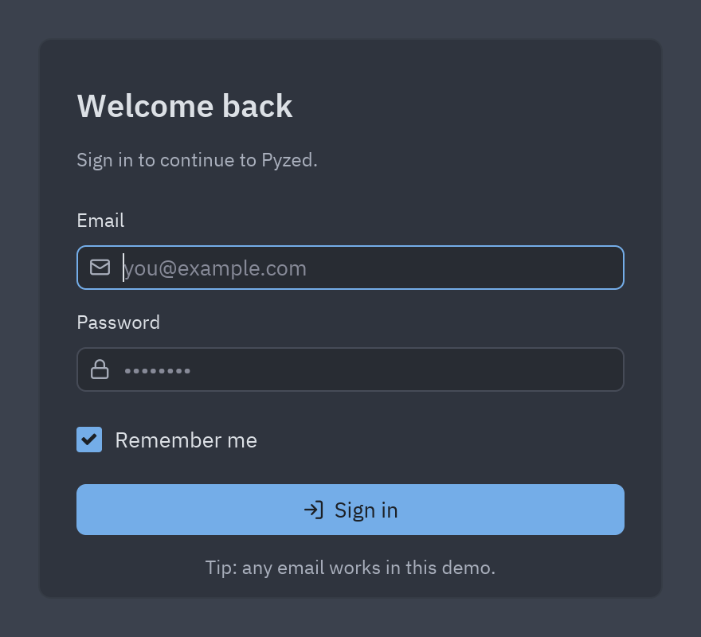
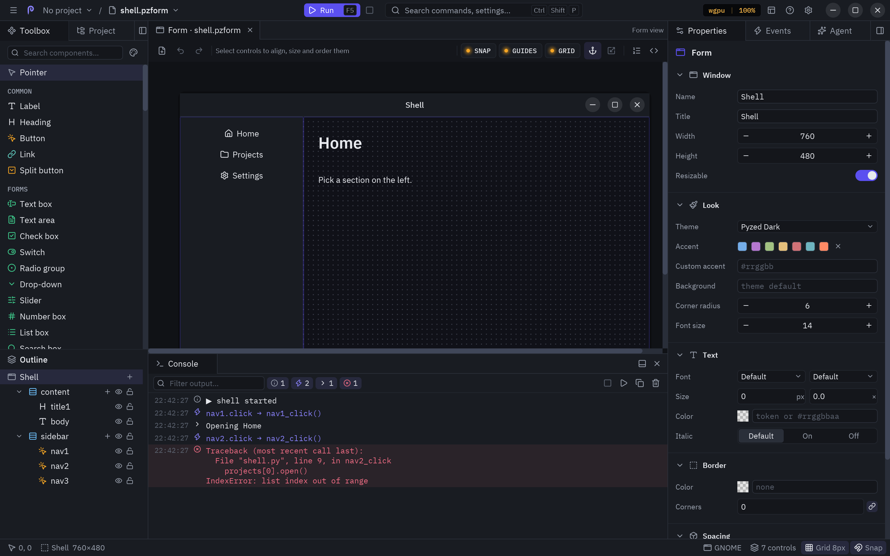

## Ejecutar y Detener

**Ejecutar** (<kbd>F5</kbd>, el botón verde de la barra de título, el menú ☰ o la consola) abre el documento en una
ventana nueva con toda su lógica; **Detener** (<kbd>Shift</kbd>+<kbd>F5</kbd>, el cuadrado junto a Ejecutar) la
cierra.



Lo que hace Ejecutar depende del documento y de dónde corre el editor:


- **En el proceso del editor** (arrancaste el editor con `uv run pyzed design`, o no hay proyecto): el formulario
  se ejecuta tal como está en el editor, **con los cambios sin guardar**, con su archivo de código recién compilado.
  Ejecutar otra vez cierra antes la ventana anterior.
- **Con `uv run`** (la app independiente Pyzed Design, o un editor instalado con `uv tool`, que no tiene las
  dependencias del proyecto): el formulario se guarda y se arranca en su propio proceso con
  `uv run pyzed run --reload`, así tiene disponibles todos los paquetes de `.venv`.
- **Un componente** se abre en una [ventana de vista previa](/pyzed/es/editor/component-designer/#ejecutarlo-y-usarlo)
  que lista los eventos personalizados que lanza.

Con **Guardar antes de ejecutar** activo (Ajustes → Ejecución), Ejecutar siempre guarda primero.

:::tip
Si el archivo de código falla al cargarse (un error de import, una errata en el nivel superior), Ejecutar se
detiene y la consola muestra la traza, con una notificación que nombra el error.
:::

## La consola

El panel **Consola** (dock inferior, <kbd>Ctrl</kbd>+<kbd>Shift</kbd>+<kbd>Y</kbd> o **Ver → Consola**) muestra lo
que hace el formulario en ejecución sin salir del editor:



| Línea | Viene de |
| --- | --- |
| ▶ `login started` / ■ `login stopped` | Una ejecución que empieza y termina (con `(uv run)` cuando corre en su propio proceso). |
| Evento (acento, icono de rayo) | Cada evento que atiende el formulario, con su valor y el manejador al que llama: `sign_in.click → sign_in_click()`. `tick`, `mouse_enter` y `mouse_leave` se omiten para no inundarla. |
| Salida | Lo que los manejadores imprimen con `print`. |
| Salida de error (amarillo) | Lo que escriben en `stderr`. |
| Error (rojo) | La traza completa de un manejador que lanzó una excepción, empezando por el manejador. |

La barra de la consola:

- Campo de **filtro**: muestra solo las líneas que contienen el texto.
- **Interruptores de nivel**, uno por cada tipo de línea presente, con su recuento: haz clic en uno para ocultar o
  mostrar esas líneas.
- **Copy** pone todo el registro en el portapapeles; **Clear** lo vacía.
- Una insignia **Running** mientras corre un formulario, **Detener** y **Ejecutar**.

La lista sigue desplazándose a la línea más nueva mientras estás abajo del todo; sube para leer líneas anteriores con
calma. La salida sigue llegando también a la terminal desde la que arrancaste el editor.

Si la consola se abre al ejecutar lo decide **Ajustes → Ejecución → Abrir la consola al ejecutar**, y si registra
los eventos, **Registrar los eventos en la consola**. Una vez que tiene algo que mostrar, o la abriste desde el menú
Ver, la consola se queda en su dock hasta que la ocultes.

## Errores en la ventana en ejecución

Un manejador que lanza una excepción no cierra la ventana: aparece abajo un aviso **Event handler error** con la
última línea del error, y la traza va a la consola. Arregla el código, guarda y vuelve a probar (ver abajo).

## Actualización en vivo al guardar

Mientras un formulario se ejecuta, **Guardar** (<kbd>Ctrl</kbd>+<kbd>S</kbd>) actualiza la ventana abierta sin
reiniciarla: se sustituyen la disposición, las propiedades y el código, y se conserva lo que el usuario escribió o
eligió en cada control (textos, casillas, selecciones, valores de los deslizadores). Si la versión nueva no carga,
la ventana sigue con la anterior y muestra el error.

Un formulario arrancado con `uv run` (o con `pyzed run app.pzform --reload` desde una terminal) vigila sus archivos,
así que guardar desde cualquier editor también lo actualiza. Desde código, usa
`designer.run(path, reload=True)` o define `PYZED_RELOAD=1`.

```bash
pyzed run login.pzform            # ejecutar un formulario sin el editor
pyzed run login.pzform --reload   # ...y actualizarlo en cada guardado
pyzed run ui/rating.pzcomp        # vista previa de un componente diseñado
```
