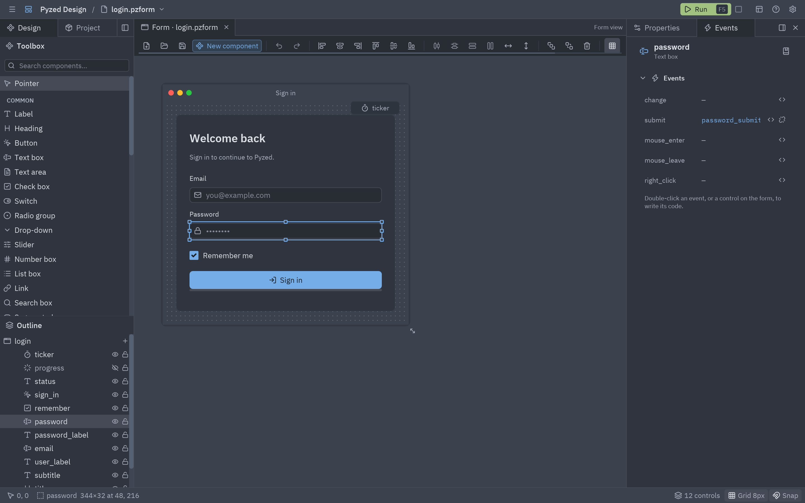
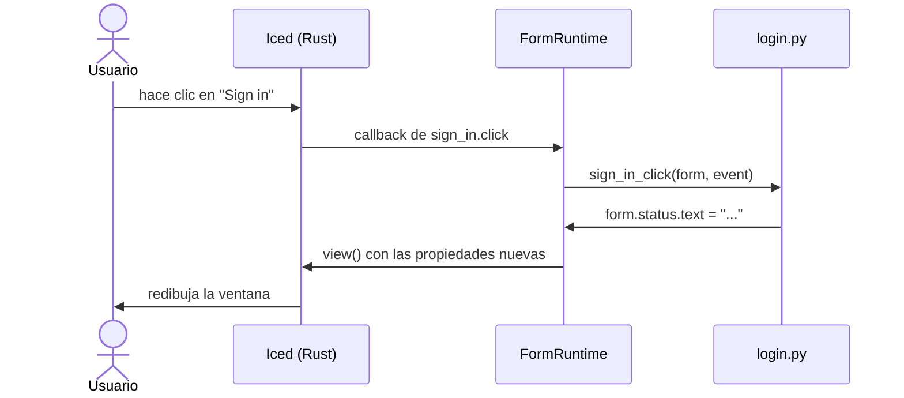

Los controles lanzan **eventos** (un clic, un cambio de texto, un tic del temporizador) y cada evento se puede
**conectar** a una función de Python, su **manejador**, en el archivo de código del formulario (`login.py` junto a
`login.pzform`).

## El panel Eventos

El panel **Eventos** (dock derecho, junto a Propiedades) lista los eventos del control seleccionado, o del
formulario cuando no hay nada seleccionado, con el manejador conectado a cada uno (`—` si no tiene).



| Acción | Resultado |
| --- | --- |
| **Doble clic** en un evento, o su botón **`<>`** (**Crear el manejador** / **Editar el código**) | Lo conecta si hace falta (creando el esqueleto del manejador) y abre el manejador en el editor de código. |
| Botón **Desconectar** (solo eventos conectados) | Desconecta el evento **y borra el código de su manejador**. |
| Pasar el ratón por un evento | Un tooltip dice cuándo se ejecuta y qué contiene `event.value`. |
| El botón del **libro** de la cabecera | Abre la página del control en la [referencia](/pyzed/es/editor/reference/), con cada evento y el nombre de su manejador (<kbd>Shift</kbd>+<kbd>F1</kbd>). |

El evento que estás editando aparece resaltado. Con varios controles seleccionados, el panel pide que elijas uno:
los eventos pertenecen a un solo control.

### Atajos para llegar

- **Doble clic en un control** del lienzo: abre el manejador de su **evento principal** (el primero: `click` en
  un botón, `change` en un cuadro de texto, `tick` en un temporizador).
- <kbd>Enter</kbd> con un control seleccionado hace lo mismo.
- **View code** en el menú contextual del control.
- <kbd>F7</kbd> (**Editar el código**) abre el archivo entero.

Los manejadores se llaman `<control>_<evento>` (`sign_in_click`), o `form_<evento>` para el formulario, y el
esqueleto lleva un docstring que dice cuándo se ejecuta. Al renombrar un control se renombran los manejadores que
siguen esta convención.

## Todos los eventos

Cada control visible tiene tres eventos comunes además de los suyos:

| Evento | Se ejecuta cuando | `event.value` |
| --- | --- | --- |
| `mouse_enter` | El puntero entra en el control. | `None` |
| `mouse_leave` | El puntero sale del control. | `None` |
| `right_click` | Se hace clic derecho en el control. | `None` |

| Componente | Eventos propios |
| --- | --- |
| Etiqueta de texto | `click`, `double_click` |
| Botón, Enlace, Etiqueta (chip) | `click` |
| Cuadro de texto, Buscador | `change` (el texto nuevo), `submit` (se pulsó <kbd>Enter</kbd>) |
| Área de texto | `change` (el texto nuevo) |
| Casilla, Interruptor | `change` (`True` o `False`) |
| Opciones, Desplegable, Segmentado, Pestañas | `change` (la opción elegida) |
| Deslizador, Número | `change` (el número nuevo) |
| Lista | `change` (el elemento elegido) |
| Tabla | `change` (el índice de la fila elegida) |
| Temporizador (invisible al ejecutar) | `tick`, cada `interval` milisegundos mientras `running` |
| Título, Barra de progreso, Insignia, Imagen, Icono, Markdown, Indicador de carga, Aviso, Avatar, Atajo, Métrica, Gráfico, contenedores, Espaciador, Separador | Solo los comunes |

El propio formulario:

| Evento | Se ejecuta cuando | `event.value` |
| --- | --- | --- |
| `load` | Una vez, al abrirse la ventana. | `None` |
| `close` | La ventana se está cerrando. Devuelve `False` para mantenerla abierta. | `None` |
| `key` | En cada pulsación de tecla. | La combinación, como `"ctrl-s"` |
| `resize` | La ventana cambia de tamaño. | `(ancho, alto)` |

Los [componentes diseñados](/pyzed/es/editor/component-designer/) añaden sus propios **eventos personalizados** a
esta lista cuando los colocas en un formulario.

## Escribir manejadores

Un manejador recibe el `form` en ejecución y un `event`. Los controles son atributos del formulario y sus
propiedades son atributos del control; al cambiarlas se actualiza la ventana.

```python
def sign_in_click(form, event):
    if "@" not in form.email.text:
        form.status.text = "Escribe un correo válido."
        return form.email.focus()          # los manejadores pueden devolver comandos
    form.sign_in.enabled = False
    form.progress.show()
    form.ticker.running = True             # un Temporizador empieza a hacer tic
```

| Nombre | Qué es |
| --- | --- |
| `event.sender` | El control (o formulario) que lanzó el evento. |
| `event.name` | El evento (`"click"`, `"change"`...). |
| `event.value` | Su valor: texto nuevo, estado marcado, combinación de teclas... |
| `form.<control>` | Un control; lee y escribe sus propiedades (`form.email.text`). |
| `form.<control>.visible`, `.enabled`, `.x`, `.y`, `.width`, `.height`, `.anchor` | Sus campos de disposición y comportamiento. |
| `form.<control>.show()`, `.hide()` | Lo muestra o lo oculta. |
| `form.<control>.focus()` | Un comando que le da el foco (cuadros y áreas de texto). |
| `form.title`, `form.name`, `form.size` | El título de la ventana (asignarlo la renombra), el nombre del formulario y el tamaño actual. |
| `form.close()` | Un comando que cierra la ventana. |
| `form.open("details", data=...)` | Un comando que abre otro formulario en una ventana nueva; recibe `data` como `form.data`. |
| `form.window` | La ventana de Pyzed que ejecuta este formulario. |

Los manejadores pueden devolver lo mismo que cualquier callback de Pyzed: un `Command`, una lista de comandos, una
corrutina (para trabajo asíncrono) o un generador. Las funciones auxiliares al principio del archivo, los imports y
los demás módulos del proyecto funcionan como siempre.



### Cuando un manejador falla

Si un manejador lanza una excepción, la ventana en ejecución no se cierra: aparece un aviso **Event handler error**
abajo con la última línea del error (ciérralo con su ×), y la traza completa va a la
[consola](/pyzed/es/editor/console-and-running/). Si un evento está conectado a una función que no está en el
archivo de código, el aviso lo dice.

:::tip
Escribe `form.` en un manejador y la lista de sugerencias ofrece los controles del formulario; `form.email.` lista
las propiedades de ese cuadro de texto, y `event.` los campos del evento. Ver
[Editor de código](/pyzed/es/editor/code-editor/#autocompletado).
:::

## Abrir otras ventanas

```python
def details_button_click(form, event):
    return form.open("details", data=form.order_id.text)

# details.py
def form_load(form, event):
    form.title = f"Pedido {form.data}"
```

El nombre se busca junto al formulario actual y luego en la carpeta `ui/` del proyecto. Crea el segundo formulario
con **Nuevo formulario** (<kbd>Ctrl</kbd>+<kbd>N</kbd>); la plantilla *Diálogo* trae **Aceptar** y **Cancelar** ya
conectados a `form.close()`.
