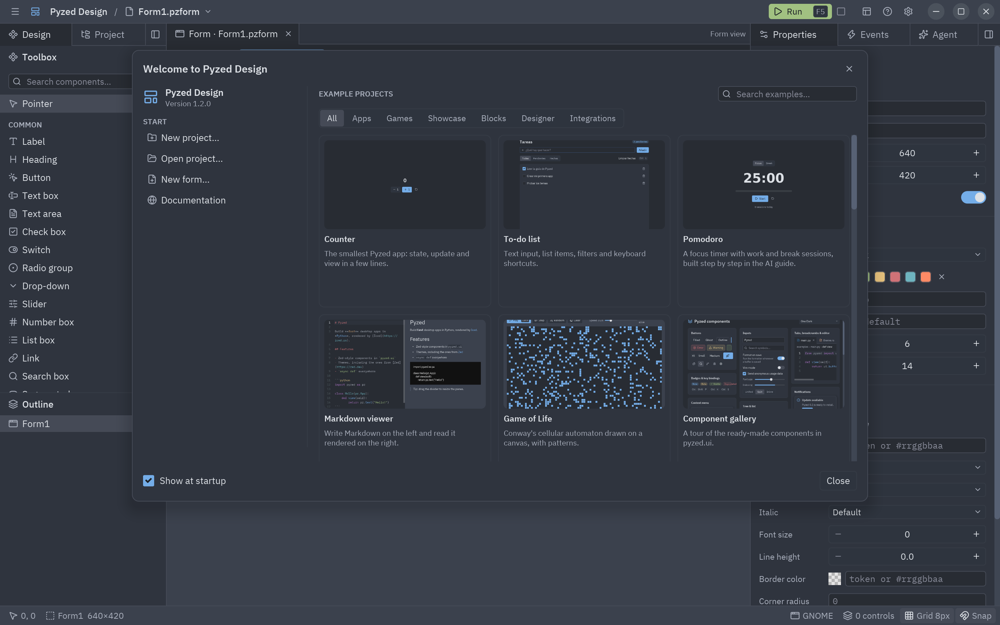
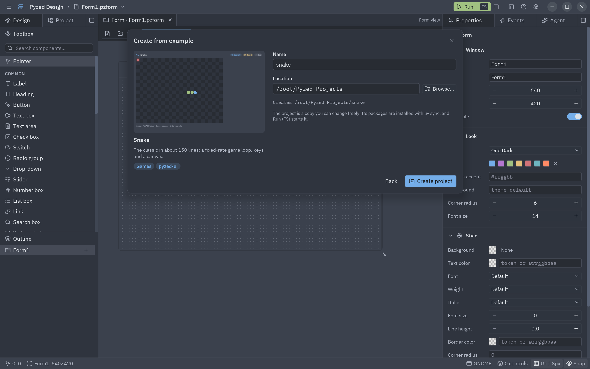

Cuando Pyzed Design se inicia sin un archivo, se abre la **ventana de bienvenida**. A la izquierda puedes empezar un
proyecto nuevo, abrir uno, crear un formulario o leer la documentación, y volver a un proyecto reciente. A la derecha
está la **galería de proyectos de ejemplo**: cada ejemplo tiene una miniatura, un título y una descripción.



Ábrela de nuevo cuando quieras desde **Ayuda → Bienvenida**, o **Ayuda → Proyectos de ejemplo…** para ver todos los
ejemplos. Desmarca **Mostrar al iniciar** (o desactiva **Ventana de bienvenida** en
[Ajustes](/pyzed/es/editor/settings/)) para empezar directamente con un formulario vacío.

## La galería

Las pestañas filtran los ejemplos por categoría y el buscador los filtra por título y descripción:

| Categoría | Ejemplos |
| --- | --- |
| **Apps** | Contador, Lista de tareas, Pomodoro, Visor de Markdown, Juego de la vida, Galería de componentes, Editor estilo Zed. |
| **Juegos** | Snake, Breakout, Neon Invaders. |
| **Vitrina** | Panel de cristal, HUD de juego, Menú principal de juego, Inventario. |
| **Bloques** | Panel de control, Tablero Kanban, Reproductor de música, Chat, Ajustes. |
| **Diseñador** | Formulario de inicio de sesión: un formulario hecho en Pyzed Design, con su código de eventos y componentes. |
| **Integraciones** | Héroes con SQLModel, Registro con Pydantic, PyPI con httpx, Contactos con SQLAlchemy. |

## Crear un proyecto desde un ejemplo

Haz clic en un ejemplo para darle nombre al proyecto nuevo y elegir dónde va (por defecto
`~/Pyzed Projects/<nombre>`; **Examinar…** elige otra carpeta). **Crear proyecto** entonces:

1. copia el ejemplo en la carpeta como un [proyecto de uv](/pyzed/es/editor/projects/) normal, con `pyzed-ui` y los
   paquetes que el ejemplo necesita en `pyproject.toml`;
2. lo abre en el panel Proyecto, con su script (o, en el ejemplo del Diseñador, su formulario principal) delante;
3. instala sus paquetes con `uv sync` en segundo plano.



La copia es tuya: cámbiala a tu gusto, el ejemplo original no se toca.

## Ejecutarlo

Los proyectos creados desde un ejemplo de código tienen un `script` en `[tool.pyzed]`:

```toml
[tool.pyzed]
ui = "ui"
script = "snake.py"
```

Cuando no hay un formulario abierto, **Ejecutar** (<kbd>F5</kbd>) inicia ese script con `uv run` y su salida va a la
[consola](/pyzed/es/editor/console-and-running/). **Ejecutar → Ejecutar el script del proyecto** hace lo mismo en
cualquier momento. Los archivos del proyecto abiertos con cambios sin guardar se guardan antes.

## De dónde salen los ejemplos

La app independiente **Pyzed Design** lleva dentro todos los ejemplos y sus miniaturas (unos 1,5 MB), así que la
galería funciona sin conexión. Un diseñador instalado con pip no los incluye: la galería ofrece **Descargar
ejemplos**, que los baja una vez desde la release de la versión instalada. Crear el entorno del proyecto con
`uv sync` necesita conexión la primera vez, para descargar Python y los paquetes.
