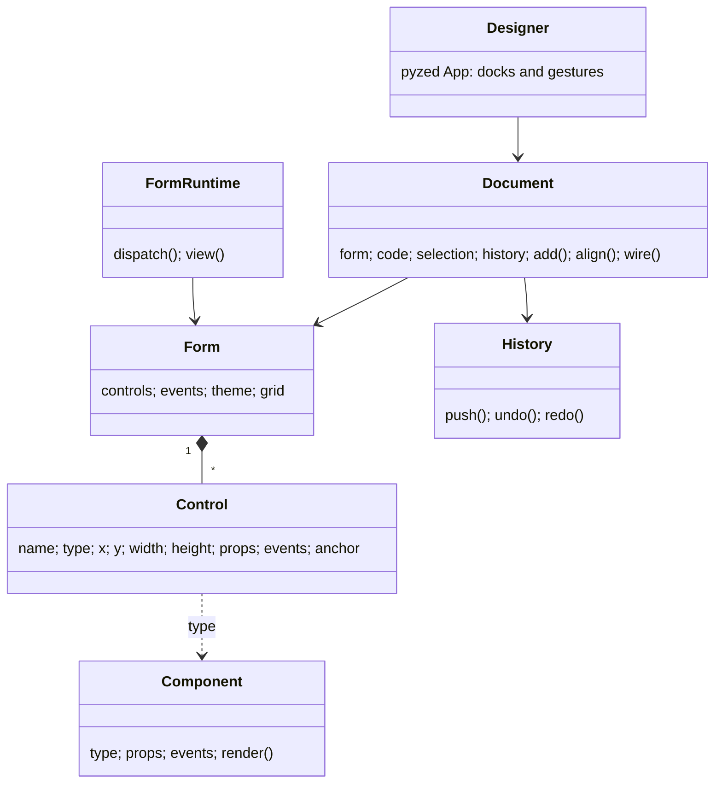

## Pestañas de documentos

Cada archivo abierto es una pestaña sobre la barra de herramientas: `Formulario · login.pzform` o
`Componente · rating.pzcomp` (con un icono de acento). Un punto marca los cambios sin guardar, y el final de la
barra de pestañas dice en qué vista estás: **Vista de formulario** o **Vista de componente**.

- Haz clic en una pestaña para cambiar. Cada documento conserva su selección y su historial de deshacer; al dejar
  una pestaña se aplica y se cierra el editor de código (si el código no se puede analizar, el cambio espera a que
  lo arregles).
- La **×** de una pestaña la cierra. Con cambios sin guardar, un diálogo ofrece **Save**, **Don't save** y
  **Cancel**.
- Abrir un archivo que ya está abierto cambia a su pestaña y conserva sus cambios sin guardar. Un formulario vacío
  sin título que no has tocado se sustituye en lugar de acumular pestañas.
- Doble clic en un [componente diseñado](/pyzed/es/editor/component-designer/) colocado abre su archivo en una
  pestaña.
- Arrastra una pestaña a lo largo de la fila para reordenarla. Sácala de la ventana para abrirla en una **ventana
  propia**, con sus pestañas, su barra de herramientas y su lienzo; arrastra una pestaña sobre otra ventana de
  Pyzed Design para apilarla entre sus pestañas. **Mover la pestaña a una ventana nueva** y **Mover la pestaña a
  la ventana principal** (menú Ver, paleta de comandos) hacen lo mismo sin ratón, también en Wayland, donde las
  apps no saben dónde están sus ventanas.
- Los paneles (Propiedades, Esquema, Código, Eventos...) se quedan en la ventana principal y siguen al documento
  que usaste por última vez. Una ventana que no es la activa muestra su formulario tal cual; su primer clic solo la
  activa, así que un clic nunca cambia un formulario que no estabas mirando. Cerrar una ventana de documento
  devuelve sus pestañas a la ventana principal.

El título de la ventana muestra el documento activo, tras un `●` cuando tiene cambios sin guardar.

## Nuevo formulario

**Nuevo formulario** (<kbd>Ctrl</kbd>+<kbd>N</kbd>, el primer botón de la barra de herramientas o el menú ☰) abre
el diálogo Nuevo. Arriba, **Formulario** o **Componente** elige qué crear (**Nuevo componente**,
<kbd>Ctrl</kbd>+<kbd>Shift</kbd>+<kbd>N</kbd>, lo abre en Componente).


| Campo | Significado |
| --- | --- |
| **Nombre** | El nombre del archivo y el prefijo de los manejadores del formulario. Se propone uno libre (`form1`, `form2`...). |
| **Título** | El título de la ventana (el nombre si está vacío). |
| **Carpeta** | Dónde van los archivos: la carpeta del documento actual o la carpeta `ui/` del proyecto. El diálogo muestra la ruta que va a crear y avisa si ya existe. |
| **Plantilla** | El punto de partida (abajo). |

| Plantilla | Te da |
| --- | --- |
| **En blanco** | Una ventana vacía. |
| **Diálogo** | Un título, un mensaje y una fila con los botones **Cancelar** y **Aceptar** anclada abajo, los dos ya conectados para cerrar la ventana. |
| **Inicio de sesión** | Correo, contraseña, "recordarme", un botón para entrar y una etiqueta de estado en una columna centrada. |
| **Barra lateral** | Botones de navegación en una columna a la izquierda y una columna de contenido a la derecha. |
| **Ajustes** | Opciones con etiqueta (cuadro de texto, desplegable, interruptor, deslizador) en una grilla de dos columnas, con un botón Guardar. |

**Crear** escribe el `.pzform` y su `.py` y los abre. **Formulario sin guardar** abre la plantilla sin escribir
nada: se guarda (pidiendo una ruta) la primera vez que guardes. Los formularios nuevos toman el tamaño de cuadrícula
de los [Ajustes](/pyzed/es/editor/settings/).

## Abrir, guardar y guardar como

- **Abrir…** (<kbd>Ctrl</kbd>+<kbd>O</kbd>, o clic en el nombre del archivo en la barra de título) lista los
  archivos `.pzform` y `.pzcomp` bajo la carpeta de trabajo (saltando `.git`, `.venv`, `node_modules`, `build`...).
  Escribe para filtrar la lista, o escribe una ruta y pulsa <kbd>Enter</kbd>.
- Los archivos **recientes** aparecen al final del menú ☰ (los cinco últimos).
- **Guardar** (<kbd>Ctrl</kbd>+<kbd>S</kbd>) escribe el documento y su archivo de código. Un documento sin título
  pide antes una ruta. Guardar también refresca el formulario que se ejecuta desde <kbd>F5</kbd>.
- **Guardar como…** (<kbd>Ctrl</kbd>+<kbd>Shift</kbd>+<kbd>S</kbd>) pide una ruta nueva, relativa a la carpeta de
  trabajo; la extensión se añade si la omites.

## Los archivos

Un formulario son dos archivos juntos, pensados para guardarse en git:

```
login.pzform   ← disposición: JSON, con diffs legibles
login.py       ← manejadores de eventos: Python normal
```

El archivo `.pzform` guarda los ajustes del formulario y, para cada control, su tipo, posición, tamaño,
propiedades, anclajes y qué manejador llama cada evento:

```json
{
  "format": "pyzed.form/1",
  "form": { "name": "login", "title": "Sign in", "width": 440, "height": 400, "theme": "One Dark", "events": { "load": "form_load" } },
  "controls": [
    { "name": "sign_in", "type": "button", "x": 48, "y": 304, "width": 344, "height": 32,
      "props": { "text": "Sign in", "variant": "solid", "icon": "log-in" },
      "events": { "click": "sign_in_click" }, "anchor": ["left", "top"] }
  ]
}
```

El editor modifica el archivo `.py` con `ast`: encuentra, añade, renombra y sustituye funciones manejadoras sin
tocar el resto del archivo, así que tus imports, funciones auxiliares y comentarios quedan como los escribiste.
También puedes editar el archivo de código en cualquier otro editor; el formulario solo necesita que existan las
funciones manejadoras.

Un componente diseñado también son dos archivos, `rating.pzcomp` (disposición) y `rating.py` (la clase); ver
[Diseñador de componentes](/pyzed/es/editor/component-designer/).

## Añadir tus propios componentes

Registra un componente y aparece en la caja de herramientas, con sus propiedades en la grilla y sus eventos en el
panel Eventos:

```python
from pyzed import ui
from pyzed.designer import Component, Prop, register

register(Component(
    type="rating", label="Rating", icon="star", category="Custom", size=(120, 24),
    props=(Prop("value", "number", 3, min=0, max=5),),
    events=("change",),
    render=lambda control, ctx: ui.label("★" * int(control.props["value"])),
))
```

`render` se usa tanto en el editor (inerte) como al ejecutar; usa `ctx.on(control, "change", "value")` para los
callbacks y el mismo código funciona en los dos. Todas las subclases de `pz.Component` de tu proyecto aparecen
también en la caja de herramientas (ver [Componentes](/pyzed/es/guides/components/)), igual que los componentes que
dibujas en el [diseñador de componentes](/pyzed/es/editor/component-designer/).

## Tus propias plantillas

Las plantillas de Nuevo formulario son datos, no código. Cada una es una carpeta:

```text
toolbar/
├── template.json      {"label": "Toolbar", "icon": "panel-top", "description": "A row of buttons on top.", "order": 10}
├── form.pzform        el formulario de partida: dibújalo en el diseñador y guárdalo aquí
└── handlers.py.tmpl   opcional: el código de los eventos que conecta el formulario (Python)
```

`{title}` en los textos del formulario se cambia por el título del formulario nuevo, y un tamaño pedido en el
diálogo redimensiona el formulario siguiendo los anclajes. Las incluidas están en `pyzed/designer/templates/`.
Carga una carpeta tuya con:

```python
from pyzed.designer import new

new.load_templates("mis_plantillas")   # cada subcarpeta con un template.json
```

Una plantilla también puede ser una función de Python que rellena un formulario vacío:

```python
def toolbar(form):
    ...  # añade controles al formulario vacío

new.register_template(new.Template("toolbar", "Toolbar", "panel-top", "A row of buttons on top.", toolbar))
```

Las plantillas registradas aparecen en el diálogo Nuevo formulario después de las incluidas.

## Formularios desde código

Todo lo que hace el editor está disponible desde Python, algo útil para generar formularios o para tests:

```python
from pyzed import designer
from pyzed.designer import Document

doc = Document(designer.Form(name="hello", title="Hello", width=320, height=140))
doc.add("input", 16, 16, 200, 28)
doc.add("button", 224, 16)
doc.select_all()
doc.align("middle")
handler = doc.wire("button1", "click")
doc.set_handler_source(handler, "def button1_click(form, event):\n    form.button1.text = form.input1.text\n")
doc.save("hello.pzform")

designer.run("hello.pzform")
```

`designer.new_form(path, template="dialog")` crea un formulario y su módulo de manejadores a partir de una plantilla
(en un proyecto, `project.find().new_form("settings")` lo pone en `ui/`). `designer.open_window(form_or_path, data=...)`
devuelve el comando que abre un formulario desde cualquier app, y también acepta un `designer.Form` construido en
código (con `handlers={"name": function}`). La API completa está en la
[referencia del diseñador](/pyzed/es/reference/designer/).

## Cómo está hecho



- `model.py`: el formulario y sus controles, guardados como JSON.
- `components.py`: la biblioteca de componentes y el `render` que comparten el editor y el runtime.
- `geometry.py`: snap, alineación, distribución, redimensionado, anclajes y guías inteligentes (funciones puras).
- `layout.py`: dónde va cada control, incluidos los contenedores flex y grilla.
- `history.py`: deshacer/rehacer como instantáneas; las ediciones repetidas de un campo se juntan en un paso.
- `code.py`: encuentra, añade, renombra y sustituye funciones manejadoras con `ast`.
- `document.py`: cada comando de edición, sin UI, así que se puede probar entero.
- `commands.py`: todos los comandos en una tabla, que leen los menús, la paleta, el teclado y la lista de atajos.
- `docks.py`, `panels.py`, `surface.py`, `dialogs.py`, `console.py`, `project_panel.py`: las vistas.
- `app.py`: la app `Designer`, que conecta clics y teclas con el documento.
- `scene.py`, `scene_code.py`, `scene_runtime.py`, `scene_panel.py`: el diseñador de componentes.
- `runtime.py`: `FormApp` y `FormWindow`, que dibujan un formulario y llaman a sus manejadores.
- `lsp.py`, `intellisense.py`, `code_panel.py`, `settings.py`: el editor de código y sus servidores de lenguaje.
- `preferences.py`, `locale.py`: los ajustes del editor y sus traducciones, leídas de `locales/<idioma>.json`.
- `new.py`: las plantillas de Nuevo formulario, leídas de las carpetas de `templates/`.
