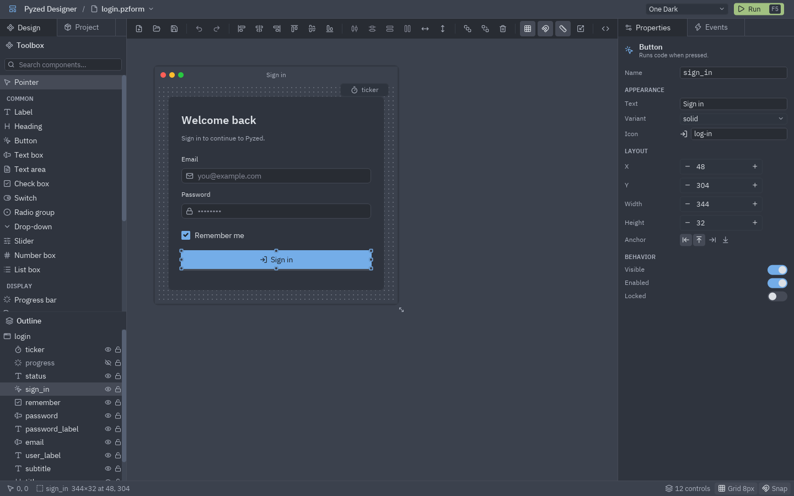
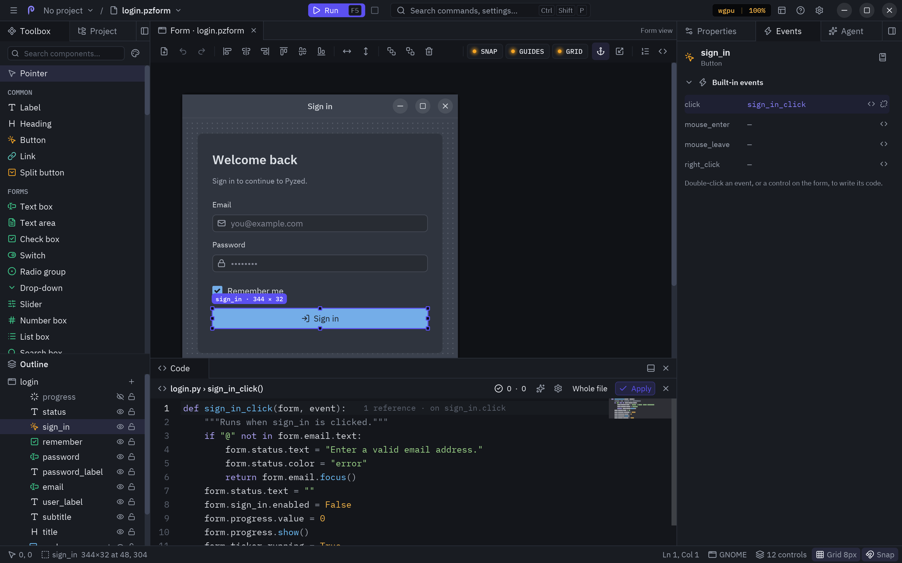
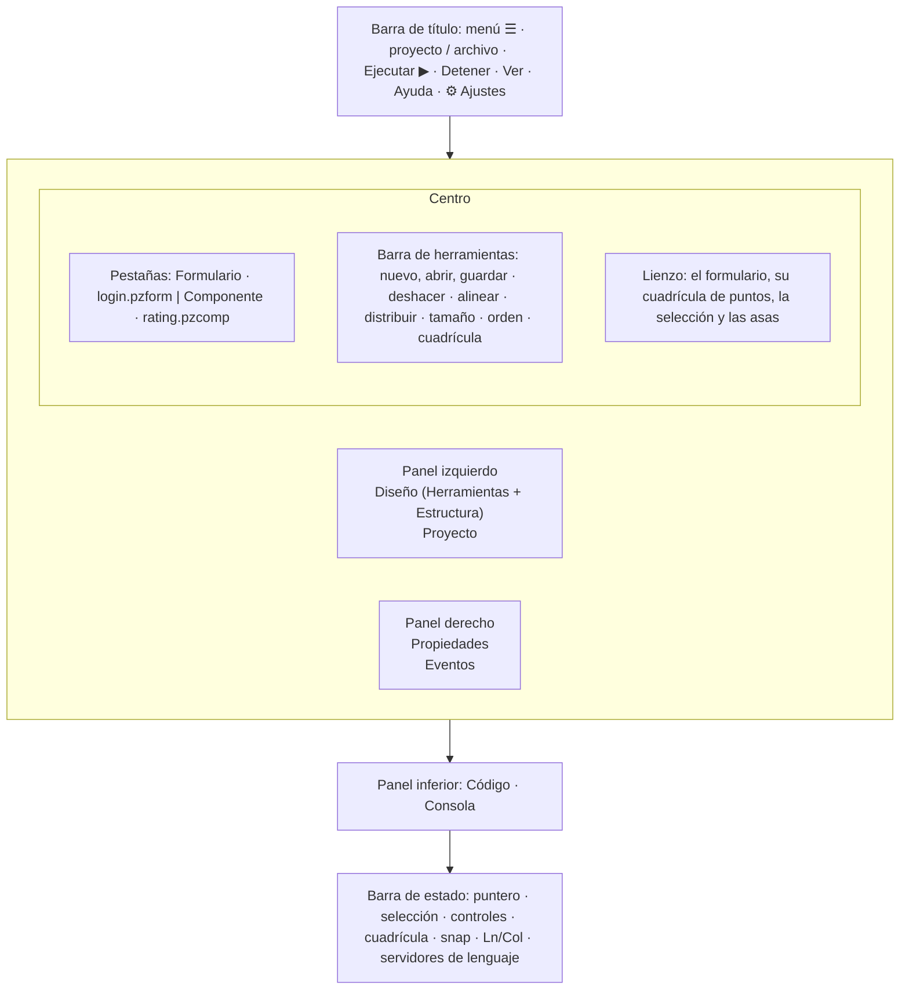
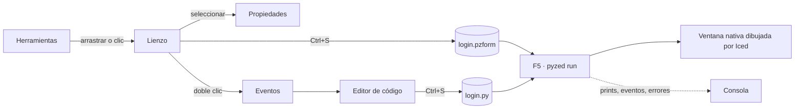

**Pyzed Design** es el editor visual de Pyzed, al estilo de Visual Basic, el diseñador de WinForms de Visual Studio
y Qt Designer, y hecho con el propio Pyzed. Dibujas una ventana con el ratón, ajustas sus propiedades en una
grilla, haces doble clic en un control para escribir el código Python de su evento y pulsas <kbd>F5</kbd> para
ejecutarla con toda su lógica. El mismo editor crea **componentes** reutilizables con propiedades tipadas, métodos y
eventos propios.

Este manual recorre cada zona del editor: qué muestra, qué puedes hacer en ella y los trucos que te hacen ir más
rápido.



## Abrirlo

| Cómo | Qué abre |
| --- | --- |
| `pyzed design` | Dentro de un proyecto: su formulario principal (`[tool.pyzed] main`). Fuera: un formulario vacío sin título. |
| `pyzed design login.pzform` | Ese formulario, o uno nuevo con ese nombre que se crea al guardar por primera vez. |
| `pyzed design ui/rating.pzcomp` | Un [componente diseñado](/pyzed/es/editor/component-designer/) (se crea al guardar si no existe). |
| `python -m pyzed.designer [archivo]` | Lo mismo, sin el comando `pyzed` en el `PATH`. |
| La app **Pyzed Design** | La versión independiente: el editor con su propio Python y `uv`, sin instalar nada más (ver [Proyectos](/pyzed/es/editor/projects/#la-app-independiente)). |

```bash
pip install "pyzed-ui[designer]"   # Pyzed más los servidores de lenguaje ty y ruff
pyzed design login.pzform
```

## Un recorrido por la ventana





| Zona | Para qué sirve | Página del manual |
| --- | --- | --- |
| **Barra de título** | El menú ☰ (Archivo y Ejecutar), el proyecto y el archivo (clic en el archivo para abrir otro), **Ejecutar** y **Detener**, los menús **Ver** y **Ayuda** y el engranaje de **Ajustes**. | [Menús y comandos](/pyzed/es/editor/menus-and-commands/) |
| **Herramientas** | Todos los componentes que puedes colocar, por categoría, con buscador. | [Herramientas y lienzo](/pyzed/es/editor/toolbox-and-canvas/) |
| **Estructura** | Los controles del documento en árbol: seleccionarlos, reordenarlos, anidarlos, ocultarlos y bloquearlos. | [Herramientas y lienzo](/pyzed/es/editor/toolbox-and-canvas/#la-estructura) |
| **Proyecto** | El proyecto de uv: sus formularios, dependencias, ruff, ty y git. | [Proyectos](/pyzed/es/editor/projects/) |
| **Pestañas** | Una por cada formulario o componente abierto. | [Archivos y documentos](/pyzed/es/editor/files-and-scripting/) |
| **Barra de herramientas** | Acciones de archivo, deshacer, alinear, distribuir, igualar tamaños, orden y cuadrícula. | [Herramientas y lienzo](/pyzed/es/editor/toolbox-and-canvas/#alinear-distribuir-e-igualar-tamaños) |
| **Lienzo** | El formulario tal como se ejecutará, con cuadrícula de puntos, selección, asas y guías inteligentes. | [Herramientas y lienzo](/pyzed/es/editor/toolbox-and-canvas/) |
| **Propiedades** | Las propiedades, el estilo, la posición y el comportamiento del control seleccionado (o del formulario). | [Propiedades](/pyzed/es/editor/properties/) |
| **Eventos** | Los eventos del control seleccionado y el manejador conectado a cada uno. | [Eventos y manejadores](/pyzed/es/editor/events/) |
| **Agente** | Un agente de IA que crea formularios y componentes, escribe su código y edita el formulario abierto. | [Agentes de IA](/pyzed/es/editor/ai-agents/) |
| **Código** | Un editor de Python con autocompletado, diagnósticos, code lens, plegado y minimapa. | [Editor de código](/pyzed/es/editor/code-editor/) |
| **Consola** | Lo que imprime el formulario en ejecución, los eventos que atiende y sus errores. | [Ejecutar y la consola](/pyzed/es/editor/console-and-running/) |
| **Barra de estado** | La posición del puntero, el tamaño y lugar de la selección, el número de controles, la cuadrícula y el snap, y mientras programas el cursor y los servidores de lenguaje. | [Ajustes](/pyzed/es/editor/settings/) |

Cada panel vive en un **dock** (izquierdo, derecho, inferior o superior) y se puede mover a otro, redimensionar u
ocultar. Ver [Paneles y docks](/pyzed/es/editor/menus-and-commands/#paneles-y-docks).

## El flujo de trabajo en una imagen



1. **Coloca** componentes desde la caja de herramientas: arrástralos al formulario, o haz clic en uno y luego clic
   (o arrastra un rectángulo) en el formulario.
2. **Ordénalos** con el ratón, el teclado, las guías inteligentes, las herramientas de alineación o un
   [contenedor de disposición](/pyzed/es/editor/layouts/).
3. **Configúralos** en [Propiedades](/pyzed/es/editor/properties/): texto, datos, estilo, anclajes.
4. **Escribe la lógica**: doble clic en un control abre el manejador de su evento principal en el
   [editor de código](/pyzed/es/editor/code-editor/).
5. **Ejecuta** con <kbd>F5</kbd>. La [consola](/pyzed/es/editor/console-and-running/) muestra prints, eventos y
   errores; guardar actualiza la ventana en ejecución.
6. **Reutiliza**: convierte las piezas repetidas en [componentes](/pyzed/es/editor/component-designer/) y
   distribuye la app con `pyzed build`.

## En este manual

- [Proyectos](/pyzed/es/editor/projects/): proyectos de uv, dependencias, ruff, ty y git desde el panel Proyecto.
- [Herramientas y lienzo](/pyzed/es/editor/toolbox-and-canvas/): colocar, seleccionar, mover, redimensionar,
  snap, guías, alineación y la estructura.
- [Propiedades](/pyzed/es/editor/properties/): cada sección de la grilla de propiedades y los editores de listas y
  tablas.
- [Disposición y contenedores](/pyzed/es/editor/layouts/): paneles, filas y columnas flex, grillas y anclajes.
- [Estilos y temas](/pyzed/es/editor/styles-and-themes/): la sección Estilo, el selector de color, degradados y
  temas.
- [Eventos y manejadores](/pyzed/es/editor/events/): todos los eventos y cómo escribir su código.
- [Editor de código](/pyzed/es/editor/code-editor/): autocompletado, diagnósticos, code lens, plegado y sus ajustes.
- [Ejecutar y la consola](/pyzed/es/editor/console-and-running/): F5, la consola, `uv run` y recarga en caliente.
- [Diseñador de componentes](/pyzed/es/editor/component-designer/): componentes reutilizables con props, estado,
  métodos y eventos.
- [Archivos, plantillas y scripting](/pyzed/es/editor/files-and-scripting/): pestañas, archivos `.pzform`,
  plantillas y la API de Python.
- [Menús y comandos](/pyzed/es/editor/menus-and-commands/): cada entrada de menú, la paleta de comandos y los docks.
- [Referencia integrada](/pyzed/es/editor/reference/): la documentación con buscador de cada control y función, con <kbd>Shift</kbd>+<kbd>F1</kbd>.
- [Atajos de teclado](/pyzed/es/editor/keyboard-shortcuts/): la lista completa.
- [Ajustes](/pyzed/es/editor/settings/): las preferencias del editor y del editor de código.
- [Trucos y consejos](/pyzed/es/editor/tips-and-tricks/).
