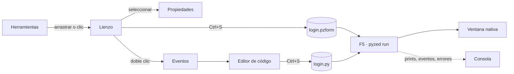

import { Aside, Tabs, TabItem } from '@astrojs/starlight/components';
import NavCards from '../../../../components/NavCards.astro';
import Media from '../../../../components/Media.astro';
import designer from '../../../../../screenshots/designer.png';
import designerLight from '../../../../../screenshots/designer-light.png';

**Pyzed Design** es el editor visual de Pyzed, hecho con el propio Pyzed. Dibujas una ventana con el ratón, ajustas
sus propiedades en una grilla, haces doble clic en un control para escribir el código Python de su evento y pulsas
<kbd>F5</kbd> para ejecutarla con toda su lógica. El mismo editor crea **componentes** reutilizables, **shaders** de
GPU hechos de nodos, y edita el Python de todo tu proyecto.

Se apoya en herramientas que mucha gente ya conoce: el diseñador de formularios de **Visual Basic** y **Qt Designer**
(dibujar, ajustar propiedades, conectar eventos), las escenas y los visual shaders de **Godot**, el panel de detalles
y el editor de materiales de **Unreal Engine**, y una interfaz limpia y cómoda con el teclado inspirada en el editor
de código **Zed**. El objetivo es un framework de frontend para apps de escritorio que puedas usar sin escribir
código, y ampliar con código cuando quieras.

<Media src={designer} light={designerLight} alt="Pyzed Design con el ejemplo de inicio de sesión abierto" caption="Un formulario de inicio de sesión abierto en la vista de formulario." size="wide" eager />

## Abrirlo

Descarga la [app independiente](/pyzed/es/download/) (trae su propio Python y uv), o arráncalo desde un entorno de
Python:

<Tabs syncKey="pkg">
	<TabItem label="uv">
		```bash
		uv add "pyzed-ui[designer]"      # en tu proyecto: Pyzed más los servidores de lenguaje ty y ruff
		uv run pyzed design
		```
	</TabItem>
	<TabItem label="pip">
		```bash
		pip install "pyzed-ui[designer]"
		pyzed design
		```
	</TabItem>
	<TabItem label="python">
		```bash title="macOS / Linux"
		python3 -m pip install "pyzed-ui[designer]"
		python3 -m pyzed design
		```
		```powershell title="Windows (PowerShell)"
		py -m pip install "pyzed-ui[designer]"
		py -m pyzed design
		```
	</TabItem>
</Tabs>

| Comando | Qué abre |
| --- | --- |
| `pyzed design` | Dentro de un proyecto: su formulario principal (`[tool.pyzed] main`). Fuera: la ventana de bienvenida o un formulario vacío. |
| `pyzed design login.pzform` | Ese formulario, o uno nuevo con ese nombre que se crea al guardar por primera vez. |
| `pyzed design ui/rating.pzcomp` | Un [componente](/pyzed/es/editor/component-designer/) (se crea al guardar si no existe). |
| `pyzed design fx/fuego.pzshad` | Un [shader hecho de nodos](/pyzed/es/editor/shader-view/) (se crea al guardar si no existe). |
| `python -m pyzed.designer [archivo]` | Lo mismo, sin el comando `pyzed` en el `PATH`. |

## El flujo de trabajo en una imagen



1. **Coloca** controles desde las herramientas: arrástralos al formulario, o haz clic en uno y luego clic (o arrastra
   un rectángulo) en el formulario.
2. **Ordénalos** con el ratón, el teclado, las guías inteligentes, las herramientas de alineación o un
   [contenedor de disposición](/pyzed/es/editor/layouts/).
3. **Configúralos** en [Propiedades](/pyzed/es/editor/properties/): texto, datos, estilo, anclajes.
4. **Escribe la lógica**: doble clic en un control abre el manejador de su evento principal en el
   [editor de código](/pyzed/es/editor/code-editor/).
5. **Ejecuta** con <kbd>F5</kbd>. La [consola](/pyzed/es/editor/console-and-running/) muestra prints, eventos y
   errores; guardar actualiza la ventana en ejecución.
6. **Reutiliza y distribuye**: convierte las piezas repetidas en [componentes](/pyzed/es/editor/component-designer/)
   y empaqueta la app con `pyzed build` (ver [Distribuir](/pyzed/es/packaging/)).

## Empieza aquí

<NavCards
	items={[
		{ title: 'La interfaz', text: 'Barra de título, menús, docks, paneles, pestañas y barra de estado: cómo se llama y qué hace cada zona.', href: '/pyzed/es/editor/interface/', icon: 'laptop', tag: 'Recorrido' },
		{ title: 'Bienvenida y ejemplos', text: 'La ventana de bienvenida y dos docenas de proyectos de ejemplo para empezar.', href: '/pyzed/es/editor/examples/', icon: 'open-book' },
		{ title: 'Proyectos', text: 'Proyectos de uv, el árbol de archivos, dependencias, ruff, ty y git.', href: '/pyzed/es/editor/projects/', icon: 'seti:folder' },
	]}
/>

## Las vistas

<NavCards
	items={[
		{ title: 'Vistas y documentos', text: 'Formularios, componentes, shaders y código: en qué vista se abre cada uno.', href: '/pyzed/es/editor/views/', icon: 'document' },
		{ title: 'La vista de formulario', text: 'Dibuja una ventana, conecta su primer evento y ejecútala, paso a paso.', href: '/pyzed/es/editor/form-view/', icon: 'pencil', tag: 'Básico' },
		{ title: 'La vista de componente', text: 'Piezas reutilizables con propiedades, estado, métodos y eventos.', href: '/pyzed/es/editor/component-designer/', icon: 'puzzle' },
		{ title: 'La vista Shader', text: 'Efectos de GPU hechos conectando nodos, con vistas previas en vivo.', href: '/pyzed/es/editor/shader-view/', icon: 'star' },
		{ title: 'Editor de código', text: 'Autocompletado, diagnósticos, code lens, cursores múltiples y atajos.', href: '/pyzed/es/editor/code-editor/', icon: 'seti:python' },
	]}
/>

## Diseñar formularios

<NavCards
	min="13rem"
	items={[
		{ title: 'Herramientas y lienzo', text: 'Colocar, seleccionar, mover, ajustar, alinear y la estructura.', href: '/pyzed/es/editor/toolbox-and-canvas/', icon: 'pencil' },
		{ title: 'Propiedades', text: 'Cada sección de la grilla de propiedades.', href: '/pyzed/es/editor/properties/', icon: 'setting' },
		{ title: 'Disposición', text: 'Paneles, filas, columnas, grillas y anclajes.', href: '/pyzed/es/editor/layouts/', icon: 'list-format' },
		{ title: 'Estilos y temas', text: 'Colores, fuentes, degradados y el estilo del formulario.', href: '/pyzed/es/editor/styles-and-themes/', icon: 'moon' },
		{ title: 'Animaciones y efectos', text: 'Brillo, desenfoque, cristal y movimiento al pasar el ratón o hacer clic.', href: '/pyzed/es/editor/animations-and-effects/', icon: 'star' },
		{ title: 'Eventos', text: 'Cada evento y cómo escribir su manejador.', href: '/pyzed/es/editor/events/', icon: 'rocket' },
		{ title: 'Enlace de datos', text: 'Enlaza campos a datos, valida y traduce.', href: '/pyzed/es/editor/data-binding/', icon: 'random' },
	]}
/>

## Ejecutar, archivos, IA y referencia

<NavCards
	min="13rem"
	items={[
		{ title: 'Ejecutar y la consola', text: 'F5, la salida, los errores y la recarga en caliente.', href: '/pyzed/es/editor/console-and-running/', icon: 'right-arrow' },
		{ title: 'Archivos y scripting', text: 'Pestañas, plantillas, el formato .pzform y la API de Python.', href: '/pyzed/es/editor/files-and-scripting/', icon: 'document' },
		{ title: 'Agentes de IA', text: 'Un agente que crea formularios y escribe su código.', href: '/pyzed/es/editor/ai-agents/', icon: 'comment-alt' },
		{ title: 'Menús y comandos', text: 'Cada entrada de menú y la paleta de comandos.', href: '/pyzed/es/editor/menus-and-commands/', icon: 'list-format' },
		{ title: 'Atajos de teclado', text: 'La lista completa.', href: '/pyzed/es/editor/keyboard-shortcuts/', icon: 'pencil' },
		{ title: 'Ajustes', text: 'Temas, lienzo, ejecución, paneles y telemetría.', href: '/pyzed/es/editor/settings/', icon: 'setting' },
	]}
/>

<Aside type="note" title="Estado de este manual">
Cada panel y cada vista tiene su página, escrita para la versión actual. Se están añadiendo capturas nuevas y
grabaciones cortas de cada zona; hasta que una página las tenga, usa las capturas de la versión anterior, que pueden
diferir en detalles pequeños como la barra de título.
</Aside>
