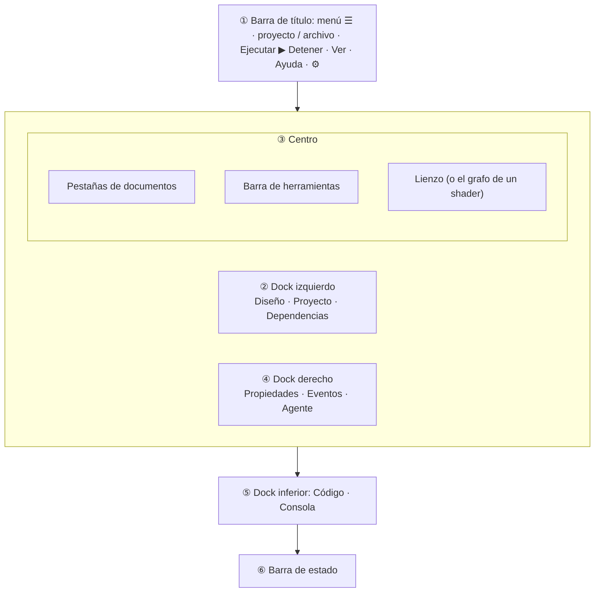

import { Aside, Tabs, TabItem } from '@astrojs/starlight/components';
import NavCards from '../../../../components/NavCards.astro';
import Media from '../../../../components/Media.astro';
import designer from '../../../../../screenshots/designer.png';
import designerLight from '../../../../../screenshots/designer-light.png';
import fileMenu from '../../../../../screenshots/editor-file-menu.png';
import dockMenu from '../../../../../screenshots/editor-dock-menu.png';

Pyzed Design es una ventana dividida en unas pocas zonas, y cada zona tiene una sola tarea. Cuando conozcas sus
nombres, el resto del manual se lee solo. La disposición toma ideas de editores que mucha gente ya conoce: los paneles
y la barra de título se inspiran en el editor de código [Zed](https://zed.dev), el lienzo del formulario y la grilla
de propiedades en Visual Basic y Qt Designer, y las ideas de nodos y escenas en Godot y Unreal Engine.

<Media src={designer} light={designerLight} alt="Pyzed Design con un formulario de inicio de sesión abierto: herramientas y estructura a la izquierda, el formulario en el centro, propiedades a la derecha" caption="Un formulario abierto en Pyzed Design. Cada zona se describe abajo." size="wide" eager />

{/* media: editor/interface-annotated (la ventana con cada zona numerada) */}

## ① La barra de título

La franja de arriba del todo. De izquierda a derecha:

| Elemento | Qué hace |
| --- | --- |
| **☰** | El menú principal: Nuevo, Abrir, Ir a archivo, Guardar, Ajustes, archivos recientes y los comandos de Ejecutar. |
| **Nombre del proyecto** | El proyecto abierto (o *Pyzed Design* si no hay ninguno). Haz clic para mostrar el panel **Proyecto**. |
| **/ nombre de archivo ⌄** | El documento que está delante. Haz clic para abrir otro formulario, componente o shader. |
| **●** | Aparece cuando el documento tiene cambios sin guardar. |
| Insignia **Componente** / **Shader** | Indica en qué [vista](/pyzed/es/editor/views/) estás cuando no es un formulario. |
| **▶ Ejecutar** (<kbd>F5</kbd>) | Ejecuta el formulario, previsualiza el componente o abre el shader en su propia ventana. |
| **■ Detener** (<kbd>Mayús</kbd>+<kbd>F5</kbd>) | Cierra lo que abrió Ejecutar. Desactivado si no hay nada en marcha. |
| **Ver** (icono de paneles) | Docks, paneles, cuadrícula y guías, vistas previas con otros temas, idiomas y marcos de ventana. |
| **Ayuda** (icono ?) | Atajos, la referencia integrada, la ventana de bienvenida, actualizaciones y Acerca de. |
| **⚙** (<kbd>Ctrl</kbd>+<kbd>,</kbd>) | [Ajustes](/pyzed/es/editor/settings/). |

<Media src={fileMenu} alt="El menú ☰ abierto con los comandos de archivo, Ejecutar y archivos recientes" caption="El menú ☰: comandos de archivo, archivos recientes y Ejecutar." size="narrow" />

Cada entrada de los menús aparece con sus teclas en [Menús y comandos](/pyzed/es/editor/menus-and-commands/). Todo lo
que puedes pulsar en un menú está también en la **paleta de comandos** (<kbd>Ctrl</kbd>+<kbd>Mayús</kbd>+<kbd>P</kbd>):
escribe unas letras de su nombre y pulsa <kbd>Enter</kbd>.

### El marco de la ventana

Por defecto Pyzed Design dibuja su **propio marco de ventana**: la barra de título también contiene los botones de
minimizar, maximizar y cerrar, con el estilo de tu sistema, y los bordes de la ventana sirven para cambiar su tamaño.
Arrastra la barra de título para mover la ventana; haz doble clic para maximizarla. Así la ventana es compacta e
igual en todas las plataformas.

{/* media: editor/window-frames (la misma barra de título con los botones de macOS, Windows 11, GNOME y KDE) */}

<Aside type="tip" title="¿Prefieres el marco de tu sistema?">
Desactiva **Ajustes → Apariencia → Marco de ventana propio** para usar el marco de tu sistema operativo (se aplica la
próxima vez que abras Pyzed Design). Tus apps pueden usar los mismos marcos: mira `ui.window_frame` y `Window.frame`
en la [referencia de la API](/pyzed/es/reference/ui/).
</Aside>

## ② ④ ⑤ Docks y paneles

Los paneles viven en **docks** alrededor del centro: izquierdo, derecho, inferior y uno superior que está vacío hasta
que mueves un panel allí. Cada dock muestra un panel a la vez, con una pestaña por panel.

| Panel | Dock | Para qué sirve | Manual |
| --- | --- | --- | --- |
| **Diseño** | Izquierdo | Las **Herramientas** (todo lo que puedes colocar) sobre la **Estructura** (el árbol de lo colocado). En un shader se convierte en la barra **Shading** y las variables del shader. | [Herramientas y lienzo](/pyzed/es/editor/toolbox-and-canvas/) |
| **Proyecto** | Izquierdo | Los archivos del proyecto en árbol, con búsqueda, estado de git y un menú contextual. | [Proyectos](/pyzed/es/editor/projects/) |
| **Dependencias** | Izquierdo | Paquetes, ruff y ty del proyecto (solo con un proyecto abierto). | [Proyectos](/pyzed/es/editor/projects/) |
| **Propiedades** | Derecho | Todo sobre la selección: texto, tamaño, colores, datos, comportamiento. | [Propiedades](/pyzed/es/editor/properties/) |
| **Eventos** | Derecho | Los eventos de la selección y el manejador Python conectado a cada uno. | [Eventos](/pyzed/es/editor/events/) |
| **Agente** | Derecho | Un agente de IA que crea formularios y componentes y escribe su código. | [Agentes de IA](/pyzed/es/editor/ai-agents/) |
| **Código** | Inferior | El editor de Python, mientras hay un manejador o un archivo abierto. | [Editor de código](/pyzed/es/editor/code-editor/) |
| **Consola** | Inferior | Lo que imprime un formulario en marcha, los eventos que maneja y sus errores. | [Ejecución y consola](/pyzed/es/editor/console-and-running/) |

Qué puedes hacer con ellos:

- **Cambiar** de panel con las pestañas de arriba de cada dock.
- **Mover** un panel: el botón del dock al final de la fila de pestañas abre **Mover *panel* a** izquierdo, derecho,
  inferior o superior.
- **Cambiar el tamaño** de un dock arrastrando su borde que da al lienzo.
- **Ocultar** un dock con su **×**, o alternarlo: <kbd>Ctrl</kbd>+<kbd>B</kbd> (izquierdo),
  <kbd>Ctrl</kbd>+<kbd>Alt</kbd>+<kbd>B</kbd> (derecho), <kbd>Ctrl</kbd>+<kbd>J</kbd> (inferior).
- **Restablecer** todo con **Ver → Restablecer los paneles**. Dónde está cada panel y el tamaño de cada dock se guardan
  con tus ajustes.

<Media src={dockMenu} alt="El menú del dock con Mover Propiedades al dock izquierdo, inferior o superior" caption="Mueve cualquier panel a otro dock desde el botón del dock." size="narrow" />

<Aside type="tip" title="Una disposición para escribir código">
En un portátil, oculta el dock izquierdo (<kbd>Ctrl</kbd>+<kbd>B</kbd>) mientras escribes código y añade controles con
<kbd>Ctrl</kbd>+<kbd>Mayús</kbd>+<kbd>A</kbd> en lugar de las herramientas. En una pantalla ancha, mueve **Eventos** al
dock izquierdo para verlo junto a Propiedades.
</Aside>

## ③ El centro: pestañas, barra de herramientas y lienzo

### Pestañas de documentos y ventanas

Cada archivo abierto es una pestaña: `Formulario · login.pzform`, `Componente · rating.pzcomp`, un shader, un archivo
Python, la referencia o las notas de la versión. El final de la fila de pestañas dice qué vista está delante
(**Vista de formulario**, **Vista de componente**...).

- **Haz clic** en una pestaña para cambiar; cada documento conserva su selección y su historial de deshacer.
- **Arrastra** una pestaña por la fila para reordenarla.
- **Arrastra una pestaña fuera** de la ventana para darle una ventana propia, con sus pestañas, barra de herramientas y
  lienzo. Suéltala sobre otra ventana de Pyzed Design para apilarla allí. **Ver → Mover la pestaña a una ventana
  nueva** y **Mover la pestaña a la ventana principal** hacen lo mismo con el teclado (útil en Wayland, donde las
  apps no pueden saber dónde están sus ventanas).
- Los paneles se quedan en la ventana principal y siguen a la ventana que usaste por última vez. Al cerrar una ventana
  de documento, sus pestañas vuelven a la ventana principal.

{/* media: editor/tab-drag-out (una pestaña arrastrada a su propia ventana, bucle corto) */}

### Barra de herramientas

Bajo las pestañas de un formulario o componente: **Nuevo formulario**, **Abrir**, **Guardar**, **Nuevo componente**;
**Deshacer** y **Rehacer**; las herramientas de **alinear**, **distribuir**, **mismo tamaño** y **centrar**; **Traer
al frente**, **Enviar al fondo** y **Eliminar**; y al final **Cuadrícula**, **Ajustar**, **Guías inteligentes**,
**Redimensionar el contenido con sus anclajes**, **Ajustar la selección a la cuadrícula** y **Editar el código**
(<kbd>F7</kbd>). Las herramientas que no se aplican a la selección aparecen en gris, y cada tooltip muestra su atajo.
Un shader tiene su propia barra; ver [la vista Shader](/pyzed/es/shading/shader-designer/).

### Lienzo

El formulario tal como se verá al ejecutarse, dentro de un marco de ventana, sobre una cuadrícula de puntos. Haz clic
para seleccionar, arrastra para mover, tira de las asas para cambiar el tamaño. Todo está en
[Herramientas y lienzo](/pyzed/es/editor/toolbox-and-canvas/).

<Aside type="note" title="Mira tu formulario en otros sistemas">
**Ver → Vista previa del marco de ventana…** dibuja el formulario dentro del marco de macOS, Windows 11, GNOME, Ubuntu
o KDE Plasma, para comprobar cómo se verá allí sin salir de tu equipo. No cambia nada del formulario.
</Aside>

## ⑥ La barra de estado

La barra de abajo te dice dónde estás y alterna algunas cosas con un clic:

| Elemento | Significado |
| --- | --- |
| `120, 48` | Dónde está el puntero en el formulario, en píxeles. |
| `sign_in 344×32 en 48, 304` | El control seleccionado, su tamaño y posición (o los del formulario, o cuántos hay seleccionados). |
| **Colocando Botón…** | Aparece mientras colocas un control desde las herramientas. |
| Tema / idioma | Aparece mientras previsualizas otro tema o idioma; haz clic para cambiarlo. |
| **macOS**, **Windows 11**... | El marco de ventana que muestra el lienzo; haz clic para elegir otro. |
| **12 controles** | Cuántos controles tiene el documento. |
| **Cuadrícula 8px** · **Ajustar** | Haz clic para activar o desactivar la cuadrícula y el ajuste. |
| `Ln 12, Col 8` · **ty** · **ruff** | Mientras programas: el cursor y el estado de los servidores de lenguaje. |
| **Actualizar a X.Y.Z** | Hay una versión nueva lista; ver [Actualizaciones](/pyzed/es/download/#actualizaciones). |

Ocúltala con **Ver → Barra de estado**.

{/* media: editor/status-bar (la barra de estado con un control seleccionado) */}

## Notificaciones

Mensajes cortos aparecen en una esquina durante unos segundos: guardado, copiado, un cable que no se puede conectar,
un comando que falló... Haz clic en la **×** para cerrar uno; se muestran como mucho cuatro a la vez.

## Abrir páginas e iniciar sesión

Los enlaces del editor (Ayuda → Documentación, la referencia, las páginas de inicio de sesión de los agentes de IA) se
abren en tu navegador predeterminado. Cuando Pyzed Design se ejecuta dentro de **WSL** en Windows, se abren en el
navegador de Windows, sin que aparezca una ventana de consola, salvo que elijas otro con la variable `BROWSER`.

## Siguiente

<NavCards
	items={[
		{ title: 'Vistas', text: 'Formulario, componente, shader y código: cómo es cada tipo de documento.', href: '/pyzed/es/editor/views/', icon: 'document' },
		{ title: 'La vista de formulario', text: 'Dibuja una ventana paso a paso y conecta su primer evento.', href: '/pyzed/es/editor/form-view/', icon: 'pencil' },
		{ title: 'Menús y comandos', text: 'Cada entrada de menú, la paleta de comandos y la barra de herramientas.', href: '/pyzed/es/editor/menus-and-commands/', icon: 'list-format' },
	]}
/>
