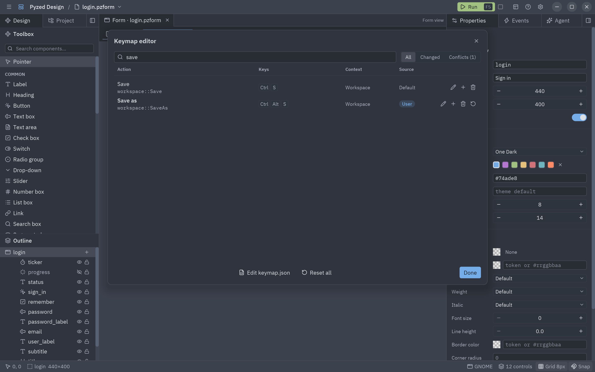
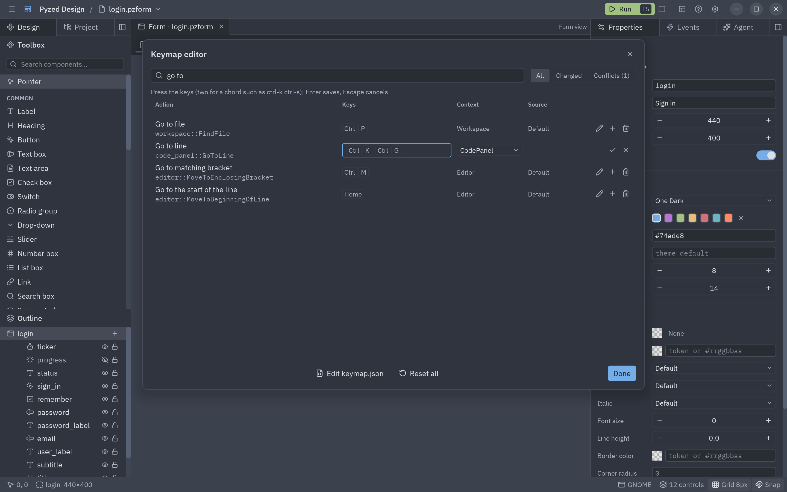
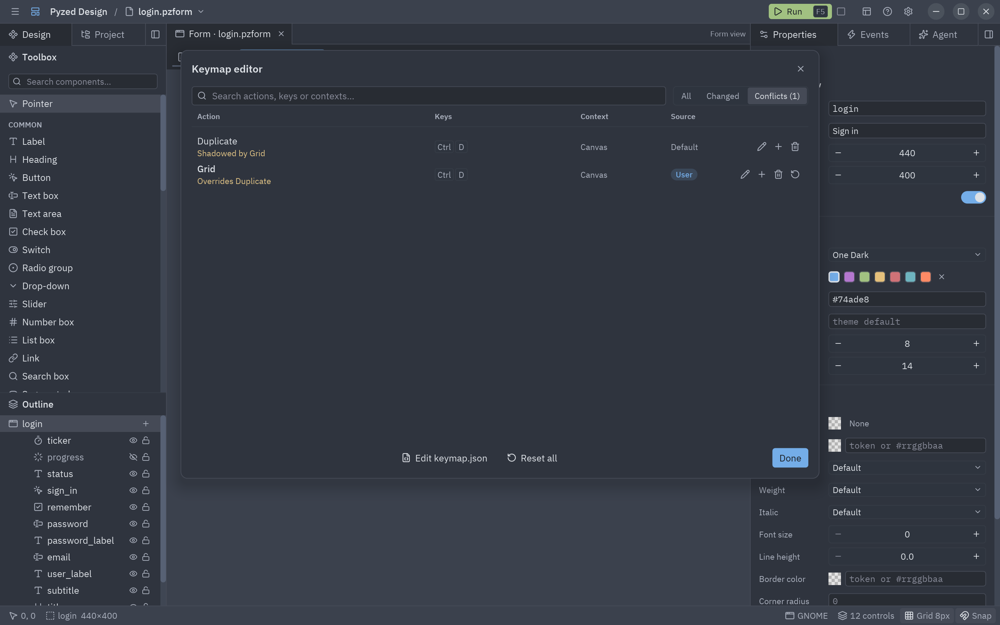

Todas las teclas de Pyzed Design salen de un solo keymap, como en Zed: los menús, la paleta de comandos, el lienzo,
el árbol del proyecto, el panel de código y el propio editor de código. Puedes cambiar cualquiera, dar más teclas a
una acción, quitarlas y volver a las de fábrica, desde una ventana o editando un archivo.

## El editor de keymap

Ábrelo con **Archivo → Editor de keymap**, <kbd>Ctrl</kbd>+<kbd>K</kbd> <kbd>Ctrl</kbd>+<kbd>S</kbd> (una tras otra),
**Ajustes → Atajos de teclado** o **Ajustes del editor → Atajos de teclado**.



Cada fila es una acción con una de sus teclas:

- **Acción**: su nombre y el que tiene en `keymap.json` (`workspace::SaveAs`).
- **Teclas**: las teclas que la ejecutan, o un guion si no tiene.
- **Contexto**: dónde funcionan las teclas (mira [Contextos](#contextos)).
- **Origen**: **Predeterminada**, o **Usuario** para las teclas que pusiste tú.

Escribe en el buscador para filtrar por nombre, teclas o contexto. **Cambiadas** muestra solo las acciones que
cambiaste y **Conflictos** las teclas que ejecutan dos acciones en el mismo lugar.

### Cambiar teclas

1. Haz clic en el lápiz de una fila (o en **+** para darle otra tecla más a la acción).
2. Pulsa las teclas nuevas. Para un acorde, pulsa dos una tras otra, como <kbd>Ctrl</kbd>+<kbd>K</kbd> y luego <kbd>Ctrl</kbd>+<kbd>G</kbd>.
3. Elige el contexto si deben funcionar en otro lugar.
4. Pulsa <kbd>Intro</kbd> (o la marca) para guardar, o <kbd>Escape</kbd> para cancelar.



Mientras grabas, la línea sobre la lista avisa si esas teclas ya ejecutan otra acción en ese contexto.

:::tip
La papelera quita las teclas, la flecha devuelve las teclas de fábrica de la acción y **Restablecer todo** devuelve
todas.
:::

### Conflictos

Cuando las mismas teclas ejecutan dos acciones en el mismo contexto, las dos filas lo dicen. Gana la última: la tuya
sobre la de fábrica. La fila de la acción que se ejecuta dice **Reemplaza a**, y la otra **Tapada por**.



## Contextos

Un contexto es la parte del diseñador que tiene el teclado. Las teclas se buscan desde el contexto más interno hasta
**Workspace**, así que las mismas teclas pueden hacer cosas distintas en sitios distintos: <kbd>Ctrl</kbd>+<kbd>N</kbd>
es **Nuevo formulario** en cualquier lado, pero **Nuevo archivo** en el árbol del proyecto.

| Contexto | Dónde | Dentro de |
| --- | --- | --- |
| `Workspace` | En todo el diseñador | (el más externo) |
| `Canvas` | El lienzo del formulario, tras hacer clic en el formulario o en un control | Workspace |
| `ProjectPanel` | El árbol del proyecto | Workspace |
| `CodePanel` | El panel de código: autocompletado, buscar, ir a la línea, ajuste de línea | Workspace |
| `Editor` | El texto del editor de código | CodePanel |

:::note
En el contexto `Editor` un acorde debe empezar con <kbd>Ctrl</kbd>+<kbd>K</kbd>, como los acordes del propio editor.
Dentro del editor, <kbd>Ctrl</kbd>+<kbd>K</kbd> espera la segunda tecla del editor, así que desde ahí abre el editor
de keymap con el menú.
:::

## El archivo keymap.json

Tus cambios se guardan en `keymap.json`, junto a los ajustes del diseñador:

| Sistema | Carpeta |
| --- | --- |
| Windows | `%APPDATA%\pyzed` |
| macOS | `~/Library/Application Support/pyzed` |
| Linux | `~/.config/pyzed` (o `$XDG_CONFIG_HOME/pyzed`) |

`PYZED_CONFIG_DIR` cambia la carpeta. **Editar keymap.json** en el editor de keymap lo abre en el panel de código, y
se aplica en cuanto lo guardas.

Usa el formato de Zed: una lista de bloques, cada uno con un `context` y sus `bindings` de teclas a una acción. `null`
quita una tecla de fábrica. Se admiten comentarios (`//`) y comas finales.

```json
// Atajos de Pyzed Design
[
  {
    "context": "Workspace",
    "bindings": {
      "ctrl-alt-s": "workspace::SaveAs",
      "ctrl-shift-s": null
    }
  },
  {
    "context": "Editor",
    "bindings": {
      "ctrl-shift-d": "editor::DuplicateLineDown",
      "ctrl-d": null
    }
  },
  {
    "context": "Canvas",
    "bindings": {
      "ctrl-k ctrl-g": "workspace::Grid"
    }
  }
]
```

- **Las teclas** se escriben como en Zed: modificadores `ctrl`, `alt`, `shift` (`cmd` y `super` cuentan como `ctrl`)
  unidos con `-` a una tecla (`a`, `f2`, `enter`, `space`, `up`, `pageup`...). Un acorde son dos teclas separadas por
  un espacio.
- **Las acciones** se escriben `espacio::Acción`: `workspace::` para los comandos de los menús, `canvas::`,
  `project_panel::`, `code_panel::` y `editor::`. El editor de keymap muestra el nombre de cada acción.

:::caution
Si el archivo tiene un error (una acción, teclas o contexto desconocidos), el resto sigue funcionando y el editor de
keymap muestra los problemas arriba.
:::

En versiones anteriores, las teclas del editor de código se guardaban en `"keymap"` dentro de `designer.json`. El
diseñador las pasa a `keymap.json` la primera vez que arranca.

## En tus propias apps

El componente editor de código acepta el mismo tipo de keymap: `ui.editor(keymap={"ctrl-shift-d": "duplicate_line_down",
"ctrl-d": None})`. Mira [el componente editor de código](/pyzed/es/components/code/#varios-cursores-y-los-atajos-de-zed).
