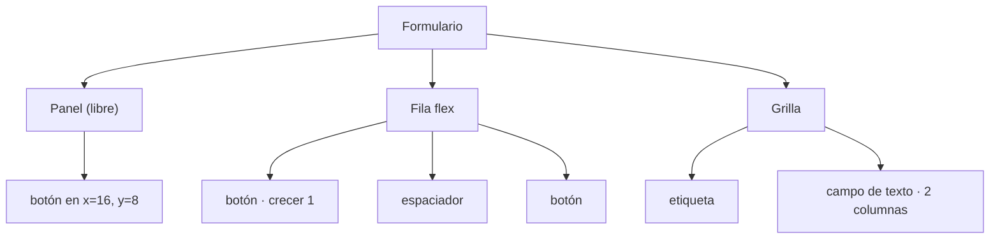

Los controles pueden estar directamente en el formulario, en posiciones fijas, o dentro de **contenedores** que los
colocan por ti. El mismo código de disposición se ejecuta en el editor y en la app, así que lo que ves al diseñar es
lo que obtienes.


## Los tres tipos de contenedor

| Tipo | Componentes | Cómo coloca a sus hijos |
| --- | --- | --- |
| **Libre** | Panel, Marco (group box), Tarjeta | Donde los sueltas, en coordenadas relativas al contenedor. Sus anclajes siguen los bordes del contenedor. |
| **Flex** | Fila flexible, Columna flexible | Uno tras otro, como flexbox de CSS. |
| **Grilla** | Grid | En celdas, de izquierda a derecha y de arriba abajo. |
| **Dock** | Dock | Solo paneles del dock, cada uno en su lado bajo una fila de pestañas (mira [Dock](#dock)). |



## Meter controles en un contenedor

- **Suelta** un control sobre un contenedor (se ilumina con un marco de acento mientras arrastras): desde la caja
  de herramientas, desde el lienzo o desde la estructura.
- **Dibuja** un control nuevo dentro: elige un componente y haz clic o arrastra dentro del contenedor.
- **Add inside…**: el **+** de la fila del contenedor en la estructura, o su menú contextual, abre la lista Añadir
  control.
- **Agrupa**: selecciona algunos controles y pulsa <kbd>Ctrl</kbd>+<kbd>G</kbd> para meterlos en un panel invisible
  que los envuelve justo, sin moverlos. <kbd>Shift</kbd>+<kbd>A</kbd> (**Añadir auto layout**) los envuelve en una
  fila o columna flex, deducida de cómo están colocados. **Editar → Agrupar en una fila / columna / cuadrícula**
  (paleta) y el menú contextual ofrecen todos los tipos, también **Group in a panel**.
- **Desagrupa**: <kbd>Ctrl</kbd>+<kbd>Shift</kbd>+<kbd>G</kbd> sobre un contenedor saca sus hijos y lo quita.
  Conservan el sitio y el tamaño que tenían en el lienzo, incluso los que una fila flex estiraba.
- **Saca**: arrastra el control al formulario vacío, usa **Move out of *contenedor*** en su menú contextual o la
  flecha junto a **Dentro de** en su sección Posición.

Mover o redimensionar un contenedor mueve a sus hijos con él, y copiar, cortar, pegar, duplicar y borrar se los
llevan. Un contenedor no se puede soltar dentro de sí mismo ni de sus hijos.

## Fila flex y columna flex

| Propiedad | Significado |
| --- | --- |
| **Dirección** | `row` (de izquierda a derecha) o `column` (de arriba abajo). Una fila flex y una columna flex son el mismo contenedor con otro valor por defecto. |
| **Separación** | Espacio entre hijos, en píxeles. |
| **Relleno** | Espacio entre el borde del contenedor y sus hijos: un número para todos los lados, dos (vertical y horizontal) o cuatro (arriba, derecha, abajo, izquierda). |
| **Justificar** | Dónde van los hijos en el eje principal cuando sobra espacio: `start`, `center`, `end`, `space-between`, `space-around`, `space-evenly`. |
| **Alineación** | En el eje cruzado: `stretch` (llenar), `start`, `center`, `end`. |
| **Fondo** | Un color detrás de los hijos. |

La sección **Auto layout** del panel Propiedades edita todo esto como Figma: una dirección, una caja de 3×3 de
**Alineación** (haz clic donde quieres los hijos), la separación (o una forma de repartirlos), el relleno y **Llenar
a lo ancho**. Ver [Propiedades](/pyzed/es/editor/properties/#auto-layout).

Cada hijo dice en su sección Posición si su **Ancho** y su **Alto** son **Fijo** (su propio tamaño) o **Llenar** (el
sitio que deja el contenedor); un hijo que llena a lo ancho ignora la **Alineación** del contenedor para sí mismo
(`align_self` en el `.pzform`). Cada hijo recibe además un campo **Crecer** en su sección Posición: la parte del espacio libre que ocupa (0 mantiene su
tamaño). Dos hijos con crecer 1 se reparten el espacio libre a medias; 2 y 1, en tercios. Cuando los hijos no caben,
todos encogen en proporción a su tamaño, como `flex-shrink` de CSS.

Un **Espaciador** (Spacer) es un control vacío con crecer 1: ponlo entre dos botones y el segundo queda empujado al
final de la fila.

## Grilla

| Propiedad | Significado |
| --- | --- |
| **Columnas** | Número de columnas del mismo ancho. |
| **Separación** | Espacio entre celdas, en los dos sentidos. |
| **Relleno** | Espacio por dentro del borde del contenedor. |
| **Alto de fila** | Alto de cada fila; **0** reparte el alto del contenedor entre las filas. |
| **Alineación** | Cómo se coloca un hijo en su celda: `stretch` la llena; si no, `start`, `center` o `end` con su propio tamaño. |
| **Fondo** | Un color detrás de las celdas. |

Cada hijo recibe **Columnas**: cuántas columnas ocupa (1 a 24). Un hijo que no cabe en lo que queda de fila empieza
una nueva.

## Dock

Un **Dock** (categoría Disposición) es la disposición de Zed y del propio Pyzed Design: un área central con paneles
a la izquierda, a la derecha, arriba y abajo. Un Dock nuevo trae tres **Paneles del dock**: Explorer a la izquierda,
Terminal abajo y Editor en el centro. Suelta controles en un panel como en cualquier contenedor libre (los anclajes
funcionan dentro).

| Dónde | Propiedad | Significado |
| --- | --- | --- |
| Panel del dock | **Título**, **Icono** | Lo que muestra su pestaña. |
| Panel del dock | **Lado** | `left`, `right`, `top`, `bottom` o `center` (sin pestaña, entre los demás). |
| Dock | **Ancho izquierdo**, **Ancho derecho**, **Alto superior**, **Alto inferior** | El tamaño de cada lado, con las pestañas. |
| Dock | **Distribución guardada** | Dónde dejó el usuario los paneles (se rellena al ejecutar; guárdala con un componente Ajustes). |

Los paneles del mismo lado comparten su sitio como pestañas; el de más arriba (el último en el orden del esquema) es
la pestaña visible, así que usa **Traer al frente** o el esquema para editar los demás. Al ejecutar el formulario,
las pestañas cambian de panel, arrastrar una pestaña a otro lado la mueve allí, el clic derecho en una pestaña ofrece
los mismos movimientos y arrastrar el borde interior de un lado cambia su tamaño. Cada cambio lanza el evento
`layout` del dock con la distribución nueva.

```python
def dock1_layout(form, event):
    """Se ejecuta al mover, redimensionar o cambiar un panel de dock1."""
    form.status.text = f"Lado izquierdo: {event.value['sizes'].get('left', 220):.0f} px"
```

## El orden de los hijos

En un contenedor flex o grilla importa el orden, no la posición: los hijos no tienen X ni Y. Para reordenarlos,
arrastra un hijo dentro del contenedor en el lienzo (cae en el sitio que hay bajo el puntero) o arrastra su fila en
la estructura, que los lista en orden de disposición.

## Anclajes: disposiciones libres que se adaptan

En el formulario y en los contenedores libres, los **anclajes** deciden qué pasa cuando la ventana (o el contenedor)
cambia de tamaño al ejecutarse, como en WinForms. Anclado a izquierda y derecha, un control se estira; anclado solo a
la derecha, sigue ese borde; sin anclar a ninguno, se queda centrado. Lo mismo en vertical con arriba y abajo.

Se eligen en la sección **Posición** de [Propiedades](/pyzed/es/editor/properties/#posición) en una cuadrícula de
16 presets, como en Unity, Unreal o Godot, y a un control estirado se le puede dar un **tamaño mínimo** y
**máximo** para que deje de crecer en un ancho legible (su **pivote** dice qué lado conserva entonces). El
formulario en ejecución los aplica todos; en código sin el diseñador,
[`pz.anchor_layout`](/pyzed/es/guides/layout/#disposiciones-ancladas) hace lo mismo.

Los anclajes también funcionan mientras diseñas: al cambiar el tamaño del formulario (o de un componente) con su
esquina o con **Ancho** y **Alto**, o al redimensionar un contenedor libre, lo que hay dentro se mueve y se estira
igual que en la ventana en ejecución, con límites de tamaño y pivote incluidos. Desactívalo con el botón del ancla
de la barra de herramientas (**Redimensionar el contenido con sus anclajes**) para cambiar el tamaño sin tocar los
controles.

Una receta habitual para una ventana redimensionable:

1. Una **columna flex** anclada por los cuatro lados llena la ventana.
2. Dentro, filas con **crecer** en la parte que debe quedarse con el espacio extra (un área de texto, una lista).
3. Una **fila flex** abajo con un **espaciador** y los botones, para que queden a la derecha.

:::tip
Las plantillas de **Nuevo formulario** usan estas recetas: *dialog* pone sus botones en una fila anclada a izquierda,
derecha y abajo; *sidebar* usa una columna anclada a izquierda, arriba y abajo junto a otra anclada por todos lados;
la plantilla *settings* es una grilla de dos columnas. Empieza desde una y mira sus propiedades.
:::
