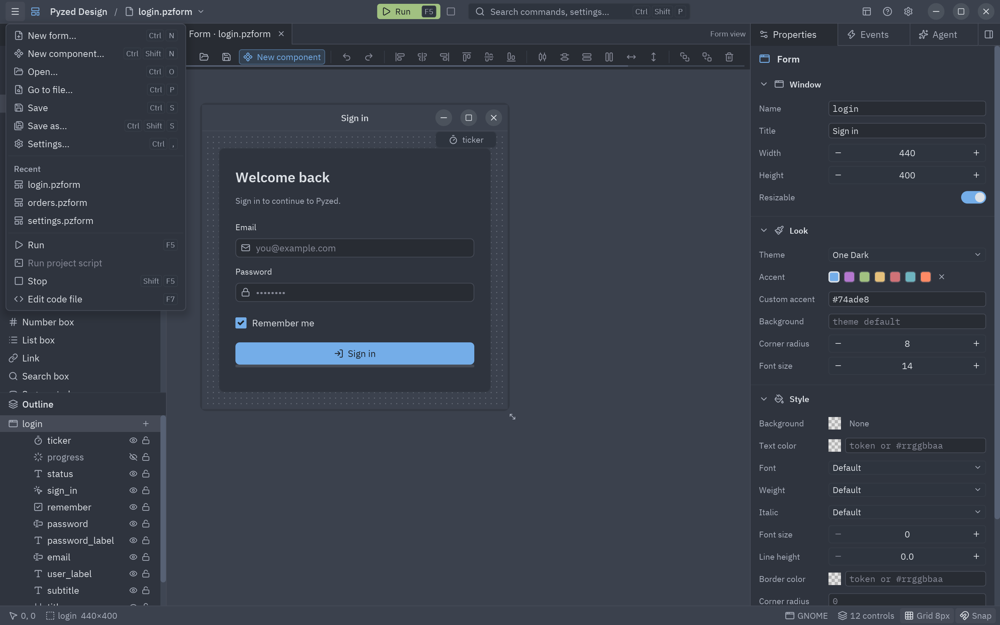
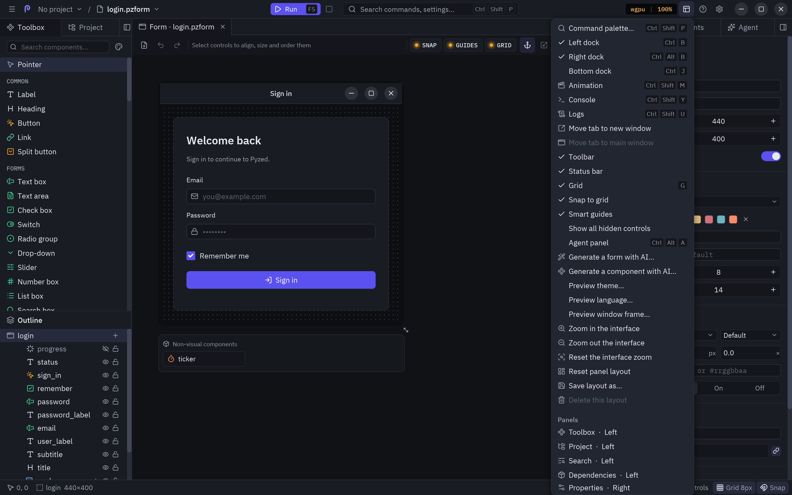
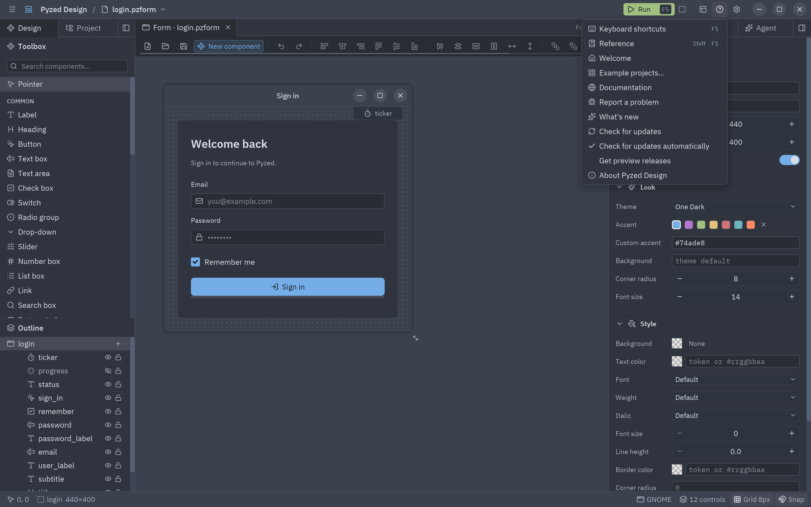
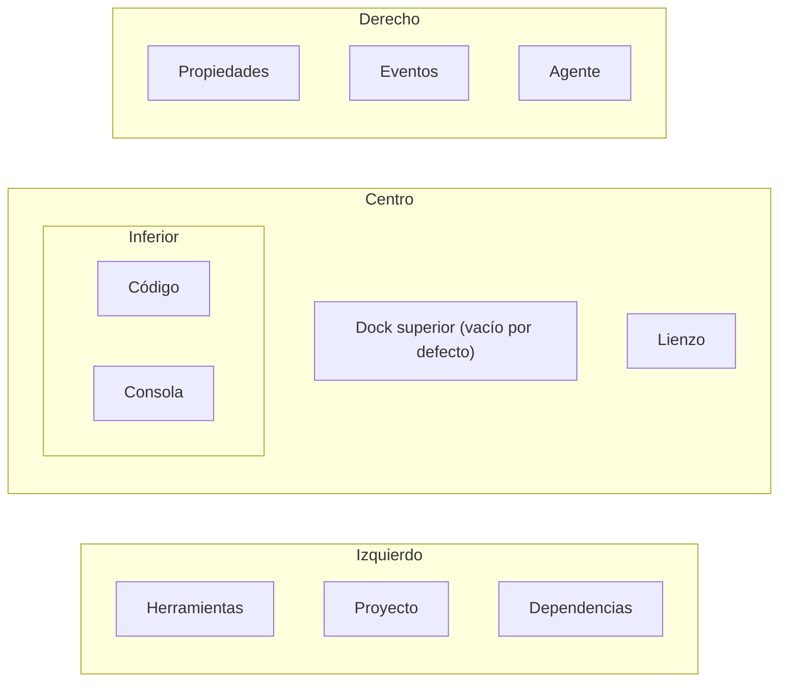

Todos los comandos del editor viven en una sola tabla, así que los menús, la paleta de comandos, el teclado y la
lista de atajos siempre coinciden. Esta página los recoge todos.

## La barra de título

De izquierda a derecha: el menú **☰**, el entorno en WSL, el nombre del proyecto (clic para abrir el selector de
proyectos: los de esta ventana y los recientes), la rama de git (clic para cambiarla), el nombre del
archivo (clic para abrir otro), un punto cuando hay cambios sin guardar y una insignia **Componente** o **Shader** en
esas vistas. En el centro: **Ejecutar** (<kbd>F5</kbd>), **Detener** y el buscador, que abre la
[paleta de comandos](#paleta-de-comandos). A la derecha: el menú **Ver**, el menú **Ayuda** y el engranaje de **Ajustes**, seguidos de los botones de la ventana cuando Pyzed Design dibuja su propio marco (ver
[La interfaz](/pyzed/es/editor/interface/#el-marco-de-la-ventana)).

## Menú ☰ Archivo

| Entrada | Teclas | Hace |
| --- | --- | --- |
| Nuevo formulario… | <kbd>Ctrl</kbd>+<kbd>N</kbd> | El diálogo Nuevo, en Formulario. |
| Nuevo componente… | <kbd>Ctrl</kbd>+<kbd>Shift</kbd>+<kbd>N</kbd> | El diálogo Nuevo, en Componente. |
| Abrir… | <kbd>Ctrl</kbd>+<kbd>O</kbd> | Lista los formularios, componentes, shaders y bibliotecas de animaciones del proyecto; **Examinar…** para cualquier archivo. |
| Abrir proyecto reciente… | <kbd>Ctrl</kbd>+<kbd>Alt</kbd>+<kbd>O</kbd> | El selector de proyectos de la barra de título; ver [Varios proyectos en una ventana](/pyzed/es/editor/projects/#varios-proyectos-en-una-ventana). |
| Ir a un archivo… | <kbd>Ctrl</kbd>+<kbd>P</kbd> | Busca un archivo del proyecto por su nombre y lo abre; ver [Ir a un archivo](/pyzed/es/editor/projects/#ir-a-un-archivo). |
| Guardar | <kbd>Ctrl</kbd>+<kbd>S</kbd> | Guarda el documento y su código. |
| Guardar como… | <kbd>Ctrl</kbd>+<kbd>Shift</kbd>+<kbd>S</kbd> | Guarda en una ruta nueva. |
| Ajustes… | <kbd>Ctrl</kbd>+<kbd>,</kbd> | Los [ajustes](/pyzed/es/editor/settings/). |
| *Recientes* | | Los cinco últimos archivos abiertos. |
| Ejecutar | <kbd>F5</kbd> | [Ejecuta](/pyzed/es/editor/console-and-running/) el formulario o muestra la vista previa del componente. |
| Detener | <kbd>Shift</kbd>+<kbd>F5</kbd> | Cierra el formulario en ejecución. |
| Ejecutar el script del proyecto | | Inicia el `[tool.pyzed] script` del proyecto con `uv run` (ver [Bienvenida y ejemplos](/pyzed/es/editor/examples/#ejecutarlo)). |
| Elegir el archivo de inicio… | | Elige el formulario o script desde el que inicia la app (ver [El archivo de inicio](/pyzed/es/editor/projects/#el-archivo-de-inicio)). |
| Usar este formulario como archivo de inicio | | Hace del formulario abierto el archivo de inicio. |
| Editar el código | <kbd>F7</kbd> | Abre el archivo de código entero en el editor de código. |

## Comandos de edición

Los comandos de Editar no tienen menú propio: están en la barra de herramientas, en el menú contextual del control,
en el teclado y en la paleta de comandos.

| Comando | Teclas |
| --- | --- |
| Deshacer / Rehacer | <kbd>Ctrl</kbd>+<kbd>Z</kbd> / <kbd>Ctrl</kbd>+<kbd>Shift</kbd>+<kbd>Z</kbd> |
| Cortar / Copiar / Pegar | <kbd>Ctrl</kbd>+<kbd>X</kbd> / <kbd>Ctrl</kbd>+<kbd>C</kbd> / <kbd>Ctrl</kbd>+<kbd>V</kbd> |
| Duplicar | <kbd>Ctrl</kbd>+<kbd>D</kbd> |
| Eliminar | <kbd>Supr</kbd> |
| Seleccionar todo | <kbd>Ctrl</kbd>+<kbd>A</kbd> |
| Añadir control… | <kbd>Ctrl</kbd>+<kbd>Shift</kbd>+<kbd>A</kbd> |
| Agrupar en una fila / en una columna / en una cuadrícula | |
| Convertir la sangría a tabulaciones / a espacios | (paleta) el archivo del editor de código; ver [Tabulaciones o espacios](/pyzed/es/editor/code-editor/#tabulaciones-o-espacios) |

## Menú Ver

| Entrada | Teclas | Hace |
| --- | --- | --- |
| Paleta de comandos… | <kbd>Ctrl</kbd>+<kbd>Shift</kbd>+<kbd>P</kbd> | Ejecuta cualquier comando por su nombre. |
| Panel izquierdo / Panel derecho / Panel inferior | <kbd>Ctrl</kbd>+<kbd>B</kbd> / <kbd>Ctrl</kbd>+<kbd>Alt</kbd>+<kbd>B</kbd> / <kbd>Ctrl</kbd>+<kbd>J</kbd> | Muestra u oculta cada dock (marcado cuando se ve). |
| Consola | <kbd>Ctrl</kbd>+<kbd>Shift</kbd>+<kbd>Y</kbd> | Muestra la consola y la mantiene abierta. |
| Logs | <kbd>Ctrl</kbd>+<kbd>Shift</kbd>+<kbd>U</kbd> | Muestra el panel Logs: los eventos y errores del editor. |
| Panel del agente | <kbd>Ctrl</kbd>+<kbd>Alt</kbd>+<kbd>A</kbd> | Muestra u oculta el [agente de IA](/pyzed/es/editor/ai-agents/) (marcado cuando se ve). |
| Generar un formulario con IA… / Generar un componente con IA… | | Abre el agente con el comienzo de una petición ("Crea un formulario nuevo para…") para que la completes. |
| Mover la pestaña a una ventana nueva / Mover la pestaña a la ventana principal | | Abre el documento que está delante en una ventana propia, o lo devuelve a las pestañas de la ventana principal. Ver [Pestañas de documentos](/pyzed/es/editor/files-and-scripting/#pestañas-de-documentos). |
| Barra de herramientas, Barra de estado | | Las muestra u oculta. |
| Cuadrícula | <kbd>G</kbd> | Muestra u oculta la cuadrícula de puntos. |
| Ajustar a la cuadrícula | | Activa o desactiva el snap. |
| Guías inteligentes | | Activa o desactiva las guías de alineación. |
| Mostrar todos los controles ocultos | | Dibuja atenuados en el lienzo todos los controles ocultos. Apagado, uno oculto solo aparece mientras está seleccionado. |
| Vista previa del marco de ventana… | | Muestra el formulario en el lienzo con el marco de ventana de otra plataforma: macOS, Windows 11, GNOME, Ubuntu o KDE Plasma (marcada mientras no es el de este sistema). |
| Vista previa con tema…, Vista previa con idioma… | | Muestra el lienzo (y la próxima ejecución) con otro tema o idioma sin cambiar el formulario (marcada mientras está activa). Consulta [Vista previa con otro tema o idioma](/pyzed/es/editor/data-binding/#vista-previa-con-otro-tema-o-idioma). |
| Restablecer los paneles | | Devuelve cada panel a su dock y tamaño iniciales y cierra las ventanas de paneles. |
| Guardar la distribución como… | | Guarda con un nombre dónde está cada panel, el tamaño de los docks y las ventanas de paneles. |
| Eliminar esta distribución | | Borra la distribución guardada que está en uso. |
| *Paneles* | | Una entrada por panel, con el dock en el que está (`Propiedades · Derecha`, o `Ventana` si flota): clic para traerlo al frente. |
| *Distribuciones* | | Las distribuciones de trabajo (Por defecto, Programar, Concentración, Eventos y código, Código con los formularios, y las tuyas); la que está en uso aparece marcada. |

Los interruptores se recuerdan entre sesiones.

## Menú Ayuda

| Entrada | Teclas | Hace |
| --- | --- | --- |
| Atajos de teclado | <kbd>F1</kbd> | Una lista con buscador de todos los atajos. |
| Referencia | <kbd>Shift</kbd>+<kbd>F1</kbd> | La [referencia integrada](/pyzed/es/editor/reference/), en la página del control seleccionado o del nombre bajo el cursor. |
| Bienvenida | | La [ventana de bienvenida](/pyzed/es/editor/examples/): empezar o abrir un proyecto, proyectos recientes y la galería de ejemplos. |
| Proyectos de ejemplo… | | La ventana de bienvenida con todos los ejemplos. |
| Documentación | | Abre esta documentación en el navegador. |
| Informar un problema | | Abre el gestor de incidencias. |
| Novedades | | Una pestaña con las notas de esta versión (o de la actualización pendiente de instalar). |
| Buscar actualizaciones | | Busca ahora una versión nueva en GitHub; consulta [Actualizaciones](/pyzed/es/download/#actualizaciones). |
| Buscar actualizaciones automáticamente | | Activa o desactiva la búsqueda diaria (activada por defecto). |
| Recibir versiones preliminares | | Ofrece también las pre-versiones (`X.Y.Z-rc.N`): el canal preview. Ver [Actualizaciones](/pyzed/es/download/#actualizaciones). |
| Acerca de Pyzed Design | | Las versiones de Pyzed, Python e Iced, la plataforma y enlaces. |

## La barra de herramientas

Bajo las pestañas de documentos, en grupos de izquierda a derecha:

1. **Nuevo…** (un formulario, un componente o un shader, a elegir en el diálogo Nuevo), **Deshacer** y **Rehacer**.
2. Con algo seleccionado: **Alinear a la izquierda, los centros, a la derecha, arriba, al medio, abajo**; **Centrar
   horizontal y verticalmente en el formulario**, luego **Distribuir** (tres o más controles) y **Mismo ancho, alto**
   (dos o más); **Traer al frente**, **Enviar al fondo** y **Eliminar**. Sin selección, un aviso ocupa su lugar.
3. Al final, cómo se comporta el lienzo: **Mostrar la cuadrícula**, **Ajustar a la cuadrícula**, **Guías
   inteligentes**, **Redimensionar el contenido con sus anclajes**, **Ajustar la selección a la cuadrícula** y
   **Editar el código**.

**Abrir** y **Guardar** están en el menú ☰ y en <kbd>Ctrl</kbd>+<kbd>O</kbd> y <kbd>Ctrl</kbd>+<kbd>S</kbd>. Cada botón
tiene un tooltip con su atajo, y las herramientas de edición se desplazan de lado cuando la ventana es estrecha. Ocúltala con **Ver → Barra de herramientas**. Ver
[Herramientas y lienzo](/pyzed/es/editor/toolbox-and-canvas/#alinear-distribuir-e-igualar-tamaños).

## Paleta de comandos

El buscador del centro de la barra de título, o <kbd>Ctrl</kbd>+<kbd>Shift</kbd>+<kbd>P</kbd>, abre un buscador sobre
todos los comandos que se pueden ejecutar en ese momento, como `Grupo: Comando` con su atajo, y sobre los lugares del
editor: `Panel: Propiedades` muestra un panel, `Ajustes del editor: Cursor` abre esa
página de los [ajustes del editor](/pyzed/es/editor/code-editor/#ajustes-del-editor) (las teclas están en `Archivo: Editor de keymap`), y `Recientes: login.pzform` abre un archivo reciente. Escribe unas letras (la búsqueda es difusa: `vcu` encuentra
*Ver: Cuadrícula*), <kbd>↑</kbd>/<kbd>↓</kbd> para moverte, <kbd>Enter</kbd> para ejecutar, <kbd>Esc</kbd> para
cerrar. También llega a los comandos que no tienen menú, como los de Editar.

## Añadir control

<kbd>Ctrl</kbd>+<kbd>Shift</kbd>+<kbd>A</kbd> es la paleta de componentes: una lista con búsqueda difusa de todos
los componentes con su categoría. <kbd>Enter</kbd> añade el resaltado, centrado en el formulario, y lo selecciona.
Desde un contenedor (su **+** en la estructura, o **Add inside…**), lo añade dentro de ese contenedor.

## Diálogo de atajos de teclado

<kbd>F1</kbd> lista todos los atajos por grupo (Archivo, Editar, Ver, Ejecutar, Ayuda, Lienzo, Código) con un
buscador. Ver la [tabla completa](/pyzed/es/editor/keyboard-shortcuts/).

## Paneles y docks

Ocho paneles viven en cuatro docks alrededor del lienzo:

| Panel | Dock por defecto | Muestra |
| --- | --- | --- |
| **Herramientas** | Izquierdo | La caja de herramientas y la estructura. |
| **Proyecto** | Izquierdo | Los archivos del proyecto. |
| **Dependencias** | Izquierdo | Dependencias, ruff y ty (solo con un proyecto abierto). |
| **Propiedades** | Derecho | La grilla de propiedades. |
| **Eventos** | Derecho | Los eventos de la selección. |
| **Agente** | Derecho | El [agente de IA](/pyzed/es/editor/ai-agents/). |
| **Código** | Inferior | El editor de código (solo mientras hay un manejador o el archivo abierto). |
| **Consola** | Inferior | La consola (cuando tiene algo que mostrar). |

Cada dock muestra una pestaña a la vez. Al final de la barra de pestañas:

- el **botón del dock** abre un menú para **Mover *panel* a** el dock izquierdo, derecho, inferior o superior, al
  **Centro** (junto a las pestañas de formularios), a una **Ventana nueva**, u **Ocultar el panel**;
- la **×** oculta el dock (vuelve a mostrarlo con su atajo o con el menú Ver).

Cualquier pestaña va a cualquier sitio: arrastra la pestaña de un panel o de un formulario para reordenarla, sobre otra
fila o sobre un dock o el centro para moverla allí, o fuera de la ventana para que flote en una ventana propia; suelta
más pestañas sobre una ventana para apilarlas. El sitio de destino se ilumina mientras arrastras. En una ventana
propia, el botón del dock ofrece **Devolver todo a los paneles laterales** y la **×** hace lo mismo.

Arrastra el borde de un dock que da al lienzo para cambiar su tamaño (cada dock tiene un tamaño mínimo). Dónde está
cada panel, qué docks están ocultos, sus tamaños y las ventanas de paneles se guardan con tus ajustes, y **Ver →
Guardar la distribución como…** los conserva como una distribución de trabajo a la que volver; **Ver → Restablecer los paneles** (o
**Ajustes → Paneles → Restablecer**) vuelve a la disposición inicial.

:::tip
En una pantalla ancha, mueve **Eventos** al dock izquierdo (o al superior) para ver Propiedades y Eventos a la vez;
en una pequeña, oculta el dock izquierdo con <kbd>Ctrl</kbd>+<kbd>B</kbd> mientras programas y usa
<kbd>Ctrl</kbd>+<kbd>Shift</kbd>+<kbd>A</kbd> para añadir controles sin la caja de herramientas.
:::

## Notificaciones

Aparecen mensajes breves en una esquina durante unos segundos: guardado, copiado, abierto, un comando que falló...
Haz clic en la × para descartar uno; se muestran como mucho cuatro a la vez.
