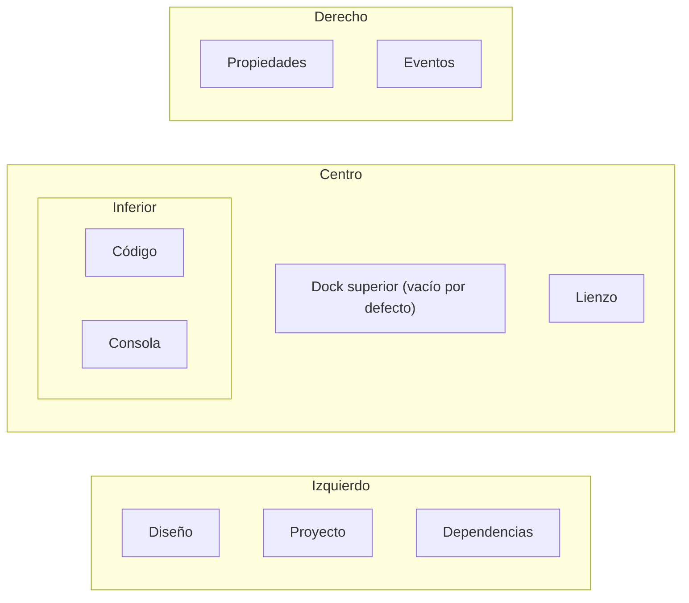

Todos los comandos del editor viven en una sola tabla, así que los menús, la paleta de comandos, el teclado y la
lista de atajos siempre coinciden. Esta página los recoge todos.

## La barra de título

De izquierda a derecha: el menú **☰**, el nombre del proyecto (clic para mostrar el panel Proyecto), el nombre del
archivo (clic para abrir otro), un punto cuando hay cambios sin guardar y una insignia **Componente** en el modo
componente. A la derecha: **Ejecutar** (<kbd>F5</kbd>), **Detener**, el menú **Ver**, el menú **Ayuda** y el
engranaje de **Ajustes**.

## Menú ☰ Archivo

| Entrada | Teclas | Hace |
| --- | --- | --- |
| Nuevo formulario… | <kbd>Ctrl</kbd>+<kbd>N</kbd> | El diálogo Nuevo, en Formulario. |
| Nuevo componente… | <kbd>Ctrl</kbd>+<kbd>Shift</kbd>+<kbd>N</kbd> | El diálogo Nuevo, en Componente. |
| Abrir… | <kbd>Ctrl</kbd>+<kbd>O</kbd> | Lista los formularios y componentes bajo la carpeta de trabajo. |
| Guardar | <kbd>Ctrl</kbd>+<kbd>S</kbd> | Guarda el documento y su código. |
| Guardar como… | <kbd>Ctrl</kbd>+<kbd>Shift</kbd>+<kbd>S</kbd> | Guarda en una ruta nueva. |
| Ajustes… | <kbd>Ctrl</kbd>+<kbd>,</kbd> | Los [ajustes](/pyzed/es/editor/settings/). |
| *Recientes* | | Los cinco últimos archivos abiertos. |
| Ejecutar | <kbd>F5</kbd> | [Ejecuta](/pyzed/es/editor/console-and-running/) el formulario o muestra la vista previa del componente. |
| Detener | <kbd>Shift</kbd>+<kbd>F5</kbd> | Cierra el formulario en ejecución. |
| Editar el código | <kbd>F7</kbd> | Abre el archivo de código entero en el editor de código. |

## Comandos de edición

Los comandos de Editar no tienen menú propio: están en la barra de herramientas, en el menú contextual del control,
en el teclado y en la paleta de comandos.

| Comando | Teclas |
| --- | --- |
| Deshacer / Rehacer | <kbd>Ctrl</kbd>+<kbd>Z</kbd> / <kbd>Ctrl</kbd>+<kbd>Shift</kbd>+<kbd>Z</kbd> |
| Cortar / Copiar / Pegar | <kbd>Ctrl</kbd>+<kbd>X</kbd> / <kbd>Ctrl</kbd>+<kbd>C</kbd> / <kbd>Ctrl</kbd>+<kbd>V</kbd> |
| Duplicar | <kbd>Ctrl</kbd>+<kbd>D</kbd> |
| Eliminar | <kbd>Supr</kbd> |
| Seleccionar todo | <kbd>Ctrl</kbd>+<kbd>A</kbd> |
| Añadir control… | <kbd>Ctrl</kbd>+<kbd>Shift</kbd>+<kbd>A</kbd> |
| Agrupar en una fila / en una columna / en una cuadrícula | |

## Menú Ver

| Entrada | Teclas | Hace |
| --- | --- | --- |
| Paleta de comandos… | <kbd>Ctrl</kbd>+<kbd>Shift</kbd>+<kbd>P</kbd> | Ejecuta cualquier comando por su nombre. |
| Panel izquierdo / Panel derecho / Panel inferior | <kbd>Ctrl</kbd>+<kbd>B</kbd> / <kbd>Ctrl</kbd>+<kbd>Alt</kbd>+<kbd>B</kbd> / <kbd>Ctrl</kbd>+<kbd>J</kbd> | Muestra u oculta cada dock (marcado cuando se ve). |
| Consola | <kbd>Ctrl</kbd>+<kbd>Shift</kbd>+<kbd>Y</kbd> | Muestra la consola y la mantiene abierta. |
| Barra de herramientas, Barra de estado | | Las muestra u oculta. |
| Cuadrícula | <kbd>G</kbd> | Muestra u oculta la cuadrícula de puntos. |
| Ajustar a la cuadrícula | | Activa o desactiva el snap. |
| Guías inteligentes | | Activa o desactiva las guías de alineación. |
| Mostrar controles ocultos | | Dibuja atenuados en el lienzo los controles ocultos, o los omite. |
| Vista previa del marco de ventana… | | Muestra el formulario en el lienzo con el marco de ventana de otra plataforma: macOS, Windows 11, GNOME, Ubuntu o KDE Plasma (marcada mientras no es el de este sistema). |
| Vista previa con tema…, Vista previa con idioma… | | Muestra el lienzo (y la próxima ejecución) con otro tema o idioma sin cambiar el formulario (marcada mientras está activa). Consulta [Vista previa con otro tema o idioma](/pyzed/es/editor/data-binding/#vista-previa-con-otro-tema-o-idioma). |
| Restablecer los paneles | | Devuelve cada panel a su dock y tamaño iniciales. |
| *Paneles* | | Una entrada por panel, con el dock en el que está (`Propiedades · Derecha`): clic para traerlo al frente. |

Los interruptores se recuerdan entre sesiones.

## Menú Ayuda

| Entrada | Teclas | Hace |
| --- | --- | --- |
| Atajos de teclado | <kbd>F1</kbd> | Una lista con buscador de todos los atajos. |
| Referencia | <kbd>Shift</kbd>+<kbd>F1</kbd> | La [referencia integrada](/pyzed/es/editor/reference/), en la página del control seleccionado o del nombre bajo el cursor. |
| Documentación | | Abre esta documentación en el navegador. |
| Informar un problema | | Abre el gestor de incidencias. |
| Novedades | | Una pestaña con las notas de esta versión (o de la actualización pendiente de instalar). |
| Buscar actualizaciones | | Busca ahora una versión nueva en GitHub; consulta [Actualizaciones](/pyzed/es/download/#actualizaciones). |
| Buscar actualizaciones automáticamente | | Activa o desactiva la búsqueda diaria (activada por defecto). |
| Acerca de Pyzed Design | | Las versiones de Pyzed, Python e Iced, la plataforma y enlaces. |

## La barra de herramientas

Bajo las pestañas de documentos, de izquierda a derecha: **Nuevo formulario**, **Abrir**, **Guardar**, **Nuevo
componente**; **Deshacer**, **Rehacer**; **Alinear a la izquierda, los centros, a la derecha, arriba, al medio,
abajo**; **Distribuir horizontalmente, verticalmente**, **Mismo ancho, alto**, **Centrar horizontal y verticalmente
en el formulario**; **Traer al frente**, **Enviar al fondo**, **Eliminar**. Al final: **Mostrar la cuadrícula**,
**Ajustar a la cuadrícula**, **Guías inteligentes**, **Redimensionar el contenido con sus anclajes**, **Ajustar la selección a la cuadrícula** y **Editar el
código**. Cada botón tiene un tooltip con su atajo, los que no se aplican a la selección están deshabilitados y la
barra se desplaza de lado cuando la ventana es estrecha. Ocúltala con **Ver → Barra de herramientas**. Ver
[Herramientas y lienzo](/pyzed/es/editor/toolbox-and-canvas/#alinear-distribuir-e-igualar-tamaños).

## Paleta de comandos

<kbd>Ctrl</kbd>+<kbd>Shift</kbd>+<kbd>P</kbd> abre un buscador sobre todos los comandos que se pueden ejecutar en
ese momento, como `Grupo: Comando` con su atajo. Escribe unas letras (la búsqueda es difusa: `vcu` encuentra
*Ver: Cuadrícula*), <kbd>↑</kbd>/<kbd>↓</kbd> para moverte, <kbd>Enter</kbd> para ejecutar, <kbd>Esc</kbd> para
cerrar. También llega a los comandos que no tienen menú, como los de Editar.

## Añadir control

<kbd>Ctrl</kbd>+<kbd>Shift</kbd>+<kbd>A</kbd> es la paleta de componentes: una lista con búsqueda difusa de todos
los componentes con su categoría. <kbd>Enter</kbd> añade el resaltado, centrado en el formulario, y lo selecciona.
Desde un contenedor (su **+** en la estructura, o **Add inside…**), lo añade dentro de ese contenedor.

## Diálogo de atajos de teclado

<kbd>F1</kbd> lista todos los atajos por grupo (Archivo, Editar, Ver, Ejecutar, Ayuda, Lienzo, Código) con un
buscador. Ver la [tabla completa](/pyzed/es/editor/keyboard-shortcuts/).

## Paneles y docks

Seis paneles viven en cuatro docks alrededor del lienzo:

| Panel | Dock por defecto | Muestra |
| --- | --- | --- |
| **Diseño** | Izquierdo | La caja de herramientas y la estructura. |
| **Proyecto** | Izquierdo | Los archivos del proyecto. |
| **Dependencias** | Izquierdo | Dependencias, ruff y ty (solo con un proyecto abierto). |
| **Propiedades** | Derecho | La grilla de propiedades. |
| **Eventos** | Derecho | Los eventos de la selección. |
| **Código** | Inferior | El editor de código (solo mientras hay un manejador o el archivo abierto). |
| **Consola** | Inferior | La consola (cuando tiene algo que mostrar). |

Cada dock muestra un panel a la vez, con una pestaña por panel. Al final de la barra de pestañas:

- el **botón del dock** abre un menú para **Mover *panel* a** el dock izquierdo, derecho, inferior o superior, u
  **Ocultar el panel**;
- la **×** oculta el dock (vuelve a mostrarlo con su atajo o con el menú Ver).

Arrastra el borde de un dock que da al lienzo para cambiar su tamaño (cada dock tiene un tamaño mínimo). Dónde está
cada panel, qué docks están ocultos y sus tamaños se guardan con tus ajustes; **Ver → Restablecer los paneles** (o
**Ajustes → Paneles → Restablecer**) vuelve a la disposición inicial.

:::tip
En una pantalla ancha, mueve **Eventos** al dock izquierdo (o al superior) para ver Propiedades y Eventos a la vez;
en una pequeña, oculta el dock izquierdo con <kbd>Ctrl</kbd>+<kbd>B</kbd> mientras programas y usa
<kbd>Ctrl</kbd>+<kbd>Shift</kbd>+<kbd>A</kbd> para añadir controles sin la caja de herramientas.
:::

## Notificaciones

Aparecen mensajes breves en una esquina durante unos segundos: guardado, copiado, abierto, un comando que falló...
Haz clic en la × para descartar uno; se muestran como mucho cuatro a la vez.
