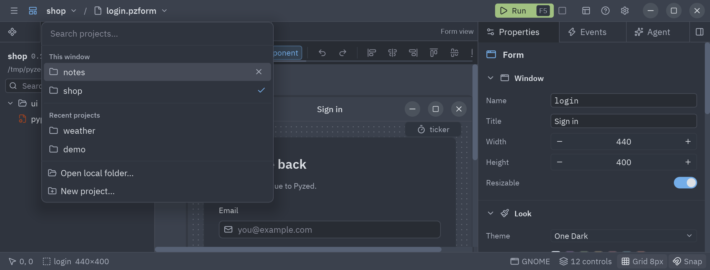

Una app de Pyzed es un proyecto de [uv](https://docs.astral.sh/uv/) normal: la interfaz vive en `ui/`, el backend
en `src/` y uv gestiona las dependencias. El panel **Proyecto** (dock izquierdo, junto a **Diseño**) muestra los
archivos del proyecto, como el explorador de un editor de código, y el panel **Dependencias** de
al lado gestiona paquetes, herramientas y comprobaciones, todo sin salir del editor. El contexto, la estructura de un proyecto y los comandos `pyzed` equivalentes están en
[Proyectos con uv](/pyzed/es/guides/projects/).


## Cómo encuentra el editor tu proyecto

Al arrancar, el editor busca un proyecto de Pyzed (un `pyproject.toml` con una tabla `[tool.pyzed]`) en el archivo
que abriste o por encima, o por encima de la carpeta actual. Si lo encuentra:

- **lo abre** en el panel Proyecto, convierte su carpeta en la de trabajo y lo recuerda entre los proyectos
  recientes;
- **lo activa**, para que formularios y manejadores puedan importar los módulos de `ui/`, el paquete de `src/` y
  cualquier dependencia de su `.venv`;
- **descubre sus componentes**: cada `.pzcomp` del proyecto se suma a la caja de herramientas;
- **comprueba sus herramientas** en segundo plano (uv, git, ruff y ty, con sus versiones);
- **prepara su entorno**, como Zed al abrir un proyecto: si falta uv lo instala con su instalador oficial, y si el
  proyecto todavía no tiene `.venv` ejecuta `uv sync`, que también instala ruff y ty. Una notificación avisa
  cuando el proyecto está listo.

La barra de título muestra entonces el nombre del proyecto, su rama de git y, en un
[worktree de git](https://git-scm.com/docs/git-worktree) enlazado, el nombre del worktree, cada uno por separado,
como en Zed.

## Varios proyectos en una ventana

Haz clic en el nombre del proyecto en la barra de título (o pulsa <kbd>Ctrl</kbd>+<kbd>Alt</kbd>+<kbd>O</kbd>) para
abrir el **selector de proyectos**:




- **Esta ventana** lista los proyectos que abriste en esta ventana; el activo lleva una marca. Haz clic en otro
  para activarlo: el panel Proyecto, Ejecutar, las comprobaciones y el agente de IA pasan a trabajar sobre él. La
  **×** de una fila saca ese proyecto de la ventana.
- **Proyectos recientes** lista los que abriste antes. Haz clic en uno para abrirlo aquí.
- Escribe para filtrar las dos listas, muévete con las flechas y pulsa <kbd>Enter</kbd> para abrir el resaltado.
- **Abrir carpeta local…** y **Nuevo proyecto…**, abajo, abren esos diálogos.

Los formularios siempre pertenecen al proyecto activo: viven en su carpeta `ui/`, y su formulario principal (o su
`script`) es donde arranca la aplicación al pulsar Ejecutar.

:::tip[Ramas]
Haz clic en la rama, junto al nombre del proyecto, para cambiar a otra rama local (`git switch`).
:::

## Entornos y WSL

El editor sabe dónde vive cada proyecto. En WSL la barra de título empieza con la distribución de Linux (*Ubuntu*,
por ejemplo), y los proyectos recientes que viven en una distribución de WSL muestran su nombre al lado. uv, ruff,
ty y git se ejecutan entonces en Linux, las ventanas de tus formularios se abren a través de WSLg y las páginas web
en el navegador de Windows.

El agente de IA recibe lo mismo con cada mensaje: el proyecto activo, su entorno y su rama, y los demás proyectos
abiertos en la ventana, para trabajar sobre el correcto.

## Sin proyecto abierto

Sin proyecto, el panel ofrece **New project** y **Open…**, y lista tus proyectos recientes (clic en uno para
abrirlo).


### Nuevo proyecto

| Campo | Qué hace |
| --- | --- |
| **Name** | El nombre del proyecto y de su carpeta. |
| **Location** | La carpeta donde se crea; el diálogo muestra la ruta completa que va a crear. **Browse…** abre el explorador de carpetas: ve hasta una carpeta y pulsa **Choose this folder**. |
| **Backend in src/** | `uv init --package`: un paquete `src/<nombre>/` que se puede importar desde la UI y desde los tests. Apagado da una estructura plana (`uv init --app`). |
| **Git repository** | Ejecuta `git init` y escribe un `.gitignore`. |

**Create** ejecuta uv en segundo plano y luego abre el proyecto nuevo y su formulario principal. La carpeta de
destino tiene que estar vacía o ser ya un proyecto.

### Abrir un proyecto

**Open…** muestra un explorador de carpetas en lugar de un campo de texto:


- La barra de arriba va a la **carpeta superior** (flecha) o al **inicio**, y cada parte de la ruta se puede
  pulsar. El ojo muestra u oculta las carpetas ocultas.
- El campo de ruta de debajo acepta una carpeta escrita o pegada; <kbd>Enter</kbd> va a ella.
- A la izquierda, los **lugares** habituales (inicio, escritorio, documentos, descargas, los discos) y tus
  proyectos **recientes** (haz clic en uno para abrirlo).
- A la derecha, las carpetas de la actual; haz clic en una para entrar. Las que son proyectos de uv (tienen un
  `pyproject.toml`) llevan la etiqueta **project** y su propio botón **Open**.

**Open**, abajo, abre la carpeta en la que estás cuando es un proyecto. Si el proyecto tiene formulario
principal, se abre en una pestaña.

## El panel del proyecto

### Cabecera

El nombre, la versión y la carpeta del proyecto. A la derecha, la **rama de git** actual, o **Create repository**
cuando la carpeta todavía no es un repositorio (ejecuta `git init` y escribe un `.gitignore`), y un
botón de carpeta que abre otro proyecto.

Mientras se ejecuta un comando, una barra con un indicador dice qué está pasando (`Adding httpx`,
`Syncing the environment`...). Los comandos corren en otro hilo, así que puedes seguir diseñando mientras uv
descarga paquetes.

### Archivos

Debajo de la cabecera, los archivos y carpetas del proyecto en árbol. Las
carpetas se abren y cierran con un clic (`ui/` y `src/` empiezan abiertas); los archivos se colorean según su
estado en git (modificado, nuevo, borrado, conflicto) y las carpetas toman el color de lo que cambió dentro. Los
entornos virtuales, las cachés y la salida de compilación (`.venv`, `__pycache__`, `build`, `dist`...) no se
muestran; los archivos ocultos como `.gitignore`, sí.

Al hacer clic en un archivo se abre donde corresponde:

| Archivo | Se abre |
| --- | --- |
| `.pzform`, `.pzcomp` | En una pestaña del diseñador. |
| El `.py` de un formulario o componente | Su formulario, con el archivo de código entero en el [panel de código](/pyzed/es/editor/code-editor/). |
| Cualquier otro archivo de texto (`.py`, `.toml`, `.md`, `.json`...) | En una pestaña del panel de código, para editarlo ahí mismo. |
| Imágenes y otros archivos binarios | Con la app del sistema para ese tipo de archivo. |


Cada archivo abierto tiene una pestaña en el panel de código, después del código del formulario si está abierto.
El editor resalta la sintaxis según el lenguaje del archivo y tiene buscar y reemplazar
(<kbd>Ctrl</kbd>+<kbd>F</kbd>), ir a una línea (<kbd>Ctrl</kbd>+<kbd>G</kbd>) y todos los atajos de edición; el
autocompletado y los diagnósticos son solo para el código del formulario. Un punto en la pestaña indica cambios sin
guardar: **Save** o <kbd>Ctrl</kbd>+<kbd>S</kbd> (con el foco en el archivo) lo guarda, y al cerrarlo pregunta
antes. Si renombras o borras un archivo en el árbol, su pestaña se actualiza.

La barra sobre el árbol tiene un **buscador** de archivos y carpetas (busca las letras en orden, como el buscador
de archivos de los editores de código, y el nombre del archivo cuenta más que las carpetas: `crt` encuentra `ui/cart.pzform`),
**New file**, **New folder** (en la carpeta seleccionada), **Collapse all** y **Refresh**. El árbol se recarga solo
al guardar y después de los comandos de uv.

**Clic derecho** sobre un archivo o carpeta (o sobre el espacio vacío bajo el árbol, para la carpeta del
proyecto) abre su menú, con las operaciones de archivo habituales de un editor de código:


| Opción | Teclas | Qué hace |
| --- | --- | --- |
| **New File** / **New Folder** | <kbd>Ctrl</kbd>+<kbd>N</kbd> / <kbd>Alt</kbd>+<kbd>N</kbd> | Crea uno en esa carpeta (un archivo nuevo se abre al momento). |
| **Reveal in File Manager** | <kbd>Ctrl</kbd>+<kbd>Alt</kbd>+<kbd>R</kbd> | Lo muestra en Archivos, Finder o el Explorador. |
| **Open in Default App** | <kbd>Ctrl</kbd>+<kbd>Shift</kbd>+<kbd>Enter</kbd> | Abre el archivo con la app del sistema para su tipo. |
| **Open in the code editor** | | Abre cualquier archivo de texto como texto (también el `.py` de un formulario por separado). |
| **Open in Terminal** | | Abre la terminal del sistema en esa carpeta (en Linux, primero `$TERMINAL`). |
| **Cut** / **Copy** / **Paste** | <kbd>Ctrl</kbd>+<kbd>X</kbd> / <kbd>C</kbd> / <kbd>V</kbd> | Lo mueve o lo copia a la carpeta donde pegas; si el nombre está ocupado, añade ` copy`. |
| **Duplicate** | <kbd>Ctrl</kbd>+<kbd>D</kbd> | Lo copia a su lado y pide el nombre de la copia. |
| **Undo** / **Redo** | <kbd>Ctrl</kbd>+<kbd>Z</kbd> / <kbd>Ctrl</kbd>+<kbd>Shift</kbd>+<kbd>Z</kbd> | Deshace o rehace el último archivo o carpeta nuevo, renombrado, movido o copiado aquí. |
| **Copy Path** / **Copy Relative Path** | <kbd>Alt</kbd>+<kbd>Shift</kbd>+<kbd>C</kbd> / <kbd>Ctrl</kbd>+<kbd>Alt</kbd>+<kbd>Shift</kbd>+<kbd>C</kbd> | Copia la ruta completa o la ruta desde la carpeta del proyecto. |
| **Add to .gitignore** / **Add to .git/info/exclude** | | Lo ignora en git, para todos o solo en tu copia. |
| **Open File Permalink** / **Copy File Permalink** | | El enlace en el commit actual de GitHub, GitLab u otro remoto (solo si hay remoto). |
| **Rename** | <kbd>F2</kbd> | Lo renombra. |
| **Trash** | <kbd>Supr</kbd> | Lo mueve a la papelera del sistema, desde donde se puede recuperar. |
| **Delete** | <kbd>Ctrl</kbd>+<kbd>Supr</kbd> | Lo borra para siempre después de preguntar (una carpeta, con todo lo que tiene). |

Las teclas funcionan después de hacer clic en el árbol, junto con <kbd>↑</kbd> <kbd>↓</kbd> para mover la
selección, <kbd>←</kbd> <kbd>→</kbd> para cerrar y abrir carpetas y <kbd>Enter</kbd> para abrir el archivo
seleccionado. Un archivo abierto en el panel de código sigue sus cambios de nombre y de carpeta, y se cierra al
borrarlo (salvo que tenga cambios sin guardar).

### Ir a un archivo

<kbd>Ctrl</kbd>+<kbd>P</kbd> (o **File → Go to file…**) abre una búsqueda sobre todos los archivos y carpetas del
proyecto. Escribe parte de un nombre y pulsa <kbd>Enter</kbd> para el mejor resultado, o haz clic en uno; una
carpeta se muestra en el panel Proyecto.

## El panel Dependencias

Con un proyecto abierto, el dock izquierdo suma un panel **Dependencias** junto a **Proyecto** (si los tres títulos
no caben, los paneles que no se muestran se quedan solo con su icono).


### Dependencias

| Control | Ejecuta |
| --- | --- |
| Campo **Add package** + **+** (o <kbd>Enter</kbd>) | `uv add <paquetes>`. Escribe varios separados por espacios, o una restricción como `httpx>=0.28`. Marca **dev** para el grupo dev. |
| **Lápiz** en una fila | Abre **Change**: escribe un requisito nuevo (`httpx==0.27.2`, `httpx>=0.28,<1`) y aplícalo. |
| **Flecha arriba** en una fila | Actualiza ese paquete dentro de su restricción. |
| **Papelera** en una fila | `uv remove` del grupo en el que está. |
| **Recargar** en la cabecera de la sección | `uv sync`: hace que `.venv` coincida con `uv.lock`. |
| **Lupa** en la cabecera de la sección | **Check for updates**: busca versiones nuevas; las filas que tienen una muestran `↑versión` en verde (pasa el ratón para ver el cambio). |
| **Flecha arriba** en la cabecera de la sección | Actualiza todos los paquetes. |

Las dependencias de otros grupos muestran su grupo como insignia.

### Herramientas

uv, git, ruff y ty con la versión encontrada, o una insignia roja **missing**. Debajo:

- **Lint** ejecuta `ruff check` en el proyecto.
- **Format** ejecuta `ruff format`.
- **Types** ejecuta `ty check`.

La sección **Output** del final muestra el comando que se ejecutó (`$ ruff check`) y las últimas líneas de su
salida, en rojo si falló. Un comando que falla muestra además una notificación con su última línea.

:::tip
Ruff lee sus reglas de `[tool.ruff]` en `pyproject.toml`, así que **Lint** y los avisos en línea del editor de
código siguen la misma configuración.
:::

## Ejecutar formularios de un proyecto

Cuando el editor corre dentro del entorno del propio proyecto (lo abriste con `uv run pyzed design`), **Ejecutar**
(<kbd>F5</kbd>) ejecuta el formulario en el proceso del editor. Si no (la app independiente, o `pyzed design`
instalado con `uv tool`), **Ejecutar** guarda el formulario y lo arranca con `uv run pyzed run --reload` en el
proyecto, así tiene todas las dependencias de `.venv` y se actualiza al guardar. En los dos casos su salida llega a
la [consola](/pyzed/es/editor/console-and-running/).

## Empaquetar la app

El panel Proyecto no empaqueta apps; usa la línea de comandos en la carpeta del proyecto:

```bash
uv run pyzed build            # una carpeta con el ejecutable para esta plataforma
uv run pyzed build --onefile  # un único archivo
uv run pyzed build --workflow # un workflow de GitHub Actions para Linux, Windows y macOS
```

Ver [Empaquetar y distribuir](/pyzed/es/packaging/build/).

## La app independiente

**Pyzed Design** también se publica como app independiente para Linux, Windows y macOS: el editor compilado con su
propio Python y el binario de `uv`, sin nada más que instalar. Los proyectos que crea son proyectos de uv normales
con su propio `.venv`, y sus formularios siempre se ejecutan con `uv run`.

:::tip
Si el autocompletado no conoce un paquete que acabas de añadir, pulsa **Restart servers** en los
[ajustes del editor](/pyzed/es/editor/code-editor/#ajustes-del-editor) cuando termine la sincronización: los
servidores de lenguaje leen el `.venv` del proyecto al arrancar.
:::
