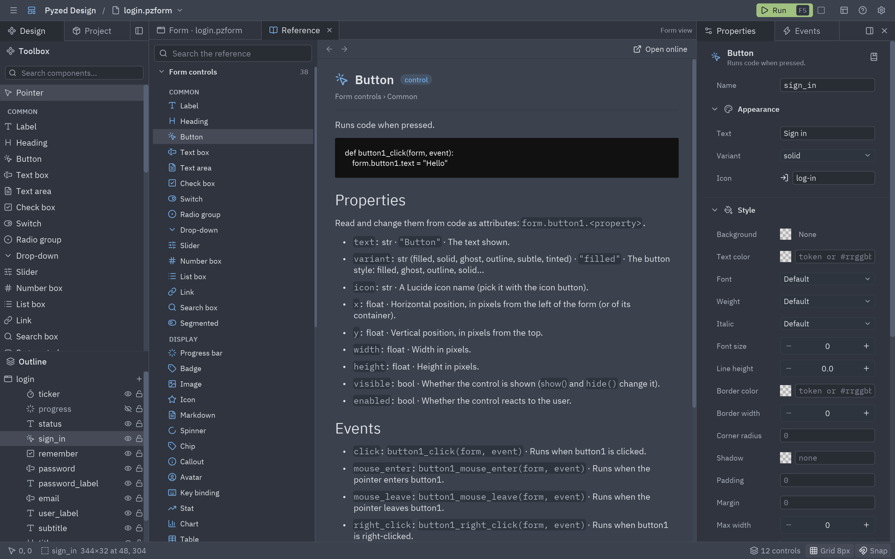
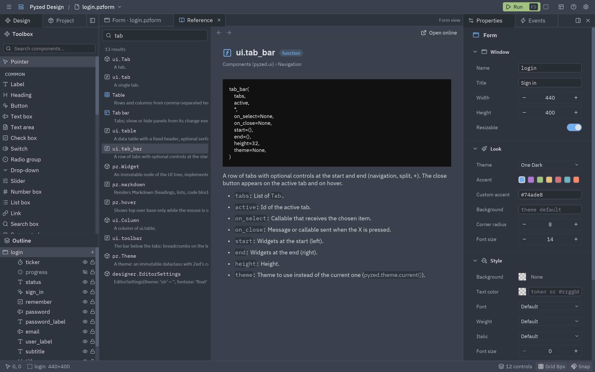

Como Godot, Pyzed Design trae su propia documentación: cada control de formulario, cada función y clase de la
librería y cada componente de tu proyecto, con firmas, parámetros, propiedades, eventos y ejemplos. Funciona sin
conexión y en el idioma del editor.



## Abrirla

| Cómo | Abre |
| --- | --- |
| <kbd>Shift</kbd>+<kbd>F1</kbd> con un control seleccionado | La página del tipo de ese control (Botón, Tabla…). |
| <kbd>Shift</kbd>+<kbd>F1</kbd> en el editor de código | La página del nombre bajo el cursor: `form.email.text` abre Caja de texto, `ui.button` y `pz.text` abren sus páginas de la librería. Si no tiene página, se busca el nombre. |
| El botón del **libro** en las cabeceras de Propiedades y Eventos | La página del control seleccionado. |
| **Ayuda** en el menú contextual de un control | La página de ese control. |
| **Ayuda → Referencia** | La referencia, donde la dejaste. |

La referencia se abre como una pestaña **Referencia** junto a tus documentos. Ciérrala como cualquier pestaña;
recuerda la página, la búsqueda y el historial.

## Encontrar una página

La columna izquierda es la **lista de clases**, por secciones:

| Sección | Páginas |
| --- | --- |
| **Controles del formulario** | Cada control de la caja de herramientas, en su orden: descripción, un manejador de ejemplo, sus propiedades (con tipo y valor por defecto), sus eventos (con el nombre del manejador) y los métodos que tiene todo control. |
| **Código del formulario** | Cómo funciona el código de un formulario: el objeto `form`, un control desde código (`ControlProxy`) y el `event` que recibe un manejador. |
| **App y ejecución**, **Widgets**, **Componentes (pyzed.ui)**… | La librería, una sección por página de la [referencia de la API](/pyzed/es/reference/app/), con firmas en vivo. |
| **Tus componentes** | Cada subclase de `pz.Component` de tu proyecto, con sus props, estado, eventos y métodos sacados de tu código y tus docstrings. |

Haz clic en una sección para plegarla. Escribe en **Buscar en la referencia** para filtrar todo: primero salen los
nombres exactos, cada palabra tiene que coincidir (`tab bar` encuentra `ui.tab_bar`) y cada resultado muestra su
primera frase.



## Leer una página

- La cabecera muestra el icono de la página, su nombre, su tipo (control, función, clase…) y dónde está en la lista.
- Los enlaces a otros nombres abren su página dentro de la referencia; los botones ← y → van atrás y adelante.
- **Abrir en la web** abre la misma página en este sitio.
- Las descripciones de la librería salen de la misma fuente que la web, y las firmas y miembros se leen del código
  instalado, así que la referencia siempre coincide con la versión que ejecutas.

## Documentar tus componentes

Escribe docstrings: el docstring de la clase es la descripción de la página, `pz.state(..., doc="…")` describe una
variable de estado y los docstrings de los métodos públicos los describen. La página se actualiza en cuanto el
código se vuelve a cargar (hot reload incluido).

```python
class Counter(pz.Component):
    """Un número con botones + y −."""

    step: int = 1
    value = pz.state(0, doc="La cuenta actual.")

    def reset(self):
        """Vuelve la cuenta a cero."""
        self.value = 0
```

## En tus apps

La referencia es parte de la librería, no solo del editor, así que puedes incluirla en tu app, probarla o añadir
tus propias secciones:

```python
import pyzed as pz
from pyzed import reference, ui


class Docs(pz.App):
    def __init__(self):
        self.help = reference.Browser("pyzed.ui.button")

    def view(self):
        return ui.reference_browser(self.help, on_open_url=print)


reference.search("tab bar")[0].id   # "pyzed.ui.tab_bar"
reference.lookup("ui.button")       # "pyzed.ui.button"
reference.page("pyzed.text").body   # Markdown
```

`reference.register(reference.Provider(...))` añade una sección propia (la ayuda de tu app, la API de un plugin).
Ver [Referencia integrada](/pyzed/es/reference/app/#referencia-integrada) y
[`ui.reference_browser`](/pyzed/es/reference/ui/#reference_browser) en la referencia de la API.
