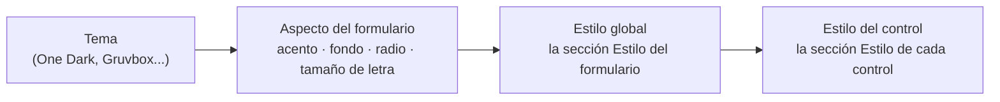
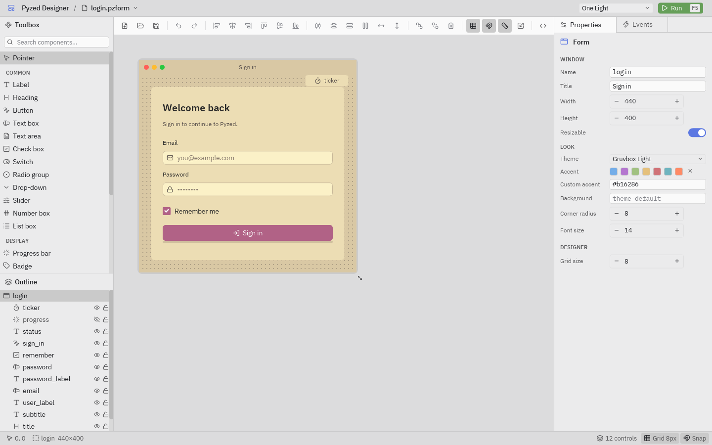
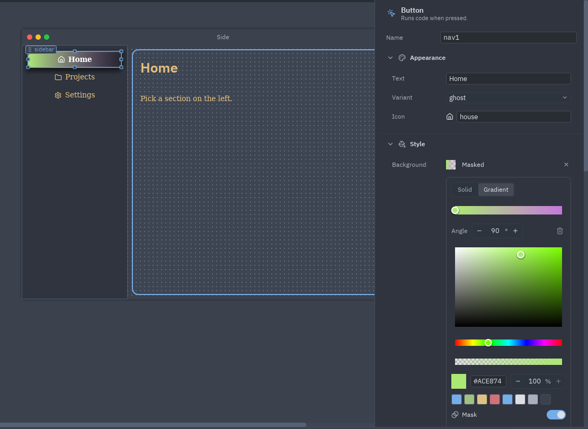

El aspecto de un formulario sale de tres capas, de la más general a la más concreta:

Cada capa solo cambia lo que fija; los campos vacíos heredan de la capa de arriba.

## Temas

Elige el tema del formulario en **Propiedades → Aspecto → Tema** (antes haz clic en un hueco del lienzo). Aparecen
todos los temas registrados: las familias One, Ayu y Gruvbox incluidas y cualquier tema que registre tu proyecto.
Junto a él:

- **Acento**: siete colores predefinidos, o **×** para el acento propio del tema. **Acento propio** acepta cualquier
  `#rrggbb`.
- **Fondo**: un color de fondo para la ventana (vacío mantiene el del tema).
- **Radio de esquina**: el radio que usan todos los controles (0 para esquinas rectas).
- **Tamaño de letra**: el tamaño base de todo el texto.

El tema del formulario es independiente del tema del **editor** (Ajustes → Apariencia → Tema) y del tema del
**editor de código** (Editor settings → Theme): puedes diseñar un formulario claro en un editor oscuro.

## La sección Estilo

Cada control tiene una sección **Estilo** en Propiedades, como CSS para ese control (ver
[Estilos](/pyzed/es/theming/styles/)):

| Campo | Acepta |
| --- | --- |
| **Fondo** | Un color, un degradado lineal o un relleno con máscara: haz clic en la muestra o en el resumen para abrir el selector; **×** lo quita. |
| **Color del texto** | Un token del tema (`accent`, `text_muted`, `success`...) o `#rrggbb` / `#rrggbbaa`. |
| **Fuente** | Por defecto, sans, serif o mono. |
| **Peso** | Por defecto, fina, ligera, normal, media, seminegrita, negrita, gruesa. |
| **Cursiva** | Por defecto, sí o no. |
| **Tamaño de letra** | Píxeles; 0 mantiene el tamaño propio del componente. |
| **Interlineado** | Un múltiplo del tamaño de letra; 0 lo mantiene. |
| **Color del borde**, **Grosor del borde** | El borde del control. |
| **Radio de esquina** | Un número, o cuatro: arriba a la izquierda, arriba a la derecha, abajo a la derecha, abajo a la izquierda (dos números se repiten). |
| **Sombra** | Un color; entonces aparecen **Desplazamiento** (x e y, de −64 a 64) y **Desenfoque** (de 0 a 96). |
| **Relleno** | Espacio interior: un número, dos (vertical horizontal) o cuatro (arriba derecha abajo izquierda). |
| **Margen** | Espacio exterior, con el mismo formato. |
| **Ancho máximo**, **Alto máximo** | 0 significa sin límite. |
| **Alinear contenido**, **Alinear en vertical** | Dónde queda el contenido dentro de la caja del control: inicio, centro o final. |
| **Recortar** | Corta lo que se sale de la caja. |

Los campos vacíos mantienen el aspecto propio del componente. **Restablecer el estilo** (al final de la sección,
cuando hay algo fijado) borra todos los cambios de ese control. Los valores a medio escribir (`#3b`) se ignoran al
dibujar en lugar de fallar, así que puedes escribir con calma.

## El selector de color

Haz clic en la muestra de un color para abrir el selector, flotando junto al panel; haz clic fuera para cerrarlo.

- **Cuadro de saturación y valor**, **barra de tono** y **barra de alfa**, el color actual con un campo hex
  (escribe `#rrggbb` o `#rrggbbaa`) y su opacidad en porcentaje.
- **Muestras** del tema del formulario: acento, éxito, aviso, error, información, texto, texto atenuado y fondo.
- En un **fondo**, **Solid / Gradient** cambia a un degradado lineal: haz clic en la barra de paradas para añadir
  una con el color que tiene el degradado en ese punto, arrastra una parada para moverla, selecciónala para cambiar
  su color, fija el **Angle** (de 15° en 15° con los botones) y quita la parada seleccionada (un degradado conserva
  al menos dos).
- En un fondo, **Mask** desvanece el relleno de opaco a transparente: su propia barra de paradas con una
  **Opacity** por parada (hasta 8 paradas) y un ángulo.

:::tip
El selector trabaja con colores concretos: al elegir, un token del tema se convierte en su valor hex. Para mantener
un color que siga al tema (y que el formulario se vea bien en un tema claro y en uno oscuro), escribe el token
(`accent`, `text_muted`, `surface`...) en el campo junto a la muestra.
:::

## El estilo global del formulario

Sin nada seleccionado, la sección **Estilo** del formulario es el estilo global de la ventana:

- **Color del texto, fuente, peso, cursiva, tamaño de letra e interlineado** se aplican a todo texto que no fije
  los suyos.
- **Fondo, color del borde, radio de esquina y relleno** pasan a ser los de la ventana.

Funciona igual al ejecutar (`Window.style`), y también en los componentes hechos en el editor. Una fuente global
serif, por ejemplo, cambia de golpe cada etiqueta, botón y campo del formulario.

## Colores como propiedades

Algunos componentes tienen además sus propias propiedades de color (el **Color** de una etiqueta, el **Fondo** de
un panel, el **Color** de un icono). Aceptan los mismos valores: un token del tema o un color hex, con una muestra
que lo previsualiza en el tema del formulario.
