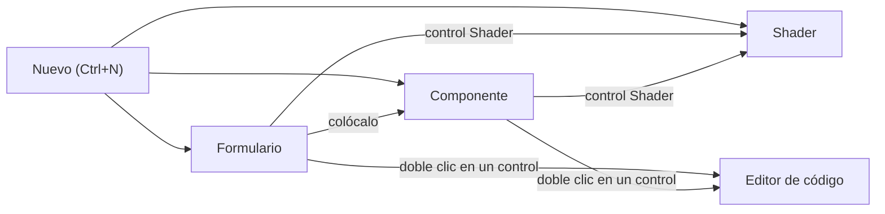

import { Aside, Tabs, TabItem } from '@astrojs/starlight/components';
import NavCards from '../../../../components/NavCards.astro';
import Media from '../../../../components/Media.astro';
import formShot from '../../../../assets/editor/form-view.png';
import formLight from '../../../../assets/editor/form-view-light.png';
import componentShot from '../../../../assets/editor/component-view.png';
import componentLight from '../../../../assets/editor/component-view-light.png';
import shaderShot from '../../../../assets/shading/shader-view.png';
import shaderLight from '../../../../assets/shading/shader-view-light.png';
import codeShot from '../../../../../screenshots/designer-code.png';

Pyzed Design edita cuatro tipos de documento. Cada uno se abre en su propia **vista**: la misma ventana, pero el dock
izquierdo, la barra de herramientas, el centro y el panel Propiedades cambian según lo que estés creando. La fila de
pestañas dice qué vista está delante, y la barra de título muestra una insignia **Componente** o **Shader** cuando no
es un formulario.

| Documento | Archivo | Se abre en | Piénsalo como |
| --- | --- | --- | --- |
| **Formulario** | `login.pzform` + `login.py` | Vista de formulario | Una ventana de tu app, como un formulario de Visual Basic o un `.ui` de Qt Designer. |
| **Componente** | `rating.pzcomp` + `rating.py` | Vista de componente | Una pieza reutilizable que colocas en formularios, como una escena de Godot o un widget blueprint de Unreal. |
| **Shader** | `fire.pzshad` | Vista Shader | Un efecto de GPU hecho de nodos, como los visual shaders de Godot o el editor de materiales de Unreal. |
| **Código y texto** | `*.py`, `*.toml`, `*.md`... | Editor de código | El Python detrás de todo, con autocompletado y diagnósticos. |

Todos los archivos son texto plano (JSON o Python), así que se comparan bien en git y puedes abrirlos en cualquier
otro editor.



## Vista de formulario

**Para:** las ventanas de tu app: un inicio de sesión, una página de ajustes, un panel, un diálogo.

<Media src={formShot} light={formLight} alt="La vista de formulario con un formulario de inicio de sesión" caption="Vista de formulario: herramientas a la izquierda, el formulario en el lienzo y sus propiedades a la derecha." />

- **Dock izquierdo:** las **Herramientas** con todos los controles y la **Estructura** del formulario.
- **Centro:** el formulario dibujado en un marco de ventana, con cuadrícula de puntos, asas y guías inteligentes.
- **Dock derecho:** **Propiedades** y **Eventos** de la selección (o del formulario si no hay nada seleccionado).
- **Ejecutar** (<kbd>F5</kbd>) abre el formulario como una ventana real con sus manejadores Python.

Lee [La vista de formulario](/pyzed/es/editor/form-view/) para un primer formulario guiado.

## Vista de componente

**Para:** piezas que usas muchas veces: una valoración con estrellas, una tarjeta de perfil, una ficha de producto.
Un componente no tiene ventana; vive dentro de formularios y de otros componentes.

<Media src={componentShot} light={componentLight} alt="La vista de componente con un ProfileCard que contiene un componente Rating" caption="Vista de componente: un marco de acento con el nombre de la clase en lugar de botones de ventana." />

- Las mismas herramientas y lienzo que un formulario, pero el lienzo muestra un **marco de acento con el nombre de la
  clase** en lugar de una ventana, y la barra de título una insignia **Componente**.
- Sin nada seleccionado, **Propiedades** muestra el **panel del componente**: el nombre de la clase, cómo aparece en
  las herramientas, sus **propiedades** tipadas, sus **eventos propios** y sus **métodos**.
- **Ejecutar** previsualiza el componente solo en una ventana.
- Haz doble clic en un componente colocado en un formulario para abrirlo en su propia pestaña.

Todo está en [La vista de componente](/pyzed/es/editor/component-designer/).

## Vista Shader

**Para:** fondos animados, brillos, transiciones y gráficos de juegos dibujados por la tarjeta gráfica.

<Media src={shaderShot} light={shaderLight} alt="La vista Shader: un grafo de nodos con vistas previas y la vista previa de la Salida" caption="Vista Shader: nodos con vista previa en vivo, conectados de las entradas a la Salida." />

- **Dock izquierdo:** la barra **Shading** (todos los nodos, por categoría) y la **Estructura** de variables, valores
  con nombre y nodos.
- **Centro:** tres pestañas: **Grafo** (los nodos), **Vista previa** (el resultado en grande, con un control por
  variable) y **WGSL** (el código generado, solo lectura).
- **Propiedades:** los ajustes y entradas del nodo seleccionado, de una variable o del propio shader.
- **Ejecutar** abre el shader en una ventana que sigue tus cambios.

Empieza por [La vista Shader](/pyzed/es/editor/shader-view/) de este manual, o ve directamente a la
[sección Shading](/pyzed/es/shading/).

## Editor de código

**Para:** el Python de cada formulario y componente (sus manejadores de eventos y métodos) y cualquier archivo de
texto del proyecto.

<Media src={codeShot} alt="El editor de código en el dock inferior con un manejador abierto" caption="El panel Código: autocompletado, diagnósticos y code lens de ty y ruff." />

- Se abre en el **dock inferior** cuando haces doble clic en un control o un evento, pulsas <kbd>F7</kbd> para el
  archivo entero o haces clic en un archivo del panel Proyecto. Cada archivo es una pestaña del panel Código.
- Autocompletado, diagnósticos, code lens, plegado, minimapa, cursores múltiples, buscar y reemplazar, y atajos de
  teclado que puedes cambiar.

Ver [Editor de código](/pyzed/es/editor/code-editor/).

## Cambiar de vista

- Cada documento abierto es una pestaña; haz clic para cambiar. Cada uno conserva su selección y su historial de
  deshacer.
- Abrir un archivo que ya está abierto cambia a su pestaña.
- Arrastra una pestaña fuera de la ventana para trabajar con dos documentos lado a lado (ver
  [La interfaz](/pyzed/es/editor/interface/#pestañas-de-documentos-y-ventanas)).

<Aside type="caution" title="Código con un error de sintaxis">
Al salir de un formulario o componente se aplica el código de sus manejadores. Si el código no se puede analizar, el
cambio espera a que lo corrijas, y una notificación explica por qué: no se pierde nada de lo que escribiste.
</Aside>

## Desde la línea de comandos

Pasa un archivo para abrirlo en la vista adecuada (se crea al guardar por primera vez si no existe):

<Tabs syncKey="pkg">
	<TabItem label="uv">
		```bash
		uv run pyzed design ui/login.pzform
		uv run pyzed design ui/rating.pzcomp
		uv run pyzed design shaders/fire.pzshad
		```
	</TabItem>
	<TabItem label="pip">
		```bash
		pyzed design ui/login.pzform
		pyzed design ui/rating.pzcomp
		pyzed design shaders/fire.pzshad
		```
	</TabItem>
	<TabItem label="python">
		```bash title="macOS / Linux"
		python3 -m pyzed design ui/login.pzform
		```
		```powershell title="Windows (PowerShell)"
		py -m pyzed design ui\login.pzform
		```
	</TabItem>
</Tabs>

<NavCards
	items={[
		{ title: 'La vista de formulario', text: 'Tu primera ventana, paso a paso.', href: '/pyzed/es/editor/form-view/', icon: 'pencil' },
		{ title: 'La vista de componente', text: 'Props, estado, métodos, eventos y herencia.', href: '/pyzed/es/editor/component-designer/', icon: 'puzzle' },
		{ title: 'La vista Shader', text: 'Nodos, vistas previas y variables.', href: '/pyzed/es/editor/shader-view/', icon: 'star' },
		{ title: 'Editor de código', text: 'Autocompletado, diagnósticos y atajos.', href: '/pyzed/es/editor/code-editor/', icon: 'seti:python' },
	]}
/>
