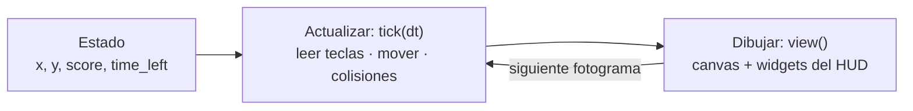

import { Aside, Code, Steps, LinkCard } from '@astrojs/starlight/components';
import Media from '../../../../components/Media.astro';
import Run from '../../showcase/_run.mdx';
import source from '../../../../../../examples/games/coin_chase.py?raw';

Un juego es un programa que **sigue funcionando aunque no pulses nada**. Cada pocos milisegundos mira las
teclas, mueve un poco las cosas y lo vuelve a dibujar todo. En este primer paso de la ruta construyes
*Coin Chase*: un orbe brillante que diriges con las flechas, una moneda que atrapar, un reloj de 30 segundos y
una puntuación. Es pequeño, pero tiene todas las partes de un juego de verdad.

<Media clip="game-first" alt="Un orbe cian se desliza sobre una cuadrícula oscura hacia una moneda dorada que gira; al tocarla aparece un anillo y la moneda reaparece en otro sitio" caption="Coin Chase: el orbe se mueve con teclas mantenidas, y la puntuación y el reloj son widgets normales." eager />

| Objetivo | Tiempo | Nivel | Necesitas |
| --- | --- | --- | --- |
| Un juego completo con bucle, teclas mantenidas, temporizador y puntuación | 25 minutos | Principiante | Python y Pyzed instalados ([Instalación](/pyzed/es/getting-started/installation/)); ninguna experiencia con juegos |

## Qué aprenderás

- Las tres partes de todo juego: **estado**, **actualización** y **dibujo**.
- Ejecutar código **una vez por fotograma** con `pz.frames(self.tick)`.
- Mover cosas con **velocidad × `dt`**, para que el juego vaya igual de rápido en cualquier pantalla.
- Leer las teclas **mantenidas** (`game.vector`) y las **pulsadas una vez** (`on_key`).
- Pausar el juego (y la CPU) devolviendo cero suscripciones.

Juégalo primero:

<Run file="examples/games/coin_chase.py" lang="es" />

## Las tres partes



Pyzed llama a `tick(dt)` antes de cada fotograma que muestra la pantalla (60, 120 o 144 veces por segundo) y
luego a `view()` para dibujar. Nunca escribes el bucle: solo dices qué pasa en un fotograma.

<Steps>

1. **El estado.** Todo lo que el juego necesita recordar vive en atributos de la app. `reset()` les da valor,
   así que el mismo método empieza la primera ronda y cada ronda nueva:

   ```python
   W, H = 560, 380
   SPEED = 260          # pixels per second
   PLAYER_R = 14
   COIN_R = 9
   ROUND = 30.0         # seconds per round

   class CoinChase(pz.App):
       def __init__(self, seed=None):
           self.random = random.Random(seed)
           self.held = None        # the keys held down; None reads the keyboard
           self.best = 0
           self.reset()

       def reset(self):
           self.x, self.y = W / 2, H / 2
           self.score = 0
           self.time_left = ROUND
           self.paused = self.over = False
           self.pops = []          # [x, y, age]: rings that grow and fade where a coin was taken
           self.clock = 0.0
           self.coin = self.new_coin()
   ```

   `held` es para pruebas y demos: le asignan `{"right"}` para mover sin teclado. Cuando es `None`, el juego lee
   las teclas reales.

2. **Enciende el bucle.** `subscriptions()` devuelve lo que debe estar en marcha ahora. `pz.frames(self.tick)`
   significa "llama a `tick` en cada fotograma". Pyzed vuelve a preguntar tras cada cambio, así que no devolver
   nada pausa el juego, y la CPU descansa:

   ```python
   def subscriptions(self):
       if self.paused or self.over:
           return []
       return [pz.frames(self.tick)]
   ```

3. **Mueve con velocidad × dt.** `dt` son los segundos desde el fotograma anterior (unos `0.0167` a 60 Hz). Si
   movieras 4 píxeles fijos por fotograma, el orbe iría el doble de rápido en una pantalla de 120 Hz.
   Multiplicar por `dt` da *píxeles por segundo*:

   ```python
   def tick(self, dt):
       self.clock += dt
       self.time_left = max(0.0, self.time_left - dt)

       dx, dy = game.vector(held=self.held)          # arrows / WASD, diagonals normalized
       self.x = game.clamp(self.x + dx * SPEED * dt, PLAYER_R, W - PLAYER_R)
       self.y = game.clamp(self.y + dy * SPEED * dt, PLAYER_R, H - PLAYER_R)
   ```

   `game.vector()` convierte las flechas y WASD en una dirección: `(1, 0)` a la derecha, `(0.71, -0.71)` arriba
   a la derecha (así las diagonales no son más rápidas). `game.clamp` mantiene el orbe dentro del tablero.

4. **¿Tocó la moneda?** Dos círculos se tocan cuando la distancia entre sus centros es menor que la suma de sus
   radios. `math.hypot` mide esa distancia:

   ```python
   cx, cy = self.coin
   if math.hypot(cx - self.x, cy - self.y) < PLAYER_R + COIN_R:
       self.score += 1
       self.pops.append([cx, cy, 0.0])
       self.coin = self.new_coin()

   for pop in self.pops:
       pop[2] += dt
   self.pops = [p for p in self.pops if p[2] < 0.4]

   if self.time_left <= 0:
       self.over = True
       self.best = max(self.best, self.score)
   ```

   Cada "pop" es un anillo que vive 0,4 segundos. Efectos así son la forma más barata de que un juego se sienta
   bien; la [página de consejos](/pyzed/es/games/tips/#juice) tiene más.

5. **Teclas pulsadas una vez.** Mantener una tecla mueve el orbe; *pulsarla* hace algo una vez. `on_key` recibe
   cada pulsación como texto:

   ```python
   def on_key(self, combo):
       if combo == "space" and not self.over:
           self.paused = not self.paused
       elif combo == "enter" and self.over:
           self.reset()
   ```

6. **Dibuja el fotograma.** `view()` convierte el estado en una imagen. El tablero es un `pz.canvas` con formas de
   `pyzed.draw`; la moneda estrecha su ancho con `cos` para parecer que gira, y `game.glow` añade una luz suave:

   ```python
   def board(self):
       shapes = [draw.background("#0b0e14")]
       ...
       for x, y, age in self.pops:
           k = age / 0.4                             # 0 -> 1 over the ring's life
           shapes.append(draw.circle(x, y, COIN_R + k * 26, stroke=game.rgba("#fde68a", 1 - k), width=3))
       shapes += game.glow(self.x, self.y, PLAYER_R, "#22d3ee", layers=4, strength=0.5)
       return pz.canvas(shapes, width=W, height=H)
   ```

7. **El HUD son widgets.** La puntuación, el reloj y la tarjeta de pausa son componentes normales de Pyzed
   apilados sobre el canvas con `pz.stack`, así que reciben el tema, los iconos y el efecto `glass` gratis:

   ```python
   hud = pz.row([
       ui.label("Coin Chase", weight="semibold"),
       pz.hspace(),
       ui.badge(f"{self.score} coins", icon="circle-dollar-sign", tint="warning"),
       ui.badge(f"{math.ceil(self.time_left)} s", icon="timer",
                tint="error" if self.time_left < 5 else "accent"),
   ], spacing=8, align="center")
   play = pz.stack([self.board(), self.overlay()], width=W, height=H)
   ```

</Steps>

<Aside type="tip" title="¿Por qué no mover 4 píxeles por fotograma?">
Muchos primeros juegos lo hacen, y van a media velocidad en un portátil a 30 fps y al doble en un monitor de
144 Hz. Multiplica siempre las velocidades por `dt`. Pyzed además limita `dt` a un cuarto de segundo, así que un
punto de interrupción o arrastrar la ventana nunca teletransporta el orbe.
</Aside>

<Aside type="note" title="¿Y los fotogramas por segundo?">
`pz.frames` sigue la frecuencia de la pantalla (vsync). Donde la pantalla no puede esperar al vsync, se detiene
en `max_fps` (240 por defecto): `pz.frames(self.tick, max_fps=60)` lo limita más.
</Aside>

## Prueba esto

- Haz que el orbe vaya más rápido un segundo después de cada moneda (un temporizador `boost` que baja en `tick`).
- Añade una segunda moneda, más rara, que vale 5 puntos y desaparece a los 3 segundos.
- Guarda la mejor puntuación en un archivo; el [paso 8](/pyzed/es/games/high-scores/) enseña cómo.

## Código completo

<Code code={source} lang="py" title="examples/games/coin_chase.py" />

## Siguiente

<LinkCard title="2. Sprites y animación" href="/pyzed/es/games/sprites-animation/" description="Personajes pixel art escritos como texto, animación por fotogramas, voltear y tweens." />
