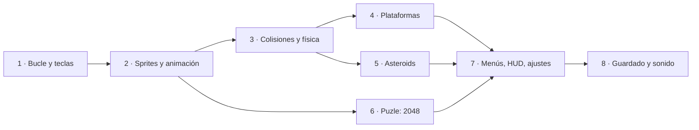

import { Aside, CardGrid, LinkCard } from '@astrojs/starlight/components';
import NavCards from '../../../../components/NavCards.astro';
import ClipGallery from '../../../../components/ClipGallery.astro';
import Run from '../../showcase/_run.mdx';

Pyzed es una librería de interfaces, pero ya trae todo lo que necesita un juego 2D: un
`pz.canvas` dibujado por la GPU, un bucle que se ejecuta una vez por fotograma, las teclas
que están pulsadas ahora mismo y toda la biblioteca de widgets para construir menús y HUD
encima de la acción. Cada juego de estas páginas es un programa completo y jugable en
[`examples/games/`](https://github.com/albakore/pyzed/tree/main/examples/games), comprobado por
las pruebas en cada cambio.

<ClipGallery
	items={[
		{ clip: 'game-platformer', title: 'Pixel Run', href: '/pyzed/es/games/platformer/', alt: 'Un héroe que corre y salta por un nivel con scroll, monedas y slimes' },
		{ clip: 'game-asteroids', title: 'Rock Storm', href: '/pyzed/es/games/asteroids/', alt: 'Una nave que dispara a rocas que se parten en chispas' },
		{ clip: 'game-2048', title: '2048', href: '/pyzed/es/games/puzzle-2048/', alt: 'Fichas numeradas que se deslizan y se juntan en un tablero de 4 por 4' },
		{ clip: 'game-menus', title: 'Menús de Orb Rush', href: '/pyzed/es/games/menus-hud/', alt: 'Un menú de título, un HUD de cristal, un menú de pausa y un panel de ajustes' },
		{ clip: 'game-high-scores', title: 'Target Rush', href: '/pyzed/es/games/high-scores/', alt: 'Clics en dianas, escribir un nombre y una tabla de récords' },
		{ clip: 'game-sprites', title: 'Walker', href: '/pyzed/es/games/sprites-animation/', alt: 'Un héroe pixel art que camina, salta y coge monedas' },
		{ clip: 'game-jump-arc', title: 'Jump Lab', href: '/pyzed/es/games/collisions-physics/', alt: 'Una caja que salta entre plataformas con el arco del salto dibujado' },
		{ clip: 'game-first', title: 'Coin Chase', href: '/pyzed/es/games/first-game/', alt: 'Un orbe que recoge monedas' },
		{ clip: 'neon-invaders', title: 'Neon Invaders', href: '/pyzed/es/games/neon-invaders/', alt: 'Oleadas de invasores neón, disparos y explosiones' },
		{ clip: 'breakout', title: 'Breakout', href: '/pyzed/es/games/breakout/', alt: 'Una pelota que rompe un muro de ladrillos de colores' },
		{ clip: 'snake', title: 'Snake', href: '/pyzed/es/games/snake/', alt: 'Una serpiente que crece al comer' },
	]}
/>

## Aprende a crear juegos

Una ruta desde cero hasta juegos completos. Cada paso es un tutorial con un objetivo, el tiempo que lleva, lo que
necesitas saber antes, el código completo e ideas para seguir. Si nunca has escrito un juego, empieza por el 1; si ya
lo has hecho, salta a lo que necesites.



<NavCards
	items={[
		{ title: '1. Tu primer juego', text: 'Coin Chase: el bucle por fotograma, velocidad × dt, teclas mantenidas, un temporizador, una puntuación y una pausa.', href: '/pyzed/es/games/first-game/', icon: 'rocket', tag: 'Empieza aquí' },
		{ title: '2. Sprites y animación', text: 'Pixel art desde texto, hojas de sprites fotograma a fotograma, voltear y tweens con easing.', href: '/pyzed/es/games/sprites-animation/', icon: 'seti:image', tag: 'Principiante' },
		{ title: '3. Colisiones y física', text: 'Velocidad, gravedad, colisiones de cajas y círculos, coyote time y una vista de depuración.', href: '/pyzed/es/games/collisions-physics/', icon: 'puzzle' },
		{ title: '4. Un juego de plataformas', text: 'Un mapa de tiles en texto, una cámara con parallax, slimes que pisar, monedas, vidas y una bandera.', href: '/pyzed/es/games/platformer/', icon: 'laptop' },
		{ title: '5. Asteroids y partículas', text: 'Rotación y empuje, espacio que da la vuelta, rocas que se parten y partículas por todas partes.', href: '/pyzed/es/games/asteroids/', icon: 'star' },
		{ title: '6. Un puzle: 2048', text: 'Reglas como funciones comprobables, fichas con tweens, gestos y un bucle que duerme entre movimientos.', href: '/pyzed/es/games/puzzle-2048/', icon: 'seti:xls' },
		{ title: '7. Menús, HUD y ajustes', text: 'Escenas, transiciones, menús con teclado, un HUD de cristal, pausa y una pantalla de ajustes.', href: '/pyzed/es/games/menus-hud/', icon: 'setting' },
		{ title: '8. Récords y guardado', text: 'Una tabla de récords guardada con seguridad, pedir un nombre, efectos de sonido y compartir el juego.', href: '/pyzed/es/games/high-scores/', icon: 'document' },
		{ title: 'Consejos', text: 'Pasos de tiempo fijos, rendimiento, buffer de entrada, juice, organizar el estado y pruebas.', href: '/pyzed/es/games/tips/', icon: 'information' },
	]}
/>

<Aside type="tip" title="¿Nunca has programado un juego?">
Empieza por [1. Tu primer juego](/pyzed/es/games/first-game/): explica cada línea, y el juego se puede jugar desde el
tercer paso. [Un bucle de juego](/pyzed/es/tutorials/advanced/game-loop/) (Dodge, en los Tutoriales) es una buena
segunda lectura.
</Aside>

## Juegos completos

Tres juegos más grandes para leer, jugar y desmontar. Crecen en dificultad:

<CardGrid>
	<LinkCard title="Snake" href="/pyzed/es/games/snake/" description="Movimiento en cuadrícula con un temporizador fijo, cola de teclas, game over y reinicio. ~150 líneas." />
	<LinkCard title="Breakout" href="/pyzed/es/games/breakout/" description="Un bucle a 60 fps con pz.frames, teclas mantenidas y ratón, física de la pelota, partículas y temblor." />
	<LinkCard title="Neon Invaders" href="/pyzed/es/games/neon-invaders/" description="Sprites pixel art, oleadas, power-ups, brillo neón y un HUD de cristal con bloom." />
</CardGrid>

Ejecuta cualquier juego desde la carpeta del repositorio; cambia el nombre del archivo para los demás:

<Run file="examples/games/neon_invaders.py" lang="es" />

## Las piezas

| Qué | API | Para qué |
| --- | --- | --- |
| Bucle por fotograma | `pz.frames(callback)` en `subscriptions()` | `callback(dt)` una vez por fotograma (sincronizado con la pantalla); `dt` son los segundos desde el anterior. |
| Temporizador fijo | `pz.every(segundos, callback)` | Juegos por turnos o en cuadrícula que avanzan a ritmo fijo (Snake). |
| Pulsaciones | `on_key(combo)` | Acciones puntuales: saltar, pausar, reiniciar (`"space"`, `"enter"`, `"ctrl-r"`). |
| Soltar teclas | `on_key_up(key)` | Mecánicas de cargar y soltar, parar un sonido. |
| Teclas mantenidas | `pz.pressed()`, `pz.is_pressed("left", "a")` | Movimiento continuo y disparo automático, consultados en cada fotograma. |
| Movimiento | `game.axis(neg, pos)`, `game.vector()` | -1/0/1 a partir de dos grupos de teclas; una dirección normalizada con flechas/WASD. |
| Dibujo | `pz.canvas([...])` con `pyzed.draw` | Rectángulos, círculos, trazados, texto, transformaciones. |
| Sprites | `draw.image(src, x, y, w, h)` y `game.sprite(filas, paleta)` | Imágenes (se decodifican una vez y quedan en caché) o pixel art escrito como texto. |
| Colisiones | `game.Rect`, `game.circle_rect` | Solapamiento de cajas; por dónde golpea una pelota a una caja, para rebotar. |
| Efectos | `game.glow`, `game.Particles`, `game.Shake` | Luces neón, explosiones y chispas, temblor de pantalla. |
| HUD y menús | `pz.stack([canvas, widgets])` | Puntuaciones, barras de vida y pantallas de pausa con `glass`, `bloom` y animaciones. |

### El bucle

Un juego es un `pz.App` normal. Devuelve `pz.frames(self.tick)` desde `subscriptions()` y
el runtime llama a `tick(dt)` antes de cada fotograma. Mueve las cosas *velocidad × dt*
para que vayan igual de rápido a 60, 120 o 144 Hz:

```python
import pyzed as pz
from pyzed import draw, game

class Ship(pz.App):
    size = (480, 320)

    def __init__(self):
        self.x, self.y = 240, 160

    def subscriptions(self):
        return [pz.frames(self.tick)]

    def tick(self, dt):
        dx, dy = game.vector()             # flechas / WASD, diagonales normalizadas
        self.x += dx * 300 * dt
        self.y += dy * 300 * dt

    def view(self):
        return pz.canvas([draw.background("#0b0e14"),
                          *game.glow(self.x, self.y, 14, "#22d3ee")], width=480, height=320)

pz.run(Ship)
```

`dt` se limita a un cuarto de segundo, así que arrastrar la ventana o parar en un
breakpoint nunca hace que el juego salte hacia delante. Donde la pantalla no espera a la
sincronización vertical (renderizado por software), `max_fps` (240 por defecto) evita que
el bucle consuma toda la CPU.

<Aside type="tip">
Para el bucle cuando nada se mueve: `subscriptions()` se evalúa tras cada actualización,
así que `return [] if self.paused else [pz.frames(self.tick)]` pausa el juego y la CPU.
</Aside>

### Entrada

`on_key` es para acciones que ocurren una vez por pulsación; `pz.pressed()` para lo que
ocurre *mientras* una tecla está pulsada. Ambos ven todas las teclas, tenga el foco el
widget que lo tenga.

```python
def on_key(self, combo):          # "space", "p", "shift-r"...
    if combo == "p":
        self.paused = not self.paused

def tick(self, dt):
    if pz.is_pressed("space") and self.cooldown <= 0:
        self.fire()               # disparo automático mientras Space está pulsada
```

El ratón llega desde el propio canvas: `on_move(x, y)`, `on_press(x, y)`, `on_release()`,
`on_right_press(x, y)` y `on_scroll(dx, dy)`, en coordenadas del canvas.

### Sprites

`draw.image` dibuja un PNG/JPEG (o bytes RGBA) dentro de una caja, opcionalmente girado y
con transparencia. Se decodifica una vez por origen y queda en caché, así que dibujar el
mismo sprite cientos de veces por fotograma es barato. Usa `pixelated=True` para pixel art
ampliado.

```python
draw.image("assets/ship.png", self.x - 16, self.y - 16, 32, 32, rotation=self.angle)
```

Para juegos retro ni siquiera hacen falta archivos: `game.sprite` convierte texto en pixel
art, con una forma por color sea cual sea el tamaño del sprite.

```python
INVADER = ["..#.....#..",
           "...#...#...",
           "..#######..",
           ".##.###.##.",
           "###########"]
game.sprite(INVADER, {"#": "#a3e635"}, x, y, scale=4)
```

### El HUD y los menús son widgets

Apila widgets sobre el canvas con `pz.stack`. Puntuaciones, barras de vida, insignias y
menús de pausa son componentes normales de Pyzed, así que tienen temas, paneles `glass`,
`bloom` y animaciones de entrada sin esfuerzo: la parte difícil de la interfaz de un juego
ya está hecha.

```python
hud = pz.container(pz.row([score, pz.hspace(), ui.badge(f"Wave {self.wave}")]),
                   padding=(8, 14)).style(glass=True, radius=12)
return pz.stack([self.scene(), hud], width=W, height=H)
```

## Consejos de rendimiento

Más en [Consejos para crear juegos](/pyzed/es/games/tips/).

- Haz poco trabajo Python por fotograma: listas y números simples, sin crear estructuras
  grandes cada vez.
- Agrupa formas: `draw.rects` dibuja muchos rectángulos de un color como una sola forma
  (es lo que usa `game.sprite`).
- Limita las partículas (`game.Particles(limit=...)`) y elimina las balas que salen de la
  pantalla.
- Solo el canvas cambia en cada fotograma; los widgets del HUD son baratos de reconstruir,
  pero `pz.memo` puede cachear los costosos.
- Prueba la lógica sin ventana: llama a `tick(1 / 60)` en un bucle y comprueba el estado,
  como hace [`tests/test_game.py`](https://github.com/albakore/pyzed/blob/main/tests/test_game.py).
  `App.screenshot` renderiza cualquier momento del juego a un PNG.
