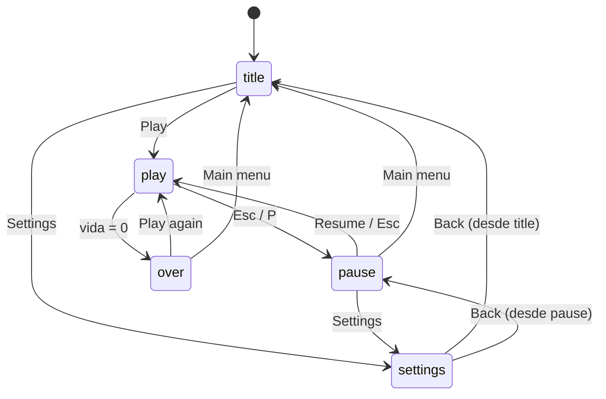

import { Aside, Code, Steps, LinkCard } from '@astrojs/starlight/components';
import Media from '../../../../components/Media.astro';
import Run from '../../showcase/_run.mdx';
import source from '../../../../../../examples/games/menus.py?raw';

Los jugadores ven tus menús antes que tu juego. Aquí es donde Pyzed brilla: es una librería de interfaces, así
que los botones, sliders, interruptores, paneles de cristal y textos que brillan ya están ahí y ya se ven bien. Este
paso envuelve un juego diminuto, *Orb Rush*, en una pantalla de título, un HUD, un menú de pausa y una pantalla de
ajustes, con transiciones entre ellos.

<Media clip="game-menus" alt="Un título brillante ORB RUSH aparece sobre un campo de estrellas con un menú de Play, Settings y Quit; la selección se mueve, el juego empieza con un HUD de cristal, luego se pausa en un menú de cristal y abre un panel de ajustes con sliders, un control segmentado e interruptores" caption="Orb Rush: cada panel aparece y se desliza desde un reloj por escena, y los menús funcionan con teclado y ratón." eager />

| Objetivo | Tiempo | Nivel | Necesitas |
| --- | --- | --- | --- |
| Un menú de título, HUD, menú de pausa y pantalla de ajustes alrededor de un juego | 45 minutos | Intermedio | [1. Tu primer juego](/pyzed/es/games/first-game/); la [biblioteca de componentes](/pyzed/es/library/) ayuda |

## Qué aprenderás

- Organizar un juego en **escenas** (`title`, `play`, `pause`, `settings`, `over`).
- Animar **transiciones** con un reloj por escena y `.style(opacity=..., translate=...)`.
- Construir menús que funcionan con **flechas y Enter** y con **clics**.
- Un **HUD** con bloom, una barra de vida, un temporizador y un contador de FPS.
- Una **pantalla de ajustes** con `ui.slider`, `ui.switch` y `ui.segmented` cuyos valores lee el juego.

<Run file="examples/games/menus.py" lang="es" />



<Steps>

1. **Un atributo decide la escena.** `go()` cambia de escena y reinicia `since`, los segundos desde que empezó la
   escena, que mueve todas las transiciones. Settings recuerda desde dónde se abrió, así que Back vuelve al título o
   al menú de pausa:

   ```python
   def go(self, scene):
       if scene == "settings":
           self.came_from = self.scene
       self.scene = scene
       self.since = 0.0
       self.selected = 0
   ```

   `tick` solo ejecuta el juego en su escena, así que pausar no cuesta nada: `if self.scene == "play":
   self.play(dt)`. Las estrellas siguen moviéndose detrás de los menús, para que la pantalla nunca parezca congelada.

2. **Menús como datos.** El menú de cada escena es una lista de `(texto, acción)`. Un solo método hace lo que
   significa cada acción, venga de una tecla o de un clic, y *Quit* devuelve `self.close()`, un comando que cierra la
   ventana:

   ```python
   MENUS = {
       "title": [("Play", "play"), ("Settings", "settings"), ("Quit", "quit")],
       "pause": [("Resume", "resume"), ("Settings", "settings"), ("Main menu", "menu")],
       "over": [("Play again", "play"), ("Main menu", "menu")],
       "settings": [("Back", "back")],
   }

   def choose(self, action):
       if action == "play":
           self.reset_round()
           self.go("play")
       ...
       elif action == "quit":
           return self.close()
   ```

3. **Navegar con el teclado.** Arriba y abajo mueven `selected` (dando la vuelta con `%`), Enter elige. El botón
   seleccionado se dibuja `solid` con una flecha; los demás son `ghost`. Hacer clic en cualquiera llama al mismo
   `choose`:

   ```python
   items = MENUS[self.scene]
   if combo in ("down", "s"):
       self.selected = (self.selected + 1) % len(items)
   elif combo in ("up", "w"):
       self.selected = (self.selected - 1) % len(items)
   elif combo in ("enter", "space"):
       return self.choose(items[self.selected][1])
   ```

4. **Transiciones desde un reloj.** `appear(delay)` va de 0 a 1 en 0,35 s, `delay` segundos después de empezar la
   escena, con un ease-out. Cualquier widget puede aparecer y deslizarse con él, y dar a cada elemento del menú un
   retraso un poco mayor hace que lleguen uno tras otro:

   ```python
   def appear(self, delay=0.0):
       return ease_out(game.clamp((self.since - delay) / FADE, 0.0, 1.0))

   def slide_in(self, widget, delay=0.0, distance=24):
       a = self.appear(delay)
       return widget.style(opacity=a, translate=(0, (1 - a) * distance))

   # each item of a menu:
   items.append(self.slide_in(pz.container(button, width=220), delay + i * 0.06, 16))
   ```

   Como los valores salen de tu propio reloj, la transición es exactamente igual cada vez, también en capturas y en
   pruebas.

5. **Un título que brilla y un HUD de cristal.** `bloom` hace brillar las partes claras de un widget; sin borde ni
   sombra, solo brilla el texto. El HUD es una fila dentro de un contenedor `glass` (un panel borroso y teñido) y
   baja desde arriba cuando empieza el juego:

   ```python
   def title_text(self, text, color, size=48):
       return pz.container(pz.text(text, size=size, weight="bold", color="#ffffff"), padding=(4, 16)).style(
           bloom=(color, 0.9), border_width=0, shadow=("#00000000", (0, 0), 0))

   bits = [
       self.title_text(f"{self.score:05d}", NEON["cyan"], size=22),
       pz.hspace(),
       pz.row([pz.icon("heart", size=14, color=NEON["red"]),
               pz.container(ui.progress(self.health, max=3, tint=NEON["red"], height=6), width=90)],
              spacing=6, align="center"),
       ui.badge(f"{self.time:4.1f} s", icon="timer", tint="text_muted"),
       ui.badge(f"{self.fps:.0f} fps", icon="gauge", tint="success") if self.settings["fps"] else None,
       pz.row([ui.kbd("Esc"), ui.muted("pause", size="sm")], spacing=4, align="center"),
   ]
   ```

   Un `None` en una fila se omite: es la forma fácil de mostrar algo solo a veces (el contador de FPS).

6. **El menú de pausa.** El juego se sigue dibujando debajo; encima van el HUD, una capa oscura que aparece y el
   panel del menú. `pz.stack` necesita el tamaño del tablero para que el panel se pueda centrar:

   ```python
   return pz.stack([self.hud(), pz.container(width="fill", height="fill").style(
       background=game.rgba("#000000", 0.35 * self.appear())), self.panel(body)], width=W, height=H)
   ```

7. **Ajustes que lee el juego.** Los ajustes son un diccionario normal. Cada control escribe una clave, y el juego
   las lee donde importan: la dificultad escala la velocidad, el interruptor de temblor decide si un golpe sacude la
   pantalla:

   ```python
   self.settings = {"music": 0.6, "effects": 0.8, "difficulty": "Normal", "shake": True, "fps": False}

   rows = [
       ui.field("Music", pz.container(ui.slider(s["music"], setter("music"), show_value=True), width=180)),
       ui.field("Effects", pz.container(ui.slider(s["effects"], setter("effects"), show_value=True), width=180)),
       ui.field("Difficulty", ui.segmented(list(DIFFICULTY), s["difficulty"], setter("difficulty"), size="sm")),
       ui.field("Screen shake", ui.switch(s["shake"], setter("shake"))),
       ui.field("Show FPS", ui.switch(s["fps"], setter("fps"))),
   ]
   ```

</Steps>

<Aside type="note" title="Sliders de volumen">
Aquí los sliders de música y efectos solo guardan un valor, porque Orb Rush no tiene sonido. El
[paso 8](/pyzed/es/games/high-scores/#efectos-de-sonido) añade efectos de sonido con `pyzed.audio`, enseña cómo un
slider cambia su volumen y guarda estos ajustes en disco.
</Aside>

<Aside type="tip" title="La accesibilidad también es un ajuste">
Ofrece un interruptor para el temblor y los destellos; a algunas personas les marean. `pz.system_reduced_motion()`
dice si el sistema pide menos movimiento, un buen valor inicial para ese interruptor.
</Aside>

<Aside type="tip" title="Mira también">
El showcase del [Menú principal de un juego](/pyzed/es/showcase/main-menu/) es una pantalla de título con un fondo
de shader interactivo, y el del [HUD de un juego](/pyzed/es/showcase/hud/) un HUD de ciencia ficción completo.
</Aside>

## Prueba esto

- Añade una página **Controles** en los ajustes que liste las teclas con `ui.kbd`.
- Añade una escena de cuenta atrás 3-2-1 entre el título y el juego.
- Anima el título de Game over con `.animate("pulse", repeat="infinite")`.

## Código completo

<Code code={source} lang="py" title="examples/games/menus.py" />

## Siguiente

<LinkCard title="8. Récords, guardado y sonido" href="/pyzed/es/games/high-scores/" description="Guarda una tabla de récords de forma segura, pide un nombre y añade efectos de sonido." />
