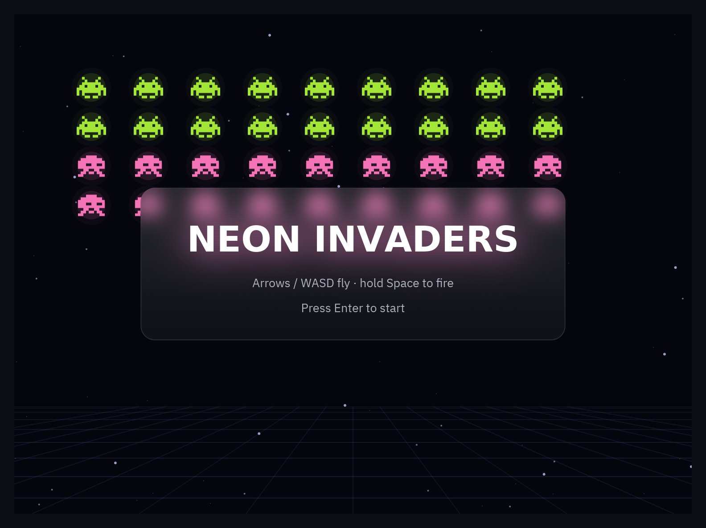

import { Code, Steps, Aside } from '@astrojs/starlight/components';
import Media from '../../../../components/Media.astro';
import Run from '../../showcase/_run.mdx';
import source from '../../../../../../examples/games/neon_invaders.py?raw';

La última demo junta todo en un shooter con aspecto de juego indie moderno: un fondo de
estrellas con paralaje, invasores pixel art que marchan y se lanzan en picado, disparo
automático, un power-up de triple disparo, luces neón por todas partes, explosiones, temblor
de pantalla y un HUD de paneles de cristal y texto brillante dibujado por la biblioteca de
widgets.

<Media clip="neon-invaders" alt="Oleadas de invasores de neón, la nave disparando, explosiones y mejoras" caption="Oleadas, disparos, explosiones y mejoras, todo dibujado con bloom en la GPU." eager />

| Objetivo | Tiempo | Nivel | Necesitas |
| --- | --- | --- | --- |
| Un matamarcianos con sprites de pixel art, oleadas, power-ups, brillo de neón y un HUD de cristal | 1 hora | Avanzado | [Breakout](/pyzed/es/games/breakout/) |

Juégalo primero:

<Run file="examples/games/neon_invaders.py" lang="es" />

<Steps>

1. **Pixel art en texto plano.** Los sprites son listas de cadenas; `game.sprite` asigna un
   color a cada carácter y dibuja una forma por color, así que una nave de 9×7 cuesta dos
   formas:

   ```python
   SHIP = ["....#....",
           "...###...",
           "...#@#...",
           "..#####..",
           ".##.#.##.",
           "###.#.###",
           "#.......#"]

   game.sprite(SHIP, {"#": NEON["cyan"], "@": "#ffffff"}, self.x - 13.5, self.y - 10.5, scale=3)
   ```

   ¿Prefieres imágenes? `draw.image("ship.png", x, y, w, h, rotation=angle)` las dibuja,
   decodificadas una vez y en caché.

2. **Volar y disparo automático.** `game.vector()` convierte las flechas y WASD en una
   dirección (con las diagonales normalizadas) y `pz.is_pressed("space")` dispara mientras
   la tecla está pulsada, con un tiempo de recarga:

   ```python
   def fly(self, dt):
       dx, dy = game.vector()
       self.x = game.clamp(self.x + dx * PLAYER_SPEED * dt, 20, W - 20)
       self.y = game.clamp(self.y + dy * PLAYER_SPEED * dt, H * 0.55, H - 30)
       self.cooldown -= dt
       if game.is_pressed("space") and self.cooldown <= 0:
           self.fire()

   def fire(self):
       self.cooldown = FIRE_DELAY
       for a in ((-12, 0, 12) if self.triple else (0,)):     # el power-up abre el disparo en abanico
           r = math.radians(a - 90)
           self.shots.append([self.x, self.y - 14, math.cos(r) * 640, math.sin(r) * 640])
   ```

3. **Una formación que marcha y ataca en picado.** La formación se desliza de lado a lado y
   baja un poco en cada borde; de vez en cuando un invasor la abandona y se lanza hacia la
   nave, corrigiendo el rumbo en cada fotograma:

   ```python
   self.march += self.direction * speed * dt
   if abs(self.march) > 60:
       self.direction = -self.direction
       self.drop = min(self.drop + 10, 140)

   for inv in self.invaders:
       if inv.diving:
           inv.vx += (self.x - inv.x) * 1.4 * dt      # persigue a la nave
           inv.x += inv.vx * dt
           inv.y += inv.vy * dt
       elif self.random.random() < dt * (0.02 + 0.01 * self.wave):
           inv.diving, inv.vx, inv.vy = True, 0.0, 170 + 20 * self.wave
   ```

   Usar `random.random() < tasa * dt` mantiene la misma frecuencia media de eventos sea cual
   sea la tasa de fotogramas.

4. **Luces neón.** Un canvas no tiene desenfoque, pero la luz es fácil de imitar: `game.glow`
   dibuja varios círculos translúcidos cada vez más grandes detrás de un núcleo brillante. Los
   láseres son dos líneas, una ancha y transparente bajo otra fina y blanca:

   ```python
   shapes += game.glow(cx, cy, 10, color, layers=2, strength=0.25, core=False)  # halo del invasor
   shapes += game.glow(x, y, 3.5, NEON["pink"], layers=2, strength=0.6)         # bala enemiga
   shapes.append(draw.line(x, y, x, y + 12, stroke=game.rgba(NEON["cyan"], 0.3), width=7, cap="round"))
   shapes.append(draw.line(x, y, x, y + 12, stroke="#e0fbff", width=2.5, cap="round"))
   ```

   El fondo de estrellas son tres capas de puntos que caen a distinta velocidad (paralaje), y
   la cuadrícula en perspectiva de abajo es un puñado de `draw.line`.

5. **Explosiones y respuesta.** Cada baja suelta partículas brillantes del color del invasor
   y los golpes fuertes hacen temblar la pantalla. Tras recibir un impacto la nave parpadea y
   es invulnerable un momento:

   ```python
   def explode(self, inv, big=False):
       cx, cy = inv.rect.center
       color = INVADER_COLORS[inv.kind]
       self.sparks.burst(cx, cy, count=40 if big else 26, color=[color, "#ffffff", color],
                         speed=(60, 300))
       self.shake.kick(10 if big else 3)
   ```

6. **Un HUD con efectos de interfaz reales.** Aquí brilla una librería de UI. La puntuación es
   texto con `bloom` (luz a partir de sus píxeles brillantes), la barra es un panel `glass` que
   desenfoca las estrellas de detrás, y el título y los avisos "WAVE 2" usan animaciones de
   entrada:

   ```python
   def neon(widget, color, intensity=1.0):
       """Bloom solo en las partes brillantes, sin el borde iluminado de la caja."""
       return pz.container(widget, padding=(4, 12)).style(
           bloom=(color, intensity), border_width=0, shadow=("#00000000", (0, 0), 0))

   score = neon(pz.text(f"{self.score:06d}", size=22, font="mono", color="#ffffff"), NEON["cyan"], 0.8)
   bar = pz.row([score, pz.hspace(), ui.badge(f"Wave {self.wave}", icon="crosshair"), shield])
   hud = pz.container(bar, padding=(8, 14)).style(glass=True, radius=12, border=(1, "#ffffff22"))

   banner = neon(pz.text(f"WAVE {self.wave}", size=30, weight="bold"), NEON["lime"]).animate("zoom_in")
   board = pz.stack([self.scene(), banner, hud], width=W, height=H)
   ```

   

</Steps>

<Aside type="tip">
Todo lo que se ve se reconstruye en cada fotograma a partir del estado del juego, como
cualquier vista de Pyzed. Eso mantiene el código simple: no hay objetos sprite que crear,
mover o borrar, solo listas que `view()` convierte en formas.
</Aside>

## Código completo

<Code code={source} lang="py" title="examples/games/neon_invaders.py" />

