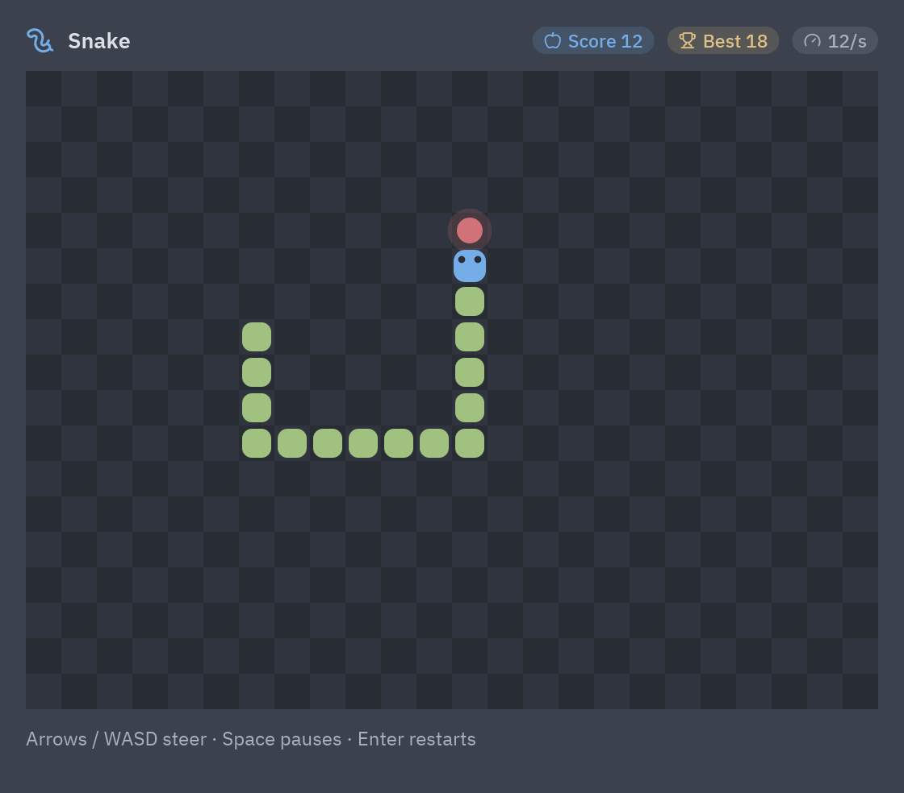
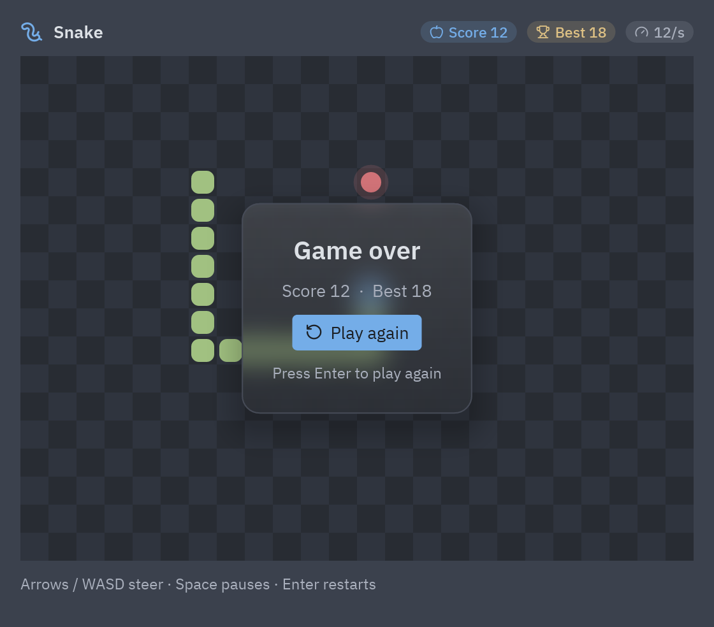

import { Code, Steps, Aside } from '@astrojs/starlight/components';
import source from '../../../../../../examples/games/snake.py?raw';

Snake se mueve en una cuadrícula, celda a celda, así que no necesita un bucle por
fotograma: basta un temporizador que salte unas cuantas veces por segundo. Aprenderás a
guardar el estado del juego en la app, avanzarlo con `pz.every`, girar con `on_key`, dibujar
el tablero en un canvas y poner un menú encima con `pz.stack`.



<Steps>

1. **El estado.** La serpiente es una lista de celdas, empezando por la cabeza. La dirección
   es un par `(dx, dy)` y `turns` guarda las pulsaciones hasta el siguiente paso (si no, dos
   pulsaciones rápidas entre pasos perderían la primera):

   ```python
   CELL = 22
   COLS, ROWS = 24, 18

   class Snake(pz.App):
       title = "Snake"
       size = (COLS * CELL + 32, ROWS * CELL + 96)

       def __init__(self, seed=None):
           self.random = random.Random(seed)   # una semilla hace las partidas reproducibles en tests
           self.best = 0
           self.reset()

       def reset(self):
           middle = (COLS // 2, ROWS // 2)
           self.body = [middle, (middle[0] - 1, middle[1]), (middle[0] - 2, middle[1])]
           self.direction = (1, 0)
           self.turns = []
           self.food = self.free_cell()
           self.score = 0
           self.paused = self.over = False
   ```

2. **Un paso.** Mueve la cabeza; si cae en la comida la serpiente crece (la cola se queda),
   si no, la cola avanza también. Las paredes dan la vuelta con `%` y morderse a sí misma
   termina la partida:

   ```python
   def step(self):
       if self.turns:
           self.direction = self.turns.pop(0)
       dx, dy = self.direction
       x, y = self.body[0]
       head = ((x + dx) % COLS, (y + dy) % ROWS)
       if head in self.body[:-1]:
           self.over = True
           self.best = max(self.best, self.score)
           return
       self.body.insert(0, head)
       if head == self.food:
           self.score += 1
           self.food = self.free_cell()
       else:
           self.body.pop()
   ```

3. **El temporizador.** `subscriptions()` se vuelve a leer tras cada actualización, así que
   el juego decide cuándo corre el reloj. Poner la velocidad en la `key` reinicia el
   temporizador cuando la serpiente acelera, y no devolver nada lo pausa:

   ```python
   @property
   def speed(self):
       return min(8 + self.score // 3, 20)      # pasos por segundo

   def subscriptions(self):
       if self.over or self.paused:
           return []
       return [pz.every(1 / self.speed, self.step, key=f"snake-{self.speed}")]
   ```

4. **Girar.** `on_key` recibe cada pulsación como texto. Se ignora dar media vuelta (o pulsar
   dos veces la misma dirección):

   ```python
   DIRECTIONS = {"up": (0, -1), "w": (0, -1), "down": (0, 1), "s": (0, 1),
                 "left": (-1, 0), "a": (-1, 0), "right": (1, 0), "d": (1, 0)}

   def on_key(self, combo):
       if combo in DIRECTIONS:
           last = self.turns[-1] if self.turns else self.direction
           new = DIRECTIONS[combo]
           if new != last and (new[0] + last[0], new[1] + last[1]) != (0, 0):
               self.turns.append(new)
       elif combo == "space" and not self.over:
           self.paused = not self.paused
       elif combo == "enter" and self.over:
           self.reset()
   ```

5. **El tablero.** Un canvas es una lista de formas de `pyzed.draw`. El damero es una sola
   forma `draw.rects` (rápida incluso con cientos de celdas), la comida tiene un halo suave
   hecho con un círculo translúcido y el cuerpo son rectángulos redondeados:

   ```python
   def board(self, t):
       shapes = [draw.background(t.editor)]
       shapes.append(draw.rects(((x * CELL, y * CELL, CELL, CELL)
                                 for x in range(COLS) for y in range(ROWS) if (x + y) % 2),
                                fill=t.surface))
       fx, fy = self.food
       shapes.append(draw.circle(fx * CELL + CELL / 2, fy * CELL + CELL / 2, CELL / 2 - 3,
                                 fill="#d07277"))
       for i, (x, y) in enumerate(self.body):
           shapes.append(draw.rect(x * CELL + 2, y * CELL + 2, CELL - 4, CELL - 4, radius=6,
                                   fill=t.accent if i == 0 else "#a1c181"))
       return pz.canvas(shapes, width=COLS * CELL, height=ROWS * CELL)
   ```

6. **HUD y game over.** La puntuación es una fila de `ui.badge`. La tarjeta de game over es un
   contenedor normal con `glass=True` (un panel tintado que desenfoca lo de detrás), apilado
   sobre el tablero:

   ```python
   def overlay(self, t):
       if not self.over:
           return None
       card = pz.container(pz.column([
           ui.heading("Game over", level=2),
           ui.muted(f"Score {self.score}  ·  Best {self.best}"),
           ui.button("Play again", self.reset, variant="solid", icon="rotate-ccw"),
       ], spacing=10, align="center"), padding=24).style(glass=True, radius=14)
       return pz.container(card, width="fill", height="fill", align_x="center", align_y="center")

   def view(self):
       game = pz.stack([self.board(t), self.overlay(t)], width=COLS * CELL, height=ROWS * CELL)
   ```

   

</Steps>

<Aside type="tip">
Ideas para seguir: paredes que matan en lugar de dar la vuelta, manzanas doradas que valen
tres puntos y desaparecen a los pocos segundos (un segundo `pz.every`), o un modo de dos
jugadores con WASD y las flechas.
</Aside>

## Código completo

<Code code={source} lang="py" title="examples/games/snake.py" />

```bash
python examples/games/snake.py
```
