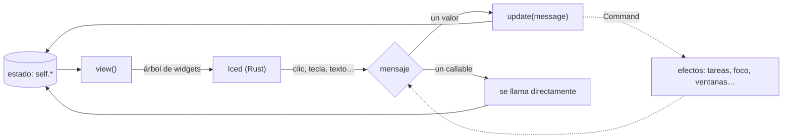

Pyzed sigue la **arquitectura Elm** de Iced: el estado vive en tu objeto, `view()` lo dibuja y
los eventos lo cambian. Después de cada cambio, Pyzed vuelve a llamar a `view()`.

```
            ┌──────────── view() ────────────┐
            │                                ▼
      estado (self)                    árbol de widgets ──► Iced lo dibuja
            ▲                                │
            └── update(msg) / callable ◄─────┘  el usuario hace clic, escribe…
```

## La clase App

```python
import pyzed as pz


class MiApp(pz.App):
    title = "Mi app"            # o un método/propiedad que devuelva el título
    size = (900, 600)
    min_size = (480, 320)
    theme = "One Dark"           # un Theme, un nombre o pz.themes.auto(...)

    def __init__(self):         # el estado inicial
        self.items = []

    def view(self):             # obligatorio: devuelve un Widget
        ...

    def update(self, message):  # opcional: recibe los mensajes
        ...


pz.run(MiApp)                   # o MiApp().run()
```

Todos los atributos de clase están en la [referencia de App](/pyzed/es/reference/app/#app).

:::tip[`view()` debe ser barato y sin efectos]
Pyzed llama a `view()` después de cada mensaje. Calcula ahí lo que vas a mostrar, pero no hagas
E/S ni cambies el estado: eso va en `update` o en los callbacks.
:::

Cada interacción recorre el mismo ciclo: Pyzed llama a `view()`, Iced dibuja el árbol y convierte cada evento en un mensaje, y el mensaje cambia tu estado, lo que provoca el siguiente `view()`.



## Mensajes

Los widgets interactivos aceptan un **mensaje**: cualquier valor de Python. Al activarse, Pyzed
lo envía a `update`:

```python
ui.button("Borrar", ("borrar", item.id))

def update(self, message):
    match message:
        case ("borrar", item_id):
            self.items = [i for i in self.items if i.id != item_id]
        case "limpiar":
            self.items.clear()
```

Usa mensajes cuando quieras centralizar la lógica en un sitio, registrar acciones, deshacerlas o
probar `update` sin interfaz.

## Callables

Si el mensaje es un callable, Pyzed lo **llama directamente** y `update` no se entera:

```python
ui.button("Guardar", self.guardar)
ui.button("Borrar", lambda: self.borrar(item.id))
```

Lo que devuelva el callable se trata así:

| Devuelve | Qué pasa |
| --- | --- |
| `None` | Nada más: Pyzed vuelve a dibujar. |
| un `Command` (o lista de ellos) | Se ejecuta el comando. |
| una corrutina, un generador o un generador async | Se ejecuta en segundo plano y cada resultado va a `update`. Ver [async y suscripciones](/pyzed/es/guides/async/). |
| cualquier otro valor | Se envía a `update` como mensaje. |

Los controles que producen un valor llaman al callable con ese valor: `on_input(texto)`,
`on_toggle(bool)`, `on_change(valor)`, `on_select(id)`, `on_cursor(línea, columna)`.

:::caution[Lambdas dentro de bucles]
Captura la variable con un argumento por defecto, o todas las lambdas usarán el último valor:
`lambda f=f: self.abrir(f)`.
:::

## Hooks opcionales

| Método | Cuándo se llama |
| --- | --- |
| `on_start()` | Una vez, al arrancar. Puede devolver un `Command` o una corrutina (por ejemplo, cargar datos). |
| `on_key(combo)` | En cada tecla pulsada. Ver [teclado y atajos](/pyzed/es/guides/keyboard/). |
| `subscriptions()` | Después de cada `update`. Devuelve los temporizadores y streams activos (`pz.every`, `pz.listen`). |
| `on_open()`, `on_close()`, `on_resize(w, h)` | Eventos de la ventana. Ver [varias ventanas](/pyzed/es/guides/windows/). |

## Efectos: `Command`

`update`, `on_start`, `on_key` y los callbacks pueden devolver un [`Command`](/pyzed/es/reference/command/)
para pedir efectos: enfocar un campo, cerrar la app, hacer trabajo en segundo plano… Ver
[comandos y tareas](/pyzed/es/guides/commands/).

## Errores

Si `view()` lanza una excepción, la ventana muestra el traceback en lugar de cerrarse. Corrige el
código y la siguiente interacción vuelve a intentarlo. Las excepciones en callbacks y en `update`
se imprimen en la consola.

## Organizar una app grande

Como los componentes son funciones, divide `view()` en métodos y funciones normales:

```python
class Editor(pz.App):
    def view(self):
        return ui.workspace(self.center(), title_bar=self.title_bar(),
                            left=self.project_panel() if self.show_left else None,
                            status_bar=self.status_bar())

    def project_panel(self):
        return pz.column([ui.panel_header("Proyecto"), ui.tree(self.nodes, expanded=self.expanded)])
```

Para reutilizar piezas entre apps, escribe funciones que reciban datos y callbacks y devuelvan
widgets, igual que las de `pyzed.ui`. Mira [`examples/zed_editor.py`](https://github.com/albakore/pyzed/blob/main/examples/zed_editor.py)
como ejemplo de una app grande.
