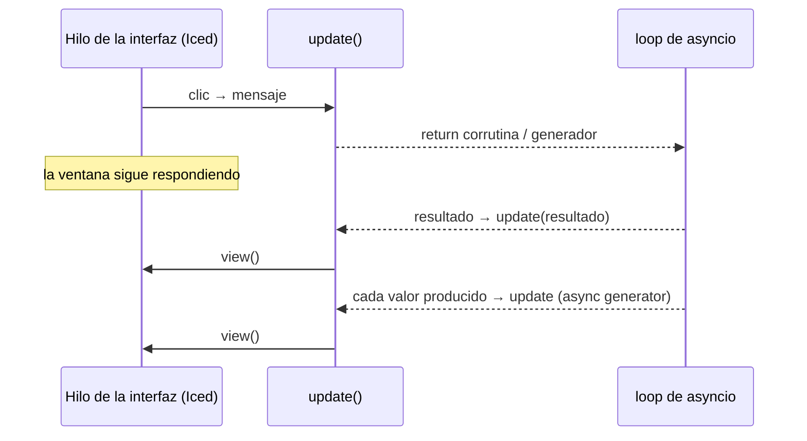

Pyzed ejecuta tus corrutinas en **un único loop de asyncio** que corre en un hilo en segundo
plano. Así puedes usar `aiohttp`, `httpx`, `websockets` y cualquier librería async sin
configurar nada, y la ventana nunca se bloquea.

## Qué puede devolver `update` o un callback



| Valor devuelto | Qué hace Pyzed |
| --- | --- |
| `None` | Vuelve a dibujar. |
| un `Command` o una lista de ellos | Los ejecuta. |
| una **corrutina** (`async def`) | La ejecuta en el loop y envía su resultado a `update`. |
| un **generador** | Lo recorre en un hilo y envía cada valor a `update`. |
| un **generador async** | Lo recorre en el loop y envía cada valor a `update`. |
| cualquier otro valor | Lo envía a `update` como mensaje. |

Los valores `None` que produzca un generador se ignoran.

## Una petición: corrutina o `Command.perform`

```python
import httpx


class Repos(pz.App):
    def __init__(self):
        self.repos, self.loading = [], False

    def on_start(self):
        return self.load()

    async def load(self):                       # devolver una corrutina la ejecuta
        self.loading = True
        async with httpx.AsyncClient() as client:
            r = await client.get("https://api.github.com/users/albakore/repos")
        return ("loaded", r.json())             # va a update()

    def update(self, message):
        kind, data = message
        if kind == "loaded":
            self.repos, self.loading = data, False
```

:::caution[Estado y corrutinas]
El cuerpo de la corrutina corre en el loop de asyncio, no en el hilo de la interfaz. Cambiar
`self` desde ahí funciona para cosas simples, pero lo más seguro es **devolver** el resultado y
modificar el estado en `update` o en el callback `then`.
:::

Con `Command.perform(funcion, then)` el resultado llega a un callback concreto en lugar de a
`update`. `funcion` puede ser normal (corre en un hilo) o `async def` (corre en el loop):

```python
async def fetch_quote():
    await asyncio.sleep(1.2)
    return "Readability counts."

class Quotes(pz.App):
    def load(self):
        self.loading = True
        return pz.Command.perform(fetch_quote, self.loaded)

    def loaded(self, quote):          # en el hilo de la interfaz
        self.quote, self.loading = quote, False
```

`then` se llama aunque `funcion` no devuelva nada (con `None`), así que también sirve para
"avísame cuando termine": `Command.perform(db.migrate, lambda _: self.reload())`.

## Progreso: generadores async

Cada `yield` llega a `update` mientras el trabajo sigue en segundo plano:

```python
async def download(index, size):
    received = 0
    while received < size:
        await asyncio.sleep(0.05)
        received = min(size, received + 100_000)
        yield index, "progress", received / size
    yield index, "finished", size


class Downloads(pz.App):
    def start(self, item):
        item.state = "running"
        return download(item.index, item.size)      # devolver el generador lo arranca

    def update(self, message):
        index, event, value = message
        if event == "progress":
            self.downloads[index].progress = value
```

Para arrancar varios a la vez, envuélvelos en `Command.perform`:
`return [pz.Command.perform(self.start(d)) for d in self.downloads]`.

## Suscripciones: temporizadores y streams

`subscriptions()` devuelve las fuentes de mensajes que deben estar **activas ahora**. Pyzed la
vuelve a evaluar después de cada `update`: una suscripción existe mientras la devuelves y se
detiene en cuanto deja de aparecer.

```python
class Stopwatch(pz.App):
    def __init__(self):
        self.running, self.elapsed = False, 0.0

    def subscriptions(self):
        return [pz.every(0.01, "tick")] if self.running else []

    def update(self, message):
        if message == "tick":
            self.elapsed += 0.01
```

| Función | Qué hace |
| --- | --- |
| `pz.every(segundos, mensaje)` | Envía `mensaje` cada `segundos` (como `time::every` de Iced). Si `mensaje` es un callable, se llama. |
| `pz.listen(funcion)` | Ejecuta `funcion()` (un generador o generador async) mientras la suscripción esté activa y envía cada valor a `update`. |

```python
async def feed():
    async with websockets.connect("wss://example.com/prices") as ws:
        async for message in ws:
            yield json.loads(message)


class Ticker(pz.App):
    def subscriptions(self):
        return [pz.listen(feed)] if self.connected else []
```

Las suscripciones se identifican por una **clave** (por defecto, el mensaje o la función). Si
necesitas dos iguales con parámetros distintos, pasa `key="..."`.

:::tip[Animaciones]
`ui.spinner()` y otros dibujos que dependen del reloj solo se mueven cuando la vista se redibuja.
Mantén una suscripción `pz.every(1 / 30, lambda: None)` activa mientras se muestran.
:::

## Utilidades

- `pz.spawn(corrutina)` programa una corrutina en el loop de Pyzed sin esperar su resultado
  (devuelve un `concurrent.futures.Future`).
- `pz.asyncio_loop()` devuelve el loop, por si una librería lo necesita.
- `pz.post(mensaje)` sigue funcionando desde cualquier hilo.
