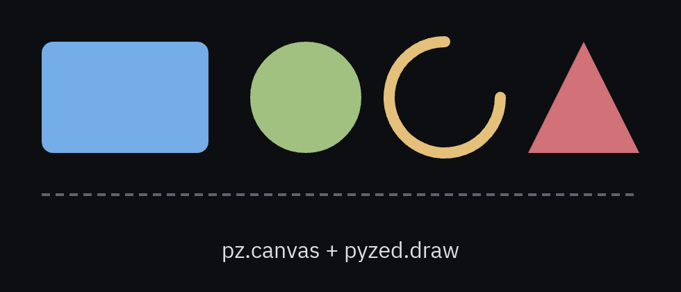

`pz.canvas` es una superficie de dibujo 2D. Las formas se crean con `pyzed.draw` y son
diccionarios simples, así que construirlas en cada frame es barato.


```python
import pyzed as pz
from pyzed import draw

pz.canvas([
    draw.background("#1e2127"),
    draw.circle(100, 100, 40, fill="#74ade8"),
    draw.line(0, 0, 200, 200, stroke="#d07277", width=2, dash=[6, 4]),
    draw.text(100, 180, "Hola", color="#dce0e5", align_x="center"),
], width=200, height=200)
```

Los ángulos van en grados, `y` crece hacia abajo y los colores aceptan lo mismo que `pz.text`.

## Formas



| Función | Forma |
| --- | --- |
| `draw.background(color)` | Rellena todo el canvas. |
| `draw.rect(x, y, w, h, fill=, stroke=, width=, radius=, dash=)` | Rectángulo (redondeado con `radius`). |
| `draw.rects([(x, y, w, h), ...], fill=)` | Muchos rectángulos de un color en una sola forma (rápido para rejillas). |
| `draw.circle(x, y, r, ...)` | Círculo. |
| `draw.line(x1, y1, x2, y2, stroke=, width=, dash=, cap=)` | Línea; `cap="round"` redondea los extremos. |
| `draw.polyline(puntos, closed=False)` / `draw.polygon(puntos)` | Líneas que unen puntos / figura cerrada. |
| `draw.arc(x, y, r, inicio, fin, pie=False)` | Arco (0° = las 3 en punto, sentido horario); `pie=True` lo cierra por el centro. |
| `draw.path(ops)` | Trazado libre con operaciones tipo SVG: `("M", x, y)`, `("L", x, y)`, `("Q", cx, cy, x, y)`, `("C", ...)`, `("A", cx, cy, r, inicio, fin)`, `("Z",)`. |
| `draw.text(x, y, texto, color=, size=, font=, weight=, align_x=, align_y=)` | Texto anclado en `(x, y)`. |
| `draw.image(source, x, y, w, h, rotation=, opacity=, pixelated=)` | Un mapa de bits (sprite), decodificado una vez y en caché. Ver [Crear videojuegos](/pyzed/es/games/). |

## Transformaciones

`draw.translate(x, y)`, `draw.rotate(grados)` y `draw.scale(x, y)` afectan a las formas que
vienen **después**. Delimítalas con `draw.save()` / `draw.restore()`, o usa `draw.group`:

```python
def manecilla(angulo, largo, color):
    return draw.group(
        [draw.line(0, 0, 0, -largo, stroke=color, width=3, cap="round")],
        x=100, y=100, rotation=angulo,
    )

pz.canvas([draw.circle(100, 100, 90, stroke="#5c6370", width=2),
           *manecilla(self.minutos * 6, 70, "#dce0e5"),
           *manecilla(self.segundos * 6, 85, "#d07277")], width=200, height=200)
```

## Eventos del ratón

`pz.canvas` acepta callbacks que reciben coordenadas relativas al canvas:

```python
pz.canvas(formas, width=400, height=300,
          on_press=lambda x, y: self.pintar(x, y),
          on_move=lambda x, y: self.mover(x, y),
          cursor="crosshair")
```

Consulta la [referencia de `canvas`](/pyzed/es/reference/widgets/#canvas) para la lista completa.

## Rendimiento

Dale un `id` al canvas para cachear la geometría entre frames: solo se vuelve a teselar cuando
cambian las formas. Para miles de celdas, usa `draw.rects` en lugar de un `draw.rect` por celda.

Los gráficos de `pyzed.ui` (`sparkline`, `bar_chart`, `donut`, `spinner`) están hechos con
`canvas`: mira [`python/pyzed/ui/display.py`](https://github.com/albakore/pyzed/blob/main/python/pyzed/ui/display.py)
como ejemplo.
