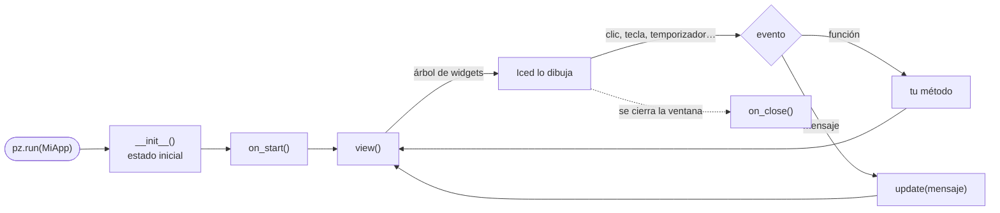

Todo lo que escribes en Pyzed es uno de cuatro tipos de clase (o archivo). Cada uno tiene unos pocos métodos que
Pyzed llama por ti en el momento justo: esta página los lista, dice cuándo se ejecutan y muestra qué poner en ellos.

| Escribes | Es | Pyzed llama a |
| --- | --- | --- |
| `class MiApp(pz.App)` | La app y su ventana principal. | `view()`, `update()`, `on_start()`, `on_key()`, `subscriptions()`… |
| `class Ajustes(pz.Window)` | Otra ventana de la misma app. | `view()`, `on_open()`, `on_close()`, `on_resize()`… |
| `login.pzform` + `login.py` | Un formulario dibujado en [Pyzed Design](/pyzed/es/editor/), con sus handlers. | `form_load(form, event)`, `<control>_<evento>(form, event)`… |
| `class Rating(pz.Component)` | Una pieza de interfaz reutilizable con props, estado y eventos. | `setup()`, `render()`, `on_mount()`, `on_unmount()` |



## `pz.App`: la aplicación

```python
import pyzed as pz
from pyzed import ui


class Notes(pz.App):
    title = "Notas"                 # las opciones de la ventana son atributos de clase
    size = (720, 480)
    theme = "One Dark"

    def __init__(self):             # 1. el estado inicial: atributos normales
        self.notes = []
        self.draft = ""
        self.saved_at = None

    def on_start(self):             # 2. una vez, cuando la ventana está abierta
        return pz.Command.focus("draft")

    def view(self):                 # 3. después de cada cambio: describe la ventana
        return pz.column([
            ui.input(self.draft, self.set_draft, id="draft", placeholder="Nota nueva",
                     on_submit=self.add),
            pz.column([ui.list_item(n, icon="sticky-note") for n in self.notes]),
            ui.muted(f"Guardado a las {self.saved_at}" if self.saved_at else "Sin guardar"),
        ], spacing=8, padding=16)

    def set_draft(self, text):      # 4. los callbacks cambian el estado
        self.draft = text

    def add(self):
        if self.draft.strip():
            self.notes.append(self.draft.strip())
            self.draft = ""

    def update(self, message):      # 5. aquí llegan los mensajes que no son funciones
        if message == "save":
            self.saved_at = "ahora"

    def on_key(self, combo):        # 6. cada tecla pulsada en la ventana
        if combo == "ctrl-s":
            return self.update("save")

    def subscriptions(self):        # 7. temporizadores y flujos activos ahora mismo
        return [pz.every(60, "save")] if self.notes else []


pz.run(Notes)
```

### Los métodos

| Método | Cuándo lo llama Pyzed | Qué poner | Puede devolver |
| --- | --- | --- | --- |
| `__init__()` | Una vez, al crear la app (`pz.run(MiApp)` la crea). | El estado inicial como atributos. Ni widgets ni E/S. | — |
| `view()` | Al empezar y después de **cada** evento, mensaje o comando. | Construir y devolver el árbol de widgets a partir del estado. Nunca cambies el estado aquí. | Un `Widget` (obligatorio). |
| `update(message)` | Cuando el handler de un widget es un valor (texto, tupla, dataclass…) o una función devuelve uno. | Cambiar el estado según el mensaje. | `None`, un `Command`, una lista, una corrutina u otro mensaje. |
| `on_start()` | Una vez, después de abrir la ventana. | Cargar datos, enfocar un campo, empezar una tarea en segundo plano. | Un `Command`, una corrutina o un mensaje. |
| `on_key(combo)` | En cada tecla de la ventana, antes que el widget enfocado. `combo` es como `"ctrl-shift-p"`. | Atajos globales. Devolver algo (aunque sea `[]`) evita que la tecla mueva el foco. | Como `update`. |
| `on_key_up(key)` | Cuando se suelta una tecla (`"left"`, `"space"`). | Juegos y controles de mantener pulsado. | Como `update`. |
| `subscriptions()` | Después de cada actualización. | Devolver los temporizadores, flujos y callbacks por fotograma que deben correr *ahora*: `pz.every`, `pz.listen`, `pz.frames`. La que dejas de devolver se detiene. | Una lista. |
| `on_close()` | Cuando el usuario cierra la ventana. | Preguntar si guardar. Devuelve `False` para dejarla abierta. | `None` o `False`. |
| `on_resize(width, height)` | Cuando la ventana cambia de tamaño. | Cambiar de diseño (mira también `self.window_size`). | Como `update`. |
| `frame_menus()` | Cuando `frame = "custom"` dibuja la barra de título. | Los menús de su izquierda: `[ui.Menu("Archivo", [...])]`. | Una lista o `None`. |

Y los que llamas tú:

| Método | Qué hace |
| --- | --- |
| `run(reload=None)` | Abre la ventana y bloquea hasta que la app se cierra (igual que `pz.run(MiApp)`). `reload=True` activa la [recarga en caliente](/pyzed/es/editor/console-and-running/). |
| `screenshot(path, size=None)` | Dibuja el estado actual en un PNG sin pantalla (tests, documentación). |
| `resolved_theme()` | El tema en uso ahora mismo, con `pz.set_style` aplicado: `self.resolved_theme().accent`. |

Atributos útiles que el runtime mantiene al día: `self.window_size`, `self.window_focused`, `self.window_maximized`,
`self.window_position` y `self.system_dark`. Las opciones de la ventana (`title`, `size`, `min_size`, `resizable`,
`frame`, `transparent`, `icon`, `splash`, `tab_focus`…) están en la [referencia de App](/pyzed/es/reference/app/#app).

:::tip[¿Funciones o mensajes?]
Un handler puede ser una **función** (`self.add`, `lambda: self.open(ruta)`), que Pyzed llama directamente, o un
**mensaje** (`"save"`, `("delete", item.id)`, `Delete(item.id)`), que va a `update`. Las dos formas conviven en la
misma app: mira [Imperativo, declarativo y funcional](/pyzed/es/guides/code-styles/) para saber cuándo usar cada una.
:::

## `pz.Window`: más ventanas

Una `Window` es una `App` sin las partes de toda la aplicación: tiene su propio `view()` y sus opciones de ventana,
y manda sus mensajes al `update()` de la app. Se abre devolviendo un comando:

```python
class Settings(pz.Window):
    title = "Ajustes"
    size = (420, 300)

    def on_open(self):                       # la ventana ya está en pantalla
        self.draft = self.app.prefs.copy()   # self.app es la App que la abrió

    def view(self):
        return pz.column([
            ui.switch(self.draft["dark"], self.set_dark, label="Modo oscuro"),
            ui.button("Guardar", self.save, variant="solid"),
        ], spacing=12, padding=16)

    def set_dark(self, value):
        self.draft["dark"] = value

    def save(self):
        self.app.prefs = self.draft
        return self.close()                  # un comando

    def on_close(self):                      # el usuario pulsó la X de la ventana
        return None if self.draft == self.app.prefs else False


class Main(pz.App):
    prefs = {"dark": True}

    def view(self):
        return ui.button("Ajustes…", lambda: Settings().open())
```

| Método | Cuándo | Notas |
| --- | --- | --- |
| `view()`, `on_key()`, `on_key_up()`, `on_resize()`, `subscriptions()` | Como en `App`. | — |
| `on_open()` | La ventana se abrió (`self.app` ya está puesto). | Puede devolver un comando. |
| `on_close()` | El usuario pidió cerrarla. | `False` la deja abierta. |
| `update(message)` | Un mensaje producido dentro de la ventana. | Por defecto lo reenvía a `self.app.update`. |
| `open()`, `close()`, `drag()`, `minimize()`, `toggle_maximize()` | Los llamas tú. | Cada uno devuelve un `Command`: devuélvelo desde un handler. |

Mira [Varias ventanas](/pyzed/es/guides/windows/) para posiciones, ventanas modales y marcos propios.

## Formularios diseñados: `.pzform` + handlers

Un formulario que dibujas en Pyzed Design se guarda como `login.pzform` (los controles y sus propiedades) y
`login.py` (tu código). El archivo de código no tiene clase: cada evento es una **función** llamada
`<control>_<evento>`, y los eventos del propio formulario son `form_<evento>`. Cada handler recibe el `form` en
marcha y el `event`:

```python
# login.py: los handlers de login.pzform

def form_load(form, event):                 # se abrió la ventana
    form.status.text = ""
    return form.email.focus()               # los handlers pueden devolver comandos


def email_change(form, event):              # cada tecla: event.value es el texto nuevo
    form.sign_in.enabled = "@" in event.value


def password_submit(form, event):           # Enter en la contraseña
    return sign_in_click(form, event)


def sign_in_click(form, event):
    if not form.validate():                 # aplica las reglas de validación del diseñador
        return
    form.progress.show()
    return form.open("welcome", data=form.email.text)


def form_key(form, event):                  # cada tecla: event.value es la combinación
    if event.value == "escape":
        return form.close()


def form_close(form, event):                # devuelve False para dejar la ventana abierta
    if form.password.text:
        return False
```

| Handler | Cuándo | `event.value` |
| --- | --- | --- |
| `form_load` | Una vez, al abrirse la ventana. | `None` |
| `form_close` | La ventana se está cerrando; `False` la deja abierta. | `None` |
| `form_key` | Cada tecla pulsada. | La combinación, `"ctrl-s"` |
| `form_resize` | La ventana cambió de tamaño. | `(ancho, alto)` |
| `<control>_<evento>` | El control lanzó el evento (`click`, `change`, `submit`, `tick`…). | Depende del evento: el texto nuevo, `True`/`False`, el elemento elegido… |

El objeto `form` es tu acceso a la ventana: `form.<control>.<propiedad>` lee y escribe propiedades,
`form.<control>.show()` / `.hide()` / `.focus()`, `form.title`, `form.data` (lo que pasó `form.open(..., data=)`),
`form.validate()`, `form.close()` y `form.open("otro_formulario")`. Los eventos de cada control están en
[Eventos y handlers](/pyzed/es/editor/events/) y en cada página de la [biblioteca](/pyzed/es/library/).

Ejecuta un formulario desde Python, o ábrelo desde una app escrita en código:

```python
from pyzed import designer

designer.run("ui/login.pzform")                       # el formulario es la app (igual que `pyzed run`)

class Main(pz.App):                                   # o un formulario como una ventana más
    def view(self):
        return ui.button("Entrar…", lambda: designer.open_window("login", data="ada@example.com"))
```

## `pz.Component`: piezas reutilizables

Un componente es una clase con **props** (atributos de clase con anotación, que pasa el padre), **estado**
(atributos que conserva entre dibujados) y **eventos** (que lanza con `self.emit`). Llamarlo devuelve un widget.

```python
class Stepper(pz.Component):
    """Un número con botones − y +."""

    value: int = 0                                  # props
    step: int = 1
    min: int = 0
    max: int = 10
    events = {"change": "Cambió el valor (event.value es el número nuevo)."}

    pressed: int = pz.state(0)                      # estado, privado de cada instancia

    def setup(self):                                # una vez, antes del primer render
        self.pressed = 0

    def on_mount(self):                             # después del primer render
        return None

    def change(self, delta):
        self.pressed += 1
        new = max(self.min, min(self.max, self.value + delta))
        return self.emit("change", new)             # llama al on_change del padre

    def render(self):                               # en cada render del padre
        return pz.row([
            ui.icon_button("minus", lambda: self.change(-self.step)),
            pz.text(str(self.value), size=18),
            ui.icon_button("plus", lambda: self.change(self.step)),
        ], spacing=8, align="center")

    def on_unmount(self):                           # ya no se dibuja
        print(f"pulsado {self.pressed} veces")


# En cualquier view:
Stepper(value=self.copies, max=99, on_change=lambda e: setattr(self, "copies", e.value))
```

| Método | Cuándo | Notas |
| --- | --- | --- |
| `setup()` | Una vez, antes del primer render. Las props ya están puestas. | Inicializa el estado. |
| `render()` | Cada vez que el `view()` del padre llama al componente. | Devuelve widgets; lee `self.<prop>` y el estado. |
| `on_mount()` | Después del primer render. | Puede devolver un `Command` o un mensaje. El handler `on_mount=` del padre también se ejecuta. |
| `on_unmount()` | Cuando el padre deja de dibujarlo. Su estado se descarta. | Para temporizadores, cierra archivos. |
| `emit(name, value)` | Lo llamas tú. | Llama al `on_<nombre>` del padre con un `pz.Event(value=..., source=self)`. Devuelve su resultado. |
| `handles(name)` | Lo llamas tú. | Si el padre pasó `on_<nombre>`: oculta un botón que nadie escucha. |
| `provide()` | Antes de cada render. | Un dict compartido con todo lo que se dibuja dentro (`pz.use_context(nombre)`). |
| `context(name)` | Lo llamas tú. | El valor más cercano compartido con `pz.provide` o `provide()`. |
| `Rating.create(...)` | En tests. | Una instancia sin dibujarla: `Rating.create(value=3).render()`. |

Todo componente acepta además los [eventos comunes](/pyzed/es/guides/events/) (`on_click`, `on_drag`,
`on_key_down`…), `style=`, `class_=`, `id=`, `animate=` y `key=`. Mira [Componentes propios](/pyzed/es/guides/components/)
para hijos, contexto, hojas de estilo y cómo aparecen los componentes en la caja de herramientas del diseñador.

## Crear tus propios eventos

Un evento es un nombre más un valor que una pieza de la interfaz le da a quien la usa. Hay tres formas de crear
uno, de la más estructurada a la más simple.

### 1. En un componente: `events` y `emit`

Declara los eventos y lánzalos con `self.emit(nombre, valor)`. El padre los escucha con `on_<nombre>=`:

```python
class ColorRow(pz.Component):
    colors: list = ()
    selected: str = ""
    events = {
        "pick": "Se hizo clic en un color (event.value es el color).",
        "remove": "Se pulsó la × de un color (event.value es el color).",
    }

    def render(self):
        return pz.row([
            pz.row([
                ui.color_swatch(c, size=28 if c == self.selected else 20,
                                on_press=lambda c=c: self.emit("pick", c)),
                self.handles("remove") and ui.icon_button("x", lambda c=c: self.emit("remove", c), size="xs"),
            ], spacing=2)
            for c in self.colors
        ], spacing=8)


ColorRow(colors=self.palette, selected=self.color,
         on_pick=lambda e: setattr(self, "color", e.value),
         on_remove=lambda e: self.palette.remove(e.value))
```

- `events` es un dict `{nombre: descripción}` (la descripción se ve en el diseñador y en la referencia) o una tupla
  de nombres. Las subclases suman eventos a los que heredan.
- El handler recibe un `pz.Event` con `type` (el nombre), `value` y `source` (el componente). Un handler sin
  argumentos (`on_pick=self.refresh`) se llama sin nada.
- `emit` de un nombre no declarado lanza un error, así que las erratas se ven enseguida.
- Todo componente emite además `mount` y `unmount`.

### 2. En una función: un parámetro callback

Los componentes de `pyzed.ui` son funciones normales con parámetros `on_*`. Las tuyas también pueden serlo: recibe el
callback como parámetro y dáselo a un widget, o envuélvelo para pasarle un valor.

```python
def tag_list(tags, on_remove=None, on_add=None):
    """Etiquetas como chips. on_remove(tag) al pulsar la × de un chip, on_add() para el botón +."""
    return pz.row([
        *[ui.chip(t, on_remove=on_remove and (lambda t=t: on_remove(t))) for t in tags],
        on_add and ui.icon_button("plus", on_add, tooltip="Añadir etiqueta"),
    ], spacing=6)


tag_list(self.tags, on_remove=self.tags.remove, on_add=self.new_tag)
```

### 3. Para toda la app: mensajes y `pz.post`

Un mensaje es un evento para toda la app: cualquier valor que llega a `update`. Úsalo cuando lo mismo puede venir de
varios sitios (un botón, un atajo, un menú, un temporizador, un hilo):

```python
from dataclasses import dataclass


@dataclass
class Downloaded:                     # un mensaje con datos
    name: str
    size: int


def worker(url):                      # se ejecuta en un hilo
    data = fetch(url)
    pz.post(Downloaded(url, len(data)))   # cualquier hilo puede mandar un mensaje a update()


class App(pz.App):
    def update(self, message):
        match message:
            case Downloaded(name, size):
                self.files.append((name, size))
```

En Pyzed Design, los **eventos propios** de un componente diseñado se añaden en su tarjeta *Eventos* y se lanzan
desde su código con `self.emit("change", valor)`. Mira [Diseñador de componentes](/pyzed/es/editor/component-designer/).

## Siguiente

- [Eventos](/pyzed/es/guides/events/): los eventos comunes de todo widget y el objeto `pz.Event`.
- [Eventos de cada componente](/pyzed/es/library/events/): cuántos eventos tiene cada componente, y cuáles.
- [Imperativo, declarativo y funcional](/pyzed/es/guides/code-styles/): la misma app escrita de tres formas.
- [Arquitectura de una app](/pyzed/es/guides/architecture/): el ciclo view → mensaje → update en detalle.
