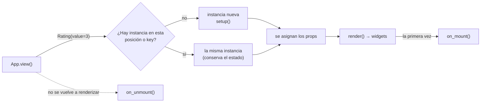

Un componente es una clase que agrupa widgets con su lógica, como un componente de React:

- **Props**: atributos de clase anotados, con su valor por defecto. El padre los pasa en cada render.
- **Estado**: cualquier otro atributo que asignes. Se conserva entre renders.
- `render()` devuelve los widgets del componente.
- `events` declara los eventos propios que lanza con `self.emit(nombre, valor)`.

```python
import pyzed as pz


class Rating(pz.Component):
    """Estrellas que se pueden pulsar."""

    value: int = 0                 # props
    max: int = 5
    events = {"change": "Se eligió una estrella (event.value es la puntuación)."}
    icon = "star"                  # cómo aparece en la biblioteca del diseñador

    def setup(self):               # una vez, antes del primer render
        self.hover = None          # estado

    def render(self):
        visibles = self.hover or self.value
        return pz.row([
            pz.text("★" if i <= visibles else "☆", size=20).on(
                click=lambda i=i: self.emit("change", i),
                mouse_enter=lambda i=i: setattr(self, "hover", i),
                mouse_leave=lambda: setattr(self, "hover", None),
            )
            for i in range(1, self.max + 1)
        ], spacing=2)
```

Llamar a un componente devuelve un widget, así que va en cualquier sitio donde iría un widget:

```python
class Opinion(pz.App):
    estrellas = 3

    def view(self):
        return pz.column([
            Rating(value=self.estrellas, on_change=lambda e: setattr(self, "estrellas", e.value)),
            pz.text(f"{self.estrellas} de 5"),
        ])
```


[`examples/components.py`](https://github.com/albakore/pyzed/blob/main/examples/components.py) tiene
una puntuación con estrellas, un editor de etiquetas y una nota que se puede arrastrar.

## Eventos

- **Eventos propios**: se declaran en `events`, como tupla de nombres o como diccionario
  `{nombre: descripción}`. El padre los atiende con `on_<nombre>=`.
- `self.emit(nombre, valor)` llama al handler del padre con un `pz.Event` que lleva `value` y
  `source`. Devuelve su resultado desde tu callback, para que un `Command` o un mensaje lleguen
  al runtime.
- **Eventos comunes**, como `on_click`, `on_drag` y `on_key_down`, funcionan en cualquier
  componente sin escribir nada. Ver [Eventos](/pyzed/es/guides/events/).
- **Eventos de ciclo de vida**: `on_mount` y `on_unmount` avisan al padre cuando el componente
  aparece y desaparece.
- **`style=`** da estilo al componente como a cualquier widget (`Rating(value=3, style="card")`),
  salvo que declare su propia prop `style`. Ver [Estilos](/pyzed/es/guides/styles/).

## Estado y claves

El estado también se puede declarar en la clase con `pz.state(valor)`. A diferencia de una prop, el padre
no puede pasarlo, cada instancia empieza con su propia copia del valor (así que listas y diccionarios son
seguros) y el diseñador lo muestra junto a las props:

```python
class Counter(pz.Component):
    step: int = 1             # prop
    count: int = pz.state(0)  # estado

    def render(self):
        return ui.button(f"{self.count}", lambda: setattr(self, "count", self.count + self.step))
```


El estado se guarda por posición dentro del `view()` del padre: el segundo `Rating` de una vista
conserva su propio estado mientras no cambie el orden. Si los componentes salen de una lista cuyos
elementos se mueven, dale a cada uno una `key` estable:

```python
pz.column([TodoItem(key=tarea.id, todo=tarea) for tarea in self.tareas])
```

Un componente que deja de renderizarse se desmonta y su estado se descarta.



## Ciclo de vida

| Hook | Cuándo |
| --- | --- |
| `setup()` | Una vez, antes del primer render. Los props ya están asignados. Inicializa aquí el estado. |
| `render()` | En cada render del padre. |
| `on_mount()` | Después del primer render. Puede devolver un `Command` o un mensaje. |
| `on_unmount()` | Cuando el componente deja de renderizarse. |

Los hooks se ejecutan después de dibujar la vista, nunca en medio.

## En el diseñador

Cada subclase de `pz.Component` aparece en la biblioteca del [diseñador](/pyzed/es/guides/designer/):

- **Props**: se convierten en propiedades. `bool` muestra un interruptor, `int` y `float` un campo
  numérico, `Literal[...]` un desplegable, `list` un elemento por línea, y un prop llamado
  `color` o `icon` tiene su propio selector.
  Las anotaciones de `pyzed` eligen un editor más completo, como los export hints de Godot:

  | Anotación | Editor |
  | --- | --- |
  | `pz.Color` | Un selector de color (token del tema o `#rrggbb`). |
  | `pz.Icon` | Un selector de icono. |
  | `pz.Multiline` | Un área de texto. |
  | `Annotated[int, pz.Range(0, 10)]` | Un campo numérico limitado de 0 a 10 (`step` es opcional). |

  En ejecución son `str` e `int` normales: `tint: pz.Color = "accent"`.
- **Eventos propios**: se convierten en eventos a los que puedes asignar código.

Estos atributos de clase controlan cómo aparece:

| Atributo | Por defecto |
| --- | --- |
| `label` | El nombre de la clase, separado en palabras. |
| `icon` | `"component"` (cualquier icono de Lucide). |
| `category` | `"Custom"`. |
| `size` | `(160, 40)`, el tamaño al colocarlo en un formulario. |
| `designer` | `True`; con `False` no aparece en la biblioteca. |
| `type_name` | El nombre de la clase en snake case; el id que se guarda en los formularios. |

El primer párrafo del docstring se muestra como descripción.

Para crear un componente dibujándolo en vez de escribir `render()`, usa el
[modo componente](/pyzed/es/guides/component-designer/) del diseñador.
