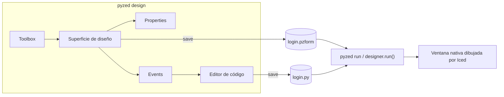
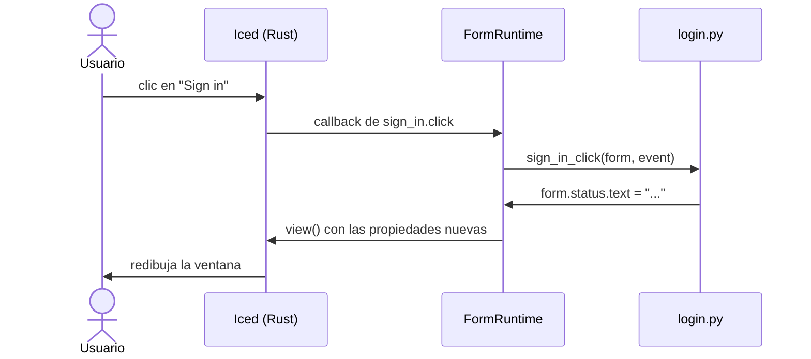
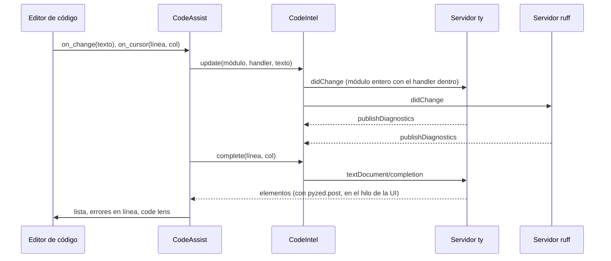
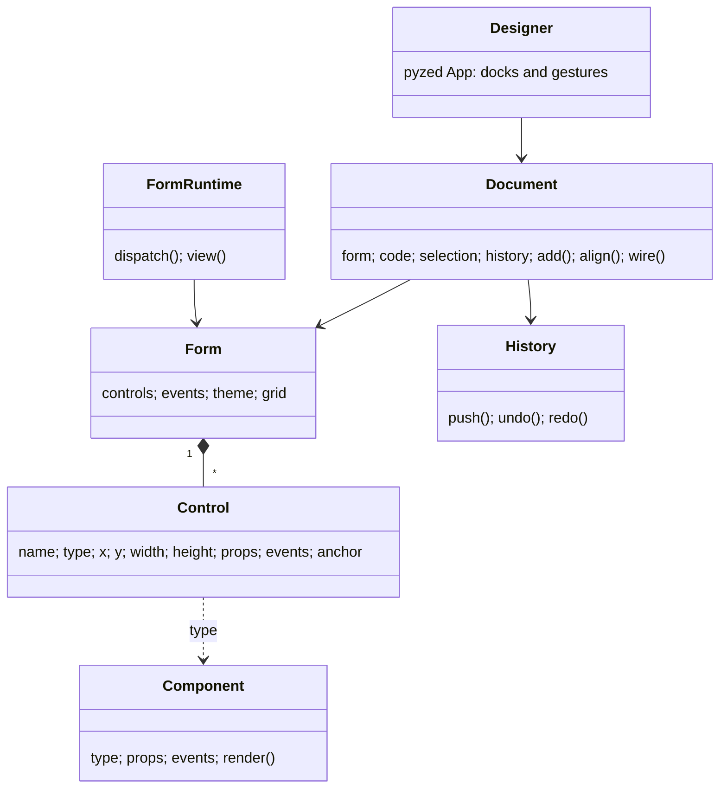

Pyzed Designer es un editor de formularios al estilo de Visual Basic, el diseñador de WinForms de Visual Studio y
Qt Designer, hecho con el propio Pyzed. Dibujas la ventana con el ratón, ajustas propiedades en una grilla, haces
doble clic en un control para escribir el código de su evento y pulsas **F5** para ejecutarla con toda su lógica.

```bash
pyzed design login.pzform      # abre (o crea) un formulario
pyzed run login.pzform         # lo ejecuta, sin el diseñador
pyzed run login.pzform --reload  # ...y lo actualiza cada vez que se guarda el formulario o su código
```


## La ventana

| Zona | Qué hace |
| --- | --- |
| **Toolbox** (izquierda) | La biblioteca de componentes. Haz clic en uno y luego en el formulario para colocarlo con su tamaño por defecto, o arrastra un rectángulo para darle tamaño. La búsqueda filtra la lista. |
| **Outline** (izquierda) | Todos los controles por orden Z (el de arriba primero). Clic para seleccionar; el ojo y el candado ocultan o bloquean un control. |
| **Formulario** (centro) | La superficie de diseño con grilla de puntos. Arrastra para mover, usa las ocho asas para redimensionar y arrastra en un hueco para seleccionar con un rectángulo. El tirador de la esquina inferior derecha cambia el tamaño del formulario. |
| **Properties** (derecha) | Nombre, propiedades del componente, layout (X, Y, tamaño, anclajes) y comportamiento (visible, habilitado, bloqueado). Sin selección edita el formulario: título, tamaño, tema, acento, fondo, radio de esquinas, tamaño de letra y grilla. |
| **Events** (derecha) | Los eventos del control seleccionado (o del formulario). Doble clic en uno crea su handler y lo abre en el editor de código. |
| **Código** (abajo) | El código de un handler, o del archivo entero (**F7**). **Apply** comprueba la sintaxis antes de tocar el archivo. |


## Alineación, grilla y snapping

- **Ajustar a la grilla** (imán) redondea posiciones y tamaños al paso de la grilla (8 px por defecto, configurable
  por formulario). **G** muestra u oculta los puntos.
- **Guías inteligentes** (regla) pegan el control que mueves a los bordes y centros de los demás y del formulario, y
  dibujan una línea roja mientras coinciden.
- La barra de herramientas alinea la selección por bordes **izquierdo, centro, derecho, superior, medio o inferior**,
  **distribuye** tres o más controles por igual, les da el **mismo ancho o alto**, los **centra** en el formulario y
  cambia el **orden Z**. Con un solo control, la alineación es respecto al formulario.
- Los **anclajes** deciden qué pasa al redimensionar la ventana en ejecución, como en WinForms: anclado a izquierda y
  derecha el control se estira, anclado solo a la derecha sigue ese borde, sin anclajes queda centrado.


### Teclado

| Teclas | Acción |
| --- | --- |
| Arrows / Shift+arrows | Mover 1 px / un paso de grilla |
| Delete | Borrar la selección |
| Ctrl+C, Ctrl+X, Ctrl+V, Ctrl+D | Copiar, cortar, pegar, duplicar |
| Ctrl+A | Seleccionar todo |
| Ctrl+Z, Ctrl+Shift+Z | Deshacer, rehacer |
| Enter | Abrir el código del evento principal del control |
| Escape | Cancelar un arrastre, cerrar un menú, volver al puntero |
| Ctrl+S, Ctrl+O, Ctrl+N | Guardar, abrir, nuevo |
| F5, Shift+F5 | Ejecutar el formulario, cerrarlo |
| F7 | Editar el archivo de código completo |
| Ctrl+Espacio | Abrir la lista de autocompletado (en el editor de código) |

Clic derecho en un control abre un menú contextual con las mismas acciones.

## Estética

Cada formulario elige cualquier tema registrado (One, Ayu, Gruvbox o el tuyo) y puede cambiar el color de acento,
el fondo, el radio de las esquinas y el tamaño de letra. El tema del propio diseñador es independiente (selector
arriba a la derecha).


## Archivos

Un formulario son dos archivos juntos, pensados para versionarse:

```
login.pzform   ← diseño: JSON, diffs legibles
login.py       ← handlers de eventos: Python normal
```



El `.pzform` guarda la configuración del formulario y, por cada control, su tipo, posición, tamaño, propiedades,
anclajes y qué handler llama cada evento:

```json
{
  "format": "pyzed.form/1",
  "form": { "name": "login", "title": "Sign in", "width": 440, "height": 400, "theme": "One Dark", "events": { "load": "form_load" } },
  "controls": [
    { "name": "sign_in", "type": "button", "x": 48, "y": 304, "width": 344, "height": 32,
      "props": { "text": "Sign in", "variant": "solid", "icon": "log-in" },
      "events": { "click": "sign_in_click" }, "anchor": ["left", "top"] }
  ]
}
```

## Cambios en vivo

Los formularios funcionan con hot reload (`pyzed.hot_reload`): ejecútalos con `pyzed run app.pzform --reload` (o
`designer.run(ruta, reload=True)`, o `PYZED_RELOAD=1`) y cada vez que guardes `app.pzform` o `app.py`, desde el
diseñador o desde tu editor, la ventana abierta se actualiza sin reiniciarse. Se reemplazan el diseño, las
propiedades y el código; lo que el usuario escribió o eligió en cada control se mantiene. Dentro del diseñador,
**Guardar** también refresca el formulario abierto con **F5**.

## Escribir handlers de eventos

Los handlers se llaman `<control>_<evento>` y reciben el `form` en ejecución y un `event`. Los controles son
atributos del formulario y sus propiedades atributos del control; al cambiarlas se actualiza la ventana.

```python
def sign_in_click(form, event):
    if "@" not in form.email.text:
        form.status.text = "Enter a valid email address."
        return form.email.focus()          # los handlers pueden devolver comandos
    form.sign_in.enabled = False
    form.progress.show()
    form.ticker.running = True             # un control Timer empieza a contar
```

`event.sender` es el control que lo lanzó, `event.name` el evento y `event.value` su valor (el texto nuevo de una caja
de texto, el estado de una casilla, la combinación de teclas del evento `key` del formulario...). Pueden devolver lo
mismo que cualquier callback de Pyzed: un `Command`, una corrutina, un generador. Si un handler lanza una excepción,
el error aparece abajo en la ventana en vez de cerrarla.



### Eventos

Todo control visible tiene `mouse_enter`, `mouse_leave` y `right_click`. Además:

| Componente | Eventos |
| --- | --- |
| Button | `click` |
| Label | `click`, `double_click` |
| Text box | `change`, `submit` |
| Text area, Check box, Switch, Radio group, Drop-down, Slider, Number box, List box | `change` |
| Timer (invisible al ejecutar) | `tick` |
| Formulario | `load`, `close` (devuelve `False` para no cerrar), `key`, `resize` |

## Editor de código

El panel de código es un editor de Python respaldado por dos servidores de lenguaje de Astral: **ty** (tipos,
autocompletado, referencias) y **ruff** (lint). Se ejecutan en el proyecto del formulario, así que el
autocompletado conoce tus dependencias.


### Autocompletado

- La lista se abre mientras escribes un nombre o después de un `.`, y **Ctrl+Espacio** la abre en cualquier
  lugar. **Arriba**/**Abajo** para moverte, **Enter** o **Tab** para insertar, **Escape** para cerrarla.
- Cada entrada tiene un icono según su tipo y un panel con su firma y su documentación (el docstring):

  | Color del icono | Tipo |
  | --- | --- |
  | Morado | Funciones y métodos |
  | Amarillo | Clases, enums, parámetros de tipo |
  | Azul | Variables, atributos y propiedades |
  | Cian | Constantes |
  | Rojo | Módulos |
  | Acento | Controles del formulario |

  Los nombres privados (`_cache`) se ven atenuados, llevan un candado y van después de los públicos; los dunders
  (`__init__`) van al final.
- `form.` lista los controles del formulario, `form.email.` las propiedades de esa caja de texto y `event.` los
  campos del evento: los completa el propio diseñador, porque el `form` de un handler no tiene un tipo que los
  servidores puedan leer.
- Si eliges un nombre que todavía no está importado (una entrada de *auto-import*), también se añade su `import`
  al principio del archivo.


### Tu proyecto y sus dependencias

Los servidores arrancan en la carpeta del `pyproject.toml` más cercano por encima del formulario (o `uv.lock`,
`setup.py`, `.git`) y usan su `.venv`, que es donde `uv sync` instala tus dependencias (si no, `$VIRTUAL_ENV`). La
carpeta del formulario y `src/` se añaden como raíces de importación, así que una UI en su propia carpeta resuelve
las dos cosas:

```
miapp/
├── pyproject.toml      ← uv add httpx
├── .venv/              ← uv sync
├── src/miapp/
└── ui/
    ├── login.pzform
    ├── login.py        ← import httpx / from helpers import greet / from miapp import api
    └── helpers.py
```

Instala los servidores en el proyecto con `uv add --dev ty ruff`, o junto al diseñador con
`pip install "pyzed-ui[designer]"`. El diseñador los busca primero en el `.venv` del proyecto, después en su propio
entorno y por último en el `PATH`. Ruff lee sus reglas de `[tool.ruff]` en `pyproject.toml`.



El editor muestra un handler, pero los servidores siempre ven el módulo entero con ese handler dentro, así que
conocen los imports y las funciones auxiliares del principio del archivo; las posiciones se traducen entre ambos.

### Diagnósticos y code lens


- El primer problema de cada línea se muestra al final de la línea (error lens) y todos aparecen en una lista bajo
  el editor; haz clic en uno para ir a él. La cabecera cuenta errores y advertencias.
- El **code lens** al final de cada línea `def` y `class` muestra cuántas referencias tiene (según ty), cuántas
  clases lo implementan y qué eventos lo llaman (`on sign_in.click`).

### Configuración del editor

El botón del engranaje del panel de código (o los puntos de los servidores en la barra de estado) abre la
configuración del editor. Se guarda por usuario en `designer.json`, dentro de la carpeta de configuración de Pyzed
(`%APPDATA%\pyzed`, `~/Library/Application Support/pyzed` o `~/.config/pyzed`).


| Opción | Qué hace |
| --- | --- |
| Servidores de lenguaje | Activa o desactiva ty y ruff, muestra si cada uno está listo (y su versión), la raíz del proyecto y el Python que se usa. **Restart servers** después de `uv sync`. |
| Tema, tamaño de fuente | El editor puede usar un tema distinto del diseñador. |
| Números de línea, resaltar la línea actual, ajuste de línea | Margen y disposición. |
| Mostrar espacios | Dibuja los espacios como `·` y los tabuladores como `→`. |
| Tamaño de tabulación | Tab inserta espacios, Enter mantiene la sangría (un nivel más después de `:`) y Retroceso quita un nivel. |
| Autocompletar al escribir | Desactivado, la lista solo se abre con Ctrl+Espacio. |
| Formatear con ruff al aplicar | Ejecuta `ruff format` sobre el código al pulsar Apply. |
| Code lens, diagnósticos en línea | Muestran u ocultan las notas al final de las líneas. |

## Componentes

Label, Heading, Button, Text box, Text area, Check box, Switch, Radio group, Drop-down, Slider, Number box,
List box, Progress bar, Badge, Image, Icon, Markdown, Spinner, Panel, Divider and Timer.


Para dibujar tus propios componentes, con propiedades, estado, métodos y eventos, usa el
[diseñador de componentes](/pyzed/es/guides/component-designer/). Se suman a esta biblioteca al guardarlos.

Registra los tuyos y aparecen en la toolbox:

```python
from pyzed import ui
from pyzed.designer import Component, Prop, register

register(Component(
    type="rating", label="Rating", icon="star", category="Custom", size=(120, 24),
    props=(Prop("value", "number", 3, min=0, max=5),),
    events=("change",),
    render=lambda control, ctx: ui.label("★" * int(control.props["value"])),
))
```

`render` se usa en el diseñador (inerte) y al ejecutar; usa `ctx.on(control, "change", "value")` para los
callbacks y el mismo código sirve en ambos.

## Formularios desde código

Todo lo que hace el diseñador está disponible desde Python, útil para generar formularios o para tests:

```python
from pyzed import designer
from pyzed.designer import Document

doc = Document(designer.Form(name="hello", title="Hello", width=320, height=140))
doc.add("input", 16, 16, 200, 28)
doc.add("button", 224, 16)
doc.select_all()
doc.align("middle")
handler = doc.wire("button1", "click")
doc.set_handler_source(handler, "def button1_click(form, event):\n    form.button1.text = form.input1.text\n")
doc.save("hello.pzform")

designer.run("hello.pzform")
```

## Cómo está hecho



- `model.py`: el formulario y sus controles, guardados como JSON.
- `components.py`: la biblioteca de componentes y el `render` compartido por diseñador y runtime.
- `geometry.py`: snapping, alineación, distribución, redimensionado, anclajes y guías (funciones puras).
- `history.py`: deshacer/rehacer con instantáneas; las ediciones seguidas de un campo cuentan como un paso.
- `code.py`: busca, añade, renombra y reemplaza handlers con `ast` sin tocar el resto del archivo.
- `document.py`: todos los comandos de edición, sin UI, así que se puede testear entero.
- `project_panel.py`: la pestaña Project (proyectos de uv, dependencias, ruff, ty y git; consulta [Proyectos con uv](/pyzed/es/guides/projects/)).
- `surface.py` y `panels.py`: las vistas; `app.py`: la app `Designer` que traduce clics y teclas al documento.
- `scene.py`, `scene_code.py`, `scene_runtime.py` y `scene_panel.py`: el [diseñador de componentes](/pyzed/es/guides/component-designer/)
  (el modelo `.pzcomp`, el código de la clase, `SceneComponent` y el panel Component).
- `runtime.py`: `FormApp` y `FormWindow`, que dibujan un formulario y llaman a sus handlers.
- `lsp.py`: un pequeño cliente JSON-RPC para servidores de lenguaje y la detección del proyecto y su `.venv`.
- `intellisense.py`: `CodeIntel`, que mantiene ty y ruff sincronizados con el handler abierto, y la lógica de
  autocompletado, diagnósticos y code lens (sin UI).
- `code_panel.py`: la vista del editor de código y `CodeAssist`, su estado; `settings.py`: la configuración del editor.
