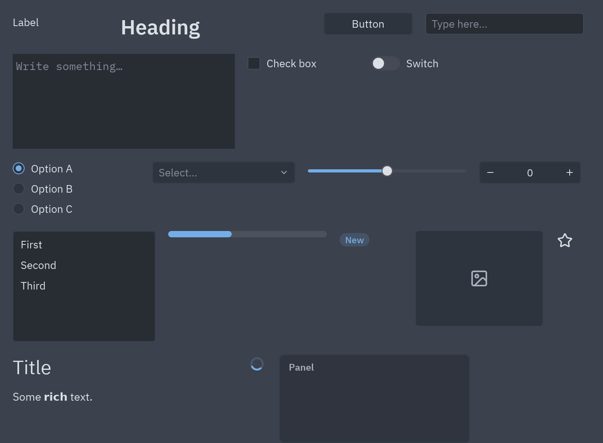

Pyzed Design es un editor de formularios al estilo de Visual Basic, el diseñador de WinForms de Visual Studio y
Qt Designer, hecho con el propio Pyzed. Dibujas la ventana con el ratón, ajustas propiedades en una grilla, haces
doble clic en un control para escribir el código de su evento y pulsas **F5** para ejecutarla con toda su lógica.

```bash
pyzed design login.pzform        # abre (o crea) un formulario
pyzed run login.pzform           # lo ejecuta, sin el diseñador
pyzed run login.pzform --reload  # ...y lo actualiza cada vez que se guarda el formulario o su código
```


Todo sobre el editor está ahora en su propio manual, **[Pyzed Design](/pyzed/es/editor/)**:

| Tema | Página |
| --- | --- |
| La ventana y sus zonas | [Introducción](/pyzed/es/editor/) |
| Colocar, mover, alinear, snap, la estructura | [Herramientas y lienzo](/pyzed/es/editor/toolbox-and-canvas/) |
| La grilla de propiedades, listas y tablas | [Propiedades](/pyzed/es/editor/properties/) |
| Paneles, filas y columnas flex, grillas, anclajes | [Disposición y contenedores](/pyzed/es/editor/layouts/) |
| La sección Estilo, el selector de color, los temas | [Estilos y temas](/pyzed/es/editor/styles-and-themes/) |
| Eventos y cómo escribir manejadores | [Eventos y manejadores](/pyzed/es/editor/events/) |
| Autocompletado, diagnósticos, servidores de lenguaje | [Editor de código](/pyzed/es/editor/code-editor/) |
| F5, la consola de depuración, recarga en caliente | [Ejecutar y la consola](/pyzed/es/editor/console-and-running/) |
| Proyectos de uv, dependencias, ruff, ty, git | [Proyectos](/pyzed/es/editor/projects/) |
| Componentes reutilizables | [Diseñador de componentes](/pyzed/es/editor/component-designer/) |
| Formularios nuevos, plantillas, archivos `.pzform`, scripting | [Archivos, plantillas y scripting](/pyzed/es/editor/files-and-scripting/) |
| Menús, la paleta de comandos, docks | [Menús y comandos](/pyzed/es/editor/menus-and-commands/) |
| Todos los atajos | [Atajos de teclado](/pyzed/es/editor/keyboard-shortcuts/) |
| Preferencias | [Ajustes](/pyzed/es/editor/settings/) |

## Consola de depuración

Ver [Ejecutar y la consola](/pyzed/es/editor/console-and-running/#la-consola).

## Paneles

Ver [Paneles y docks](/pyzed/es/editor/menus-and-commands/#paneles-y-docks).

## Editor de código

Ver [Editor de código](/pyzed/es/editor/code-editor/): autocompletado, diagnósticos, code lens, plegado y los
servidores de lenguaje ty y ruff.

## Telemetría

Ver [Ajustes → Telemetría](/pyzed/es/editor/settings/#telemetría).

## Componentes

**Comunes**: Label, Heading, Button, Text box, Text area, Check box, Switch, Radio group, Drop-down, Slider, Number
box, List box, Link y Search box. **Contenedores**: Panel, Group box, Card. **Disposición**: Flex row, Flex column,
Grid, Spacer. **Navegación**: Tab bar, Segmented. **Presentación**: Progress bar, Badge, Chip, Callout, Avatar, Key
binding, Stat, Chart, Table, Image, Icon, Markdown, Spinner, Divider y Timer.



Para añadir los tuyos, ver [Archivos, plantillas y scripting](/pyzed/es/editor/files-and-scripting/#añadir-tus-propios-componentes)
y el [diseñador de componentes](/pyzed/es/editor/component-designer/).

## Cómo está hecho

Ver [Archivos, plantillas y scripting → Cómo está hecho](/pyzed/es/editor/files-and-scripting/#cómo-está-hecho).
