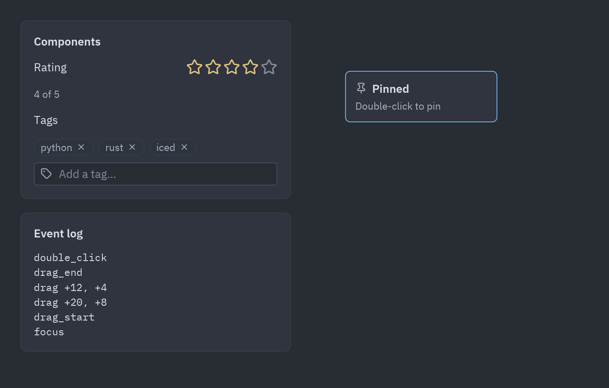
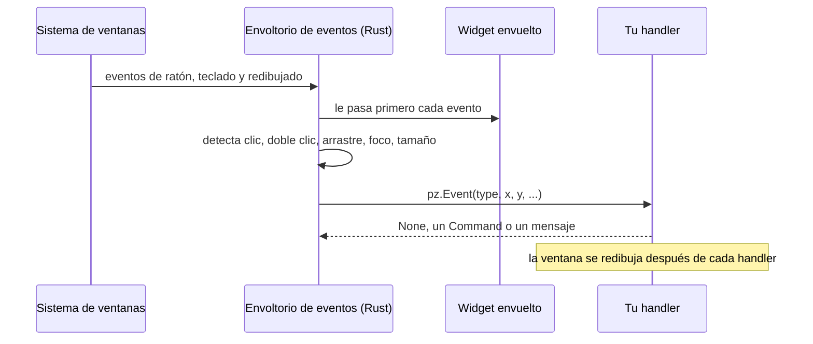

Cualquier widget puede reaccionar a los eventos que suelen ofrecer los editores gráficos: clics,
dobles clics, hover, arrastre, foco, teclas y cambios de tamaño. Se añaden con `.on(...)`:

```python
import pyzed as pz

tarjeta = pz.container(pz.text("Arrástrame"), padding=12, bg="#2c313a").on(
    click=self.seleccionar,                       # sin argumentos: solo se llama
    double_click=lambda e: self.renombrar(e.x),   # con uno: recibe un pz.Event
    drag=self.mover,                              # e.dx, e.dy desde el último drag
    key_down=self.atajo,                          # después de que un clic le dé el foco
    cursor="grab",
)
```

`pz.on(widget, ...)` hace lo mismo. Llamar otra vez a `.on()` combina los handlers, y `None`
quita uno. Un handler también puede ser un mensaje (cualquier valor que no sea invocable), que va
a `update` como el resto de callbacks de Pyzed.



## Los eventos

| Grupo | Evento | Cuándo |
| --- | --- | --- |
| Ratón | `click` | Se pulsó y soltó el botón izquierdo. |
| | `double_click` | Dos clics seguidos (después del segundo `click`). |
| | `right_click`, `middle_click` | Se pulsó el botón derecho o el central. |
| | `mouse_down`, `mouse_up` | Cualquier botón (`event.button` es `"left"`, `"right"`...). |
| | `mouse_enter`, `mouse_leave` | El puntero entró o salió del widget. |
| | `mouse_move` | El puntero se movió sobre el widget. |
| | `scroll` | Giró la rueda (`event.dx`, `event.dy` en líneas). |
| Arrastre | `drag_start`, `drag`, `drag_end` | Botón izquierdo pulsado y movido unos píxeles; `drag` da el movimiento desde el anterior. |
| Foco | `focus`, `blur` | Un clic en el widget le da el foco; un clic fuera se lo quita. |
| Teclado | `key_down`, `key_up` | Teclas mientras tiene el foco (`event.key`, por ejemplo `"ctrl-s"`). |
| Layout | `resize` | El widget tiene un tamaño nuevo, incluido el primero. |

`pz.events.CATALOG` tiene esta lista con sus descripciones (el diseñador las muestra).

## El objeto `Event`

| Campo | Significado |
| --- | --- |
| `type` | El nombre del evento. |
| `x`, `y` | Posición del puntero respecto a la esquina superior izquierda del widget (`position` da las dos). |
| `dx`, `dy` | Cantidad de scroll, o movimiento del arrastre desde el `drag` anterior. |
| `width`, `height` | El tamaño del widget (`size` da los dos). |
| `button` | `"left"`, `"right"`, `"middle"`... para los botones del ratón. |
| `key` | La combinación de teclas en los eventos de teclado. |
| `shift`, `ctrl`, `alt`, `logo` | Modificadores pulsados. |
| `value`, `source` | En eventos personalizados: el valor y el componente que lo emitió. |

Un handler recibe el evento solo si tiene un parámetro posicional obligatorio (o `*args`).
`lambda: ...` y `lambda i=i: ...` se llaman sin nada, así que la forma habitual de capturar la
variable de un bucle sigue funcionando.

## Cómo funciona

Los eventos están implementados una sola vez, en un widget nativo que envuelve al tuyo
(`src/events.rs`), en lugar de en cada componente. Ese envoltorio solo observa: nunca detiene un
evento, así que un botón dentro de una tarjeta sigue recibiendo su clic y la tarjeta también.



Los componentes hechos con [`pz.Component`](/pyzed/es/guides/components/) también aceptan estos
eventos (`on_click=...`) y añaden los suyos.
