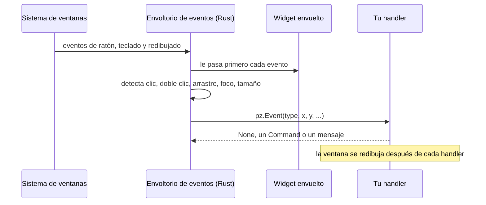

Cualquier widget puede reaccionar a los eventos que suelen ofrecer los editores gráficos: clics,
dobles clics, hover, arrastre, foco, teclas y cambios de tamaño. Se añaden con `.on(...)`:

```python
import pyzed as pz

tarjeta = pz.container(pz.text("Arrástrame"), padding=12, bg="#2c313a").on(
    click=self.seleccionar,                       # sin argumentos: solo se llama
    double_click=lambda e: self.renombrar(e.x),   # con uno: recibe un pz.Event
    drag=self.mover,                              # e.dx, e.dy desde el último drag
    key_down=self.atajo,                          # después de que un clic le dé el foco
    cursor="grab",
)
```

`pz.on(widget, ...)` hace lo mismo. Llamar otra vez a `.on()` combina los handlers, y `None`
quita uno. Un handler también puede ser un mensaje (cualquier valor que no sea invocable), que va
a `update` como el resto de callbacks de Pyzed.


## Los eventos

| Grupo | Evento | Cuándo |
| --- | --- | --- |
| Ratón | `click` | Se pulsó y soltó el botón izquierdo. |
| | `double_click` | Dos clics seguidos (después del segundo `click`). |
| | `right_click`, `middle_click` | Se pulsó el botón derecho o el central. |
| | `mouse_down`, `mouse_up` | Cualquier botón (`event.button` es `"left"`, `"right"`...). |
| | `mouse_enter`, `mouse_leave` | El puntero entró o salió del widget. |
| | `mouse_move` | El puntero se movió sobre el widget. |
| | `scroll` | Giró la rueda (`event.dx`, `event.dy` en líneas). |
| Arrastre | `drag_start`, `drag`, `drag_end` | Botón izquierdo pulsado y movido unos píxeles; `drag` da el movimiento desde el anterior. |
| Foco | `focus`, `blur` | Un clic en el widget le da el foco; un clic fuera se lo quita. |
| Teclado | `key_down`, `key_up` | Teclas mientras tiene el foco (`event.key`, por ejemplo `"ctrl-s"`). |
| Layout | `resize` | El widget tiene un tamaño nuevo, incluido el primero. |

`pz.events.CATALOG` tiene esta lista con sus descripciones (el diseñador las muestra).

## El objeto `Event`

| Campo | Significado |
| --- | --- |
| `type` | El nombre del evento. |
| `x`, `y` | Posición del puntero respecto a la esquina superior izquierda del widget (`position` da las dos). |
| `dx`, `dy` | Cantidad de scroll, o movimiento del arrastre desde el `drag` anterior. |
| `width`, `height` | El tamaño del widget (`size` da los dos). |
| `button` | `"left"`, `"right"`, `"middle"`... para los botones del ratón. |
| `key` | La combinación de teclas en los eventos de teclado. |
| `shift`, `ctrl`, `alt`, `logo` | Modificadores pulsados. |
| `value`, `source` | En eventos personalizados: el valor y el componente que lo emitió. |

Un handler recibe el evento solo si tiene un parámetro posicional obligatorio (o `*args`).
`lambda: ...` y `lambda i=i: ...` se llaman sin nada, así que la forma habitual de capturar la
variable de un bucle sigue funcionando.

## Eventos propios y eventos comunes

Todo widget reacciona a los eventos en dos capas:

| | Eventos propios | Eventos comunes |
| --- | --- | --- |
| Qué son | Los parámetros `on_*` de un componente: `on_press`, `on_input`, `on_select`, `on_close`… | Los 18 eventos de esta página: `click`, `mouse_enter`, `drag`, `key_down`, `resize`… |
| Qué widgets | Cada componente los suyos (un botón tiene 1, una barra de pestañas 7, un área de ratón 10). | Todos, sean lo que sean. |
| Cómo | `ui.input(texto, self.escrito, on_submit=self.enviar)` | `widget.on(double_click=self.renombrar)` |
| El handler recibe | El valor del componente: el texto, si está marcado, el elemento, la fila… | Nada, o un `pz.Event`. |

Los dos se mezclan sin problema en el mismo widget:

```python
ui.list_item("main.py", self.abrir, icon="file").on(   # on_press: su evento propio
    right_click=lambda e: self.menu(e.x, e.y),          # un evento común
    mouse_enter=lambda: setattr(self, "encima", "main.py"),
)
```

[Eventos de cada componente](/pyzed/es/library/events/) lista los eventos propios de cada componente, qué recibe su
handler y cuántos eventos puede tener en total. Cada página de la [biblioteca](/pyzed/es/library/) tiene una sección
**Eventos** con ellos, escritos en tres estilos.

## Recetas

### Pasar el puntero y hacer clic

```python
class Cards(pz.App):
    def __init__(self):
        self.hovered = None
        self.opened = None

    def card(self, name):
        hot = self.hovered == name
        return pz.container(pz.text(name), padding=16, radius=8, bg="#3b4048" if hot else "#2c313a").on(
            mouse_enter=lambda: setattr(self, "hovered", name),
            mouse_leave=lambda: setattr(self, "hovered", None),
            click=lambda: setattr(self, "opened", name),
            cursor="pointer",
        )

    def view(self):
        return pz.row([self.card(n) for n in ("Entrada", "Borradores", "Enviados")], spacing=8)
```

:::tip
Para cambiar solo *colores* al pasar el puntero no hacen falta eventos: `pz.Style(hover={"background": "..."})` y el
`hover_bg` de los botones los cambian sin llamar a Python. Usa `mouse_enter` / `mouse_leave` cuando el estado le
importa a tu app.
:::

### Un menú contextual donde está el puntero

```python
class Board(pz.App):
    def __init__(self):
        self.menu_at = None

    def view(self):
        board = pz.container(ui.muted("Clic derecho en cualquier sitio"), width="fill", height="fill").on(
            right_click=lambda e: setattr(self, "menu_at", (e.x, e.y)),   # dónde, dentro del tablero
        )
        x, y = self.menu_at or (0, 0)
        menu = ui.menu([ui.MenuItem("Nota nueva", lambda: setattr(self, "menu_at", None), icon="plus")])
        return ui.popover(board, menu if self.menu_at else None, x=x, y=y,
                          on_dismiss=lambda: setattr(self, "menu_at", None))
```

### Arrastrar para mover

```python
class Desk(pz.App):
    def __init__(self):
        self.x, self.y = 40, 40

    def move(self, e):                          # e.dx, e.dy: lo que se movió desde el último drag
        self.x += e.dx
        self.y += e.dy

    def view(self):
        note = pz.container(pz.text("Arrástrame"), padding=12, radius=8, bg="#e5c07b", color="#282c34")
        return pz.stack([pz.pin(note.on(drag=self.move, cursor="grab"), x=self.x, y=self.y)],
                        width="fill", height="fill")
```

### Doble clic para renombrar

```python
class Rename(pz.App):
    def __init__(self):
        self.name, self.editing = "notas.py", False

    def view(self):
        if self.editing:
            return ui.input(self.name, lambda t: setattr(self, "name", t), id="name",
                            on_submit=lambda: setattr(self, "editing", False))
        return ui.label(self.name).on(double_click=self.start)

    def start(self):
        self.editing = True
        return pz.Command.focus("name")          # un handler puede devolver un comando
```

### Ctrl + clic para elegir varios

```python
class Files(pz.App):
    def __init__(self):
        self.selected = set()

    def pick(self, name, e):
        if e.ctrl or e.logo:                     # Ctrl (Cmd en macOS) suma a la selección
            self.selected ^= {name}
        else:
            self.selected = {name}

    def view(self):
        return pz.column([
            ui.list_item(n, None, icon="file", selected=n in self.selected).on(
                click=lambda e, n=n: self.pick(n, e))
            for n in ("a.py", "b.py", "c.py")
        ], width=240)
```

### Cambiar el diseño según el tamaño

```python
class Gallery(pz.App):
    def __init__(self):
        self.narrow = False

    def view(self):
        items = [ui.card(ui.muted(f"Foto {i}"), width=160) for i in range(6)]
        layout = pz.column(items, spacing=8) if self.narrow else pz.row(items, spacing=8, wrap=True)
        return pz.container(layout, width="fill").on(resize=lambda e: setattr(self, "narrow", e.width < 520))
```

### Ctrl + rueda para hacer zoom

```python
class Zoom(pz.App):
    def __init__(self):
        self.zoom = 1.0

    def view(self):
        return pz.container(pz.text("Hazme zoom", size=16 * self.zoom), width="fill", height="fill").on(
            scroll=lambda e: setattr(self, "zoom", max(0.5, min(4, self.zoom + e.dy * 0.1))) if e.ctrl else None,
            double_click=lambda: setattr(self, "zoom", 1.0),
        )
```

### Foco y teclas en cualquier widget

```python
class Field(pz.App):
    def __init__(self):
        self.focused, self.last_key = False, ""

    def view(self):
        border = "#74ade8" if self.focused else "#3e4452"
        return pz.container(pz.text(self.last_key or "Haz clic y pulsa teclas"), padding=16,
                            border_color=border, border_width=1, radius=6).on(
            focus=lambda: setattr(self, "focused", True),
            blur=lambda: setattr(self, "focused", False),
            key_down=lambda e: setattr(self, "last_key", e.key),
        )
```

## En los tres estilos

Un handler de `.on(...)` puede ser una función o un mensaje, como cualquier otro handler, así que los eventos comunes
encajan en los [tres estilos](/pyzed/es/guides/code-styles/):

```python
# Imperativo: el handler cambia self
ui.card(ui.muted("Pasa por encima"), selected=self.hovered).on(
    mouse_enter=lambda: setattr(self, "hovered", True),
    mouse_leave=lambda: setattr(self, "hovered", False))

# Declarativo: los handlers son mensajes y update() decide
@dataclass
class Hover:
    on: bool

ui.card(ui.muted("Pasa por encima"), selected=self.hovered).on(mouse_enter=Hover(True), mouse_leave=Hover(False))

def update(self, message):
    match message:
        case Hover(on):
            self.hovered = on

# Funcional: una vista pura pide un estado nuevo
def view(state, set_state):
    return ui.card(ui.muted("Pasa por encima"), selected=state.hovered).on(
        mouse_enter=lambda: set_state(hovered=True), mouse_leave=lambda: set_state(hovered=False))
```

Un mensaje que le das a `.on()` llega a `update` tal cual, sin el `pz.Event`. Si necesitas los datos del evento,
construye el mensaje en una lambda: `drag=lambda e: Moved(e.dx, e.dy)`.

## Cómo funciona

Los eventos están implementados una sola vez, en un widget nativo que envuelve al tuyo
(`src/events.rs`), en lugar de en cada componente. Ese envoltorio solo observa: nunca detiene un
evento, así que un botón dentro de una tarjeta sigue recibiendo su clic y la tarjeta también.



Los componentes hechos con [`pz.Component`](/pyzed/es/guides/components/) también aceptan estos
eventos (`on_click=...`) y añaden los suyos: mira [crear tus propios eventos](/pyzed/es/guides/classes/#crear-tus-propios-eventos).
En un [formulario diseñado](/pyzed/es/editor/events/), los eventos de cada control se conectan en el panel Eventos.
