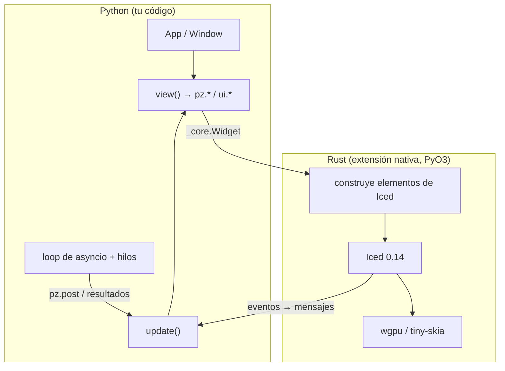

```
Python                         Rust (pyzed._core, PyO3)                 Iced 0.14
App.view() ──► árbol de Widget ──► render.rs: Widget → iced::Element ──► layout + wgpu/tiny-skia
App.update() ◄── mensajes ◄────── app.rs: Message, Command → Task ◄──── eventos (ratón, teclado)
```

## Piezas



| Archivo | Responsabilidad |
| --- | --- |
| `src/widget.rs` | La clase `Widget` (inmutable) y las funciones que la construyen (`text`, `row`…). |
| `src/render.rs` | Convierte el árbol de `Widget` en `iced::Element` en cada frame. |
| `src/app.rs` | El runtime: `Message`, `Command`, despacho a Python, teclado, `post`, `run` y `screenshot`. |
| `src/style.rs` | Conversión de colores, tamaños, relleno y fuentes desde valores de Python. |
| `src/highlighter.rs` | Resaltado de sintaxis con syntect (gramáticas de two-face) y los colores del tema. |
| `src/fonts.rs` | Fuentes incluidas (IBM Plex, Lucide) y `load_font`. |
| `python/pyzed/` | La clase `App`, temas, iconos, CLI y los componentes de `pyzed.ui`. |

## Rendimiento

- **Los widgets son datos de Rust.** Construir el árbol desde Python crea objetos pequeños e
  inmutables; no hay objetos de Iced vivos en Python.
- **El trabajo pesado está en Rust.** Layout, medición de texto, resaltado, scroll y dibujado
  ocurren en Rust; Python solo se ejecuta cuando hay un mensaje.
- **El GIL se libera** mientras Iced espera eventos, así que los hilos de Python siguen corriendo.
- **Estado nativo para el editor.** El buffer de cada editor (texto, cursor, historial) vive en
  Rust y se identifica por `id`, así que escribir no reconstruye el texto en Python.

## Mensajes

Cada widget interactivo guarda una referencia al valor de Python que le diste. Cuando Iced
produce un evento, `app.rs` lo convierte en una llamada:

1. Si es un callable, lo llama (con el valor del control si lo hay).
2. Si devuelve un `Command`, lo traduce a una `Task` de Iced.
3. Si devuelve otro valor (o el mensaje no era callable), llama a `app.update(valor)`.
4. Vuelve a pedir `view()` y Iced dibuja la diferencia.

## Contribuir

```bash
maturin develop --release
pytest tests
cargo fmt --check && cargo clippy -- -D warnings
```

La documentación vive en [`docs/`](https://github.com/albakore/pyzed/tree/main/docs). Ver
[cómo editar la documentación](/pyzed/es/guides/contributing-docs/).
