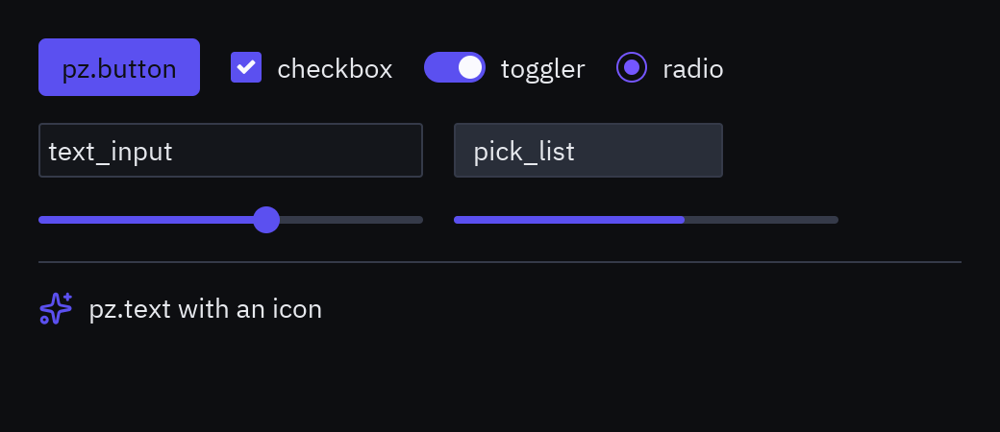
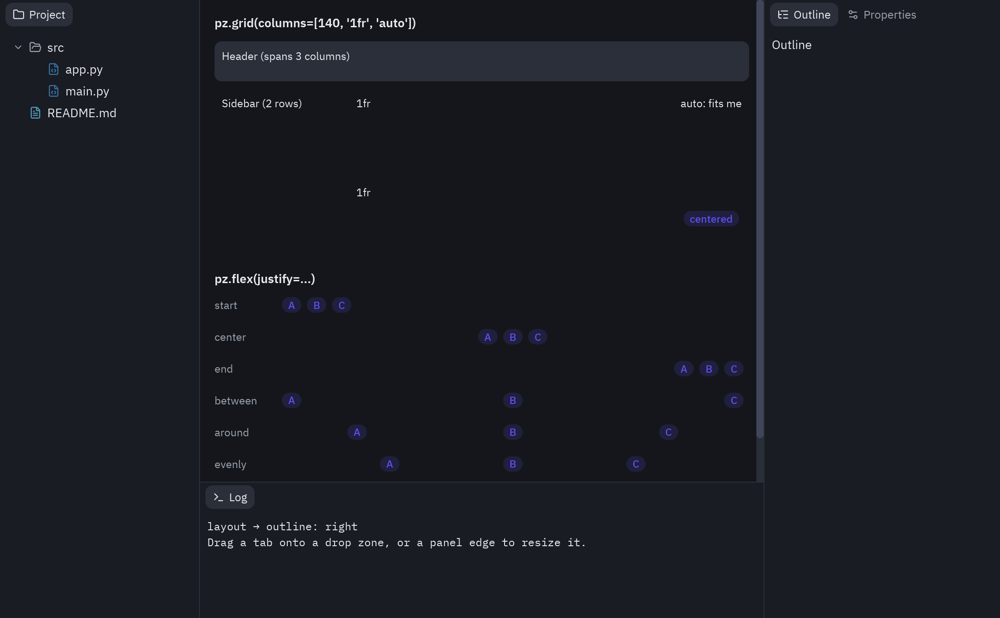

## Filas y columnas



```python
pz.column([a, b, c], spacing=8, padding=16)            # vertical
pz.row([a, b, c], spacing=8, align="center")          # horizontal
```

- `children` acepta listas anidadas y omite `None` y `False`, así que puedes escribir
  `self.error and ui.label(self.error, color="error")`.
- Un texto o un número como hijo se convierte en `pz.text`.
- `align` alinea los hijos en el eje cruzado: `"start"`, `"center"`, `"end"`.

## Tamaños

`width` y `height` aceptan:

| Valor | Significado |
| --- | --- |
| `240` | Píxeles fijos. |
| `"shrink"` | Lo justo para el contenido. |
| `"fill"` | Todo el espacio disponible. |
| `"fill:2"` | Una proporción del espacio: dos `"fill:1"` y un `"fill:2"` reparten 25/25/50. |

```python
pz.row([
    pz.container(sidebar, width=240),
    pz.container(contenido, width="fill"),
])
```

Empuja elementos a los extremos con un hueco flexible:

```python
pz.row([ui.label("Título"), pz.hspace(), ui.button("Cerrar", self.cerrar)])
```

:::caution[Hijos que rellenan]
Un hijo con `"fill"` (por ejemplo, `pz.rule()` horizontal) hace que su columna también rellene.
Si quieres que la columna encoja, pon `width="shrink"` en la columna.
:::

## Relleno

`padding` acepta `8` (todos los lados), `(vertical, horizontal)` o `(arriba, derecha, abajo, izquierda)`.

## Contenedores

`pz.container` envuelve un hijo para darle tamaño, alineación y estilo:

```python
pz.container(
    contenido,
    padding=(12, 16),
    width="fill",
    max_width=720,
    align_x="center",
    bg="#2f343e",
    border_color="#464b57",
    border_width=1,
    radius=8,
    shadow=("#00000066", (0, 4), 16),   # (color, (dx, dy), desenfoque)
    clip=True,
)
```

`pz.center(contenido)` lo centra en todo el espacio. `pz.container(None, width=8, height=8, bg=...)`
es un rectángulo de color.

## Colores

Los colores aceptan `"#rgb"`, `"#rrggbb"`, `"#rrggbbaa"`, tuplas `(r, g, b)` / `(r, g, b, a)` o
`"transparent"`. En los componentes de `pyzed.ui` también puedes usar un token del tema
(`"accent"`, `"text_muted"`…). Para colores derivados:

```python
from pyzed.theme import alpha, mix

alpha(self.resolved_theme().accent, 0.2)            # 20 % de opacidad
mix(self.resolved_theme().editor, "#ffffff", 0.05)  # un 5 % más claro
```

## Texto

```python
pz.text("Hola", size=16, weight="semibold", color="#dce0e5")
pz.text("código", font="mono")
pz.text("una línea muy larga…", wrap=False)
```

Fuentes incluidas: IBM Plex Sans (`"sans"`, por defecto), IBM Plex Mono (`"mono"`) y Lucide
(`"icons"`). Ver [iconos y fuentes](/pyzed/es/theming/icons-fonts/).

## Superposiciones y scroll

- `pz.stack([abajo, arriba])` superpone widgets; `pz.opaque(w)` evita que los clics lo atraviesen.
- `pz.scrollable(contenido, direction="vertical" | "horizontal" | "both")` añade scroll.
  Con `anchor_bottom=True` se queda pegado al final.
- `pz.hover(base, encima)` muestra `encima` solo al pasar el ratón.
- `pz.mouse_area(w, on_right_press=..., on_double_click=..., cursor="pointer")` detecta eventos
  del ratón.

## Rejillas

`pz.grid(hijos, columns=2)` sigue dando una rejilla uniforme. Si pasas **pistas**, se
convierte en una rejilla al estilo CSS: cada pista es un tamaño en píxeles, una parte del
espacio libre (`"1fr"`, `"2fr"`) o `"auto"` (tan grande como su contenido). Las pistas pueden
ser una lista o un texto.



```python
pz.grid(
    [
        pz.cell(cabecera, column=0, row=0, column_span=3),
        pz.cell(lateral, column=0, row=1, row_span=2),
        principal, detalles,
        pz.cell(pz.text("centrado"), align_x="center", align_y="center"),
    ],
    columns=[140, "1fr", "auto"],   # o "140 1fr auto"
    rows="44 1fr 1fr",
    spacing=8,                      # row_spacing= para otro hueco vertical
    height=240,
)
```

`pz.cell` coloca un hijo en una columna/fila, hace que ocupe varias pistas y lo alinea dentro
de su celda. Los hijos sin posición llenan las celdas libres fila a fila.

## Flex

`pz.flex` coloca los hijos en un eje, como flexbox en CSS:

```python
pz.flex([a, b, c], justify="between", align="center", gap=6)
pz.flex([a, b], direction="column", justify="end")
pz.flex([pz.flex_item(a), pz.flex_item(b, grow=2), pz.flex_item(c, basis=120)], gap=6)
```

`justify` es `"start"`, `"center"`, `"end"`, `"between"`, `"around"` o `"evenly"`.
`pz.flex_item` indica cuánto espacio libre toma un hijo (`grow`) o un tamaño fijo (`basis`).
`wrap=True` hace que una fila salte a nuevas líneas.

## Cajas

`pz.box` es un contenedor para cualquier cosa, como un `div` de HTML.
Coloca sus hijos y acepta todas las [propiedades de estilo](/pyzed/es/theming/styles/),
clases y un id, así que una pantalla entera se puede montar con cajas:

```python
pz.box(
    pz.text("Planes").style(size=20, weight="bold"),
    pz.box([plan_card(p) for p in plans], display="grid", columns=3, gap=12),
    pz.box(ui.button("Cancelar", cancel), ui.button("Continuar", go), display="flex", justify="end", gap=8),
    ui.badge("Nuevo").style(position="absolute", top=8, right=8),
    class_="page", padding=24, gap=16, overflow="scroll",
)
```

- `display`:
  - `"block"` (por defecto) pone los hijos uno debajo de otro, tan anchos como la caja.
  - `"flex"` los coloca a lo largo de `direction` con `justify`, `align`, `gap` y `wrap`, como `pz.flex`.
  - `"grid"` usa `columns` y `rows`: un número de columnas iguales o pistas como `"200 1fr auto"`.
  - `"stack"` los pone uno encima de otro.
- `align` acepta `"start"`, `"center"`, `"end"` o `"stretch"`.
- `overflow` acepta `"visible"`, `"hidden"` (recorta el contenido) o `"scroll"`
  (también `"scroll_x"` o `"scroll_y"`).
- Un hijo con `position="absolute"` sale del flujo. Se coloca con
  `top`/`right`/`bottom`/`left` dentro de la caja, por encima del resto, y el de mayor
  `z_index` queda arriba.
- `class_` e `id` aplican las reglas de la [hoja de estilo](/pyzed/es/theming/styles/#hojas-de-estilo)
  (una regla para `"box"` da estilo a todas las cajas). `style=` y las propiedades por palabra
  clave van encima, como un atributo `style` en línea.

## Disposiciones ancladas

`pz.anchor_layout` coloca hijos libremente, como un formulario hecho en Pyzed Design, y cada hijo sigue a su
**anclaje** cuando la ventana cambia de tamaño: mantiene su distancia a los bordes a los que está anclado, se estira
entre bordes opuestos y se queda centrado en los demás casos.

```python
pz.anchor_layout([
    pz.anchor(ui.heading("Informe"), x=16, y=12, width=368, height=28, anchor="top_wide"),
    pz.anchor(cuerpo, x=16, y=48, width=368, height=192, anchor="full", max_width=720),
    pz.anchor(ui.button("Cerrar", on_close), x=284, y=252, width=100, height=32, anchor="bottom_right"),
], design=(400, 300))
```

`x`, `y`, `width` y `height` están en el tamaño `design` (por defecto, el más pequeño que contiene a todos los
hijos). `anchor` es uno de los 16 presets de `pyzed.anchors.PRESETS` (`"top_left"`, `"top_center"`, `"top_right"`,
`"top_wide"`, `"center_left"`, `"center"`... `"bottom_wide"`, `"left_tall"`, `"center_tall"`, `"right_tall"` y
`"full"`), palabras como `"left right bottom"` o una tupla de bordes. `min_width`, `min_height`, `max_width` y
`max_height` limitan el tamaño cuando un hijo se estira; `pivot` (de `0` a `1` en cada eje) es el punto que queda
fijo cuando un límite lo frena, y alrededor del que gira `rotate` (grados en sentido horario). `pyzed.anchors.place`
hace la cuenta por su cuenta si colocas cajas tú mismo.

## Paneles acoplables y redimensionables

`pz.resizable(contenido, edge="right", size=240)` da a un panel un borde que el usuario
puede arrastrar. `min_size`/`max_size` lo limitan y `on_resize(tamaño)` avisa del nuevo
tamaño al soltar. `ui.panel` y `ui.workspace` lo usan, así que sus paneles laterales se
pueden redimensionar sin más, y `pz.split` conserva la proporción arrastrada.

`pz.Dock` es un dock estilo editor: un área central con paneles a los lados. Arrastra una
pestaña a una zona (o haz clic derecho) para mover el panel a otro lado, y arrastra su borde
interior para cambiar su tamaño.

```python
pz.Dock(
    center=editor,
    panels=[
        pz.DockPanel("project", "Proyecto", arbol, icon="folder", side="left"),
        pz.DockPanel("outline", "Esquema", esquema, icon="list-tree", side="left"),
        pz.DockPanel("log", "Log", log, icon="terminal", side="bottom"),
    ],
    layout=self.layout,               # restaura una disposición guardada
    on_layout=lambda e: setattr(self, "layout", e.value),
)
```

`on_layout` recibe un dict (posiciones, tamaños, pestañas activas y lados ocultos) que puedes
guardar y devolver como `layout=`. Ver [`examples/layout.py`](https://github.com/albakore/pyzed/blob/main/examples/layout.py).
