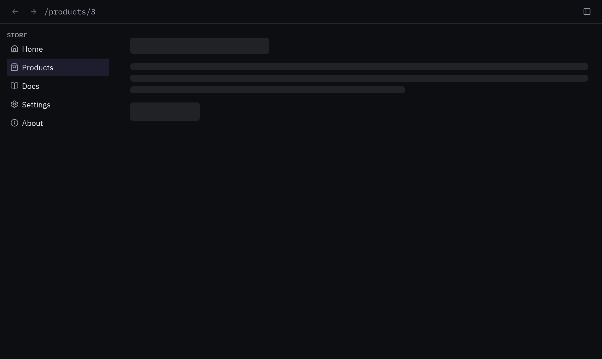
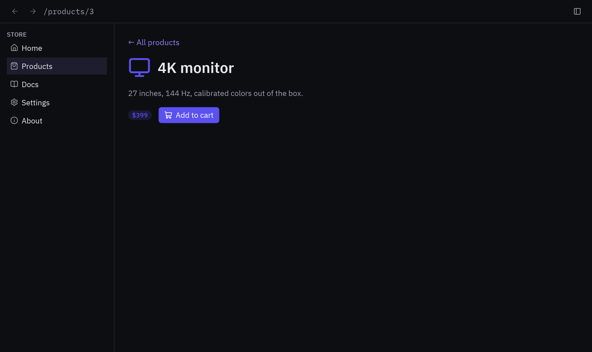
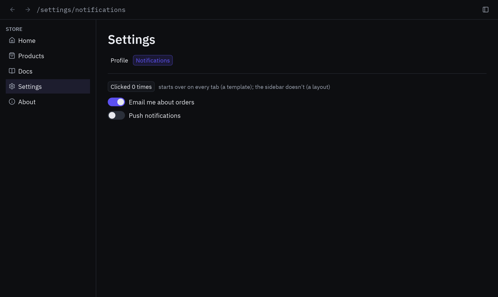
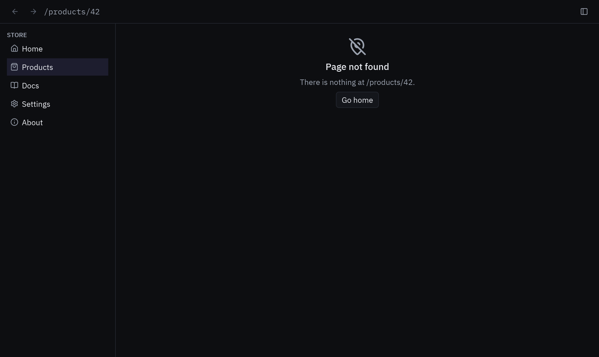

Si has hecho un sitio con el App Router de Next.js, ya sabes hacer una app de Pyzed con varias
páginas. Cada carpeta de `app/` es una parte de la dirección, `page.py` es lo que muestra esa
dirección y `layout.py`, `template.py`, `loading.py`, `error.py` y `not_found.py` hacen lo que dicen
sus nombres. Una app web pasa al escritorio con las mismas carpetas.


## Crear un proyecto

```bash
pyzed new tienda --router            # un proyecto uv
pyzed new tienda --script --router   # o solo main.py y app/, sin uv
```

La plantilla trae un layout con barra lateral, una página de inicio, una lista que carga sus datos
y una página de detalle. Ejecútala con `uv run pyzed dev main.py` (o `python main.py`). Con
`pyzed dev`, cada página que guardas se ve al momento, y una carpeta nueva se convierte en una página
nueva sin reiniciar.

`main.py` solo arranca el router:

```python
import pyzed as pz


class Tienda(pz.RouterApp):
    routes = "app"        # la carpeta, junto a este archivo
    title = "Tienda"      # el título de la ventana cuando una página no tiene
    size = (1000, 680)


if __name__ == "__main__":
    pz.run(Tienda)
```

## Las carpetas son direcciones

```text
app/
├── layout.py               envuelve todas las páginas
├── page.py                 /
├── loading.py              mientras carga una página
├── error.py                cuando una página falla
├── not_found.py            direcciones desconocidas
├── about/page.py           /about
├── (tienda)/               un grupo: no forma parte de la dirección
│   └── products/
│       ├── page.py         /products
│       └── [id]/
│           ├── loading.py
│           └── page.py     /products/3        params["id"] == "3"
├── docs/[[...slug]]/page.py   /docs, /docs/a/b   params["slug"] == ["a", "b"]
└── _componentes/           privada: no es una ruta, pon aquí tus ayudas
```

| Nombre de carpeta | Coincide con | `params` |
| --- | --- | --- |
| `products` | ese texto exacto | |
| `[id]` | una parte | `{"id": "3"}` |
| `[...slug]` | una parte o más | `{"slug": ["a", "b"]}` |
| `[[...slug]]` | cero partes o más | `{"slug": []}` en `/docs` |
| `(grupo)` | nada: solo organiza | |
| `_privada` | se ignora | |

Como en Next.js, una carpeta fija gana a `[id]`, que gana a `[...slug]`, que gana a `[[...slug]]`.
Si dos carpetas responden a la misma dirección (por ejemplo `(a)/about` y `(b)/about`), el router
lo avisa al arrancar.

## Páginas

Un archivo de ruta define una función con su mismo nombre, que recibe solo los argumentos que pide:

```python
# app/about/page.py
import pyzed as pz
from pyzed import ui

title = "Acerca de"        # el título de la ventana en esta página


def page(params, query, router):
    return pz.column([ui.heading("Acerca de"), ui.label(f"{len(router.history)} páginas visitadas")])
```

| Argumento | Qué es |
| --- | --- |
| `params` | las partes dinámicas de la dirección: `{"id": "3"}` |
| `query` | la query como dict: `?sort=price` da `{"sort": "price"}` (`query.get_all("tag")` para claves repetidas) |
| `data` | lo que devolvió el `load` del archivo (ver abajo) |
| `children` | en layouts y templates: lo que va dentro |
| `error`, `reset` | en `error.py`: la excepción y una función que lo vuelve a intentar |
| `router`, `pathname` | el router y la ruta actual |

Una página también puede ser un componente. Sus props reciben los mismos valores y su estado vive
mientras la página está abierta:

```python
class Page(pz.Component):
    params: dict = {}
    nombre = pz.state("")

    def render(self):
        return ui.input(self.nombre, on_input=lambda v: setattr(self, "nombre", v))
```

La función (o la clase) también puede llamarse `default`, como `export default`. Una página puede
devolver además un texto o una lista, que se convierten en texto y en una columna.

## Datos: `load` y `loading.py`

Los datos se piden en `load`, junto a la página. Corre fuera del hilo de la interfaz, así que la
ventana sigue respondiendo. Un `async def` corre en el bucle asyncio de Pyzed y una función normal
en un hilo de trabajo. Lo que devuelve llega a la página como `data`:

```python
# app/(tienda)/products/[id]/page.py
import pyzed as pz
from pyzed import ui

import store                     # store.py junto a app/ se puede importar, como @/ en Next.js


async def load(params):
    producto = await store.product(params["id"])
    if producto is None:
        pz.not_found()           # muestra el not_found.py más cercano
    return producto


def title(data):
    return data.name


def page(data):
    return pz.column([pz.link("/products", "← Todos los productos"), ui.heading(data.name)])
```

Mientras `load` corre, el `loading.py` más cercano por encima ocupa el lugar de la página, dentro
de los layouts:





Sin `loading.py`, la página anterior sigue en pantalla hasta que la nueva está lista, como en
Next.js. Los datos de una página se guardan: ir atrás y adelante los muestra al momento, y volver a
la página pasados `stale_time` segundos (30 por defecto, `pz.Router(..., stale_time=60)`) los carga
otra vez. `router.refresh()` vuelve a cargar los datos actuales y deja los viejos en pantalla
mientras tanto, y `router.prefetch(href)` empieza el `load` de una página antes de ir (los enlaces lo
hacen cuando el ratón pasa por encima).

Un layout puede tener su propio `load`: sus datos se mantienen mientras navegas entre las páginas
que contiene.

:::note
La función de la página no puede ser `async def`. Los widgets se crean en el hilo de la interfaz,
así que los `await` van en `load`. El mensaje de error lo explica si lo intentas.
:::

## Layouts y templates

`layout.py` envuelve todas las páginas de su carpeta y los layouts que hay dentro. **Mantiene su
estado** mientras navegas entre ellas, así que una barra lateral sigue plegada y el scroll sigue
donde estaba:

```python
# app/layout.py
import pyzed as pz
from pyzed import ui

title_template = "%s · Tienda"     # los títulos quedan "Productos · Tienda"


class Layout(pz.Component):
    children: list = ()
    plegada = pz.state(False)      # sobrevive a cada navegación

    def render(self):
        lateral = pz.column([
            pz.nav_link("/", "Inicio", icon="house"),
            pz.nav_link("/products", "Productos", icon="shopping-bag"),
        ], width=200, padding=12)
        return pz.row([lateral if not self.plegada else None, pz.column(self.children, padding=24)],
                      height="fill")
```

También vale una función: `def layout(children): ...`. Los layouts se anidan:
`app/settings/layout.py` añade pestañas dentro del layout raíz.



`template.py` es igual, salvo que **empieza de cero** en cada navegación: sus componentes y su
estado se crean otra vez, así que una animación de entrada vuelve a verse. Un layout debajo de una
carpeta dinámica (`[id]/layout.py`) empieza de cero cuando cambia el parámetro, y una página empieza
de cero cuando cambian sus parámetros, pero no cuando solo cambia la query.

Un layout también puede compartir valores con todo lo que tiene dentro mediante `provide`, que los
componentes leen con `pz.use_context`:

```python
def provide(params, data):
    return {"equipo": data}
```

## Errores y páginas que no existen

`error.py` atrapa lo que falla por debajo: sus páginas, los layouts anidados y sus `load`. No atrapa
el layout de su propia carpeta, que se atrapa un nivel más arriba. `reset` descarta los datos que
fallaron y vuelve a dibujar:

```python
# app/error.py
def error(error, reset):
    return pz.column([ui.heading("Algo salió mal"), ui.label(str(error)),
                      ui.button("Reintentar", reset)])
```

`not_found.py` aparece en las direcciones que no coinciden con ninguna página y donde una página o un
`load` llama a `pz.not_found()`. Gana el más cercano por encima:



Sin estos archivos, Pyzed muestra su propia tarjeta de error (con la traza en la terminal) y su
propio "Página no encontrada". `pz.redirect("/login")` lleva a otra página en lugar de la que se está
dibujando y reemplaza la entrada del historial. Con `push=True` añade una entrada.

## Navegar

```python
pz.link("/products/3", "Ver el monitor")           # texto en el color de acento
pz.link("/products/3", ui.card(...))               # cualquier widget
pz.link("?sort=price", "Más baratos primero", replace=True)
pz.link(("/users/[id]", {"id": usuario.id}), usuario.nombre)
pz.nav_link("/settings", "Ajustes", icon="settings")    # una fila de barra lateral, marcada si está activa
```

Desde el código, `pz.use_router()` da el router:

| Llamada | Hace |
| --- | --- |
| `push(href)` | va allí y añade una entrada al historial |
| `replace(href)` | va allí en lugar de la entrada actual |
| `back()`, `forward()`, `go(n)` | se mueve por el historial (`can_go_back`, `can_go_forward`) |
| `refresh()` | vuelve a cargar los datos actuales |
| `prefetch(href)` | empieza el `load` de una página antes de ir |
| `is_active(href, exact=False)` | si `href` es la página actual o una de sus madres |
| `href("/users/[id]", id=7)` | construye `/users/7` |
| `routes()` | todos los patrones de página: `["/", "/products", "/products/[id]"]` |
| `listen(callback)` | llama a `callback(location)` después de cada navegación |

`pz.use_pathname()`, `pz.use_params()` y `pz.use_search_params()` dicen dónde estás, como sus
equivalentes de Next.js. Las direcciones relativas funcionan como en un navegador: `"reviews"`,
`"../"` y `"?page=2"`.

Alt+Izquierda y Alt+Derecha (Cmd+[ y Cmd+] en macOS), los botones de atrás y adelante del ratón y el
botón atrás de Android se mueven por el historial. El título de la ventana sigue el `title`,
`title(data)` o `metadata` de la página con el `title_template` más cercano.

## Rutas en código

Una app de un solo archivo puede dar sus rutas en un dict. Cada valor es la página, o un dict con
sus archivos:

```python
def inicio():
    return ui.heading("Inicio")

def usuario(params):
    return ui.heading(f"Usuario {params['id']}")

pz.run(pz.RouterApp({
    "/": {"page": inicio, "layout": marco, "not_found": no_existe},
    "/users/[id]": {"page": usuario, "load": cargar_usuario, "loading": cargando, "title": "Usuario"},
}))
```

Un router también cabe dentro de tu propia app: guarda `self.router = pz.Router("app")`, devuelve
`self.router.view()` desde `view()` (o desde una zona de ella) y pásale las teclas con
`def on_key(self, combo): return self.router.handle_key(combo) or None`.

## Formularios de Pyzed Design

Un `page.pzform` hecho en [Pyzed Design](/pyzed/es/guides/designer/) funciona como página: ponlo en
la carpeta de la ruta en lugar de `page.py`. Se distribuye en el espacio que le dejan los layouts y
sus manejadores pueden navegar con `pz.use_router().push(...)`.

## En la web

Las ubicaciones son URLs normales (`/products/3?sort=price#reviews`), así que la misma carpeta `app/`
puede corresponderse una a una con la barra de direcciones de un navegador. `router.url` y
`router.location` dan la actual y `push` acepta cualquiera.

## Equivalencias con Next.js

| Next.js | Pyzed |
| --- | --- |
| `page.tsx`, `layout.tsx`, `template.tsx` | `page.py`, `layout.py`, `template.py` |
| `loading.tsx`, `error.tsx`, `not-found.tsx` | `loading.py`, `error.py`, `not_found.py` |
| server component asíncrono | `async def load(params)` + `def page(data)` |
| `generateMetadata` / `metadata` | `title`, `def title(data)`, `metadata` |
| `<Link href>` | `pz.link(href, contenido)` |
| `useRouter`, `usePathname`, `useParams`, `useSearchParams` | `pz.use_router`, `pz.use_pathname`, `pz.use_params`, `pz.use_search_params` |
| `notFound()`, `redirect()` | `pz.not_found()`, `pz.redirect()` |

Las rutas paralelas (`@slot`) y las rutas que interceptan (`(.)foto`) todavía no están.

Mira el ejemplo completo en `examples/routing/` y la [referencia de la API](/pyzed/es/reference/routing/).
