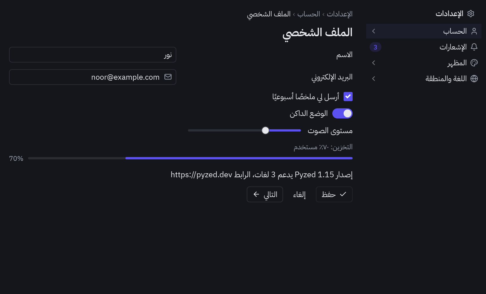
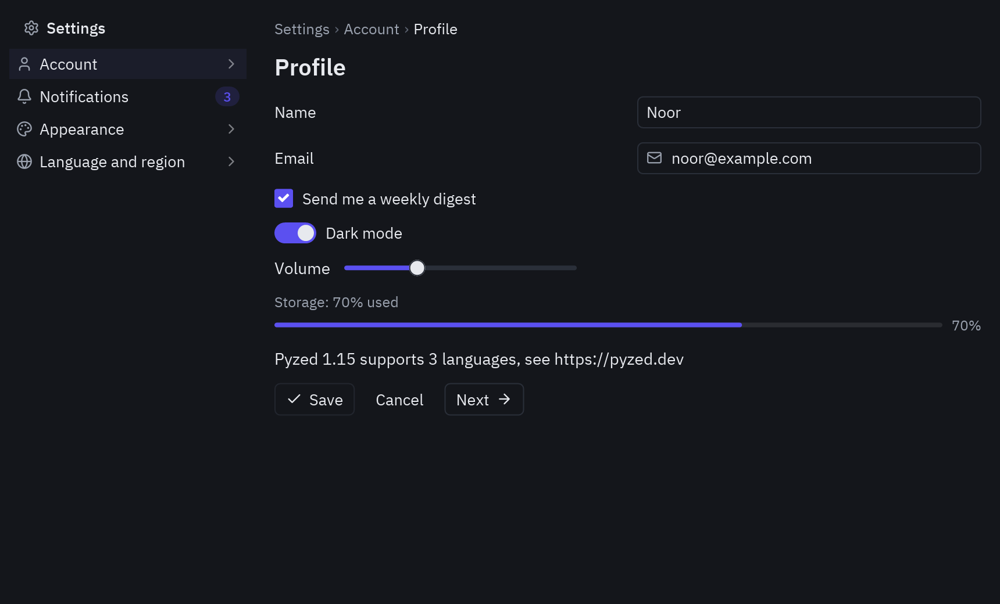
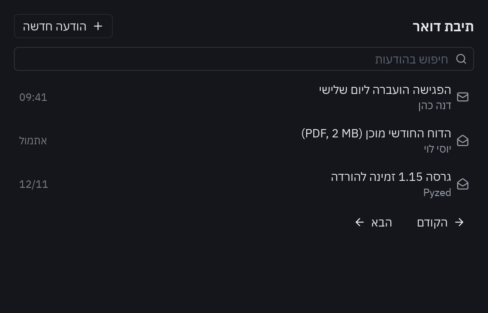

El árabe, el hebreo, el persa y el urdu se leen de derecha a izquierda, y la pantalla entera
también: la barra lateral va a la derecha, las filas empiezan a la derecha, una barra de progreso
se llena desde la derecha y la flecha de "siguiente" apunta a la izquierda. Pyzed hace todo eso
con un solo ajuste.



La misma pantalla con el idioma en inglés:



## Activarlo

La dirección sigue al idioma por defecto: en cuanto [`i18n.set_language`](/pyzed/es/guides/i18n/)
elige `"ar"`, `"he"`, `"fa"`, `"ur"` u otro idioma de derecha a izquierda, todas las ventanas se
disponen de derecha a izquierda. No cambia nada más en la app.

```python
import pyzed as pz
from pyzed import i18n

i18n.set_language("ar")   # la app pasa a ir de derecha a izquierda


class Settings(pz.App):
    def view(self):
        return pz.row([
            pz.text("الإعدادات"),                       # empieza a la derecha
            pz.button("التالي", icon="arrow-right"),    # su flecha apunta a la izquierda
        ], spacing=8)
```

También puedes elegirla tú:

| Dónde | Cómo |
| --- | --- |
| Toda la app | `pz.set_direction("rtl")`, `"ltr"` o `"auto"` (seguir el idioma, por defecto) |
| Una ventana | `direction = "rtl"` en la clase, o `self.set_direction("rtl")`; `None` usa la de la app |
| Una parte de una vista | `pz.direction(widget, "ltr")` o `widget.direction("ltr")` |

`pz.get_direction()` devuelve `"ltr"` o `"rtl"`, y `pz.is_rtl()` le dice a una vista en qué
sentido se está dibujando, para las pocas cosas que colocas a mano.

```python
class Editor(pz.Window):
    direction = "rtl"

    def view(self):
        return pz.column([
            pz.text("שלום"),
            # un teléfono, un código o una fórmula se leen de izquierda a derecha incluso aquí
            pz.row([pz.text("+972"), pz.text("52-123-4567")]).direction("ltr"),
        ])
```

## Qué se refleja

- **Diseño.** Filas, rejillas, wraps, pilas y docks colocan a sus hijos desde la derecha. El
  inicio de `padding=(top, right, bottom, left)` y `align_x="left"` significan el lado de
  inicio, así que un diseño escrito para una dirección funciona en las dos.
- **Texto.** Las líneas se alinean a la derecha, y las letras, números, palabras latinas y URLs
  dentro de una frase en árabe o hebreo mantienen su propio orden (el algoritmo bidireccional de
  Unicode). `align_x="right"` en un texto significa "el lado final", la izquierda en una parte de
  derecha a izquierda.
- **Campos de texto.** El texto empieza a la derecha, lo que escribes avanza hacia la izquierda y
  las teclas <kbd>←</kbd>/<kbd>→</kbd> se mueven en el sentido en que se lee la línea:
  <kbd>←</kbd> avanza en una línea de derecha a izquierda. Un clic pone el cursor en la letra
  donde cae, también en árabe, hebreo y texto con acentos.
- **Controles.** Los sliders y las barras de progreso se llenan desde la derecha, las áreas con
  scroll empiezan a la derecha, las vistas divididas y los paneles redimensionables mantienen su
  asa entre las mismas dos partes, y los tooltips y popups colocados en `"left"` o `"right"` se
  abren del otro lado.
- **Iconos.** Las flechas, los chevrons y los iconos de paneles y deshacer/rehacer apuntan al
  otro lado (`chevron-right` se dibuja como `chevron-left`). Un texto que solo es una marca que
  apunta, como `›` o `→`, también se gira. `pyzed.bidi.mirrored_icon(name)` te dice qué icono se
  muestra.
- **Componentes.** Todo `pyzed.ui` (listas, migas de pan, pestañas, menús, diálogos,
  formularios, barras de herramientas) está hecho con las piezas de arriba, así que se refleja
  sin código extra. Los temas son los mismos en las dos direcciones.



## Fuentes

Pyzed incluye IBM Plex Sans Arabic e IBM Plex Sans Hebrew, las compañeras de la fuente de la
interfaz, en los cuatro pesos que usan los componentes. Se eligen solas para las letras árabes y
hebreas, así que el texto en esas escrituras se ve igual en todos los sistemas. El persa y el urdu
usan la fuente árabe; otras escrituras usan las fuentes del sistema.

## Qué se queda igual

- **Los editores de código** (`pz.code_editor`) siempre van de izquierda a derecha, como el
  código.
- **Los dibujos de canvas, las posiciones de `pz.pin` y las coordenadas del ratón** son
  posiciones reales en pantalla: x sigue creciendo hacia la derecha. Usa `pz.is_rtl()` si un
  dibujo debe girarse.
- **Las barras de scroll** se quedan a la derecha del área.
- **Las imágenes y el resto de iconos** se dibujan tal cual. Para reflejar una imagen propia usa
  otro archivo.
- Un texto largo de derecha a izquierda en un campo sin el foco muestra su final, no su inicio.
- Las fuentes propias que uses en texto de derecha a izquierda deberían incluir las marcas de
  Unicode U+200F y U+200B (casi todas las tienen); sin ellas la primera letra de algunas líneas
  puede dibujarse con otra fuente.

## API

| Nombre | Descripción |
| --- | --- |
| `pz.set_direction(direction)` | La dirección de la app: `"ltr"`, `"rtl"` o `"auto"` (seguir el idioma) |
| `pz.get_direction()` | La dirección vigente, `"ltr"` o `"rtl"` |
| `pz.is_rtl()` | Si la vista que se dibuja va de derecha a izquierda |
| `pz.direction(widget, direction)` / `widget.direction(direction)` | Dispone una parte de la vista en su propia dirección |
| `Window.direction`, `Window.set_direction`, `Window.resolved_direction()` | La dirección propia de una ventana |
| `pyzed.bidi.is_rtl_language(code)` | Si un código de idioma (`"ar"`, `"he-IL"`, `"fa_IR"`) es de derecha a izquierda |
| `pyzed.bidi.mirrored_icon(name)` | El icono que se dibuja para `name` en una parte de derecha a izquierda |
| `pyzed.bidi.RTL_LANGUAGES` | Los códigos de idioma que van de derecha a izquierda |
