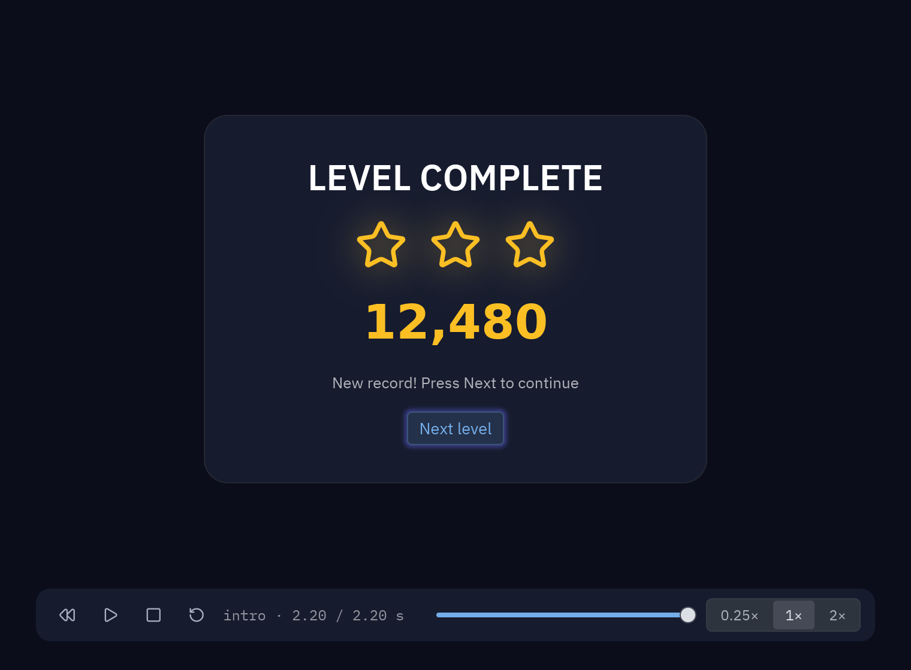

`animate()` le da a un widget su propio movimiento. Cuando varios widgets tienen que moverse a
la vez, como en una pantalla de título, una cinemática, un HUD que reacciona a un golpe o un
recorrido de bienvenida, ponlos en una misma línea de tiempo. Un **clip** contiene esa línea
de tiempo y un **reproductor de animaciones** la reproduce. El AnimationPlayer de Godot funciona
igual.



```python
import pyzed as pz

INTRO = pz.Clip("intro", length=2.2, tracks=[
    pz.Track("card:opacity", {0: 0, 0.35: 1}),
    pz.Track("card:y", [(0, 40, "ease_out_back"), (0.5, 0)]),
    pz.Track("title:scale", [(0.3, 0.6, "ease_out_back"), (0.7, 1)]),
    pz.Track(":score", [(0.7, 0, "ease_out_cubic"), (1.9, 12_480)]),
], calls=[pz.Call(1.6, "chime")])


class Game(pz.App):
    def __init__(self):
        self.score = 0
        self.player = pz.AnimationPlayer(INTRO, autoplay="intro")

    def chime(self):
        ...

    def view(self):
        return pz.column([
            pz.text("LEVEL COMPLETE").animate(self.player["title"]),
            pz.text(f"{self.score:,.0f}"),
        ]).animate(self.player["card"])
```

El ejemplo completo está en [`examples/timeline.py`](https://github.com/albakore/pyzed/blob/main/examples/timeline.py).

## Clips, pistas y keys

Un `pz.Clip` tiene un `name`, una duración `length` en segundos, pistas (`tracks`) y llamadas
(`calls`). Si no le das `length`, dura hasta su última key o llamada.

Un `pz.Track` cambia una propiedad con el tiempo. Su ruta dice qué anima:

| Ruta | Anima |
| --- | --- |
| `"card:opacity"` | Una propiedad de cada widget que reproduce el objetivo `card`. |
| `":score"` | Un atributo de la app. |
| `":hud.hp"` | Un atributo de un atributo (sigue los puntos). |

Las propiedades de widget son las que acepta `animate()`: `opacity`, `x`, `y`, `scale`,
`rotate`, `blur`, `background`, `border_color`, `color`, `radius`, `border_width`, `glow`,
`glow_color`, `width`, `height`, `padding` y `font_size`. Se reproducen de forma nativa a la
frecuencia de la pantalla, y tu código no se ejecuta mientras tanto.

Los atributos de la app pueden contener cualquier cosa. Los números, los colores
(`"#rrggbb"`) y las tuplas de números se mezclan entre keys; los demás valores (textos,
booleanos) cambian en cada key. Como `view()` los lee, pueden controlar **cualquier parámetro
de cualquier widget**, como el texto de una etiqueta, el valor de una barra de progreso, un
tamaño o un icono.

Las keys se pueden escribir de varias formas:

```python
pz.Track("card:x", {0: -40, 0.5: 0})                       # {tiempo: valor}
pz.Track("card:x", [(0, -40, "ease_out_back"), (0.5, 0)])  # (tiempo, valor, curva hasta la siguiente)
pz.Track("card:x", [pz.Key(0, -40), pz.Key("500ms", 0)])   # objetos Key; tiempos también como "500ms"
```

- **Curvas.** El `easing` de cada key es la curva hasta la siguiente. Sirve cualquier nombre de
  `pz.animation.EASINGS`, además de Béziers cúbicas `(x1, y1, x2, y2)` y `"steps(n)"`. El
  `easing` de la pista (por defecto `"linear"`) se usa en las keys que no lo indican.
- **Mantener valores.** `interpolation="discrete"` mantiene cada valor hasta la siguiente key.
- **Silenciar.** `enabled=False` deja la pista en el clip sin reproducirla.
- **Antes y después de las keys.** Un widget mantiene el valor de la primera key antes de ella
  y el de la última después, como en Godot.

### Llamadas a métodos

`pz.Call(tiempo, método, *args)` llama a un método de la app cuando el clip pasa por ese
tiempo. `método` también puede ser cualquier función. Lo que devuelve se trata igual que lo
que devuelve un callback (un `Command`, un mensaje). Las llamadas se ejecutan al reproducir
hacia delante, hacia atrás y en cada vuelta de un bucle, pero no al saltar con `seek`.

### Bucles

- `loop="none"` se reproduce una vez y se queda en el último fotograma.
- `loop="loop"` vuelve a empezar.
- `loop="pingpong"` va y vuelve.

## El reproductor

```python
self.player = pz.AnimationPlayer(INTRO, IDLE, "ui.pzanim", autoplay="intro",
                                 on_started=..., on_finished=...)
```

Guarda el reproductor en un atributo de la app (o de una ventana). Allí encuentra a su dueño,
el objeto cuyos atributos y métodos usan las pistas y las llamadas, y se mantiene en marcha
solo. Dale a cada widget su objetivo con `widget.animate(self.player["card"])`. Todos los
widgets que usan el mismo objetivo lo siguen.

| Llamada | Hace |
| --- | --- |
| `play(name, speed=1, backwards=False, restart=False)` | Reproduce un clip o sigue con el actual. Un clip que ya se está reproduciendo continúa salvo con `restart`. Uno terminado vuelve a empezar. |
| `play_backwards(name)` | Lo reproduce al revés desde el final. |
| `pause()`, `resume()`, `toggle()` | Detiene el tiempo y lo reanuda. |
| `stop(reset=False)` | Vuelve al primer fotograma. Con `reset=True` los widgets recuperan sus propios valores. |
| `seek(segundos)` | Salta a un tiempo. |
| `advance(segundos)` | Avanza el tiempo a mano y ejecuta las llamadas (útil en tests). |
| `queue(name)` | Reproduce un clip cuando termina el actual. |
| `speed` | La velocidad de reproducción de todos los clips. `play(speed=...)` la multiplica. |

Para leer su estado usa `current`, `position`, `length`, `playing`, `paused`, `finished`,
`queued`, `names` y `value(ruta)`. `on_started(name)` y `on_finished(name)` se llaman cuando
un clip empieza y cuando termina (los clips en bucle nunca terminan).

El reproductor solo despierta a tu app cuando hace falta. Un clip con pistas de atributos los
actualiza hasta `fps` veces por segundo (60 por defecto). Si no las tiene, el reproductor solo
despierta para la siguiente llamada o para el final del clip. Las pistas de widgets nunca lo
necesitan.

## Bibliotecas y archivos .pzanim

Los clips son valores inmutables, así que puedes compartirlos y reutilizarlos. Una
`AnimationLibrary` los agrupa y los guarda en un archivo `.pzanim` (JSON) que puedes tener en
tu proyecto y cargar en cualquier app:

```python
library = pz.AnimationLibrary([INTRO, IDLE], name="ui")
library.save("ui.pzanim")

player = pz.AnimationPlayer("ui.pzanim")      # clips llamados "ui/intro", "ui/idle"
player.play("ui/intro")
library = pz.load_animations("ui.pzanim")
```

Los clips tienen métodos para reutilizarlos y editarlos. Cada uno devuelve un clip nuevo:

- `clip.retarget({"card": "panel"})` lleva las pistas del clip a otros widgets.
- `clip.animation("card")` convierte las pistas de un objetivo en una `pz.Animation`. Puedes
  reproducirla con `animate()` sin reproductor, o darle un nombre con `pz.define_animation`.
- `clip.with_key(ruta, tiempo, valor)`, `without_key`, `with_track` y `without_track` editan el
  clip.
