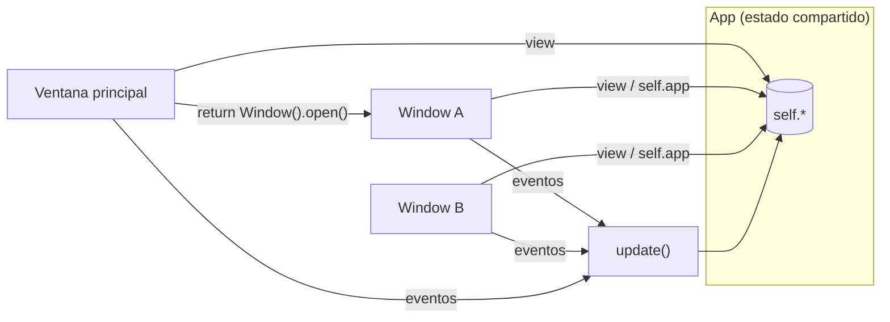

Una app puede tener tantas ventanas como quieras. La ventana principal es tu `App`; las demás son
subclases de `pz.Window`, cada una con su `view()`, título, tamaño y tema.


```python
import pyzed as pz
from pyzed import ui


class Settings(pz.Window):
    title = "Ajustes"
    size = (420, 300)
    theme = "One Light"                # opcional: por defecto usa el de la app

    def view(self):
        return pz.container(
            pz.column([
                ui.heading("Ajustes", level=2),
                ui.field("Autoguardado", ui.switch(self.app.autosave, self.app.set_autosave)),
                ui.button("Cerrar", self.close),
            ], spacing=12),
            padding=20,
        )


class Main(pz.App):
    def __init__(self):
        self.autosave = True
        self.settings = Settings()

    def set_autosave(self, value):
        self.autosave = value

    def open_settings(self):
        if not self.settings.is_open:
            return self.settings.open()
        return pz.Command.focus_window(self.settings)

    def view(self):
        return pz.center(ui.button("Abrir ajustes", self.open_settings, icon="settings"))


pz.run(Main)
```

## Cómo funciona



- `ventana.open()` (o `Command.open_window(ventana)`) devuelve el comando que la abre.
- `self.app` apunta a la app dentro de cada ventana, así que **comparten estado**: los callbacks
  como `self.app.guardar` funcionan directamente.
- Los mensajes que se producen en una ventana van a su `update()`, que por defecto los reenvía a
  `app.update()`.
- `ventana.is_open` indica si está abierta. Cerrar la ventana principal termina la app.

## Opciones

Atributos de clase o de instancia:

| Atributo | Descripción |
| --- | --- |
| `title` | Texto o callable. |
| `size`, `min_size`, `max_size` | Tamaños en píxeles lógicos. |
| `position` | `"center"` o `(x, y)`. |
| `resizable`, `decorations` | `decorations=False` quita el marco del sistema (barra de título propia). |
| `transparent`, `maximized`, `fullscreen` | Estado inicial. |
| `scale` | Escala de la interfaz. |
| `theme` | Un `Theme`, un nombre o `themes.auto(...)`. `None` usa el de la app. |
| `transition`, `exit_transition` | Cómo se anima al abrirse y al cerrarse: `"fade"`, `"zoom"`, `"pop"`, `"slide_up"`... un preset o una `pz.Animation`. Ver [Animación](/pyzed/es/guides/animation/#transiciones-de-ventana). |

`window_size` contiene el tamaño actual y `window_position` dónde está la ventana en la pantalla (los actualiza el runtime; la posición es `None` en Wayland).

## Ganchos

| Método | Cuándo se llama |
| --- | --- |
| `on_open()` | Al abrirse. |
| `on_close()` | Cuando el usuario pide cerrarla. Devuelve `False` para mantenerla abierta (por ejemplo, para preguntar si guardar). |
| `on_resize(ancho, alto)` | Al cambiar de tamaño. |
| `on_key(combo)` | Teclas pulsadas con esa ventana enfocada. |

## Comandos de ventana

Todos aceptan la ventana como último argumento; sin él actúan sobre la ventana que produjo el
mensaje.

| Comando | Efecto |
| --- | --- |
| `Command.open_window(w)` / `w.open()` | Abre la ventana. |
| `Command.close_window(w)` / `w.close()` | La cierra. |
| `Command.drag_window(w)` / `w.drag()` | Empieza a moverla con el ratón (para barras de título propias). |
| `Command.minimize_window(w)` | La minimiza. |
| `Command.toggle_maximize_window(w)` | Maximiza o restaura. |
| `Command.set_fullscreen(True, w)` | Pantalla completa. |
| `Command.resize_window(ancho, alto, w)` | Cambia el tamaño. |
| `Command.move_window(x, y, w)` | La mueve. |
| `Command.focus_window(w)` | La trae al frente. |

### Barra de título propia

```python
class Frameless(pz.App):
    decorations = False

    def view(self):
        bar = pz.mouse_area(
            ui.title_bar([ui.title_button("Mi app")], [ui.icon_button("x", self.close)]),
            on_press=self.drag,
            on_double_click=lambda: pz.Command.toggle_maximize_window(),
        )
        return pz.column([bar, self.contenido()])
```

### Pestañas arrastrables y ventanas desprendibles

Las pestañas de `ui.tab_bar` se pueden arrastrar. `on_drag(id)` avisa de que empezó un arrastre; mientras
`dragging` nombra la pestaña, `on_drag_over(index)` informa del punto de inserción bajo el puntero (o `None`
fuera de la fila) y `drop_index` dibuja la marca ahí. `on_drop(id, event)` llega al soltarla, con el puntero en la
ventana (`event.window_x`, `event.window_y`, fuera de ella si se soltó fuera) y en la pantalla (`event.screen`).
El `window_position` y el `window_size` de cada ventana dicen dónde está, así que puedes abrir la pestaña en una
ventana nueva o apilarla en la ventana que hay bajo el puntero:

```python
class Detached(pz.Window):
    size = (640, 420)

    def __init__(self, name, position):
        self.name = self.title = name
        if position is not None:
            self.position = position

    def view(self):
        return ui.tab_bar([ui.Tab.for_file(self.name)], self.name)


class Editor(pz.App):
    def __init__(self):
        self.files, self.active = ["main.py", "app.py", "README.md"], "main.py"
        self.dragging, self.over = None, None

    def start(self, name):
        self.dragging = name

    def hover(self, index):
        self.over = index

    def drop(self, name, event):
        over, self.dragging, self.over = self.over, None, None
        if over is not None:  # soltada en la fila: reordenar
            i = self.files.index(name)
            self.files.insert(over - (over > i), self.files.pop(i))
            return None
        width, height = self.window_size or self.size
        if 0 <= event.window_x < width and 0 <= event.window_y < height:
            return None  # soltada dentro de la ventana, fuera de la fila
        self.files.remove(name)
        self.active = self.files[0] if self.files else None
        where = (event.screen_x - 80, event.screen_y - 12) if event.screen else None
        return Detached(name, where).open()

    def view(self):
        return ui.tab_bar([ui.Tab.for_file(f) for f in self.files], self.active,
                          on_select=lambda f: setattr(self, "active", f),
                          on_drag=self.start, on_drop=self.drop, on_drag_over=self.hover,
                          dragging=self.dragging, drop_index=self.over)
```

Para apilar una pestaña en otra de tus ventanas, compara `event.screen` con el `window_position` y el
`window_size` de esa ventana. Wayland no les dice a las apps dónde están sus ventanas: ahí `event.screen` y
`window_position` son `None`, así que ofrece también un comando de menú (Pyzed Design tiene **Mover la pestaña a
una ventana nueva** y **Mover la pestaña a la ventana principal**).

:::note
`pz.run()` solo puede llamarse una vez por proceso (limitación de winit). Para más ventanas,
usa `pz.Window`.
:::
