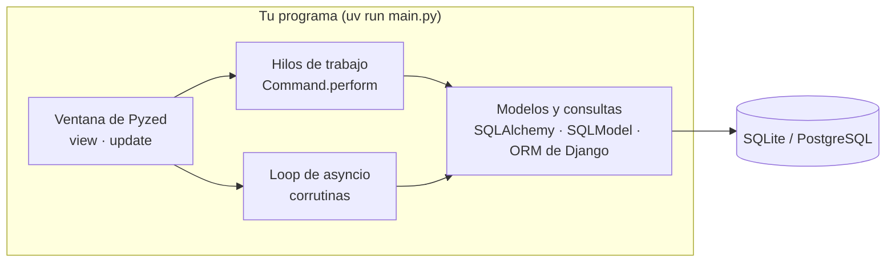
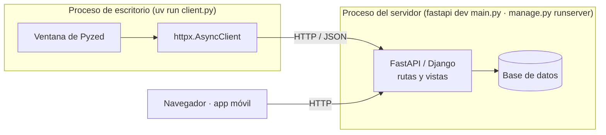
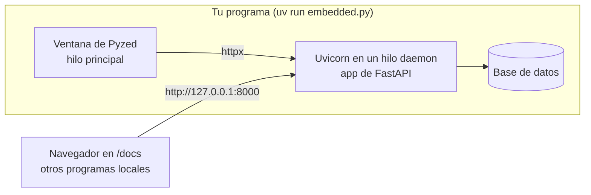
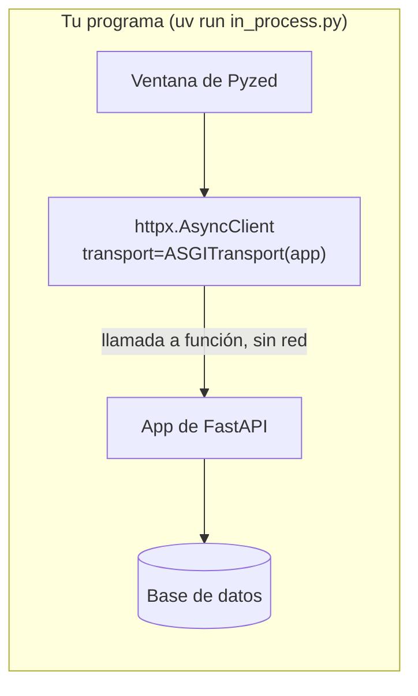

Una ventana de Pyzed es un programa de Python, así que una librería de backend puede colocarse a
su lado de cuatro formas distintas. La elección depende de una pregunta: **¿quién más necesita
los datos?**

| Arquitectura | Quién usa los datos | Red | Demos |
| --- | --- | --- | --- |
| [1. Mismo proceso](#1-mismo-proceso) | Solo esta app de escritorio | Ninguna | SQLAlchemy, SQLModel, ORM de Django, aiosqlite, Pydantic |
| [2. Cliente y servidor](#2-cliente-y-servidor) | Una web, una app móvil, otros usuarios | HTTP a un servidor | FastAPI `client.py`, Django `client.py`, httpx |
| [3. Servidor integrado](#3-servidor-integrado) | Esta app y otros programas del mismo ordenador | Puerto local | FastAPI `embedded.py` |
| [4. API en el proceso](#4-api-en-el-proceso) | Solo esta app, pero el código es una API | Ninguna | FastAPI `in_process.py` |

Las cuatro pueden compartir el mismo código: los modelos y la API no saben si los llama una
ventana, un navegador o un test. Eso es lo que permite que una app empiece con la arquitectura 1
y pase a la 2 más adelante.

## 1. Mismo proceso

La ventana importa la librería y la llama directamente. No hay servidor y nada escucha en la
red. Es la opción por defecto para una app de escritorio con su propia base de datos.



- **Las librerías bloqueantes** (una `Session` de SQLAlchemy, SQLModel, el ORM de Django) corren
  en un hilo de trabajo con `Command.perform(función, then)`.
- **Las librerías async** (`AsyncSession`, aiosqlite) corren como corrutinas en el loop de Pyzed.
- La base de datos se puede seguir compartiendo: el `desktop.py` de la
  [demo de Django](/pyzed/es/integrations/django/) y `manage.py runserver` usan el mismo
  `db.sqlite3` a la vez.

Demos: [`sqlalchemy_quickstart`](/pyzed/es/integrations/sqlalchemy/) (los dos backends),
[`sqlmodel_heroes`](/pyzed/es/integrations/sqlmodel/), [`django_polls`](/pyzed/es/integrations/django/) `desktop.py`,
[`aiosqlite_journal`](/pyzed/es/integrations/other-libraries/#aiosqlite), [`pydantic_signup`](/pyzed/es/integrations/pydantic/).

## 2. Cliente y servidor

El backend es un programa aparte, que se arranca con su propia herramienta (`fastapi dev`,
`manage.py runserver`, un despliegue en un servidor). La ventana es un cliente más y solo habla
HTTP, normalmente con httpx.



- Úsala cuando los datos se deben compartir entre usuarios o dispositivos, o cuando la API ya
  existe.
- La ventana no necesita tener instalados ni el driver de la base de datos ni el framework del
  backend.
- Los errores llegan como códigos HTTP: un 422 de FastAPI va directo a `pz.validation_errors`.

Demos: [`fastapi_heroes`](/pyzed/es/integrations/fastapi/) `client.py`, [`django_polls`](/pyzed/es/integrations/django/)
`client.py`, [`httpx_pypi`](/pyzed/es/integrations/httpx/) (una API pública).

## 3. Servidor integrado

Un solo programa arranca la API en un hilo en segundo plano con Uvicorn y luego abre la ventana.
La API está disponible en un puerto local mientras la ventana está abierta, para un navegador, un
script u otra app.



- Úsala para una herramienta que también expone una API o una página web, como un panel local o
  un dispositivo que recibe webhooks.
- El servidor se detiene con la ventana, porque su hilo es daemon.
- Escucha en `127.0.0.1` salvo que otros ordenadores tengan que conectarse.

Demo: [`fastapi_heroes`](/pyzed/es/integrations/fastapi/#3-servidor-integrado) `embedded.py`.

## 4. API en el proceso

httpx puede enviar peticiones directamente a una app ASGI con `httpx.ASGITransport`, sin servidor
ni puerto. El código se escribe como una API y un cliente, pero se ejecuta como un único programa
sin conexión.



- Úsala para distribuir la misma API como una app de escritorio que funciona sin conexión, o
  para probar el cliente.
- `ASGITransport` no ejecuta los eventos de startup ni de lifespan: llama tú mismo a tu código de
  inicialización.

Demo: [`fastapi_heroes`](/pyzed/es/integrations/fastapi/#4-en-el-proceso) `in_process.py`.

## Cuál encaja con cada librería

| Librería | Mismo proceso | Cliente y servidor | Servidor integrado | API en el proceso |
| --- | --- | --- | --- | --- |
| FastAPI | Solo importar sus modelos | ✅ `fastapi dev` / `fastapi run` | ✅ Uvicorn en un hilo | ✅ `ASGITransport` |
| Django | ✅ ORM tras `django.setup()` | ✅ `manage.py runserver` | No recomendado: ejecútalo aparte | Posible con su app ASGI |
| SQLAlchemy | ✅ `Session` o `AsyncSession` | Detrás de tu API | — | — |
| SQLModel | ✅ `Session` | Detrás de FastAPI | — | — |
| httpx | — | ✅ el cliente | ✅ el cliente | ✅ el transporte |
| Pydantic | ✅ valida el formulario | ✅ convierte las respuestas | ✅ | ✅ |
| aiosqlite | ✅ en el loop de Pyzed | — | — | — |

## Estructura de un proyecto

Mantén el backend libre de Pyzed y la ventana libre de SQL. Todas las demos siguen esta
estructura, que permite que el mismo backend sirva a una ventana, a una API y a los tests:

```text
myapp/
├── pyproject.toml
├── models.py       # modelos de SQLModel / SQLAlchemy / Django, esquemas de Pydantic
├── db.py           # las consultas, una función por acción, sin imports de Pyzed
├── main.py         # app de FastAPI o proyecto de Django (cuando hay servidor)
└── window.py       # la App de Pyzed: llama a db.py o a la API
```
