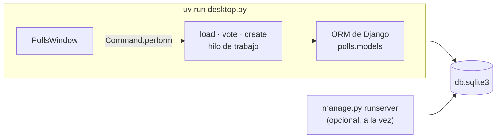
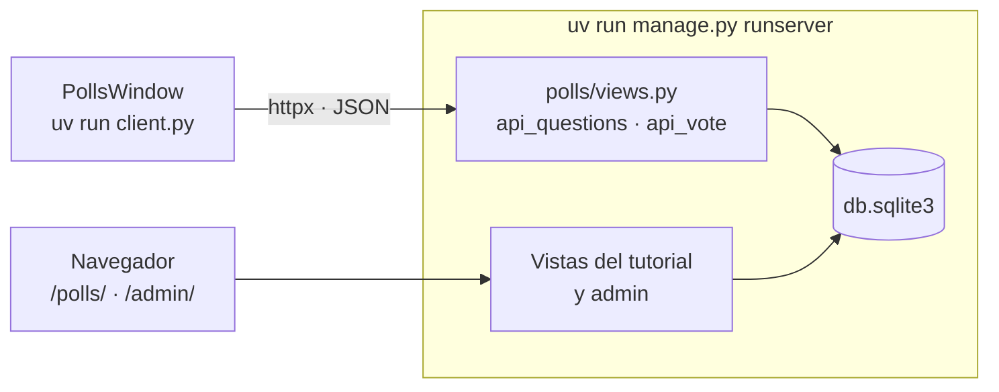

import { Code, Steps, Aside, Tabs, TabItem } from '@astrojs/starlight/components';
import desktop from '../../../../../../examples/integrations/django_polls/desktop.py?raw';
import client from '../../../../../../examples/integrations/django_polls/client.py?raw';
import window from '../../../../../../examples/integrations/django_polls/polls_window.py?raw';
import views from '../../../../../../examples/integrations/django_polls/polls/views.py?raw';

La demo es el proyecto del [tutorial de Django](https://docs.djangoproject.com/en/stable/intro/tutorial01/),
`mysite` con su app `polls`, construido paso a paso como lo hace el tutorial: modelos,
migraciones, el admin, vistas genéricas y plantillas. Después, una ventana de Pyzed vota en las
encuestas de dos formas, que corresponden a dos [arquitecturas](/pyzed/es/integrations/architectures/):

- **`desktop.py`**: la ventana importa los modelos y usa el ORM directamente (mismo proceso).
- **`client.py`**: el sitio corre con `runserver` y la ventana llama a sus vistas JSON (cliente y servidor).


## El proyecto de Django, como lo construye el tutorial

<Steps>

1. **Crea el proyecto y la app** (ya está hecho en la carpeta de la demo):

   ```bash
   uv run django-admin startproject mysite .
   uv run manage.py startapp polls
   ```

   y añade `"polls.apps.PollsConfig"` a `INSTALLED_APPS` en `mysite/settings.py`.

2. **Escribe los modelos** en `polls/models.py` (parte 2 del tutorial):

   ```python
   class Question(models.Model):
       question_text = models.CharField(max_length=200)
       pub_date = models.DateTimeField("date published")

   class Choice(models.Model):
       question = models.ForeignKey(Question, on_delete=models.CASCADE)
       choice_text = models.CharField(max_length=200)
       votes = models.IntegerField(default=0)
   ```

3. **Crea las tablas y un usuario administrador:**

   ```bash
   uv run manage.py migrate
   uv run manage.py createsuperuser
   ```

4. **Registra el admin** (parte 7), con las opciones en línea, para poder añadir encuestas en
   [http://127.0.0.1:8000/admin/](http://127.0.0.1:8000/admin/).

5. **Escribe las vistas y las URLs** (partes 3 y 4): `IndexView`, `DetailView`, `ResultsView` y
   `vote`, que usa una expresión `F()` para que los votos simultáneos no se pisen. La demo añade
   dos pequeñas vistas JSON para el cliente de escritorio, `api/questions/` y
   `api/questions/<id>/vote/`.

6. **Ejecuta el sitio:**

   ```bash
   uv run manage.py runserver
   ```

   Las encuestas están en [http://127.0.0.1:8000/polls/](http://127.0.0.1:8000/polls/).

</Steps>

## Forma 1: el ORM en el mismo proceso

`desktop.py` configura Django igual que `manage.py` y luego importa los modelos. No hace falta
ningún servidor web; la ventana lee y escribe `db.sqlite3` a través del ORM.

```bash
uv run manage.py migrate     # una vez
uv run desktop.py
```



<Steps>

1. **Llama a `django.setup()` antes de importar los modelos:**

   ```python
   os.environ.setdefault("DJANGO_SETTINGS_MODULE", "mysite.settings")
   django.setup()

   from polls.models import Question
   ```

2. **Ejecuta las consultas del ORM en hilos de trabajo.** Son bloqueantes, así que
   `Command.perform` las ejecuta fuera del hilo de la UI. Django abre una conexión a la base de
   datos por hilo; cerrarlas al terminar evita que el pool de hilos acumule conexiones:

   ```python
   def in_thread(function):
       @functools.wraps(function)
       def wrapper(*args, **kwargs):
           try:
               return function(*args, **kwargs)
           finally:
               connections.close_all()
       return wrapper

   @in_thread
   def vote(question_id, choice_id):
       choice = Question.objects.get(pk=question_id).choice_set.get(pk=choice_id)
       choice.votes = F("votes") + 1
       choice.save()
   ```

3. **Valida con las reglas del propio modelo.** `full_clean()` comprueba `max_length`, los campos
   obligatorios y los validadores propios; `pz.validation_errors` convierte el `ValidationError`
   de Django en `{campo: mensaje}` para `ui.field`:

   ```python
   question = Question(question_text=draft["question_text"], pub_date=timezone.now())
   try:
       question.full_clean()
   except ValidationError as error:
       return pz.validation_errors(error)
   with transaction.atomic():
       question.save()
       for text in draft["choices"]:
           question.choice_set.create(choice_text=text, votes=0)
   ```

</Steps>

<Aside type="tip">
`runserver` puede correr a la vez sobre la misma base de datos. Un voto emitido en la ventana
aparece en `/polls/` y en el admin, y una pregunta añadida en el admin aparece en la ventana al
recargar.
</Aside>

## Forma 2: un cliente HTTP del sitio

`client.py` no importa Django en absoluto. Habla con las vistas JSON del sitio con httpx, así que
el sitio puede correr en este ordenador o en un servidor:

```bash
uv run manage.py runserver   # terminal 1
uv run client.py             # terminal 2 (o: uv run client.py https://polls.example.com)
```



```python
async def vote(question_id, choice_id):
    async with httpx.AsyncClient(base_url=SITE, timeout=5) as client:
        response = await client.post(f"/polls/api/questions/{question_id}/vote/", json={"choice": choice_id})
        response.raise_for_status()
    return response.json()
```

<Aside type="caution">
La vista JSON de votar está marcada con `@csrf_exempt` porque una app de escritorio no tiene
cookie CSRF. Para una API real, autentica al cliente con tokens, por ejemplo con
[Django REST framework](https://www.django-rest-framework.org/).
</Aside>

## Una ventana, dos backends

`PollsWindow` recibe `load`, `vote` y, opcionalmente, `create` como funciones normales.
`desktop.py` le pasa funciones normales (que corren en hilos) y `client.py` le pasa corrutinas
(que corren en el loop de asyncio); `Command.perform` acepta las dos, así que el código de la
ventana es el mismo.

## Código completo

<Tabs>
<TabItem label="desktop.py"><Code code={desktop} lang="py" /></TabItem>
<TabItem label="client.py"><Code code={client} lang="py" /></TabItem>
<TabItem label="polls_window.py"><Code code={window} lang="py" /></TabItem>
<TabItem label="polls/views.py"><Code code={views} lang="py" /></TabItem>
</Tabs>
