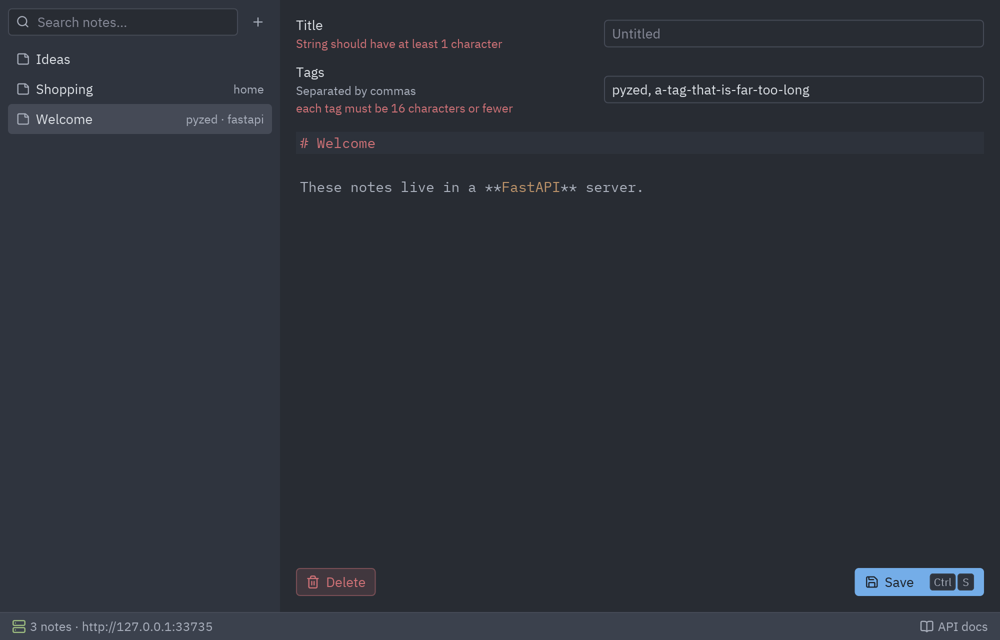

import { Code, Steps, Aside } from '@astrojs/starlight/components';
import client from '../../../../../../examples/integrations/fastapi_notes/main.py?raw';
import api from '../../../../../../examples/integrations/fastapi_notes/api.py?raw';

FastAPI y Pyzed encajan de forma natural: los dos usan tipos, los dos son async y los dos usan
Pydantic. Esta demo es una app de notas cuyos datos viven detrás de una API REST de FastAPI. La
ventana habla con ella usando `httpx.AsyncClient` en el loop de asyncio de Pyzed, y cuando la API
rechaza una nota, su respuesta 422 aparece junto a cada campo.



```bash
cd examples/integrations/fastapi_notes
uv run main.py                          # arranca la API en segundo plano y abre la ventana
uv run main.py http://127.0.0.1:8000    # o habla con una API que ya está corriendo
uv run uvicorn api:app --reload         # sirve solo la API (docs en /docs)
```

<Steps>

1. **La API es FastAPI normal.** Los modelos de Pydantic declaran las reglas; FastAPI las
   aplica y responde 422 con los detalles cuando una petición no las cumple:

   ```python
   class NoteIn(BaseModel):
       title: str = Field(min_length=1, max_length=60)
       body: str = ""
       tags: list[str] = []

       @field_validator("tags")
       @classmethod
       def short_tags(cls, tags):
           if any(len(tag) > 16 for tag in tags):
               raise ValueError("each tag must be 16 characters or fewer")
           return tags

   @app.post("/notes", status_code=201)
   def create_note(data: NoteIn) -> Note: ...
   ```

2. **Integra el servidor (opcional).** Para una app autocontenida, ejecuta uvicorn en un hilo
   daemon antes de abrir la ventana. Fuera del hilo principal uvicorn no instala sus manejadores
   de señales, y el hilo termina con la app:

   ```python
   def serve_in_background() -> str:
       with socket.socket() as probe:          # un puerto libre
           probe.bind(("127.0.0.1", 0))
           port = probe.getsockname()[1]
       server = uvicorn.Server(uvicorn.Config(api, host="127.0.0.1", port=port, log_level="warning"))
       threading.Thread(target=server.run, daemon=True).start()
       while not server.started:
           time.sleep(0.02)
       return f"http://127.0.0.1:{port}"

   pz.run(NotesClient(serve_in_background()))
   ```

   El mismo cliente funciona contra una API remota: pásale su URL.

3. **Las peticiones son corrutinas.** Devolver una corrutina desde un callback la ejecuta en el
   loop de Pyzed, y lo que devuelve va a `update`. El `AsyncClient` se crea una sola vez, dentro
   de una corrutina, para que pertenezca a ese loop:

   ```python
   async def http(self):
       if self.client is None:
           self.client = httpx.AsyncClient(base_url=self.base_url, timeout=5)
       return self.client

   async def fetch(self, query):
       try:
           response = await (await self.http()).get("/notes", params={"q": query})
           response.raise_for_status()
       except httpx.HTTPError as error:
           return ("offline", str(error))
       return ("loaded", query, response.json())

   def search(self, text):
       self.query = text
       return self.fetch(text)
   ```

4. **Descarta respuestas viejas.** Escribir "py" envía dos peticiones; la respuesta de "p" puede
   llegar la última. La consulta viaja con la respuesta y `update` solo guarda la actual:

   ```python
   def update(self, message):
       kind, *rest = message
       if kind == "loaded":
           query, notes = rest
           if query == self.query:
               self.notes = notes
   ```

5. **Muestra los errores 422 en cada campo.** `pz.validation_errors` lee el
   `{"detail": [{"loc": ["body", "title"], "msg": ...}]}` de FastAPI y devuelve `{"title": msg}`,
   listo para `ui.field(error=)`:

   ```python
   async def send(self, note_id, payload):
       client = await self.http()
       response = await client.put(f"/notes/{note_id}", json=payload)
       if response.is_error:
           return ("invalid", response.json())
       return ("saved", response.json())

   # update():
   elif kind == "invalid":
       self.errors = pz.validation_errors(rest[0])

   # view():
   ui.field("Title", ui.input(self.draft["title"], self.edit("title")), error=self.errors.get("title"))
   ```

   Un error simple como `{"detail": "Note not found"}` queda en la clave `""`, que se muestra en
   un `ui.callout` encima del formulario.

</Steps>

<Aside type="tip">
Comparte los modelos. Si el cliente y la API están en el mismo proyecto, importa `NoteIn` en el
cliente y valida antes de enviar (`NoteIn.model_validate(...)`) para mostrar los errores sin ir
al servidor; el servidor sigue validando, como debe.
</Aside>

## Código completo

<Code code={client} lang="py" title="examples/integrations/fastapi_notes/main.py" />

<Code code={api} lang="py" title="examples/integrations/fastapi_notes/api.py" />
