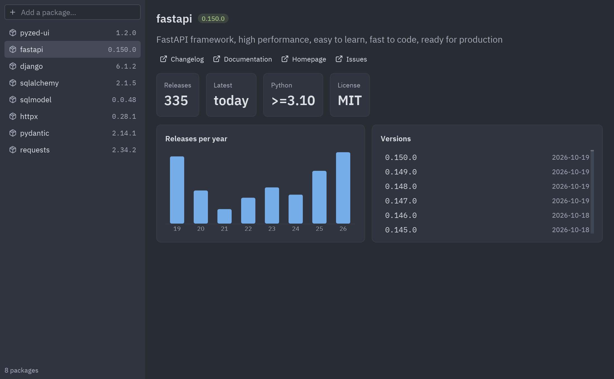
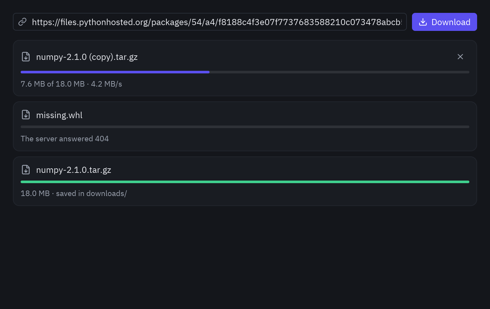

import { Code, Steps, Aside, Tabs, TabItem } from '@astrojs/starlight/components';
import pypiMain from '../../../../../../examples/integrations/httpx_pypi/main.py?raw';
import pypi from '../../../../../../examples/integrations/httpx_pypi/pypi.py?raw';
import download from '../../../../../../examples/integrations/httpx_download/main.py?raw';
import Commands from '../../../../components/Commands.astro';

[httpx](https://www.python-httpx.org/) es el cliente HTTP que usa una ventana de Pyzed para hablar
con cualquier API: una pública, o tu propio servidor de [FastAPI](/pyzed/es/integrations/fastapi/)
o [Django](/pyzed/es/integrations/django/) (la [arquitectura](/pyzed/es/integrations/architectures/)
de cliente y servidor). Dos demos:

- **`httpx_pypi`**: peticiones concurrentes a la API JSON de PyPI, que se muestran a medida que llegan.
- **`httpx_download`**: un gestor de descargas con respuestas en streaming y una barra de progreso.

## Lo básico, del quickstart de httpx

httpx tiene la misma API en versión síncrona y async. En una app de Pyzed puedes usar cualquiera:

<Tabs>
<TabItem label="AsyncClient (recomendado)">

```python
import httpx

class App(pz.App):
    async def load(self):
        # A coroutine returned from a callback runs on Pyzed's asyncio loop.
        async with httpx.AsyncClient() as client:
            response = await client.get("https://pypi.org/pypi/httpx/json")
        response.raise_for_status()
        return ("loaded", response.json())

    def update(self, message):
        kind, data = message
        self.info = data["info"]
```

</TabItem>
<TabItem label="API síncrona en un hilo">

```python
import httpx

def fetch():
    response = httpx.get("https://pypi.org/pypi/httpx/json")
    response.raise_for_status()
    return response.json()

class App(pz.App):
    def load(self):
        # A blocking call runs in a worker thread; then() receives the result.
        return Command.perform(fetch, lambda data: setattr(self, "info", data["info"]))
```

</TabItem>
</Tabs>

El resto del quickstart se aplica sin cambios:

| Tarea | httpx |
| --- | --- |
| Parámetros de consulta | `client.get(url, params={"q": "pyzed", "page": 2})` |
| Enviar JSON | `client.post(url, json={"name": "Deadpond"})` |
| Enviar un formulario o archivos | `client.post(url, data={...}, files={"upload": open("a.png", "rb")})` |
| Cabeceras y autenticación | `httpx.AsyncClient(headers={"Authorization": f"Bearer {token}"})`, `auth=("user", "pass")` |
| Una URL base | `httpx.AsyncClient(base_url="https://api.example.com")` y luego `client.get("/items/")` |
| Timeouts | `httpx.AsyncClient(timeout=10)` |
| Errores | `response.raise_for_status()`; captura `httpx.HTTPStatusError` y `httpx.RequestError` |

<Aside type="tip">
Crea un solo `AsyncClient` y reutilízalo, como [recomienda httpx](https://www.python-httpx.org/advanced/clients/),
para mantener las conexiones abiertas. Todas las corrutinas de Pyzed comparten un loop de asyncio,
así que un cliente creado dentro de una corrutina se puede guardar en `self` y usar en las
siguientes (la demo de FastAPI lo hace).
</Aside>

## Peticiones concurrentes: el explorador de PyPI



<Commands
	uv={`
		cd examples/integrations/httpx_pypi
		uv run main.py
		uv run main.py rich textual polars      # otros paquetes
	`}
	pip={`
		cd examples/integrations/httpx_pypi
		{venv}
		{activate}
		pip install pyzed-ui httpx pydantic
		python main.py
		python main.py rich textual polars      # otros paquetes
	`}
	python={`
		cd examples/integrations/httpx_pypi
		{py} -m pip install pyzed-ui httpx pydantic
		{py} main.py
		{py} main.py rich textual polars      # otros paquetes
	`}
/>

<Steps>

1. **Devuelve un valor para cada resultado posible.** El modelo, o un texto corto para la lista:

   ```python
   async def fetch(client, name):
       try:
           response = await client.get(f"https://pypi.org/pypi/{name}/json")
       except httpx.HTTPError as error:
           return f"Network error: {error}"
       if response.status_code == 404:
           return "Not on PyPI"
       return Package.model_validate_json(response.content)  # see the Pydantic page
   ```

2. **Envía todas las peticiones a la vez y emite cada respuesta con `yield`.** Un generador async
   devuelto desde `on_start` o desde un callback envía cada `yield` a `update`, así que la lista
   se va llenando a medida que llegan las respuestas:

   ```python
   async def fetch_all(names):
       async with httpx.AsyncClient(timeout=10, follow_redirects=True) as client:
           async def one(name):
               return name, await fetch(client, name)

           for done in asyncio.as_completed([one(n) for n in names]):
               yield await done

   class Explorer(pz.App):
       def on_start(self):
           return fetch_all(self.names)

       def update(self, message):
           name, result = message
           self.packages[name] = result
   ```

</Steps>

<Tabs>
<TabItem label="main.py"><Code code={pypiMain} lang="py" /></TabItem>
<TabItem label="pypi.py"><Code code={pypi} lang="py" /></TabItem>
</Tabs>

## Descargas en streaming con progreso



<Commands
	uv={`
		cd examples/integrations/httpx_download
		uv run main.py
	`}
	pip={`
		cd examples/integrations/httpx_download
		{venv}
		{activate}
		pip install pyzed-ui httpx
		python main.py
	`}
	python={`
		cd examples/integrations/httpx_download
		{py} -m pip install pyzed-ui httpx
		{py} main.py
	`}
/>

Las [respuestas en streaming](https://www.python-httpx.org/quickstart/#streaming-responses) de
httpx leen el cuerpo por partes en lugar de cargarlo entero en memoria, y su receta de
[progreso de descarga](https://www.python-httpx.org/advanced/clients/#monitoring-download-progress)
usa `response.num_bytes_downloaded`. En Pyzed el bucle se convierte en un generador async que
hace `yield` tras cada parte, y la ventana vuelve a dibujar la barra cada vez:

```python
async def download(item):
    async with httpx.AsyncClient(follow_redirects=True) as client:
        async with client.stream("GET", item.url) as response:
            response.raise_for_status()
            item.total = int(response.headers["Content-Length"])
            with open(FOLDER / item.name, "wb") as file:
                async for chunk in response.aiter_bytes():
                    if item.cancel:          # set by the Cancel button
                        break
                    file.write(chunk)
                    item.done = response.num_bytes_downloaded
                    yield item               # reaches update(), which redraws

class Downloads(pz.App):
    def start(self, *_):
        item = Download(self.url)
        self.items.insert(0, item)
        return download(item)

    def view(self):
        ...
        ui.progress(item.done / item.total)
```

Varias descargas pueden correr a la vez: cada una es su propio generador en el mismo loop.

<Code code={download} lang="py" title="examples/integrations/httpx_download/main.py" />
