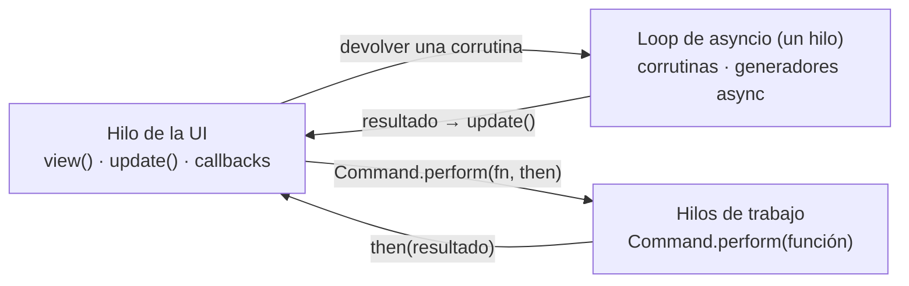

import Commands from '../../../../components/Commands.astro';

:::note[Demos que puedes ejecutar]
Cada integración tiene una demo completa en `examples/integrations` que se ejecuta con uv, pip o python. Con el tiempo se añadirán más bibliotecas.
:::

Pyzed es solo la interfaz: el resto de tu app es Python normal. Por eso las librerías que ya usas
para backends web, bases de datos y HTTP funcionan sin cambios en una app de escritorio. Esta
sección muestra cómo conectar las más comunes. Cada demo parte del tutorial oficial de la propia
librería (el tutorial de SQL de FastAPI, la app de encuestas de Django, el Quick Start de
SQLAlchemy, los héroes de SQLModel) y le añade una ventana de Pyzed.

Cuando un backend tiene que ejecutarse junto a la ventana, [Arquitecturas](/pyzed/es/integrations/architectures/)
explica las cuatro formas de combinarlos, con un diagrama para cada una: mismo proceso, cliente y
servidor, servidor integrado y API en el proceso.

| Demo | Librerías | Qué muestra | Tutorial |
| --- | --- | --- | --- |
| [`fastapi_heroes`](https://github.com/albakore/pyzed/tree/main/examples/integrations/fastapi_heroes) | FastAPI, SQLModel, httpx | La API del tutorial de SQL de FastAPI y un cliente de escritorio para ella, ejecutados de tres formas: servidor aparte, servidor integrado y en el proceso. | [FastAPI](/pyzed/es/integrations/fastapi/) |
| [`django_polls`](https://github.com/albakore/pyzed/tree/main/examples/integrations/django_polls) | Django, httpx | El tutorial de encuestas de Django, usado desde una ventana con el ORM en el mismo proceso o por HTTP mientras corre runserver. | [Django](/pyzed/es/integrations/django/) |
| [`sqlalchemy_quickstart`](https://github.com/albakore/pyzed/tree/main/examples/integrations/sqlalchemy_quickstart) | SQLAlchemy 2.0, aiosqlite | Los usuarios y direcciones del ORM Quick Start, con una Session síncrona en hilos o una AsyncSession en el loop. | [SQLAlchemy](/pyzed/es/integrations/sqlalchemy/) |
| [`sqlalchemy_contacts`](https://github.com/albakore/pyzed/tree/main/examples/integrations/sqlalchemy_contacts) | SQLAlchemy 2.0 | 20.000 filas en una tabla virtual, con búsqueda y orden en SQL desde un hilo de trabajo. | [SQLAlchemy](/pyzed/es/integrations/sqlalchemy/#muchas-filas-la-demo-de-contactos) |
| [`sqlmodel_heroes`](https://github.com/albakore/pyzed/tree/main/examples/integrations/sqlmodel_heroes) | SQLModel | El tutorial de SQLModel: equipos, héroes, filtros con where(), relaciones y un formulario validado. | [SQLModel](/pyzed/es/integrations/sqlmodel/) |
| [`sqlmodel_inventory`](https://github.com/albakore/pyzed/tree/main/examples/integrations/sqlmodel_inventory) | SQLModel, Pydantic | Un solo modelo para validar el formulario y definir la tabla. | [SQLModel](/pyzed/es/integrations/sqlmodel/#un-modelo-para-el-formulario-y-la-tabla-la-demo-de-inventario) |
| [`httpx_pypi`](https://github.com/albakore/pyzed/tree/main/examples/integrations/httpx_pypi) | httpx, Pydantic | Peticiones concurrentes que llegan a la ventana a medida que responden, convertidas en modelos. | [httpx](/pyzed/es/integrations/httpx/) |
| [`httpx_download`](https://github.com/albakore/pyzed/tree/main/examples/integrations/httpx_download) | httpx | Descargas en streaming con barras de progreso y cancelación. | [httpx](/pyzed/es/integrations/httpx/#descargas-en-streaming-con-progreso) |
| [`pydantic_signup`](https://github.com/albakore/pyzed/tree/main/examples/integrations/pydantic_signup) | Pydantic | Un formulario de registro validado por un modelo, guardado y cargado como JSON. | [Pydantic](/pyzed/es/integrations/pydantic/) |
| [`aiosqlite_journal`](https://github.com/albakore/pyzed/tree/main/examples/integrations/aiosqlite_journal) | aiosqlite | Una conexión SQLite async que vive en el loop de Pyzed. | [Otras librerías](/pyzed/es/integrations/other-libraries/#aiosqlite) |

## Ejecutar una demo

Cada demo es un pequeño proyecto de [uv](https://docs.astral.sh/uv/). Desde su carpeta:

<Commands
	uv={`
		cd examples/integrations/sqlalchemy_contacts
		uv run main.py
	`}
	pip={`
		cd examples/integrations/sqlalchemy_contacts
		{venv}
		{activate}
		pip install pyzed-ui sqlalchemy
		python main.py
	`}
	python={`
		cd examples/integrations/sqlalchemy_contacts
		{py} -m pip install pyzed-ui sqlalchemy
		{py} main.py
	`}
/>

La primera vez, `uv run` crea el entorno virtual e instala las dependencias del `pyproject.toml`
de la demo. Dentro del repositorio las demos usan tu copia de Pyzed (la tabla
`[tool.uv.sources]`); para empezar tu propia app a partir de una, copia la carpeta y borra esas
dos líneas para que `pyzed-ui` venga de PyPI.

## Dónde se ejecuta tu código

Una app de Pyzed ejecuta código en tres sitios. Saber en cuál cae cada llamada a una librería es
todo lo que hace falta para integrar cualquier cosa:



| La librería es… | Úsala con | Ejemplos |
| --- | --- | --- |
| **async** (`await ...`) | Devuelve una corrutina o un generador async desde `update`, un callback u `on_start`. Su resultado va a `update`. | `AsyncClient` de httpx, aiosqlite, ORM async de Django, `AsyncSession` de SQLAlchemy, websockets, redis.asyncio |
| **bloqueante** | `Command.perform(función, then)`: `función` corre en un hilo y `then(resultado)` en el hilo de la UI. | Sesiones de SQLAlchemy y SQLModel, requests, pandas, archivos |
| **un servidor** | Ejecútalo aparte (`fastapi dev`, `manage.py runserver`) o en un hilo daemon antes de `pz.run`. Mira [Arquitecturas](/pyzed/es/integrations/architectures/). | FastAPI, Django, Starlette |
| **un stream** | `pz.listen(generador_async)` en `subscriptions()`. | websockets, server-sent events, pub/sub de Redis |

Tres reglas lo mantienen seguro:

1. **Modifica `self` en el hilo de la UI.** Las corrutinas y los hilos *devuelven* resultados;
   `update` o `then` los guardan. Leer `self` desde una corrutina está bien.
2. **No bloquees nunca el hilo de la UI.** Una consulta de 50 ms congela la ventana 50 ms. Usa
   `Command.perform` o una librería async.
3. **Descarta respuestas viejas.** Mientras el usuario escribe una búsqueda, los resultados
   pueden llegar desordenados. Envía la consulta junto con la petición y descarta las respuestas
   de una anterior (todas las demos lo hacen en su manejador `loaded`).

Todas las corrutinas comparten **un** loop de asyncio (`pz.asyncio_loop()`), así que los objetos
atados a un loop, como un `httpx.AsyncClient` o una conexión de `aiosqlite`, se crean una vez y
se reutilizan.

## Errores de validación en cada campo

La mayoría de los backends informan de una entrada inválida con una lista de errores por campo.
`pz.validation_errors(error)` convierte cualquiera de ellos en `{campo: mensaje}`, y
`ui.field(..., error=)` muestra el mensaje bajo el título del campo, con el color de error del
tema:

```python
from pydantic import ValidationError

def save(self):
    try:
        item = ItemIn.model_validate(self.draft)
    except ValidationError as error:
        self.errors = pz.validation_errors(error)
        return
    ...

def view(self):
    return ui.field("Price", ui.input(self.draft["price"], self.set_price),
                    error=self.errors.get("price"))
```

Entiende:

- `ValidationError` de Pydantic y SQLModel (los mensajes de tus `ValueError` pierden el prefijo
  `Value error,`),
- el JSON de una respuesta **422** de FastAPI, `{"detail": [...]}`, sin la parte `body`/`query`
  de cada ubicación, y un `{"detail": "Not found"}` simple,
- el `ValidationError` de Django que lanza `full_clean()` (los errores `__all__` usan la clave `""`).

Los campos anidados se unen con puntos (`"address.city"`) y los errores que no son de ningún
campo usan la clave `""`, que las demos muestran en un `ui.callout`.

## Selects con objetos

`ui.select` acepta cualquier objeto como opción y lo muestra con `str()`: un modelo de Django, un
enum, una dataclass. `on_select` recibe el objeto, no su texto:

```python
ui.select(self.authors, self.draft["author"], lambda author: self.draft.update(author=author))
```
