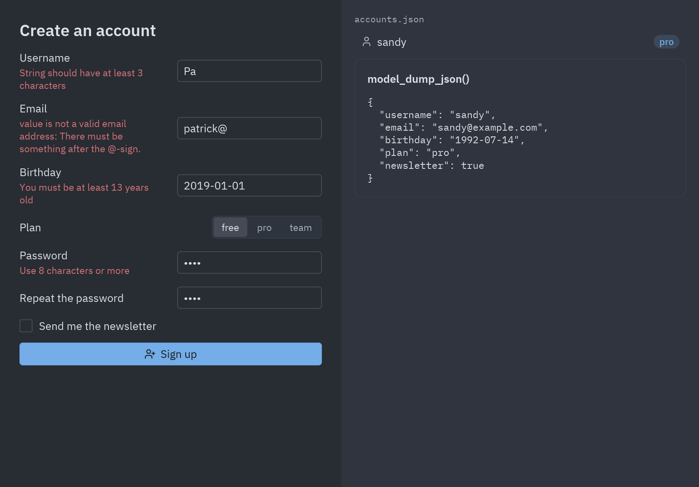

import { Code, Steps, Aside, Tabs, TabItem } from '@astrojs/starlight/components';
import main from '../../../../../../examples/integrations/pydantic_signup/main.py?raw';
import models from '../../../../../../examples/integrations/pydantic_signup/models.py?raw';

[Pydantic](https://docs.pydantic.dev/) comprueba datos contra anotaciones de tipo. En una app de
escritorio hace dos trabajos: valida lo que el usuario escribió en un formulario y convierte el
JSON de archivos y APIs. Corre en el mismo proceso que la ventana, sin necesidad de hilos ni de
loop, porque validar es rápido.



```bash
cd examples/integrations/pydantic_signup
uv run main.py
```

<Steps>

1. **Escribe las reglas como un modelo.** Los [campos](https://docs.pydantic.dev/latest/concepts/fields/)
   llevan las restricciones, tipos especiales como `EmailStr` (de `pydantic[email]`) y `SecretStr`
   hacen el resto, y los [validadores](https://docs.pydantic.dev/latest/concepts/validators/)
   añaden comprobaciones propias. Un validador de modelo `after` compara dos campos:

   ```python
   class SignUp(BaseModel):
       username: str = Field(min_length=3, max_length=20, pattern=r"^[a-z0-9_]+$")
       email: EmailStr
       birthday: date
       plan: Literal["free", "pro", "team"] = "free"
       password: SecretStr
       password_repeat: SecretStr
       newsletter: bool = False

       @field_validator("username", mode="before")
       @classmethod
       def lowercase(cls, value: str) -> str:
           return value.strip().lower()

       @model_validator(mode="after")
       def passwords_match(self) -> "SignUp":
           if self.password.get_secret_value() != self.password_repeat.get_secret_value():
               raise ValueError("The passwords don't match")
           return self
   ```

2. **Guarda el formulario como valores simples y valida al enviar.** Los inputs dan texto;
   Pydantic convierte `"1990-05-02"` en un `date` e informa de todos los problemas a la vez:

   ```python
   def submit(self, *_):
       try:
           signup = SignUp.model_validate(self.draft)
       except ValidationError as error:
           self.errors = pz.validation_errors(error)
           return
       ...
   ```

3. **Muestra cada error bajo su campo.** `pz.validation_errors` devuelve `{campo: mensaje}`; los
   errores de un validador de modelo usan la clave `""`:

   ```python
   ui.field("Email", ui.input(d["email"], self.edit("email")), error=self.errors.get("email"))
   ui.callout(self.errors[""], tint="error") if self.errors.get("") else None
   ```

4. **Guarda y carga JSON.** [Serialización](https://docs.pydantic.dev/latest/concepts/serialization/)
   con `model_dump` y `model_dump_json`, y un `TypeAdapter` para una lista entera:

   ```python
   account = Account.model_validate(signup.model_dump(exclude={"password", "password_repeat"}))

   Accounts = TypeAdapter(list[Account])
   FILE.write_bytes(Accounts.dump_json(self.accounts, indent=2))
   accounts = Accounts.validate_json(FILE.read_bytes())
   ```

</Steps>

## Leer respuestas de APIs

Los mismos modelos convierten el JSON que llega por la red. Declara solo los campos que usas;
Pydantic ignora el resto, convierte las fechas y falla con un error claro si la API cambia de
forma. Del [explorador de PyPI](/pyzed/es/integrations/httpx/#peticiones-concurrentes-el-explorador-de-pypi):

```python
class Info(BaseModel):
    name: str
    version: str
    summary: str | None = None

class File(BaseModel):
    upload_time_iso_8601: datetime

class Package(BaseModel):
    info: Info
    releases: dict[str, list[File]]

package = Package.model_validate_json(response.content)
```

<Aside type="tip">
Los modelos de Pydantic son lo que FastAPI usa para los cuerpos de las peticiones y la base sobre
la que se construye SQLModel. Un modelo escrito para el formulario de escritorio puede convertirse
más adelante en el cuerpo de un endpoint de una API; mira
[FastAPI](/pyzed/es/integrations/fastapi/) y [SQLModel](/pyzed/es/integrations/sqlmodel/).
</Aside>

## Código completo

<Tabs>
<TabItem label="main.py"><Code code={main} lang="py" /></TabItem>
<TabItem label="models.py"><Code code={models} lang="py" /></TabItem>
</Tabs>
