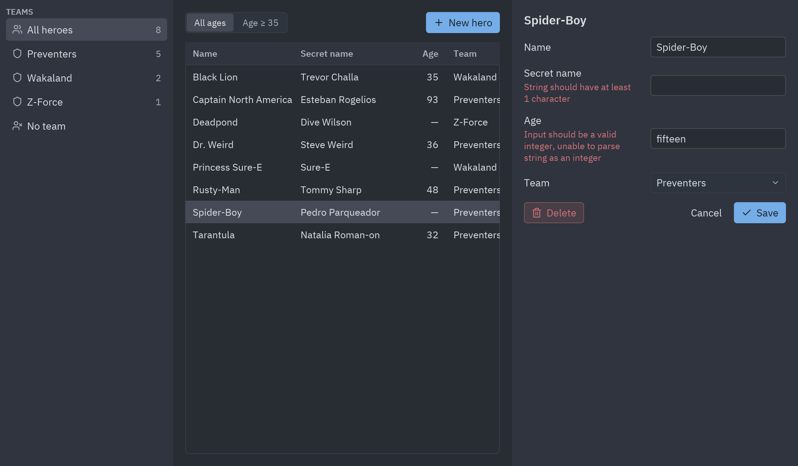
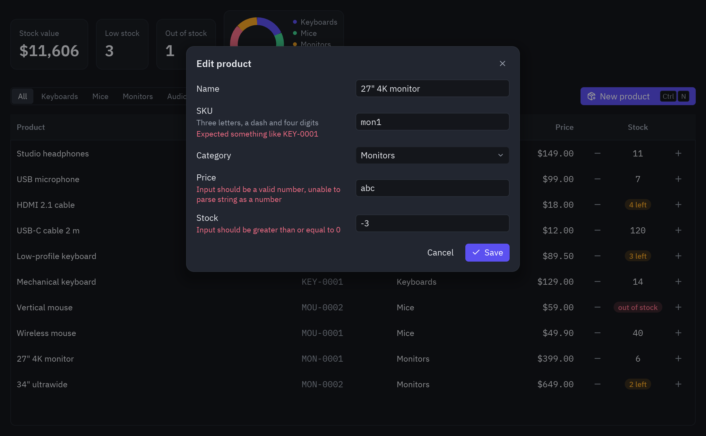

import { Code, Steps, Aside, Tabs, TabItem } from '@astrojs/starlight/components';
import hMain from '../../../../../../examples/integrations/sqlmodel_heroes/main.py?raw';
import hModels from '../../../../../../examples/integrations/sqlmodel_heroes/models.py?raw';
import hDb from '../../../../../../examples/integrations/sqlmodel_heroes/db.py?raw';
import main from '../../../../../../examples/integrations/sqlmodel_inventory/main.py?raw';
import models from '../../../../../../examples/integrations/sqlmodel_inventory/models.py?raw';

SQLModel corre en el mismo proceso que la ventana (la arquitectura 1 de
[Arquitecturas](/pyzed/es/integrations/architectures/)); cuando los mismos modelos se tienen que
compartir por HTTP, ponlos detrás de FastAPI como en la [demo de FastAPI](/pyzed/es/integrations/fastapi/).
Hay dos demos:

- **`sqlmodel_heroes`**: las tablas `Team` y `Hero` del [tutorial de SQLModel](https://sqlmodel.tiangolo.com/tutorial/),
  con sus datos de ejemplo, filtros `where()`, relaciones y un modelo de datos para el formulario.
- **`sqlmodel_inventory`**: un inventario cuyas reglas de validación y cuya tabla salen de una
  sola clase.

## Los héroes del tutorial en una ventana



```bash
cd examples/integrations/sqlmodel_heroes
uv run main.py
```

<Steps>

1. **Define las tablas** como en el capítulo
   [Relationship Attributes](https://sqlmodel.tiangolo.com/tutorial/relationship-attributes/) del tutorial:

   ```python
   class Team(SQLModel, table=True):
       id: int | None = Field(default=None, primary_key=True)
       name: str = Field(index=True)
       headquarters: str

       heroes: list["Hero"] = Relationship(back_populates="team")

   class Hero(SQLModel, table=True):
       id: int | None = Field(default=None, primary_key=True)
       name: str = Field(index=True)
       secret_name: str
       age: int | None = Field(default=None, index=True)

       team_id: int | None = Field(default=None, foreign_key="team.id")
       team: Team | None = Relationship(back_populates="heroes")
   ```

2. **Crea el engine y las tablas**, y añade los héroes del tutorial la primera vez:

   ```python
   sqlite_file_name = "database.db"
   sqlite_url = f"sqlite:///{sqlite_file_name}"
   engine = create_engine(sqlite_url)

   def create_db_and_tables():
       SQLModel.metadata.create_all(engine)
   ```

3. **Consulta con `select()` y `where()`.** Los filtros se añaden uno a uno; `col()` le da al
   comprobador de tipos una columna para la comparación, como recomienda el tutorial:

   ```python
   def heroes(team_id, min_age):
       statement = select(Hero).options(selectinload(Hero.team)).order_by(Hero.name)
       if team_id != "all":
           statement = statement.where(Hero.team_id == team_id)
       if min_age is not None:
           statement = statement.where(col(Hero.age) >= min_age)
       with Session(engine) as session:
           return list(session.exec(statement))
   ```

   `selectinload` carga el equipo de cada héroe antes de que se cierre la sesión, para que la
   tabla pueda mostrar `hero.team.name`.

4. **Valida el formulario con un modelo de datos.** Los modelos con `table=True` no validan (los
   crea SQLAlchemy), así que se aplica el enfoque de
   [Multiple Models](https://sqlmodel.tiangolo.com/tutorial/fastapi/multiple-models/) del tutorial:
   un `HeroCreate` sin `table=True` comprueba lo que se escribió en el formulario.

   ```python
   class HeroCreate(SQLModel):
       name: str = Field(min_length=1)
       secret_name: str = Field(min_length=1)
       age: int | None = Field(default=None, ge=0)
       team_id: int | None = None

   def save(self):
       try:
           data = HeroCreate.model_validate({**self.draft, "age": self.draft["age"] or None, ...})
       except ValidationError as error:
           self.errors = pz.validation_errors(error)
           return None
       return Command.perform(lambda: db.save(hero_id, data), lambda _: self.reload())
   ```

5. **Crea o actualiza con `sqlmodel_update`:**

   ```python
   def save(hero_id, data: HeroCreate):
       with Session(engine) as session:
           hero = session.get(Hero, hero_id) if hero_id else Hero.model_validate(data)
           hero.sqlmodel_update(data.model_dump())
           session.add(hero)
           session.commit()
   ```

</Steps>

<Tabs>
<TabItem label="main.py"><Code code={hMain} lang="py" /></TabItem>
<TabItem label="models.py"><Code code={hModels} lang="py" /></TabItem>
<TabItem label="db.py"><Code code={hDb} lang="py" /></TabItem>
</Tabs>

## Un modelo para el formulario y la tabla: la demo de inventario

SQLModel une Pydantic y SQLAlchemy: una sola clase describe los campos, sus reglas y la tabla. En
una app de escritorio eso significa que el formulario y la base de datos coinciden por diseño.
Esta demo es un inventario con niveles de stock, un gráfico de dona y un diálogo cuyos campos
muestran los errores de Pydantic.



```bash
cd examples/integrations/sqlmodel_inventory
uv run main.py
```

<Steps>

1. **Pon las reglas en una clase base.** La tabla y el validador del formulario heredan de ella:

   ```python
   class ProductBase(SQLModel):
       name: str = Field(min_length=2, max_length=60)
       sku: str
       category: str = "Keyboards"
       price: float = Field(gt=0)
       stock: int = Field(ge=0)

       @field_validator("sku")
       @classmethod
       def sku_format(cls, sku):
           sku = sku.strip().upper()
           if not re.fullmatch(r"[A-Z]{3}-\d{4}", sku):
               raise ValueError("Expected something like KEY-0001")
           return sku

   class Product(ProductBase, table=True):
       id: int | None = Field(default=None, primary_key=True)
       sku: str = Field(unique=True, index=True)

   class ProductIn(ProductBase):
       """Validates what the form typed."""
   ```

2. **Valida con `ProductIn`, no con `Product`.** SQLModel no valida los modelos con `table=True`
   (los construye SQLAlchemy), así que lo hace una clase aparte sin `table=True`. El formulario
   guarda todo como texto y Pydantic lo convierte: `"12.5"` pasa a ser `12.5` y `"abc"`, un
   error.

   ```python
   def save(self):
       try:
           data = ProductIn.model_validate(self.draft)
       except ValidationError as error:
           self.errors = pz.validation_errors(error)
           return None
       product_id = None if self.editing == "new" else self.editing.id
       return Command.perform(lambda: models.save(product_id, data), self.saved)
   ```

3. **Guárdalo en un hilo.** `models.save` copia los datos validados en la fila con
   `sqlmodel_update` y devuelve `{campo: mensaje}` cuando algo que solo sabe la base de datos está
   mal, como un SKU repetido:

   ```python
   def save(product_id, data):
       with Session(engine, expire_on_commit=False) as session:
           clash = session.exec(select(Product).where(Product.sku == data.sku, Product.id != product_id)).first()
           if clash:
               return {"sku": f"Already used by “{clash.name}”"}
           product = session.get(Product, product_id) if product_id else Product.model_validate(data)
           product.sqlmodel_update(data.model_dump())
           session.add(product)
           session.commit()
           return product
   ```

4. **Muestra los errores en un diálogo.** `ui.layer` pone un `ui.modal` sobre la página; cada
   `ui.field` toma su mensaje de `self.errors`:

   ```python
   ui.field("Price", ui.input(self.draft["price"], self.edit("price")), error=self.errors.get("price"))
   ```

5. **Dibuja las celdas con widgets.** Una `ui.Column` puede dibujar cualquier cosa; la columna de
   stock muestra botones y un badge que se vuelve ámbar o rojo cuando queda poco stock:

   ```python
   ui.Column("Stock", lambda p: p, width=180, align="center", render=self.stock_cell, sortable=False)
   ```

</Steps>

<Aside>
El mismo `ProductIn` puede ser el cuerpo de un endpoint de FastAPI. Si tu app acaba teniendo un
servidor, el cliente de escritorio y la API validan con un solo modelo. Mira
[FastAPI](/pyzed/es/integrations/fastapi/).
</Aside>

<Tabs>
<TabItem label="main.py"><Code code={main} lang="py" /></TabItem>
<TabItem label="models.py"><Code code={models} lang="py" /></TabItem>
</Tabs>
