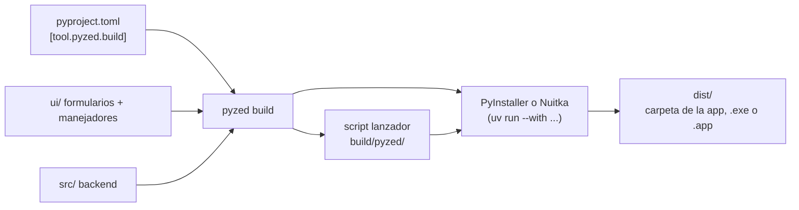

import { Aside, Steps, Tabs, TabItem } from '@astrojs/starlight/components';

`pyzed build` convierte un [proyecto Pyzed](/pyzed/es/guides/projects/) en una app que funciona en equipos sin
Python: una carpeta (o un único archivo) con el intérprete de Python, `pyzed-ui`, tus dependencias, el código de tu
backend y tus formularios. Usa [PyInstaller](https://pyinstaller.org) o [Nuitka](https://nuitka.net) por debajo,
dentro del entorno del propio proyecto, así que no hay que instalar nada de forma global.

<Aside type="tip" title="Desde el diseñador">
Pyzed Design hace todo esto desde un diálogo: **Archivo → Exportar aplicación…** ajusta cada opción de abajo, muestra
el icono y la pantalla de inicio, compila con la salida en la consola y escribe el workflow de CI. Consulta
[Exportar tu aplicación](/pyzed/es/editor/exporting/).
</Aside>

## Compilar en tres pasos

<Steps>

1. Abre una terminal en la carpeta del proyecto (la que tiene `pyproject.toml`). Si todavía no tienes un proyecto,
   créalo con `pyzed new` (mira [Crear un proyecto](/pyzed/es/getting-started/new-project/)).

2. Compila:

   <Tabs syncKey="pkg">
   	<TabItem label="uv">
   		```bash title="Windows, macOS y Linux"
   		uv run pyzed build
   		```
   	</TabItem>
   	<TabItem label="pip">
   		```bash title="macOS y Linux"
   		source .venv/bin/activate
   		pyzed build          # o: python -m pyzed build
   		```

   		```powershell title="Windows (PowerShell)"
   		.venv\Scripts\Activate.ps1
   		pyzed build          # o: py -m pyzed build
   		```
   	</TabItem>
   </Tabs>

3. Abre el resultado en `dist/`:

   | Plataforma | Resultado | Cómo se ejecuta |
   | --- | --- | --- |
   | Windows | `dist\Shop\Shop.exe` (o `dist\Shop.exe` con `--onefile`) | Doble clic. |
   | macOS | `dist/Shop.app` | Ábrela desde Finder. |
   | Linux | `dist/Shop/Shop` (o `dist/Shop` con `--onefile`) | `./dist/Shop/Shop` |

</Steps>

<Aside type="note" title="Hace falta uv, incluso con pip">
`pyzed build` ejecuta PyInstaller con `uv run --with pyinstaller` (y Nuitka con `uv run --with nuitka`), así que [uv](https://docs.astral.sh/uv/) tiene que
estar instalado aunque uses pip para todo lo demás. No necesitas instalar PyInstaller ni Nuitka. Instala uv con `pip install uv`
o desde su web.
</Aside>

<Aside type="caution" title="Una compilación por plataforma">
Ni PyInstaller ni Nuitka hacen compilación cruzada: compila la app de Windows en Windows, la de macOS en macOS y la de
Linux en Linux, cada una en la arquitectura a la que va dirigida (x64 o ARM). Un [flujo de CI](/pyzed/es/packaging/ci/)
las compila todas por ti.
</Aside>

## Qué pasa al compilar



1. `pyzed build` lee `[tool.pyzed]` y `[tool.pyzed.build]` de `pyproject.toml`.
2. Escribe un pequeño **lanzador** (`build/pyzed/<nombre>_launcher.py`) que abre el formulario principal
   (`[tool.pyzed] main`) desde dentro del paquete, con el icono de la ventana y la pantalla de inicio.
3. Crea los archivos de icono (`.ico`, `.icns`, `.png`) a partir de tu imagen, y el archivo de versión de Windows.
4. Analiza los `.py` de la carpeta de la interfaz con el módulo `ast` de Python para saber qué importan.
5. Ejecuta el empaquetador en el entorno del proyecto con las opciones adecuadas, y la app queda en `dist/`. Por último
   completa el `Info.plist` de macOS y comprime el archivo, si lo pediste.

### Qué se incluye

Los formularios cargan sus manejadores desde archivos `.py` al abrirse, así que PyInstaller no puede seguir sus
imports por sí solo. `pyzed build` completa lo que falta:

- **La carpeta de la interfaz** se incluye como datos, con su estructura (`ui/main.pzform`, `ui/main.py`, módulos
  auxiliares...).
- **Cada módulo que importa la interfaz** se pasa como import oculto, así que el backend en `src/`, los módulos junto a
  `pyproject.toml` y los paquetes de terceros se incluyen con todas sus dependencias.
- **El paquete propio del proyecto** (`src/<nombre>`) se incluye entero, también los módulos importados dinámicamente.
- **Pyzed** con sus archivos de datos (temas, iconos, plantillas).
- `ui/`, `src/` y la raíz del proyecto se añaden a la ruta de búsqueda de PyInstaller.

El código de fuera del proyecto, como una biblioteca compartida en una carpeta vecina, se incluye como cualquier otra
dependencia una vez instalado en el entorno:

```bash
pyzed add --editable ../facturacion     # luego `from facturacion import factura` en un manejador
```

<Aside type="note" title="Apps escritas en código">
`pyzed build` arranca el **formulario** principal del proyecto. Para una app escrita totalmente en código (una clase
`pz.App` y `pz.run(...)`), mira [Apps escritas en código](#apps-escritas-en-código) más abajo.
</Aside>

## Opciones

Las opciones de la línea de comandos ganan a `[tool.pyzed.build]` de `pyproject.toml`:

| Opción | Efecto |
| --- | --- |
| `--backend nuitka` | Compila con Nuitka en lugar de PyInstaller (mira [Elegir un empaquetador](#elegir-un-empaquetador)). |
| `--onefile` | Un único ejecutable en lugar de una carpeta. |
| `--console` | Mantiene la ventana de consola (útil para ver los tracebacks). |
| `--name Shop` | Nombre del ejecutable o del paquete. |
| `--archive zip` | Además comprime la app en un `zip` (o `tar.gz`) con el nombre que busca el [actualizador](/pyzed/es/packaging/updates/). |
| `--target linux-x64` | Comprueba que este equipo compila ese destino (lo usa la CI); no hace compilación cruzada. |
| `--dry-run` | Muestra el comando del empaquetador y se detiene. |
| `--workflow` | Escribe un flujo de GitHub Actions para los `targets` del proyecto en lugar de compilar (mira [CI](/pyzed/es/packaging/ci/)). |

Toda la configuración del proyecto está en `pyproject.toml` (el [diálogo Exportar](/pyzed/es/editor/exporting/) de
Pyzed Design escribe la misma tabla):

```toml title="pyproject.toml"
[tool.pyzed.build]
name = "Shop"                          # nombre del ejecutable / paquete (por defecto: el del proyecto)
backend = "pyinstaller"                # o "nuitka"
onefile = false                        # un único archivo autoextraíble en lugar de una carpeta
windowed = true                        # sin ventana de consola en Windows y macOS
icon = "assets/icon.png"               # una imagen cuadrada; de ella salen el .ico y el .icns
version = "1.2.0"                      # por defecto: la versión de [project]
publisher = "Acme"                     # la empresa en las propiedades del archivo en Windows
identifier = "com.acme.shop"           # id del paquete en macOS e id de la app en Linux
copyright = "© 2026 Acme"
optimize = 0                           # 1 quita los assert, 2 también los docstrings
slim = true                            # deja fuera tkinter, test, idlelib... (las apps de Pyzed no los usan)
exclude = ["numpy.tests"]              # más módulos que dejar fuera
include = ["assets", "data/precios.csv"]  # archivos y carpetas extra, con la misma ruta relativa
hidden-imports = ["shop.plugins.csv"]  # módulos importados con importlib o por nombre
collect = ["babel"]                    # paquetes a incluir enteros: código, datos y binarios
archive = "zip"                        # además comprime la app: shop-windows-x86_64.zip...
targets = ["windows-x64", "macos-arm64", "linux-x64"]  # lo que compila el flujo de CI
args = []                              # cualquier otra cosa, pasada al empaquetador tal cual

[tool.pyzed.build.splash]
image = "assets/splash.png"
duration = 1.5                         # segundos, como mínimo
text = "Cargando…"
native = true                          # también la pantalla propia del empaquetador mientras se descomprime

[tool.pyzed.build.nuitka]              # opciones solo para un empaquetador ([tool.pyzed.build.pyinstaller] también)
args = ["--lto=yes"]
```

| Ajuste | Por defecto | Notas |
| --- | --- | --- |
| `name` | el nombre del proyecto | También el nombre de la carpeta en `dist/`. |
| `backend` | `"pyinstaller"` | `"nuitka"` compila a C: mira más abajo. |
| `onefile` | `false` | Un único archivo arranca más lento (se descomprime cada vez) y no puede [actualizarse solo](/pyzed/es/packaging/updates/). |
| `windowed` | `true` | `false` (o `--console`) muestra una terminal junto a la app. |
| `icon` | ninguno | Un PNG se convierte en `.ico`, `.icns` y el icono de la ventana; mira [Iconos y metadatos](/pyzed/es/packaging/icons-metadata/). |
| `version`, `publisher`, `identifier`, `description`, `copyright` | de `[project]` | Se escriben en las propiedades del archivo en Windows y en el `Info.plist` de macOS. |
| `splash` | ninguna | Una [pantalla de inicio](#pantalla-de-inicio). |
| `optimize` | `0` | El `-O` (`1`) o `-OO` (`2`) de Python. |
| `slim` | `true` | Deja fuera `tkinter`, `test`, `idlelib`, `lib2to3`, `ensurepip`, `pydoc_data`, `turtle` y `turtledemo`. |
| `strip`, `upx` | `true`, `false` | Quita los símbolos de depuración (Linux y macOS); comprime con [UPX](https://upx.github.io/) si está instalado. |
| `exclude` | `[]` | Módulos que dejar fuera. |
| `include` | `[]` | Rutas relativas a la raíz del proyecto. |
| `hidden-imports` | `[]` | Módulos que el empaquetador no puede ver. |
| `collect` | `[]` | Paquetes con archivos de datos o plugins. |
| `archive` | ninguno | `"zip"` o `"tar.gz"`. |
| `targets` | este equipo | Para `--workflow`: `windows-x64`, `windows-arm64`, `macos-arm64`, `macos-x64`, `linux-x64`, `linux-arm64`. |
| `args` | `[]` | Cualquier otra opción del empaquetador ([PyInstaller](https://pyinstaller.org/en/stable/usage.html), [Nuitka](https://nuitka.net/user-documentation/)). |

## Elegir un empaquetador

| | PyInstaller | Nuitka |
| --- | --- | --- |
| Cómo | Empaqueta tus `.py` tal cual, junto a Python | Compila tu código y sus dependencias a C y luego a código máquina |
| Tiempo de compilación | Segundos | Minutos |
| Velocidad | Python normal | Compilado: código Python puro más rápido |
| Tamaño de un archivo único | Mayor | Alrededor de un 15 % menor (mejor compresión) |
| Tamaño de una carpeta | Menor | Mayor (el código compilado ocupa más que los `.pyc`) |
| Necesita | Nada (uv lo instala) | Un compilador de C |

Medido con una app de un formulario en Linux x64: PyInstaller creó una carpeta de 57 MB o un archivo único de 25 MB
en unos 25 segundos; Nuitka una carpeta de 72 MB o un archivo único de 21 MB en unos 3 minutos. Casi todo el tamaño
es el motor de Pyzed (unos 33 MB) y el propio Python, así que `slim`, `exclude` y `strip` importan más que el
empaquetador.

Empieza con PyInstaller mientras desarrollas y prueba Nuitka para las versiones publicadas. Nuitka necesita un
compilador de C: en Linux `gcc` (`sudo apt install gcc`), en macOS las herramientas de línea de comandos de Xcode
(`xcode-select --install`), en Windows las Build Tools de Visual Studio, o Nuitka descarga un compilador la primera
vez. `pyzed build` añade por su cuenta `patchelf` (Linux) y `zstandard` (archivos únicos).

## Pantalla de inicio

Con `[tool.pyzed.build.splash]`, la app abre antes del formulario principal una ventana sin marco con tu imagen,
centrada en la pantalla. Se queda al menos `duration` segundos y hasta que el formulario principal ha cargado, y luego
se cierra. `text` se escribe sobre la parte inferior de la imagen. Con `native = true` también se muestra la pantalla
propia del empaquetador antes de que arranque Python (PyInstaller en Windows y Linux, que necesita `tkinter` en el
Python del proyecto; Nuitka para archivos únicos en Windows), útil en apps de un solo archivo que tardan un momento en
descomprimirse.

La misma pantalla funciona en una app escrita en código, con `App.splash`:

```python
import pyzed as pz

class Shop(pz.App):
    splash = pz.Splash("assets/splash.png", duration=1.5, text="Cargando…")
```

### Encontrar tus archivos de datos

Los archivos de `include` terminan bajo la raíz del paquete, con la misma ruta relativa. Encuéntralos desde tu código
con:

```python
import sys
from pathlib import Path

RAIZ = Path(getattr(sys, "_MEIPASS", Path(__file__).resolve().parents[1]))
precios = RAIZ / "data" / "precios.csv"
```

`sys._MEIPASS` es la carpeta del paquete en una app de PyInstaller. En una app de Nuitka y mientras desarrollas se usa
la alternativa: desde un manejador de `ui/` apunta a la raíz del paquete (o del proyecto); ajusta `parents[1]` según
dónde esté el archivo que ejecuta esto.

<Aside type="tip" title="No escribas junto a la app">
La carpeta de la app puede ser de solo lectura una vez instalada (por ejemplo en `/Applications` o `Program Files`).
Guarda los datos del usuario en sus carpetas: el paquete `platformdirs` (`pyzed add platformdirs`) da el sitio
correcto en cada sistema con `platformdirs.user_data_dir("Shop")`.
</Aside>

### Dónde van los archivos

Los archivos intermedios van a `build/pyzed/` y el resultado a `dist/`; ambos están en el `.gitignore` de los
proyectos nuevos. Cada compilación empieza limpia, así que no hay que borrar nada a mano.

## Apps escritas en código

`pyzed build` arranca el **formulario** principal del proyecto. Para una app escrita totalmente en código (una clase
`pz.App` y `pz.run(...)`), ejecuta tú mismo PyInstaller sobre tu script, incluyendo los datos de Pyzed.
`pyzed build --dry-run` muestra el comando exacto que ejecutaría `pyzed build`, que puedes adaptar:

<Tabs syncKey="pkg">
	<TabItem label="uv">
		```bash
		uv run --with pyinstaller pyinstaller main.py --name Shop --windowed --collect-data pyzed --collect-submodules pyzed
		```
	</TabItem>
	<TabItem label="pip">
		```bash title="macOS y Linux"
		python3 -m pip install pyinstaller
		python3 -m PyInstaller main.py --name Shop --windowed --collect-data pyzed --collect-submodules pyzed
		```

		```powershell title="Windows (PowerShell)"
		py -m pip install pyinstaller
		py -m PyInstaller main.py --name Shop --windowed --collect-data pyzed --collect-submodules pyzed
		```
	</TabItem>
</Tabs>

Con Nuitka:

```bash
uv run --with nuitka --with patchelf python -m nuitka --mode=standalone --include-package-data=pyzed main.py
```

## Siguiente

- Por plataforma: [Windows](/pyzed/es/packaging/windows/), [macOS](/pyzed/es/packaging/macos/),
  [Linux](/pyzed/es/packaging/linux/).
- [Compilar todas las plataformas en CI](/pyzed/es/packaging/ci/) y [publicar actualizaciones](/pyzed/es/packaging/updates/).
- ¿Algo falla? [Solución de problemas](/pyzed/es/packaging/troubleshooting/).
