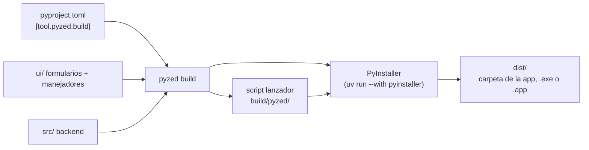

import { Aside, Steps, Tabs, TabItem } from '@astrojs/starlight/components';

`pyzed build` convierte un [proyecto Pyzed](/pyzed/es/guides/projects/) en una app que funciona en equipos sin
Python: una carpeta (o un único archivo) con el intérprete de Python, `pyzed-ui`, tus dependencias, el código de tu
backend y tus formularios. Usa [PyInstaller](https://pyinstaller.org) por debajo, dentro del entorno del propio
proyecto, así que no hay que instalar nada de forma global.

## Compilar en tres pasos

<Steps>

1. Abre una terminal en la carpeta del proyecto (la que tiene `pyproject.toml`). Si todavía no tienes un proyecto,
   créalo con `pyzed new` (mira [Crear un proyecto](/pyzed/es/getting-started/new-project/)).

2. Compila:

   <Tabs syncKey="pkg">
   	<TabItem label="uv">
   		```bash title="Windows, macOS y Linux"
   		uv run pyzed build
   		```
   	</TabItem>
   	<TabItem label="pip">
   		```bash title="macOS y Linux"
   		source .venv/bin/activate
   		pyzed build          # o: python -m pyzed build
   		```

   		```powershell title="Windows (PowerShell)"
   		.venv\Scripts\Activate.ps1
   		pyzed build          # o: py -m pyzed build
   		```
   	</TabItem>
   </Tabs>

3. Abre el resultado en `dist/`:

   | Plataforma | Resultado | Cómo se ejecuta |
   | --- | --- | --- |
   | Windows | `dist\Shop\Shop.exe` (o `dist\Shop.exe` con `--onefile`) | Doble clic. |
   | macOS | `dist/Shop.app` | Ábrela desde Finder. |
   | Linux | `dist/Shop/Shop` (o `dist/Shop` con `--onefile`) | `./dist/Shop/Shop` |

</Steps>

<Aside type="note" title="Hace falta uv, incluso con pip">
`pyzed build` ejecuta PyInstaller con `uv run --with pyinstaller`, así que [uv](https://docs.astral.sh/uv/) tiene que
estar instalado aunque uses pip para todo lo demás. No necesitas instalar PyInstaller. Instala uv con `pip install uv`
o desde su web.
</Aside>

<Aside type="caution" title="Una compilación por plataforma">
PyInstaller no hace compilación cruzada: compila la app de Windows en Windows, la de macOS en macOS y la de Linux en
Linux. Un [flujo de CI](/pyzed/es/packaging/ci/) compila las tres por ti.
</Aside>

## Qué pasa al compilar



1. `pyzed build` lee `[tool.pyzed]` y `[tool.pyzed.build]` de `pyproject.toml`.
2. Escribe un pequeño **lanzador** (`build/pyzed/<nombre>_launcher.py`) que abre el formulario principal
   (`[tool.pyzed] main`) desde dentro del paquete.
3. Analiza los `.py` de la carpeta de la interfaz con el módulo `ast` de Python para saber qué importan.
4. Ejecuta PyInstaller en el entorno del proyecto con las opciones adecuadas, y PyInstaller escribe la app en `dist/`.

### Qué se incluye

Los formularios cargan sus manejadores desde archivos `.py` al abrirse, así que PyInstaller no puede seguir sus
imports por sí solo. `pyzed build` completa lo que falta:

- **La carpeta de la interfaz** se incluye como datos, con su estructura (`ui/main.pzform`, `ui/main.py`, módulos
  auxiliares...).
- **Cada módulo que importa la interfaz** se pasa como import oculto, así que el backend en `src/`, los módulos junto a
  `pyproject.toml` y los paquetes de terceros se incluyen con todas sus dependencias.
- **El paquete propio del proyecto** (`src/<nombre>`) se incluye entero, también los módulos importados dinámicamente.
- **Pyzed** con sus archivos de datos (temas, iconos, plantillas).
- `ui/`, `src/` y la raíz del proyecto se añaden a la ruta de búsqueda de PyInstaller.

El código de fuera del proyecto, como una biblioteca compartida en una carpeta vecina, se incluye como cualquier otra
dependencia una vez instalado en el entorno:

```bash
pyzed add --editable ../facturacion     # luego `from facturacion import factura` en un manejador
```

<Aside type="note" title="Apps escritas en código">
`pyzed build` arranca el **formulario** principal del proyecto. Para una app escrita totalmente en código (una clase
`pz.App` y `pz.run(...)`), ejecuta PyInstaller sobre tu script; mira [Otras herramientas](#otras-herramientas) más
abajo.
</Aside>

## Opciones

Las opciones de la línea de comandos ganan a `[tool.pyzed.build]` de `pyproject.toml`:

| Opción | Efecto |
| --- | --- |
| `--onefile` | Un único ejecutable en lugar de una carpeta. |
| `--console` | Mantiene la ventana de consola (útil para ver los tracebacks). |
| `--name Shop` | Nombre del ejecutable o del paquete. |
| `--dry-run` | Muestra el comando de PyInstaller y se detiene. |
| `--workflow` | Escribe un flujo de GitHub Actions en lugar de compilar (mira [CI](/pyzed/es/packaging/ci/)). |

Toda la configuración del proyecto está en `pyproject.toml`:

```toml title="pyproject.toml"
[tool.pyzed.build]
name = "Shop"                          # nombre del ejecutable / paquete (por defecto: el del proyecto)
onefile = false                        # un único archivo autoextraíble en lugar de una carpeta
windowed = true                        # sin ventana de consola en Windows y macOS
icon = "assets/icon.ico"               # .ico en Windows, .icns en macOS
include = ["assets", "data/precios.csv"]  # archivos y carpetas extra, con la misma ruta relativa
hidden-imports = ["shop.plugins.csv"]  # módulos importados con importlib o por nombre
collect = ["babel"]                    # paquetes a incluir enteros: código, datos y binarios
args = ["--noupx"]                     # cualquier otra cosa, pasada a PyInstaller tal cual
```

| Ajuste | Por defecto | Notas |
| --- | --- | --- |
| `name` | el nombre del proyecto | También el nombre de la carpeta en `dist/`. |
| `onefile` | `false` | Un único archivo arranca más lento (se descomprime cada vez) y no puede [actualizarse solo](/pyzed/es/packaging/updates/). |
| `windowed` | `true` | `false` (o `--console`) muestra una terminal junto a la app. |
| `icon` | ninguno | Mira [Iconos y metadatos](/pyzed/es/packaging/icons-metadata/). |
| `include` | `[]` | Rutas relativas a la raíz del proyecto. |
| `hidden-imports` | `[]` | Módulos que PyInstaller no puede ver. |
| `collect` | `[]` | Paquetes con archivos de datos o plugins. |
| `args` | `[]` | Cualquier otra [opción de PyInstaller](https://pyinstaller.org/en/stable/usage.html). |

### Encontrar tus archivos de datos

Los archivos de `include` terminan bajo la raíz del paquete, con la misma ruta relativa. Encuéntralos desde tu código
con:

```python
import sys
from pathlib import Path

RAIZ = Path(getattr(sys, "_MEIPASS", Path(__file__).resolve().parents[1]))
precios = RAIZ / "data" / "precios.csv"
```

`sys._MEIPASS` es la carpeta del paquete cuando la app está empaquetada; mientras desarrollas, la alternativa apunta a
la raíz del proyecto (ajusta `parents[1]` según dónde esté el archivo que ejecuta esto).

<Aside type="tip" title="No escribas junto a la app">
La carpeta de la app puede ser de solo lectura una vez instalada (por ejemplo en `/Applications` o `Program Files`).
Guarda los datos del usuario en sus carpetas: el paquete `platformdirs` (`pyzed add platformdirs`) da el sitio
correcto en cada sistema con `platformdirs.user_data_dir("Shop")`.
</Aside>

### Dónde van los archivos

Los archivos intermedios van a `build/pyzed/` y el resultado a `dist/`; ambos están en el `.gitignore` de los
proyectos nuevos. Cada compilación empieza limpia (`--clean`), así que no hay que borrar nada a mano.

## Otras herramientas

`pyzed build --dry-run` muestra el comando exacto de PyInstaller, que puedes adaptar a otros empaquetadores.

**Una app escrita en código.** Ejecuta PyInstaller sobre tu script, incluyendo los datos de Pyzed:

<Tabs syncKey="pkg">
	<TabItem label="uv">
		```bash
		uv run --with pyinstaller pyinstaller main.py --name Shop --windowed --collect-data pyzed --collect-submodules pyzed
		```
	</TabItem>
	<TabItem label="pip">
		```bash title="macOS y Linux"
		python3 -m pip install pyinstaller
		python3 -m PyInstaller main.py --name Shop --windowed --collect-data pyzed --collect-submodules pyzed
		```

		```powershell title="Windows (PowerShell)"
		py -m pip install pyinstaller
		py -m PyInstaller main.py --name Shop --windowed --collect-data pyzed --collect-submodules pyzed
		```
	</TabItem>
</Tabs>

**Nuitka.** [Nuitka](https://nuitka.net) compila Python a C y puede producir binarios más pequeños y rápidos.
Ejecútalo desde el entorno del proyecto con las mismas ideas: incluye la carpeta de la interfaz como datos y los
módulos que importa. El lanzador que escribe `pyzed build` ya sabe encontrar la carpeta de la interfaz en una
compilación de Nuitka:

```bash
uv run --with nuitka python -m nuitka --standalone --include-data-dir=ui=ui \
  --include-package=shop --include-package=pyzed --include-package-data=pyzed build/pyzed/shop_launcher.py
```

(`build/pyzed/shop_launcher.py` lo escribe `pyzed build --dry-run`.)

<Aside type="caution" title="Pyzed no prueba Nuitka">
El comando de Nuitka es un punto de partida, no un camino soportado: `pyzed build` solo usa PyInstaller.
</Aside>

## Siguiente

- Por plataforma: [Windows](/pyzed/es/packaging/windows/), [macOS](/pyzed/es/packaging/macos/),
  [Linux](/pyzed/es/packaging/linux/).
- [Compilar todas las plataformas en CI](/pyzed/es/packaging/ci/) y [publicar actualizaciones](/pyzed/es/packaging/updates/).
- ¿Algo falla? [Solución de problemas](/pyzed/es/packaging/troubleshooting/).
