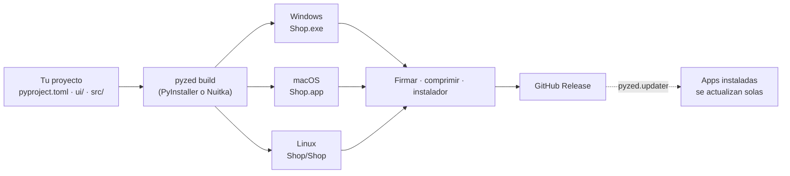

import { Aside, Tabs, TabItem } from '@astrojs/starlight/components';
import NavCards from '../../../../components/NavCards.astro';

Cuando tu app funciona en tu equipo, `pyzed build` (o **Archivo → Exportar aplicación…** en
[Pyzed Design](/pyzed/es/editor/exporting/)) la empaqueta con PyInstaller o Nuitka: Python, Pyzed, tus dependencias, tu código y tus
formularios van a una carpeta (o un archivo) que funciona por sí sola. Quien la use no necesita Python, pip ni nada
más. Ejecútalo desde la raíz de tu [proyecto](/pyzed/es/getting-started/new-project/):

<Tabs syncKey="pkg">
	<TabItem label="uv">
		```bash title="Windows, macOS y Linux"
		uv run pyzed build
		```
	</TabItem>
	<TabItem label="pip">
		```bash title="macOS y Linux"
		source .venv/bin/activate
		pyzed build          # o: python -m pyzed build
		```

		```powershell title="Windows (PowerShell)"
		.venv\Scripts\Activate.ps1
		pyzed build          # o: py -m pyzed build
		```
	</TabItem>
</Tabs>

| Compilas en | Obtienes | La gente la ejecuta |
| --- | --- | --- |
| Windows | `dist\Shop\Shop.exe` | Con doble clic, desde un zip o un instalador |
| macOS | `dist/Shop.app` | Abriéndola (fírmala y notarízala para compartirla) |
| Linux | `dist/Shop/Shop` | Con `./Shop`, o desde el menú de aplicaciones |

## De tu proyecto a tus usuarios



<Aside type="caution" title="Una compilación por plataforma">
Una compilación solo funciona en el sistema donde se hizo: compila la app de Windows en Windows, la de macOS en macOS y
la de Linux en Linux. Un [flujo de CI](/pyzed/es/packaging/ci/) puede hacer las tres por ti.
</Aside>

## En esta sección

<NavCards
	items={[
		{ title: 'Cómo funciona la compilación', text: 'Qué se incluye, cada opción de <code>pyproject.toml</code>, PyInstaller o Nuitka, archivos de datos y la pantalla de inicio.', href: '/pyzed/es/packaging/build/', icon: 'rocket', tag: 'Empieza aquí' },
		{ title: 'Exportar desde el diseñador', text: 'Archivo → Exportar aplicación… en Pyzed Design: plataformas, empaquetador, icono y pantalla de inicio en un solo diálogo.', href: '/pyzed/es/editor/exporting/', icon: 'pencil' },
		{ title: 'Windows', text: 'El .exe, carpeta o archivo único, un zip o un instalador de Inno Setup, y firma para SmartScreen.', href: '/pyzed/es/packaging/windows/', icon: 'seti:windows' },
		{ title: 'macOS', text: 'El paquete .app, identificador de paquete, firma, notarización y un .dmg.', href: '/pyzed/es/packaging/macos/', icon: 'apple' },
		{ title: 'Linux', text: 'En qué distribución compilar, archivos comprimidos, entradas de menú, y AppImage o .deb.', href: '/pyzed/es/packaging/linux/', icon: 'linux' },
		{ title: 'Iconos y metadatos', text: 'Nombre, versión, editor, los iconos creados a partir de un PNG y el identificador de paquete de macOS.', href: '/pyzed/es/packaging/icons-metadata/', icon: 'star' },
		{ title: 'CI con GitHub Actions', text: 'Compila los tres sistemas en cada etiqueta, publica una versión y firma con secretos.', href: '/pyzed/es/packaging/ci/', icon: 'github' },
		{ title: 'Apps que se actualizan solas', text: 'Busca en GitHub Releases, descarga con suma de verificación y cambia la app al reiniciar.', href: '/pyzed/es/packaging/updates/', icon: 'random' },
		{ title: 'Solución de problemas', text: 'Módulos que faltan, ventanas en blanco, apps bloqueadas, errores de glibc y mensajes de actualización.', href: '/pyzed/es/packaging/troubleshooting/', icon: 'warning' },
		{ title: 'Referencia de la CLI', text: 'Todas las opciones de <code>pyzed build</code> y de los demás comandos.', href: '/pyzed/es/reference/cli/', icon: 'list-format' },
	]}
/>

## Qué está soportado hoy

| | Windows | macOS | Linux |
| --- | --- | --- | --- |
| Carpeta de la app (`pyzed build`) | ✅ `.exe` | ✅ `.app` | ✅ ejecutable |
| Archivo único (`--onefile`) | ✅ | ✅ | ✅ |
| PyInstaller o Nuitka (`--backend`) | ✅ | ✅ | ✅ |
| x64 y ARM | ✅ | ✅ | ✅ |
| Icono a partir de un PNG (`icon =`) | ✅ `.ico` + ventana | ✅ `.icns` | ✅ ventana; menú con un archivo `.desktop` |
| Datos del archivo (versión, editor...) | ✅ | ✅ `Info.plist` | - |
| Pantalla de inicio | ✅ | ✅ | ✅ |
| Flujo de CI (`--workflow`) y archivos comprimidos para releases | ✅ | ✅ | ✅ |
| Autoactualización (`pyzed.updater`) | ✅ | ✅ | ✅ |
| Firma | Con `signtool` | Con `codesign` + notarización | No hace falta |
| Instalador | El tuyo (Inno Setup, WiX) | Tu propio `.dmg` (`hdiutil`) | El tuyo (archivo, script, AppImage...) |
| Compilación cruzada | ❌ | ❌ | ❌ |

<Aside type="note" title="Estado de esta sección">
El empaquetado para escritorio está listo para usarse hoy. Los instaladores, la firma y los canales de actualización
se documentan con las herramientas que usa el propio Pyzed Design, pero `pyzed build` todavía no las ejecuta por ti.
Las plataformas móvil y web están planificadas para el futuro y aún no están disponibles.
</Aside>
